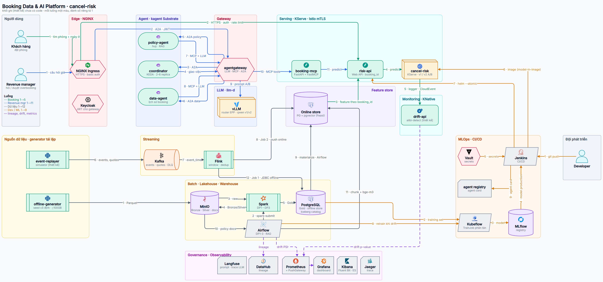

# Hotel booking pipeline: dự báo huỷ phòng để bán vượt

Một model `cancel-risk` dự báo xác suất huỷ của từng booking; cộng dồn theo khách sạn × đêm để đề xuất số phòng bán
vượt K, revenue manager duyệt trước khi áp dụng. `edai1/` là data platform, `edai2/` là ML + agent platform.

## Mục lục

- [Bài toán](#bài-toán)
- [Kiến trúc](#kiến-trúc)
- [Cấu trúc repo](#cấu-trúc-repo)
- [Luồng dữ liệu theo ngày](#luồng-dữ-liệu-theo-ngày-airflow)
- [Chạy trên GKE](#chạy-trên-gke-thứ-tự)
- [Test cục bộ](#test-cục-bộ)
- [Tài liệu theo rubric](docs/README.md)

## Bài toán

Khách sạn bán theo đêm; một phần booking sẽ huỷ hoặc không đến, nên giữ đúng số phòng thì phòng trống, bán vượt quá tay
thì phải chuyển khách. Số booking huỷ của một đêm là tổng các biến Bernoulli với xác suất từ `cancel-risk`
(Poisson-binomial); K là số lớn nhất sao cho P(số huỷ < K) ≤ c_spoil / (c_spoil + c_walk) (phòng trống 1, chuyển khách 3).
Vì K dùng thẳng xác suất, model được đánh giá bằng calibration chứ không chỉ AUC.

Dữ liệu sinh bằng generator tái lập (~108GB/năm quote, booking, huỷ, event stream) với lỗi cài sẵn (double submit,
schema đổi giữa năm, event trễ, vi phạm contract) và drift biết trước từ 2025-06-01, nên mọi kết quả (đối soát stream,
DLQ, calibration, sai số K, độ trễ phát hiện drift) so được với sự thật.

## Kiến trúc



Sơ đồ còn ghi `[thiết kế]` ở event-replayer và drift-api; cả hai đã có code (`edai1/generator/stream_gen.py`,
`edai2/drift_api/`). Trạng thái từng dòng rubric: [docs/README.md](docs/README.md).

## Cấu trúc repo

```
docs/               tài liệu theo từng dòng rubric (edai-1, edai-2, final), architecture/, images/
edai1/
  generator/        offline_gen (landing ~108GB/năm), stream_gen (replay Kafka + lỗi contract cài sẵn), profile_data
  spark_jobs/       landing_to_bronze, silver_bookings (schema v2, dedup, MERGE tăng dần theo ngày), silver_quotes (skew 4 cấu hình), stage_gold
  sql/              dp2_upsert_gold (dim_customer, dim_hotel SCD2, fact_bookings), dp3_features (feat_*)
  dags/             dp1_ingest_bronze (+ dp1_load_dims), dp2_bronze_to_gold, dp3_offline_features, gold_checks
  flink_jobs/       booking_events_window (sliding 1h + tumbling 1 phút đối soát + side output), contract (DLQ)
  schema/           gold_schema.sql, contracts/booking_event.json (JSON Schema của topic booking_events)
  storage/          optimize.sql (Iceberg DDL, compaction, z-order)
  governance/       emit_datahub (lineage, validate_sql), bronze_checks (Great Expectations 1.x)
  docker/           Dockerfile (multistage), Dockerfile.single (so kích thước), docker-compose (local)
  k8s/              storage (MinIO, Postgres+pgvector), kafka (Strimzi + DLQ), generator, flink, spark/flink Dockerfile
  tests/            stream_gen, silver_quotes, silver_bookings (pyspark), gold_sql (Postgres Docker), bronze_checks,
                    stream_e2e (Kafka -> Flink -> Postgres trên Docker)
edai2/
  feature_repo/     features.py + feature_store.yaml (registry/offline/online trên PostgreSQL)
  ml/               training_pipeline (KFP, TrainJob phân tán, MLflow, cổng promote), train_xgb_dist, data_version,
                    Dockerfile (train-base)
  risk_api/         POST /v1/cancel-risk(/batch), metric HTTP + OTel trace
  drift_api/        CloudEvent từ KServe logger -> KSDrift lead_days -> Prometheus
  mcp_server/       server (5 tool MCP), overbooking (K bán vượt Poisson-binomial)
  dags/             rag_pipeline + 2 DAG materialize, score_bookings, drift_monitor (+ drift_stats)
  serving/          InferenceService cancel-risk (logger, canary), predictor.py (xác suất + model_version),
                    Dockerfile (model-inside-image)
  policies/         tài liệu chính sách huỷ / hoàn tiền / bán vượt (nguồn RAG + fine-tune)
  llm_platform/     llm-inference.yaml, finetune/ (build_dataset, train_lora)
  k8s/              ingress, keda, drift-eventing, istio-authz, agent-substrate
  helm/api/         chart chung cho booking-mcp, risk-api, drift-api (Vault injector, ServiceMonitor, KEDA)
  agents/ gateway/  kagent (policy-agent v1/v2, HITL), agentgateway (LLM 90/10, A2A, MCP auth)
  observability/    llm_metrics, dashboards/ (3 dashboard Grafana), stack/ (Prometheus, PushGateway, EFK, Jaeger)
  ci/               Jenkinsfile (API + agent), Jenkinsfile.ml, pod-template, kfp_run, fetch_model, các script CI
  docker/           api.Dockerfile (dùng chung 3 API)
  iac/              modules/{network,gke,registry,budget} + envs/dev, ansible/ (Jenkins + Vault VM)
  tests/            risk_api, server, overbooking, drift_api (Python 3.12), drift_stats, llm_metrics, data_version,
                    train_xgb_dist, finetune_dataset
notebooks/          cancel_risk.ipynb (chạy cục bộ trên generator, có output)
ci/                 Jenkinsfile.data (DP1-DP3, materialize, RAG, Flink), test_dags.sh (DAG integrity trong image Airflow)
tests/              test_dag_integrity.py
```

## Luồng dữ liệu theo ngày (Airflow)

`dp1_ingest_bronze` → `dp2_bronze_to_gold` → `dp3_offline_features` —Dataset→ `feast_materialize_incremental`
—Dataset→ `score_bookings` (chấm booking mới 1 lần, ghi `gold.booking_risk`) ; `drift_monitor` mỗi ngày (PSI/KS + calibration → PushGateway,
gọi KFP retrain). Stream: `event-replayer` → Kafka → Flink → `gold.feat_hotel_realtime` → `feast_materialize_realtime`
(5 phút). Tất cả backfill được (`airflow dags backfill`), vì mọi mốc thời gian lấy theo ngày logic, không theo giờ máy.

## Chạy trên GKE (thứ tự)

Chưa chạy trên cluster; các bước dưới là kế hoạch, mọi phần đã chạy cục bộ ghi ở mục Test cục bộ.

Cần: `gcloud auth login`, `gcloud auth application-default login`, tài khoản đã Upgrade (free trial chặn GPU, giới hạn
8 vCPU), quota `NVIDIA_L4_GPUS` ≥ 1 ở asia-southeast1. Thay `REGISTRY`/`TAG` trong manifest bằng output `registry` và commit.

1. **Hạ tầng** (`edai2/iac/envs/dev`):
   `gcloud storage buckets create gs://$PROJECT-tf-state --location=asia-southeast1`,
   `terraform init -backend-config="bucket=$PROJECT-tf-state"`,
   `terraform apply -var project_id=$PROJECT -var billing_account=$BILLING`,
   `gcloud container clusters get-credentials booking-ai --zone asia-southeast1-b`.
2. **Lưu trữ + dữ liệu** (`edai1/`): tạo Secret `data-secrets`; `kubectl apply -f k8s/storage.yaml`;
   chạy `schema/gold_schema.sql` + `storage/optimize.sql`; build image generator; `kubectl apply -f k8s/generator.yaml`
   (Job `offline-generator` ~1,5 giờ); kiểm `mc du` ≥ 100GB.
3. **Stream**: cài Strimzi + flink-kubernetes-operator; `kubectl apply -f k8s/kafka.yaml -f k8s/flink.yaml`; chạy Job
   `event-replayer`.
4. **Batch**: cài Airflow (chart `apache-airflow/airflow`, DAG từ `edai1/dags`, `edai1/sql`, `edai1/governance`,
   `edai2/dags`), Connection `spark_default` (k8s master, image `spark.Dockerfile`), `warehouse`, `minio_landing`;
   trigger `dp1_load_dims`, rồi backfill DP1–DP3 từ 2025-01-01.
5. **Feature + ML**: `kubectl create configmap feature-repo -n ml --from-file=edai2/feature_repo` (lặp lại cho
   namespace `agents`); `feast apply`; cài MLflow, Kubeflow Pipelines; compile + chạy `training_pipeline` (v1);
   cài Knative Serving/Eventing + KServe + Istio; apply `serving/`, `k8s/drift-eventing.yaml`, `k8s/istio-authz.yaml`;
   Jenkins deploy `risk-api`, `drift-api`, `booking-mcp` bằng `helm/api`.
6. **Drift demo** (drift từ 2025-06-01): backfill DP1–DP3 + `score_bookings` 2025-05-15 → 2025-10-15, chạy `drift_monitor`
   theo ngày: phát hiện vài ngày sau mốc, retrain khi đủ 30 ngày booking sau mốc có nhãn chín (~mốc + 120 ngày), canary 50/50.
   Booking tạo trước 2025-05-15 không có điểm (`score_bookings` chỉ chấm booking mới), nên demo `propose_overbooking`
   chọn đêm nhận phòng từ khoảng tháng 10/2025 trở đi, khi mọi booking của đêm đó đã được chấm.
7. **LLM + agent**: llm-d/vLLM trên node pool `gpu-l4`, agentgateway, kagent (`agents/agents.yaml` qua Jenkins).
8. **Dọn**: `terraform destroy` (budget alert 50/80/100% của $300 do module `budget` gửi email).

## Test cục bộ

Cần Python + uv; Docker cho SQL/e2e/DAG; Java 17 + winutils cho pyspark trên Windows.

```
cd edai1 && uv run --with pytest --with-requirements requirements.txt python -m pytest tests/test_stream_gen.py
cd edai2 && PYTHONPATH="mcp_server;risk_api;dags;observability;ml" uv run --with-requirements requirements-dev.txt python -m pytest tests -o asyncio_mode=auto --ignore=tests/test_drift_api.py
cd edai2 && PYTHONPATH=drift_api uv run --python 3.12 --with pytest --with httpx --with-requirements drift_api/requirements.txt python -m pytest tests/test_drift_api.py
cd edai1 && uv run --python 3.12 --with pytest --with setuptools --with pyspark==3.5.6 --with-requirements requirements.txt python -m pytest tests/test_silver_quotes.py tests/test_silver_bookings.py
cd edai1 && uv run --with pytest --with "psycopg[binary]" --with-requirements requirements.txt python -m pytest tests/test_gold_sql.py tests/test_stream_e2e.py
docker run --rm -v "$PWD:/opt/booking" -w /opt/booking apache/airflow:2.10.5-python3.12 bash ci/test_dags.sh
```
