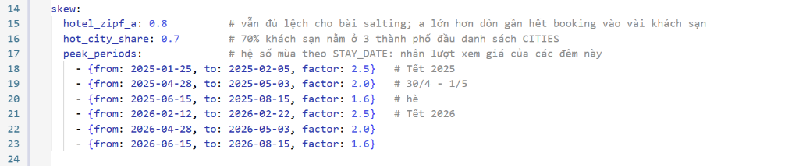
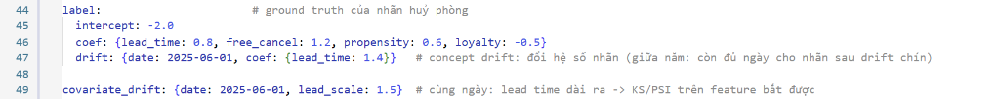
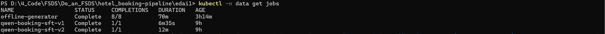
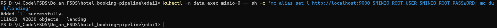

# Data generator

Generator tái lập được (cùng seed cho cùng dữ liệu), sinh lỗi dữ liệu offline, lỗi streaming, data drift và
bảng nhãn.

## Đặc tính dữ liệu đo được

`python -m generator.profile_data` (chạy trong thư mục `edai1/`) in ra các bảng dưới đây. Mẫu gồm đủ 16 shard của
12 ngày cách nhau 30 ngày, rải đều các mùa trong năm, rồi ngoại suy ra cả năm. Với `quotes_per_cell` 580 và `conversion`
0,01267, dữ liệu đạt khoảng 108GB. Khi sửa `config.yaml`, cần chạy lại lệnh và thay các bảng này.

config_sha256 94e5c466f09d

| Bảng | Dòng / ngày | Byte / dòng (Parquet zstd) | Dòng / năm | Dung lượng / năm |
|---|---|---|---|---|
| quotes | 33,771,299 | 8.4 | 12.33 tỉ | 103.9 GB |
| bookings | 387,034 | 24.3 | 0.14 tỉ | 3.4 GB |
| cancellations | 156,979 | 15.3 | 0.06 tỉ | 0.9 GB |
| **tổng** | | | | **108.2 GB** |

| Phễu và lỗi dữ liệu | Giá trị |
|---|---|
| Đặt / lượt xem (look-to-book) | 1.12% |
| Lượt xem gặp hết phòng | 3.73% |
| Double submit (dòng thừa / booking) | 1.99% |
| Tỉ lệ huỷ trước drift | 32.9% |
| Lead time trung bình trước drift (covariate drift) | 18.6 ngày |
| Tỉ lệ huỷ sau drift | 47.4% |
| Lead time trung bình sau drift (covariate drift) | 28.3 ngày |
| Booking schema v1 / v2 trong mẫu | 2,359,953 / 2,284,456 |

| Skew theo khách sạn (mỗi ngày, trung bình mẫu) | Lượt xem | Booking |
|---|---|---|
| Top 1 khách sạn | 2.6% | 2.7% |
| Top 10 khách sạn | 9.1% | 9.1% |
| Top 1% khách sạn | 33.0% | 33.0% |
| Khách sạn trung vị (dòng / ngày) | 262 | 3.0 |

| Khách (1 năm) | Giá trị |
|---|---|
| Booking / khách (trung bình) | 4.6 |
| Khách không đặt trong năm | 21% |
| Khách có đặt: trung vị / p99 | 3 / 42 |

| Trần AUC (điểm = công thức nhãn thật) | Trước drift | Sau drift |
|---|---|---|
| oracle (biết propensity ẩn) | 0.734 | 0.745 |
| lead + policy + loyalty (input của cancel-risk, chưa tính lịch sử khách) | 0.681 | 0.698 |
| lead + policy (bỏ loyalty) | 0.648 | 0.669 |

| Event trễ (booking_created, 1 shard) | Tỉ lệ |
|---|---|
| Trễ 10–15 phút (vào lại qua allowed lateness) | 5.68% |
| Trễ > 15 phút (side output nhánh tumbling 1 phút) | 6.83% |
| Trễ > 75 phút (side output nhánh trượt 1 giờ) | 0.88% |
| Qua channel manager (trễ 1–4 giờ) | 0.97% |

*Chú thích: Đoạn cấu hình `skew` trong `generator/config.yaml`: `hotel_zipf_a: 0.8`, `hot_city_share: 0.7` (70% khách sạn ở 3 thành phố lớn) và các mùa cao điểm Tết, 30/4, hè.*

*Chú thích: Đoạn cấu hình `label.drift` và `covariate_drift` trong `generator/config.yaml` tại mốc `2025-06-01`: hệ số `lead_time` tăng từ `0.8` lên `1.4` và `lead_scale: 1.5`.*

### Kết quả kiểm chứng drift trực tiếp từ `generator/profile_data.py`

> Kết quả dưới đây lấy trực tiếp từ output lệnh `python -m generator.profile_data 15,200` (so sánh ngày `15` trước drift và ngày `200` sau mốc drift `2025-06-01`, đủ 16 shard; số cả năm = mẫu × 182, `config_sha256 94e5c466f09d`, xem [ảnh chụp terminal](../images/edai-1/generator-profile-drift.jpg)).
>
> Lần chạy này dùng để so phân phối trước và sau drift, không dùng để đo dung lượng. Ngày 200 thuộc mùa hè cao điểm, nên
> cột dung lượng (ngoại suy từ 2 ngày) cao hơn thực tế. Dung lượng cả năm lấy theo bảng đầu mục, vốn dựa trên 12 ngày rải
> đều các mùa (khoảng 108 GB), và đã được đo thật trên MinIO (111 GiB).

| Bảng | Dòng / ngày | Byte / dòng (Parquet zstd) | Dòng / năm | Dung lượng / năm |
|---|---|---|---|---|
| quotes | 42,225,380 | 8.4 | 15.41 tỉ | 129.8 GB |
| bookings | 409,825 | 24.4 | 0.15 tỉ | 3.6 GB |
| cancellations | 159,708 | 15.4 | 0.06 tỉ | 0.9 GB |

| Phễu và lỗi dữ liệu | Giá trị |
|---|---|
| Đặt / lượt xem (look-to-book) | 0.95% |
| Lượt xem gặp hết phòng | 6.07% |
| Double submit (dòng thừa / booking) | 2.02% |
| Tỉ lệ huỷ trước drift | 32.8% |
| Lead time trung bình trước drift (covariate drift) | 17.9 ngày |
| Tỉ lệ huỷ sau drift | 47.0% |
| Lead time trung bình sau drift (covariate drift) | 27.3 ngày |
| Booking schema v1 / v2 trong mẫu | 416,240 / 403,410 |

| Skew theo khách sạn (mỗi ngày, trung bình mẫu) | Lượt xem | Booking |
|---|---|---|
| Top 1 khách sạn | 2.6% | 2.7% |
| Top 10 khách sạn | 9.1% | 9.1% |
| Top 1% khách sạn | 33.0% | 33.1% |
| Khách sạn trung vị (dòng / ngày) | 328 | 3.5 |

| Khách (1 năm) | Giá trị |
|---|---|
| Booking / khách (trung bình) | 4.9 |
| Khách không đặt trong năm | 20% |
| Khách có đặt: trung vị / p99 | 3 / 44 |

| Trần AUC (điểm = công thức nhãn thật) | Trước drift | Sau drift |
|---|---|---|
| oracle (biết propensity ẩn) | 0.734 | 0.745 |
| lead + policy + loyalty (input của cancel-risk, chưa tính lịch sử khách) | 0.681 | 0.698 |
| lead + policy (bỏ loyalty) | 0.647 | 0.669 |

| Event trễ (booking_created, 1 shard) | Tỉ lệ |
|---|---|
| Trễ 10–15 phút (vào lại qua allowed lateness) | 6.02% |
| Trễ > 15 phút (side output nhánh tumbling 1 phút) | 6.87% |
| Trễ > 75 phút (side output nhánh trượt 1 giờ) | 0.92% |
| Qua channel manager (trễ 1–4 giờ) | 1.01% |

## Mô phỏng lệch phân phối (Data Skew)

Lượt xem và booking lệch theo phân phối Zipf của khách sạn (`hotel_zipf_a`); 70% khách sạn tập trung ở
3 thành phố. Mùa cao điểm tính theo `stay_date` (Tết, 30/4, hè, cả năm 2026), còn sự kiện chỉ tác động từ
`announce_date`, khiến độ lệch nặng nhất dồn vào các cặp (`hotel_id`, `stay_date`) nóng.

Để kiểm chứng độ phân tán sau khi sinh dữ liệu, [cardinality.py](../../edai1/generator/cardinality.py) thống kê cardinality trên mẫu ngày 2025-07-15: quotes lấy shard 0 (2.379.119 dòng; mỗi shard giữ 1/16 số khách sạn nên `hotel_id` có 3.125 giá trị), còn bookings lấy đủ 16 shard trên landing (409.892 dòng).

Cardinality bằng số giá trị khác nhau chia số dòng; mức high từ 50% trở lên, low dưới 1%.

| quotes: cột | Số giá trị khác nhau | Tỉ lệ / số dòng | Mức |
|---|---|---|---|
| `quote_id` | 2.379.119 | 100% | high |
| `quoted_at` | 86.400 | 3,63% | medium |
| `price` | 6.457 | 0,27% | low |
| `hotel_id` | 3.125 | 0,13% | low |
| `stay_date` | 226 | 0,0095% | low |
| `nights`, `room_type`, `rate_plan`, `available`, `booked` | 2–5 | < 0,001% | low |

| bookings: cột | Số giá trị khác nhau | Tỉ lệ / số dòng | Mức |
|---|---|---|---|
| `booking_id` | 409.892 | 100% | high |
| `idempotency_key` | 401.912 | 98,05% | high (1,95% là bản gửi trùng) |
| `customer_id` | 391.447 | 95,50% | high |
| `created_at` | 85.980 | 20,98% | medium |
| `hotel_id` | 47.057 | 11,48% | medium |
| `price` | 5.171 | 1,26% | medium |
| `checkin` | 201 | 0,049% | low |
| `nights`, `room_category`, `channel`, `cancellation_policy` | 2–5 | < 0,002% | low |

Các cột high cardinality (`quote_id`, `booking_id`, `idempotency_key`, `customer_id`) không dùng làm khoá partition, vì
mỗi giá trị sẽ thành một thư mục nhỏ. Dữ liệu partition theo ngày (`dt`, `days(quoted_at)`), còn key Kafka là
`hotel_id`. `customer_id` đo trên 1 ngày nên gần 100%. Tính cả năm, tỉ lệ này thấp hơn nhiều vì khách đặt lại (trung bình
4,6 booking/khách, trung vị 3 với khách có đặt, xem bảng Khách ở trên).

`hotel_id` có cardinality thấp nhưng lệch mạnh. Trên trục log–log, số dòng theo hạng khách sạn là một đường thẳng
(Zipf): khách sạn đứng đầu có khoảng 10⁶ lượt xem/ngày, khách sạn cuối khoảng 10². Trong shard 0, ô (`hotel_id`,
`room_type`, `stay_date`) trung vị có 2 lượt xem, p99 có 55, ô nóng nhất có 2.723. Đây là khoá join gây skew ở
`silver_quotes`.

*Chú thích: Biểu đồ phân phối lệch (Zipf) theo hạng khách sạn trên trục log–log và theo từng ô (`hotel_id, room_type, stay_date`): khách sạn đứng đầu nhận ~10⁶ lượt xem/ngày, ô nóng nhất có 2.723 lượt xem/shard/ngày.*

## Mô phỏng thay đổi lược đồ (Schema Evolution)

Từ 2025-07-01, bảng `landing/bookings` chuyển sang schema v2 (`anomalies.schema_v2_date`,
`apply_schema_version` trong `generator/offline_gen.py`): thêm cột `channel`, đổi `room_type` thành `room_category`. Cột
`cancellation_policy` có ở cả hai phiên bản, nên thay đổi schema không ảnh hưởng tới công thức nhãn.

| Cột | v1 (trước 2025-07-01) | v2 (từ 2025-07-01) |
|---|---|---|
| `booking_id`, `idempotency_key`, `customer_id`, `hotel_id` | BIGINT | BIGINT |
| `room_type` → `room_category` | `room_type` STRING | `room_category` STRING (đổi tên, cùng giá trị) |
| `channel` | không có | STRING: `mobile` / `web` / `channel_manager` (thêm mới) |
| `created_at`, `checkin` | TIMESTAMP | TIMESTAMP |
| `nights` | BIGINT | BIGINT |
| `cancellation_policy`, `price` | STRING, DOUBLE | STRING, DOUBLE |

Mẫu 12 ngày của `profile_data` (bảng Đặc tính dữ liệu ở trên) có 2.359.953 dòng v1 và 2.284.456 dòng v2. Tính cả năm,
landing có khoảng 181 ngày v1 và 214 ngày v2. Nếu đọc cả hai phiên bản cùng lúc mà không xử lý, Parquet báo thiếu cột
hoặc tách thành hai cột khác tên cho cùng một ý nghĩa. Silver xử lý bằng `mergeSchema`, gộp
`coalesce(room_category, room_type)` và thêm `channel` null cho dữ liệu v1 (`spark_jobs/silver_bookings.py`, mục
Handle schema evolution ở `processing_jobs.md`).

## Mô phỏng các lỗi dữ liệu offline khác (trùng lặp, null, giá trị âm)

2% booking bị gửi hai lần với cùng `idempotency_key`. Mỗi bản thừa có `booking_id` mới và `created_at`
lệch 1–3 giây, nên khoá chính không trùng dù vẫn là cùng một lần đặt. Ở nhánh stream, khoảng 0,5% bản sao của
`booking_created` vi phạm data contract (giá âm, `hotel_id` không tồn tại, thiếu `event_time`).

`profile_data` đo trên mẫu 12 ngày cho tỉ lệ double submit **1,99%** dòng thừa trên mỗi booking (config 2%).
Ngày 2025-07-15, `idempotency_key` có 401.912 giá trị khác nhau trên 409.892 dòng (bảng cardinality ở mục Simulate skew).
Silver dedup theo `idempotency_key`, giữ dòng có `created_at` nhỏ nhất.

Vi phạm data contract đo bằng `python -m generator.stream_profile 195` trên ngày 2025-07-15, đủ 16 shard:

| Loại vi phạm | Số event | Tỉ lệ trên booking_created |
|---|---|---|
| `event_time` (thiếu trường) | 707 | 0,172% |
| `hotel_id` (= 0, không tồn tại) | 640 | 0,156% |
| `price` (giá âm) | 692 | 0,169% |
| **tổng** | **2.039** | **0,497%** (config 0,5%) |

Trên GKE, các event này vào topic `booking_events_dlq` kèm `reason` (Idea 1 ở `novel_ideas.md`).

## Lưu trữ dữ liệu sinh ra vào Bronze Zone (MinIO)

Generator ghi Parquet nén zstd lên MinIO landing theo `dt=`/`shard=`, kèm manifest sha256, cho các bảng
append-only: quotes, bookings, cancellations, payments. Xác suất huỷ thật `p_cancel_true` nằm ở bucket riêng
`truth/p_cancel/`, ngoài landing, và pipeline không đọc. Quote là dữ liệu gốc, nên dung lượng trên 100GB đến từ quotes
(`demand.quotes_per_cell`) thay vì tăng số booking. Trên GKE, Indexed Job `offline-generator` (`k8s/generator.yaml`)
chạy 8 pod song song, mỗi pod một khoảng ngày.

Chạy trên GKE. Job `offline-generator` hoàn thành 8/8 pod trong 70 phút, trải trên 3 node
`cpu-spot`. Bucket `landing` đạt **111 GiB, 42.830 object**, vượt mốc 100GB của rubric.

Pod số 0 khởi động lại một lần. Nguyên nhân là 8 pod cùng tạo bucket `landing`, pod chậm hơn nhận lỗi
`BucketAlreadyOwnedByYou` rồi chạy lại bình thường. Bản sửa trong `generator/offline_gen.py` bỏ qua đúng lỗi này.

*Chú thích: Trạng thái 8 pod của Indexed Job `offline-generator` chạy song song trên cụm GKE (`cpu-spot`), mỗi pod phụ trách sinh một dải ngày riêng.*

*Chú thích: Indexed Job `offline-generator` hoàn thành `8/8` (`Complete`) với thời gian chạy 70 phút.*

*Chú thích: Kiểm tra dung lượng bucket `landing` trên MinIO của GKE: đạt tổng cộng 111 GiB với 42.830 object, vượt mốc 100 GB.*

## Mô phỏng dữ liệu đến trễ (Late Arrivals)

Generator tạo ba nguồn event trễ:

- 30% booking từ mobile offline trễ 5–20 phút; một phần vượt watermark 10 phút cộng lateness 5 phút nên rơi ra side output.
- Webhook thanh toán trễ 1–15 phút.
- 1% booking qua channel manager trễ 1–4 giờ.

Replay chỉ phát event có `ingest_time` trong cửa sổ. Generator lùi 150 ngày để có event huỷ của các booking tạo trước
cửa sổ; mỗi `idempotency_key` huỷ đúng một lần. Event log gom mỗi ngày ingest thành một file đã sắp theo `ingest_time`,
nên replay chỉ mở vài file cùng lúc. Lần chạy đầu sinh khoảng 2.900 partition song song bằng `GEN_WORKERS` process, thay
cho cách sinh tuần tự mất khoảng 3 giờ. Độ trễ đo bằng `python -m generator.stream_profile 195 <file png>`
trên event của mọi booking tạo ngày 2025-07-15, đủ 16 shard (1.009.407 event).

Độ trễ bằng `ingest_time` − `event_time`, so với watermark 10 phút và allowedLateness 5 phút của Flink:

| Nguồn | Event | Trễ trung vị | p99 | Max | Trễ > 10 phút | Trễ > 15 phút |
|---|---|---|---|---|---|---|
| booking_created · web | 160.334 | 0 | 0 | 0 | 0% | 0% |
| booking_created · mobile | 245.388 | 0,01 phút | 19,5 phút | 20 phút | 20,09% | 10,03% |
| booking_created · channel_manager | 4.170 | 147,7 phút | 238,7 phút | 240 phút | 100% | 100% |
| payment_callback (webhook) | 408.016 | 8,0 phút | 14,9 phút | 15 phút | 35,79% | 0,03% |
| booking_cancelled | 189.460 | 0 | 0 | 0 | 0% | 0% |

Với booking, 10,03% event mobile và toàn bộ event channel manager trễ quá watermark + lateness, nên nhánh tumbling
1 phút đẩy chúng ra side output. Event trễ 10–15 phút vẫn được cửa sổ nhận lại nhờ allowedLateness. Webhook không đi qua
cửa sổ (chỉ dedup), nên độ trễ của nó không làm mất event.

*Chú thích: Biểu đồ phân phối độ trễ (`ingest_time - event_time`) đo bằng `stream_profile.py` trên 1.009.407 event: web và huỷ gần như 0 phút, mobile 5–20 phút, webhook 1–15 phút, còn channel manager trễ 1–4 giờ.*

## Mô phỏng lỗi dữ liệu streaming (sai định dạng, thiếu trường)

1,5% callback thanh toán bị gửi lặp (at-least-once). Bản gửi lại giữ nguyên `event_id` như webhook thật
và tới sau bản gốc 1–30 giây. Tỉ lệ đo bằng `python -m generator.stream_profile 195` trên ngày 2025-07-15, đủ 16 shard.

| Lỗi | Số event lặp | Tỉ lệ |
|---|---|---|
| `payment_callback` gửi lại (cùng `event_id`, tới sau bản gốc 1–30 giây) | 6.104 | 1,52% callback (config 1,5%) |
| `booking_created` double submit (cùng `idempotency_key`, khác `booking_id`) | 7.980 | 1,99% booking (config 2%) |

Nếu đếm thẳng, các khoản thanh toán gửi lại bị đếm hai lần. Flink giữ lần đầu theo `event_id` bằng keyed state
(`DedupByEventId`); timer xoá state khi watermark vượt `event_time` + 5 giờ. Double submit có `event_id` khác nhau, nên
Flink dedup theo `idempotency_key` trước khi đếm booking, cùng quy tắc với Silver.
