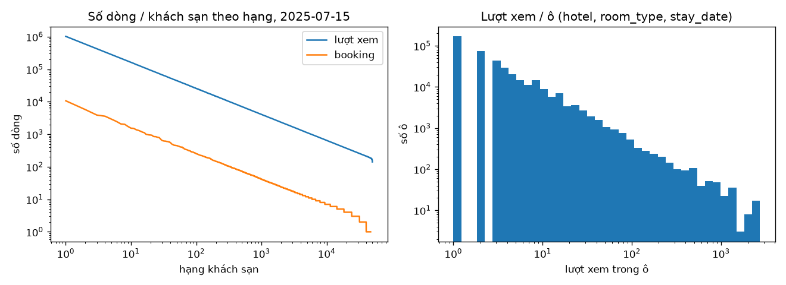
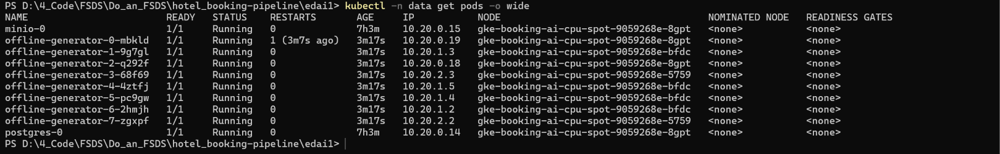
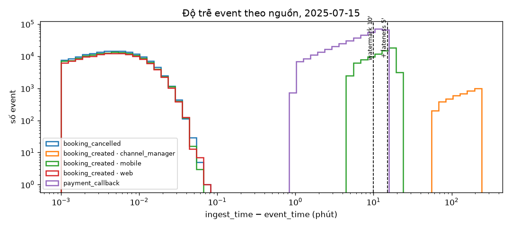

# Data generator

Generator tái lập được (cùng seed cho cùng dữ liệu), sinh lỗi dữ liệu offline, lỗi streaming, data drift và
bảng nhãn.

Mỗi mục dưới đây ứng với một dòng của rubric. Phần **Cách làm** mô tả giải pháp đã triển khai, đồng bộ từ
cột F của rubric. Phần **Kết quả** ghi test đã chạy, số liệu đo được hoặc ảnh chụp (`docs/images/`).

## Đặc tính dữ liệu đo được

Các bảng dưới đây do `python -m generator.profile_data` (chạy trong thư mục `edai1/`) in ra. Mẫu gồm đủ 16 shard của
12 ngày cách nhau 30 ngày, rải đều các mùa trong năm, rồi ngoại suy ra cả năm. Với `quotes_per_cell` 580 và `conversion`
0,01267, dữ liệu đạt khoảng 108GB, cao hơn mốc 100GB khoảng 8%; tích hai tham số được giữ nguyên nên số booking không
đổi. Khi sửa `config.yaml`, cần chạy lại lệnh và thay các bảng này. Số đo không được ghi vào config hay comment.

Mẫu: ngày [15, 45, 75, 105, 135, 165, 195, 225, 255, 285, 315, 345], đủ 16 shard; số cả năm = mẫu × 30. config_sha256 94e5c466f09d

| Bảng | Dòng / ngày | Byte / dòng (Parquet zstd) | Dòng / năm | Dung lượng / năm |
|---|---|---|---|---|
| quotes | 33,771,299 | 8.4 | 12.33 tỉ | 103.9 GB |
| bookings | 387,034 | 24.3 | 0.14 tỉ | 3.4 GB |
| cancellations | 156,979 | 15.3 | 0.06 tỉ | 0.9 GB |
| **tổng** | | | | **108.2 GB** |

| Phễu và lỗi dữ liệu | Giá trị |
|---|---|
| Đặt / lượt xem (look-to-book) | 1.12% |
| Lượt xem gặp hết phòng | 3.73% |
| Double submit (dòng thừa / booking) | 1.99% |
| Tỉ lệ huỷ trước drift | 32.9% |
| Lead time trung bình trước drift (covariate drift) | 18.6 ngày |
| Tỉ lệ huỷ sau drift | 47.4% |
| Lead time trung bình sau drift (covariate drift) | 28.3 ngày |
| Booking schema v1 / v2 trong mẫu | 2,359,953 / 2,284,456 |

| Skew theo khách sạn (mỗi ngày, trung bình mẫu) | Lượt xem | Booking |
|---|---|---|
| Top 1 khách sạn | 2.6% | 2.7% |
| Top 10 khách sạn | 9.1% | 9.1% |
| Top 1% khách sạn | 33.0% | 33.0% |
| Khách sạn trung vị (dòng / ngày) | 262 | 3.0 |

| Khách (1 năm) | Giá trị |
|---|---|
| Booking / khách (trung bình) | 4.6 |
| Khách không đặt trong năm | 21% |
| Khách có đặt: trung vị / p99 | 3 / 42 |

| Trần AUC (điểm = công thức nhãn thật) | Trước drift | Sau drift |
|---|---|---|
| oracle (biết propensity ẩn) | 0.734 | 0.745 |
| lead + policy + loyalty (input của cancel-risk, chưa tính lịch sử khách) | 0.681 | 0.698 |
| lead + policy (bỏ loyalty) | 0.648 | 0.669 |

| Event trễ (booking_created, 1 shard) | Tỉ lệ |
|---|---|
| Trễ 10–15 phút (vào lại qua allowed lateness) | 5.68% |
| Trễ > 15 phút (side output nhánh tumbling 1 phút) | 6.83% |
| Trễ > 75 phút (side output nhánh trượt 1 giờ) | 0.88% |
| Qua channel manager (trễ 1–4 giờ) | 0.97% |

## Simulate skew

**Rubric:** edai-1 · dòng 5 · 2 điểm · nhóm *Implement Data Generator* › *Simulate offline data problems (Tối thiểu 100GB, nếu mọi người cảm thấy chưa đủ để thể hiện rõ các optimization thì mọi người hãy tăng lên nhé. Ví dụ: mọi người cố gắng xử lý data skew, nhưng để data quá bé thì hầu như thời gian xử lý không thay đổi nhiều)*

**Cần nộp (cả nhóm):** Document thể hiện data characteristics sau khi generate - Cột nào skew, tỉ lệ như thế nào - Cột nào có high cardinality (tỉ lệ số unique values/tổng số values trong cột) - Schema trước và sau evolution là gì - Tỉ lệ duplicate - Data volume là bao nhiêu

**Cách làm:** [Đã có] Lượt xem và booking lệch theo phân phối Zipf của khách sạn (`hotel_zipf_a`). 70% khách sạn tập trung ở 3 thành phố. Mùa cao điểm tính theo `stay_date` (Tết, 30/4, hè, cả năm 2026), sự kiện chỉ tác động từ `announce_date`. Độ lệch nặng nhất nằm ở các cặp (`hotel_id`, `stay_date`) nóng. Lệnh `python -m generator.profile_data` in các số đo top 1, top 1% và khách sạn trung vị. [Cần làm] vẽ histogram và tính cardinality từng cột.

**Kết quả:** `python -m generator.cardinality 195 <file png>` (2026-11-17) đo trên ngày 2025-07-15: quotes lấy shard 0
(2.379.119 dòng; mỗi shard giữ 1/16 số khách sạn nên `hotel_id` ở đây chỉ có 3.125 giá trị), bookings landing đủ 16
shard (409.892 dòng). Cardinality = số giá trị khác nhau / số dòng; high ≥ 50%, low < 1%.

| quotes: cột | Số giá trị khác nhau | Tỉ lệ / số dòng | Mức |
|---|---|---|---|
| `quote_id` | 2.379.119 | 100% | high |
| `quoted_at` | 86.400 | 3,63% | medium |
| `price` | 6.457 | 0,27% | low |
| `hotel_id` | 3.125 | 0,13% | low |
| `stay_date` | 226 | 0,0095% | low |
| `nights`, `room_type`, `rate_plan`, `available`, `booked` | 2–5 | < 0,001% | low |

| bookings: cột | Số giá trị khác nhau | Tỉ lệ / số dòng | Mức |
|---|---|---|---|
| `booking_id` | 409.892 | 100% | high |
| `idempotency_key` | 401.912 | 98,05% | high (1,95% là bản gửi trùng) |
| `customer_id` | 391.447 | 95,50% | high |
| `created_at` | 85.980 | 20,98% | medium |
| `hotel_id` | 47.057 | 11,48% | medium |
| `price` | 5.171 | 1,26% | medium |
| `checkin` | 201 | 0,049% | low |
| `nights`, `room_category`, `channel`, `cancellation_policy` | 2–5 | < 0,002% | low |

Cột high cardinality (`quote_id`, `booking_id`, `idempotency_key`, `customer_id`) không dùng làm khoá partition: mỗi
giá trị thành một thư mục nhỏ. Partition theo ngày (`dt`, `days(quoted_at)`), key Kafka là `hotel_id`. `customer_id`
đo trên 1 ngày nên gần 100%; cả năm thấp hơn nhiều vì khách đặt lại (trung bình 4,6 booking/khách, khách có đặt trung vị 3, bảng Khách ở trên).
`hotel_id` có cardinality thấp nhưng lệch: số dòng theo hạng khách sạn là đường thẳng trên trục log–log (Zipf), khách
sạn đứng đầu có khoảng 10⁶ lượt xem/ngày, khách sạn cuối khoảng 10². Trong shard 0, ô (`hotel_id`, `room_type`,
`stay_date`) trung vị có 2 lượt xem, p99 có 55, ô nóng nhất 2.723: đây là khoá join gây skew ở `silver_quotes`.

## Simulate schema evolution

**Rubric:** edai-1 · dòng 6 · 2 điểm · nhóm *Implement Data Generator* › *Simulate offline data problems (Tối thiểu 100GB, nếu mọi người cảm thấy chưa đủ để thể hiện rõ các optimization thì mọi người hãy tăng lên nhé. Ví dụ: mọi người cố gắng xử lý data skew, nhưng để data quá bé thì hầu như thời gian xử lý không thay đổi nhiều)*

**Cách làm:** [Đã có] Từ 2025-07-01, bảng bookings chuyển sang schema v2: thêm cột `channel`, đổi `room_type` thành `room_category`. Cột `cancellation_policy` có ở cả hai phiên bản, nên thay đổi schema không ảnh hưởng tới công thức nhãn. `profile_data` in số dòng của từng phiên bản. [Cần làm] ghi bảng so sánh schema v1 và v2.

**Kết quả:** bảng `landing/bookings` đổi schema tại `dt=2025-07-01` (`anomalies.schema_v2_date`,
`apply_schema_version` trong `generator/offline_gen.py`):

| Cột | v1 (trước 2025-07-01) | v2 (từ 2025-07-01) |
|---|---|---|
| `booking_id`, `idempotency_key`, `customer_id`, `hotel_id` | BIGINT | BIGINT |
| `room_type` → `room_category` | `room_type` STRING | `room_category` STRING (đổi tên, cùng giá trị) |
| `channel` | không có | STRING: `mobile` / `web` / `channel_manager` (thêm mới) |
| `created_at`, `checkin` | TIMESTAMP | TIMESTAMP |
| `nights` | BIGINT | BIGINT |
| `cancellation_policy`, `price` | STRING, DOUBLE | STRING, DOUBLE |

Trong mẫu 12 ngày của `profile_data` (bảng Đặc tính dữ liệu ở trên) có 2.359.953 dòng v1 và 2.284.456 dòng v2; cả năm
khoảng 181 ngày v1 và 214 ngày v2 trên landing. Đọc cả hai phiên bản cùng lúc mà không xử lý thì Parquet báo thiếu cột
hoặc tách thành hai cột khác tên cho cùng một ý nghĩa; Silver xử lý bằng `mergeSchema`, gộp
`coalesce(room_category, room_type)` và thêm `channel` null cho dữ liệu v1 (`spark_jobs/silver_bookings.py`, mục
Handle schema evolution ở `processing_jobs.md`).

## Simulate another offline data problem

**Rubric:** edai-1 · dòng 7 · 2 điểm · nhóm *Implement Data Generator* › *Simulate offline data problems (Tối thiểu 100GB, nếu mọi người cảm thấy chưa đủ để thể hiện rõ các optimization thì mọi người hãy tăng lên nhé. Ví dụ: mọi người cố gắng xử lý data skew, nhưng để data quá bé thì hầu như thời gian xử lý không thay đổi nhiều)*

> Simulate another offline data problem (Ví dụ: 2% duplicate rate)

**Cách làm:** [Đã có] 2% booking bị gửi hai lần với cùng `idempotency_key`. [Thêm cho novelty] Khoảng 0,5% bản ghi vi phạm data contract (giá âm, `hotel_id` không tồn tại, thiếu `event_time`); ghi lại tỉ lệ đo được.

**Kết quả:** double submit đo bằng `profile_data` trên mẫu 12 ngày: **1,99%** dòng thừa trên mỗi booking (config 2%).
Mỗi bản thừa có `booking_id` mới, cùng `idempotency_key`, `created_at` lệch 1–3 giây, nên khoá chính không trùng mà
vẫn là cùng một lần đặt; trên ngày 2025-07-15, `idempotency_key` có 401.912 giá trị khác nhau trên 409.892 dòng
(bảng cardinality ở mục Simulate skew). Silver dedup theo `idempotency_key`, giữ dòng `created_at` nhỏ nhất.

Vi phạm data contract (chỉ ở nhánh stream, bản sao lỗi của `booking_created`), đo bằng
`python -m generator.stream_profile 195` trên ngày 2025-07-15, đủ 16 shard:

| Loại vi phạm | Số event | Tỉ lệ trên booking_created |
|---|---|---|
| `event_time` (thiếu trường) | 707 | 0,172% |
| `hotel_id` (= 0, không tồn tại) | 640 | 0,156% |
| `price` (giá âm) | 692 | 0,169% |
| **tổng** | **2.039** | **0,497%** (config 0,5%) |

Trên GKE các event này vào topic `booking_events_dlq` kèm `reason` (mục Handle other streaming problem ở
`processing_jobs.md`).

## Store data after generating so that we can ingest to Bronze zone later

**Rubric:** edai-1 · dòng 8 · 2 điểm · nhóm *Implement Data Generator* › *Simulate offline data problems (Tối thiểu 100GB, nếu mọi người cảm thấy chưa đủ để thể hiện rõ các optimization thì mọi người hãy tăng lên nhé. Ví dụ: mọi người cố gắng xử lý data skew, nhưng để data quá bé thì hầu như thời gian xử lý không thay đổi nhiều)*

> Store data after generating so that we can ingest to Bronze zone later (Ví dụ: Dùng MinIO/PostgreSQL để mô phỏng data đang ở department khác và mình cần kéo về)

**Cách làm:** [Đã có] Generator ghi Parquet nén zstd lên MinIO landing theo `dt=`/`shard=`, kèm manifest sha256, cho các bảng append-only: quotes, bookings, cancellations, payments. Xác suất huỷ thật `p_cancel_true` nằm ở bucket riêng `truth/p_cancel/`, ngoài landing, pipeline không đọc. Quote là dữ liệu gốc, nên dung lượng ≥ 100GB đến từ quotes (`demand.quotes_per_cell`) thay vì tăng số booking. `profile_data` ước tính dung lượng một năm từ 12 ngày rải đều trong năm. Trên GKE, Indexed Job `offline-generator` (`k8s/generator.yaml`) chạy 8 pod song song, mỗi pod một khoảng ngày.

**Kết quả:** chạy trên GKE ngày 2026-11-17. Job `offline-generator` hoàn thành 8/8 pod trong 70 phút, trải trên 3 node `cpu-spot`. Bucket `landing` đạt **111 GiB, 42.830 object**, vượt mốc 100GB của rubric.

Pod số 0 khởi động lại một lần: 8 pod cùng tạo bucket `landing`, pod chậm hơn nhận lỗi `BucketAlreadyOwnedByYou` rồi chạy lại bình thường. Bản sửa trong `generator/offline_gen.py` bỏ qua đúng lỗi này.

## Simulate late arrivals

**Rubric:** edai-1 · dòng 9 · 2 điểm · nhóm *Implement Data Generator* › *Simulate online data problems*

**Cần nộp (cả nhóm):** Tương tự cái trên: - Dữ liệu nào late, late bao lâu - Tỷ lệ duplicate như nào...

**Cách làm:** [Đã có] Ba nguồn event trễ: 30% booking từ mobile offline trễ 5–20 phút (một phần vượt watermark 10 phút cộng lateness 5 phút nên rơi ra side output), webhook thanh toán trễ 1–15 phút, 1% booking qua channel manager trễ 1–4 giờ. Replay chỉ phát event có `ingest_time` trong cửa sổ. Generator lùi 150 ngày để có event huỷ của booking tạo trước cửa sổ, mỗi `idempotency_key` huỷ đúng một lần. Event log gom mỗi ngày ingest thành một file đã sắp theo `ingest_time`, nên replay chỉ mở vài file cùng lúc. Lần chạy đầu sinh khoảng 2.900 partition song song bằng `GEN_WORKERS` process, thay cho cách sinh tuần tự mất khoảng 3 giờ. [Cần làm] lập bảng event trễ theo nguồn và histogram của (`ingest_time` − `event_time`).

**Kết quả:** `python -m generator.stream_profile 195 <file png>` (2026-11-18) trên event của mọi booking tạo ngày
2025-07-15, đủ 16 shard (1.009.407 event). Độ trễ = `ingest_time` − `event_time`; mốc so sánh là watermark 10 phút
và allowedLateness 5 phút của Flink:

| Nguồn | Event | Trễ trung vị | p99 | Max | Trễ > 10 phút | Trễ > 15 phút |
|---|---|---|---|---|---|---|
| booking_created · web | 160.334 | 0 | 0 | 0 | 0% | 0% |
| booking_created · mobile | 245.388 | 0,01 phút | 19,5 phút | 20 phút | 20,09% | 10,03% |
| booking_created · channel_manager | 4.170 | 147,7 phút | 238,7 phút | 240 phút | 100% | 100% |
| payment_callback (webhook) | 408.016 | 8,0 phút | 14,9 phút | 15 phút | 35,79% | 0,03% |
| booking_cancelled | 189.460 | 0 | 0 | 0 | 0% | 0% |

Dữ liệu trễ là `booking_created` từ mobile (30% bị trễ 5–20 phút do mất mạng) và từ channel manager (trễ 1–4 giờ),
cùng webhook thanh toán (1–15 phút). Với booking, 10,03% event mobile và toàn bộ event channel manager trễ quá
watermark + lateness, nên nhánh tumbling 1 phút đẩy chúng ra side output; event trễ 10–15 phút vẫn được cửa sổ nhận
lại nhờ allowedLateness. Webhook không đi qua cửa sổ (chỉ dedup) nên độ trễ của nó không làm mất event.

## Simulate another streaming data problem

**Rubric:** edai-1 · dòng 10 · 2 điểm · nhóm *Implement Data Generator* › *Simulate online data problems*

> Simulate another streaming data problem (Ví dụ: 1.5% duplicate rate)

**Cách làm:** [Đã có] 1,5% callback thanh toán bị gửi lặp (at-least-once); Flink khử trùng theo `event_id`. `generator/profile_data` in tỉ lệ đo được.

**Kết quả:** `python -m generator.stream_profile 195` trên ngày 2025-07-15, đủ 16 shard:

| Lỗi | Số event lặp | Tỉ lệ |
|---|---|---|
| `payment_callback` gửi lại (cùng `event_id`, tới sau bản gốc 1–30 giây) | 6.104 | 1,52% callback (config 1,5%) |
| `booking_created` double submit (cùng `idempotency_key`, khác `booking_id`) | 7.980 | 1,99% booking (config 2%) |

Bản callback gửi lại giữ nguyên `event_id` như webhook at-least-once thật, nên đếm thẳng thì số thanh toán bị đếm hai
lần; Flink giữ lần đầu theo `event_id` bằng keyed state có TTL 1 giờ (`DedupByEventId`). Double submit khác
`event_id`, nên Flink dedup theo `idempotency_key` trước khi đếm booking, cùng quy tắc với Silver.
