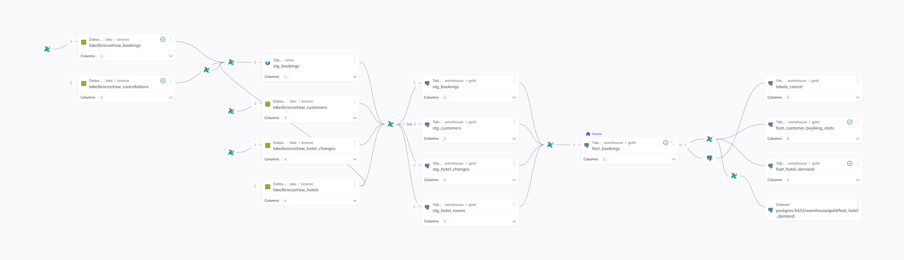
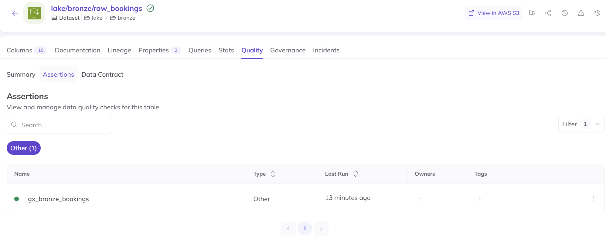
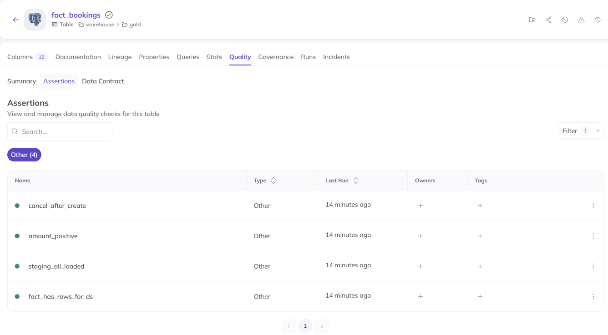
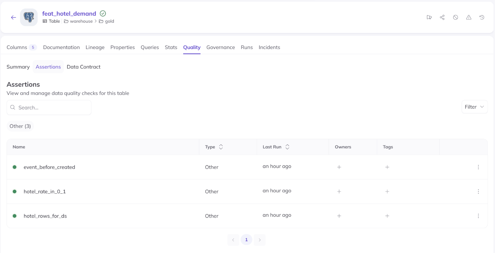

# Data governance

Lineage và kết quả kiểm tra dữ liệu của DP1–DP3 được ghi lên DataHub.

Mỗi mục dưới đây ứng với một dòng của rubric. Phần **Cách làm** mô tả giải pháp đã triển khai, đồng bộ từ
cột F của rubric. Phần **Kết quả** ghi test đã chạy, số liệu đo được hoặc ảnh chụp (`docs/images/`).

## Lineage between the pipeline and tables · DP1 linked with related tables

**Rubric:** edai-1 · dòng 28 · 2 điểm · nhóm *Data Governance* › *DP1 linked with related tables*

**Cần nộp (cả nhóm):** Document + thể hiện được các bảng trên DataHub, + thể hiện được các bảng sinh ra từ Airflow pipeline nào + thể hiện được data validation cho các bảng trên DataHub

**Cách làm:** [Đã có] `emit_datahub.py` khai báo lineage của DP1 (landing → `raw_bookings`). Đã chạy trên GKE (2026-11-18, ds 2025-01-01), ảnh trong docs.

**Kết quả:** chạy trên GKE ngày 2026-11-18 (Airflow 2.10.5, KubernetesExecutor, image `airflow-booking:b9cf9a8-1`), backfill ngày `ds` = 2025-01-01; schema 3 zone ingest bằng job `k8s/datahub-ingest.yaml` (8 bảng Bronze, 2 bảng Silver,
16 bảng Gold). Lineage trên DataHub nối task DP1 với các bảng `lake/bronze/raw_*` và đi tiếp qua DP2, DP3:

## Data validation · DP1 linked with related tables

**Rubric:** edai-1 · dòng 29 · 2 điểm · nhóm *Data Governance* › *DP1 linked with related tables*

**Cách làm:** [Đã có] `emit_validation` gửi `AssertionRunEvent`. Kết quả Great Expectations của DP1 lên tab Quality của `raw_bookings` (khai báo `AssertionInfo` trước `AssertionRunEvent`). Đã chạy trên GKE (2026-11-18, ds 2025-01-01), ảnh trong docs.

**Kết quả:** chạy trên GKE ngày 2026-11-18 (Airflow 2.10.5, KubernetesExecutor, image `airflow-booking:b9cf9a8-1`), backfill ngày `ds` = 2025-01-01. Assertion `gx_bronze_bookings` (khai báo `AssertionInfo` trước rồi mới gửi
`AssertionRunEvent`) hiện ở tab Quality của `lake/bronze/raw_bookings`, trạng thái đạt.

## Lineage between the pipeline and tables · DP2 linked with related tables

**Rubric:** edai-1 · dòng 30 · 2 điểm · nhóm *Data Governance* › *DP2 linked with related tables*

**Cách làm:** [Đã có] `PIPELINES` khai báo `dp2_bronze_to_gold` (`silver_bookings`, `stage_gold`, `upsert_gold`), khớp inlets, outlets của DAG. Đã chạy trên GKE (2026-11-18, ds 2025-01-01), ảnh trong docs.

**Kết quả:** chạy trên GKE ngày 2026-11-18 (Airflow 2.10.5, KubernetesExecutor, image `airflow-booking:b9cf9a8-1`), backfill ngày `ds` = 2025-01-01. Lineage đi đúng `raw_bookings` → `silver_bookings` → `stg_bookings` (Iceberg) →
`stage_gold` → các bảng staging Gold → `upsert_gold` → `fact_bookings`, kèm nhánh dim (`raw_customers`,
`raw_hotels`, `raw_hotel_changes`).

## Data validation · DP2 linked with related tables

**Rubric:** edai-1 · dòng 31 · 2 điểm · nhóm *Data Governance* › *DP2 linked with related tables*

**Cách làm:** [Đã có] `validate_gold` gồm 5 kiểm tra SQL: có dòng cho ngày `ds`, mọi dòng staging đều vào được fact, `amount` > 0, mỗi khách sạn có đúng một phiên bản hiện hành, thời điểm huỷ sau ngày đặt. Kết quả được đẩy lên DataHub dưới dạng `AssertionRunEvent` (`governance.validate_sql`). Đã chạy trên GKE (2026-11-18, ds 2025-01-01), ảnh trong docs.

**Kết quả:** chạy trên GKE ngày 2026-11-18 (Airflow 2.10.5, KubernetesExecutor, image `airflow-booking:b9cf9a8-1`), backfill ngày `ds` = 2025-01-01. Tab Quality của `fact_bookings` có 4 assertion đều đạt: `fact_has_rows_for_ds`,
`staging_all_loaded`, `amount_positive`, `cancel_after_create`; kiểm tra phiên bản hiện hành SCD2 gắn với `dim_hotel`.

## Lineage between the pipeline and tables · DP3 linked with related tables

**Rubric:** edai-1 · dòng 32 · 2 điểm · nhóm *Data Governance* › *DP3 linked with related tables*

**Cách làm:** [Đã có] `PIPELINES` khai báo `dp3_offline_features.build_features`: `fact_bookings`, `dim_hotel` → `feat_customer_booking_stats`, `feat_hotel_demand`. Đã chạy trên GKE (2026-11-18, ds 2025-01-01), ảnh trong docs.

**Kết quả:** chạy trên GKE ngày 2026-11-18 (Airflow 2.10.5, KubernetesExecutor, image `airflow-booking:b9cf9a8-1`), backfill ngày `ds` = 2025-01-01. Phía phải ảnh lineage: `fact_bookings` → task `build_features` →
`feat_customer_booking_stats`, `feat_hotel_demand` (và view `labels_cancel`), cùng Airflow Dataset
`postgres:5432/warehouse/gold/feat_hotel_demand`.

## Data validation · DP3 linked with related tables

**Rubric:** edai-1 · dòng 33 · 2 điểm · nhóm *Data Governance* › *DP3 linked with related tables*

**Cách làm:** [Đã có] `validate_features` kiểm có dòng cho ngày `ds`, tỉ lệ nằm trong [0, 1], `event_timestamp` ≤ `created`, rồi đẩy kết quả lên DataHub. Đã chạy trên GKE (2026-11-18, ds 2025-01-01), ảnh trong docs.

**Kết quả:** chạy trên GKE ngày 2026-11-18 (Airflow 2.10.5, KubernetesExecutor, image `airflow-booking:b9cf9a8-1`), backfill ngày `ds` = 2025-01-01. Tab Quality của `feat_hotel_demand` có 3 assertion đều đạt; `feat_customer_booking_stats`
có dấu đạt trên ảnh lineage.

