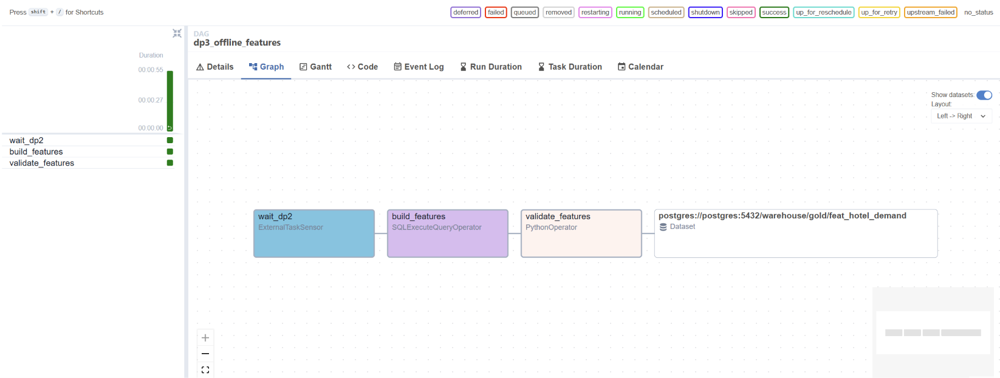

# Data pipeline orchestration

Ba pipeline DP1–DP3 chạy trên Airflow, mỗi pipeline gồm bước ingest và bước validate.

Mọi lần chạy dưới đây diễn ra trên GKE (Airflow 2.10.5), dữ liệu minh họa ngày 2025-01-01.

## Giai đoạn Ingest · Pipeline DP1 (Raw → Bronze)

DP1 gồm hai DAG: `dp1_load_dims` (nạp 4 bảng danh mục) và `dp1_ingest_bronze` (`check_landing` → ingest bằng Spark trên Kubernetes → validate). Các kết nối (Connections) và biến dùng chung (Variables như `spark_image`, `landing_start_date`) được quản lý tập trung trong Airflow thay vì ghi cứng trong code. DAG tắt tự động chạy bù (`catchup=False`) và nạp dữ liệu lịch sử bằng `airflow dags backfill`; cấu trúc DAG được kiểm tra tự động qua `tests/test_dag_integrity.py`.

`dp1_load_dims` nạp 4 bảng dim. `dp1_ingest_bronze` chạy đủ 12 task (4 bảng × check → ingest → validate),
tất cả đều success.

*Chú thích: Graph View của DAG `dp1_ingest_bronze` trên Airflow UI gồm 12 task (`check_* → ingest_* → validate_*` cho 4 bảng), toàn bộ đều chuyển màu xanh `success`.*

*Chú thích: Danh sách Airflow Connections (`spark_default`, `warehouse`, `minio_landing`, `datahub_rest_default`) được cấu hình tập trung trong Airflow thay vì hard-code.*

*Chú thích: Danh sách Airflow Variables gồm 2 biến `landing_start_date` và `spark_image`, dùng chung cho các DAG thay vì hard-code.*

## Giai đoạn Validate · Pipeline DP1 (Raw → Bronze)

`validate_bronze` dùng Great Expectations 1.x (`governance/bronze_checks.py`, context ephemeral, chỉ đọc
các cột cần kiểm). `tests/test_bronze_checks.py` cho thấy landing của generator qua hết các kiểm tra, còn các lỗi cài
vào (giá âm, `quote_id` trùng, partition rỗng) đều bị bắt.

`validate_bookings` chạy Great Expectations trên từng shard Bronze (34/34 metric) rồi đẩy kết quả
`gx_bronze_bookings` lên DataHub. Cả 4 task `validate_*` đều success.

*Chú thích: Log task `validate_bookings` chạy Great Expectations 1.x trên từng shard Bronze: cả 34/34 kiểm tra đều đạt và đẩy kết quả `gx_bronze_bookings` lên DataHub.*

## Giai đoạn Ingest · Pipeline DP2 (Bronze → Silver → Gold)

DAG `dp2_bronze_to_gold` đợi DP1 cùng ngày bằng `ExternalTaskSensor`, rồi chạy lần lượt:

1. `silver_bookings` (Spark, xử lý tăng dần theo từng ngày).
2. `stage_gold` (Spark ghi staging và `gold.hotel_rooms`).
3. `upsert_gold`: `sql/dp2_upsert_gold.sql` chạy trong một transaction, cập nhật `dim_customer`, `dim_hotel` SCD2 và
   `fact_bookings`; fact join theo khoảng hiệu lực của phiên bản dim.

Quotes (khoảng 15 tỷ dòng/năm) giữ ở lakehouse `silver.stg_quotes` (Iceberg, phân vùng theo ngày) thay vì đưa vào Gold
PostgreSQL, vì chưa có consumer nào cần quotes ở warehouse.

Cả 5 task (`wait_dp1` → `silver_bookings` → `stage_gold` → `upsert_gold` → `validate_gold`) success trong
khoảng 4 phút. Sau lần chạy, Gold có `fact_bookings` 380.512 dòng cho ngày 2025-01-01 (không trùng `booking_id`, 6.425
dòng huỷ ngay trong ngày), `dim_hotel` 50.000 dòng, `dim_customer` 370.969 dòng và `hotel_rooms` 1,5 triệu dòng.

*Chú thích: Graph View của DAG `dp2_bronze_to_gold` gồm 5 bước tuần tự (`wait_dp1 → silver_bookings → stage_gold → upsert_gold → validate_gold`), hoàn thành ngày 2025-01-01 trong ~4 phút.*

## Giai đoạn Validate · Pipeline DP2 (Bronze → Silver → Gold)

`validate_gold` gồm 5 kiểm tra SQL (`dags/gold_checks.py`); `tests/test_gold_sql.py` chạy các kiểm tra
này trên Postgres thật. Mỗi kiểm tra đẩy một `AssertionRunEvent` lên DataHub. Gold dùng SQL thay cho Great Expectations
vì dữ liệu đã nằm sẵn trong PostgreSQL.

Log `validate_gold` cho thấy từng câu SQL kiểm tra, theo sau mỗi câu là một lần gửi kết quả lên DataHub.
Cả 5 kiểm tra đều đạt.

*Chú thích: Log task `validate_gold` trên Airflow cho thấy 5 câu kiểm tra SQL chạy lần lượt trên PostgreSQL Gold, cả 5 đều trả `True` và gửi `AssertionRunEvent` lên DataHub.*

*Chú thích: Tab Quality trên DataHub của `gold.fact_bookings` ghi nhận cả 4 assertion SQL (`fact_has_rows_for_ds`, `staging_all_loaded`, `amount_positive`, `cancel_after_create`) đều Passing.*

## Giai đoạn Ingest · Pipeline DP3 (Tính Offline Features)

DAG `dp3_offline_features` chạy `sql/dp3_features.sql`, upsert `feat_customer_booking_stats` và
`feat_hotel_demand` trực tiếp trên Gold trong một transaction. `event_timestamp` lấy mốc cuối ngày dữ liệu chứ không phải giờ
máy, nhờ đó backfill sinh đủ lịch sử point-in-time cho training. Task validate phát Airflow Dataset để kích hoạt
materialize.

`wait_dp2` → `build_features` → `validate_features` success trong 55 giây. Ngày 2025-01-01 cho ra 370.969
dòng `feat_customer_booking_stats` và 46.655 dòng `feat_hotel_demand` (các khách sạn có booking trong cửa sổ 31 ngày).
`event_timestamp` bằng 2025-01-02 00:00, đúng thiết kế train/serve. Đầu ra là Airflow Dataset `feat_hotel_demand`, dùng
để kích hoạt DAG materialize của Feast.

*Chú thích: Graph View của DAG `dp3_offline_features` (`wait_dp2 → build_features → validate_features`) chạy trong 55 giây và phát Airflow Dataset `feat_hotel_demand`.*

## Giai đoạn Validate · Pipeline DP3 (Tính Offline Features)

`validate_features` kiểm tra ba điều: có dữ liệu cho ngày chạy, tỉ lệ nằm trong [0, 1], và
`event_timestamp` ≤ `created` (`dags/gold_checks.py`; `tests/test_gold_sql.py` chạy trên Postgres thật).

Ba kiểm tra của `feat_hotel_demand` (`hotel_rows_for_ds`, `hotel_rate_in_0_1`, `event_before_created`) đều
đạt và hiện trên DataHub. `feat_customer_booking_stats` cũng có dấu đạt (ảnh lineage).

*Chú thích: Tab Quality trên DataHub của `gold.feat_hotel_demand` hiển thị 3/3 assertion (`hotel_rows_for_ds`, `hotel_rate_in_0_1`, `event_before_created`) đều đạt màu xanh.*
