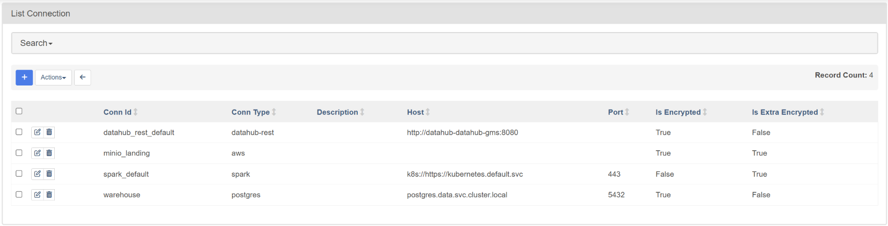
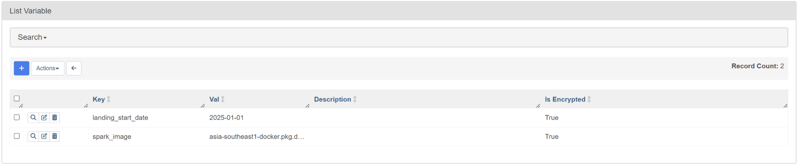
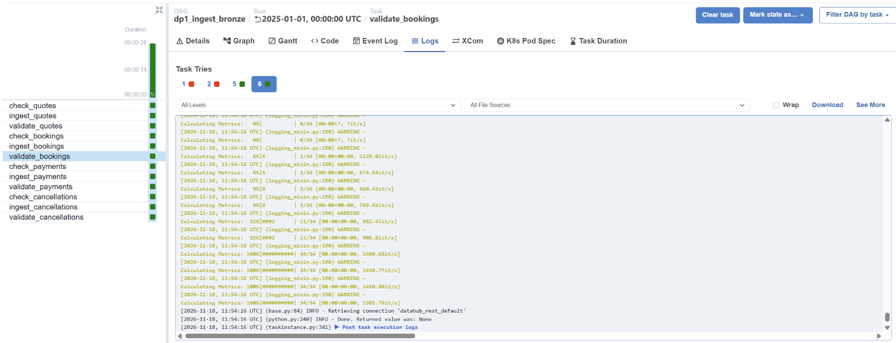
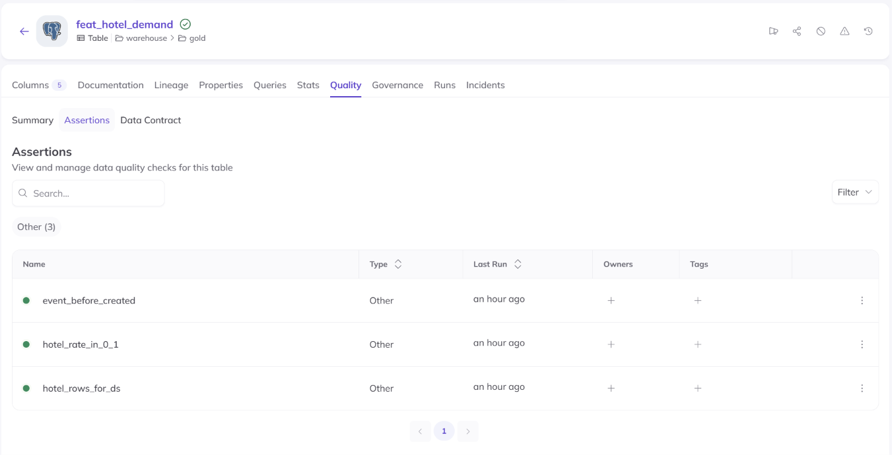

# Data pipeline orchestration

Ba pipeline DP1–DP3 chạy trên Airflow, mỗi pipeline gồm bước ingest và bước validate.

Mỗi mục dưới đây ứng với một dòng của rubric. Phần **Cách làm** mô tả giải pháp đã triển khai, đồng bộ từ
cột F của rubric. Phần **Kết quả** ghi test đã chạy, số liệu đo được hoặc ảnh chụp (`docs/images/`).

## Ingest stage · Pipeline to ingest raw data into bronze zone (DP1)

**Rubric:** edai-1 · dòng 22 · 2 điểm · nhóm *Data Pipeline Orchestration* › *Pipeline to ingest raw data into bronze zone (DP1)*

**Cần nộp (cả nhóm):** Document show hình ảnh 3 pipelines trên Airflow, giải thích từng pipeline làm gì, từng component trong pipeline làm gì

**Cách làm:** [Đã có] DAG `dp1_ingest_bronze` (`check_landing` → ingest → validate) và `dp1_load_dims`. Connection, Variable đặt trong Airflow; image Spark lấy từ Variable `spark_image`. Backfill bằng `airflow dags backfill`; `catchup=False` để DAG không tự chạy 600 ngày khi bật. `tests/test_dag_integrity.py` kiểm cấu trúc DAG trong image `apache/airflow:2.10.5`.

**Kết quả:** chạy trên GKE ngày 2026-11-18 (Airflow 2.10.5, KubernetesExecutor, image `airflow-booking:b9cf9a8-1`), backfill ngày `ds` = 2025-01-01. `dp1_load_dims` nạp 4 bảng dim, `dp1_ingest_bronze` chạy đủ 12 task (4 bảng × check →
ingest → validate) đều success; ingest là `SparkSubmitOperator` chạy trên Kubernetes. Connection (`spark_default`,
`warehouse`, `minio_landing`, `datahub_rest_default`) và Variable (`spark_image`, `landing_start_date`) đặt trong Airflow.

## Validate stage · Pipeline to ingest raw data into bronze zone (DP1)

**Rubric:** edai-1 · dòng 23 · 2 điểm · nhóm *Data Pipeline Orchestration* › *Pipeline to ingest raw data into bronze zone (DP1)*

**Cách làm:** [Đã có] `validate_bronze` dùng Great Expectations 1.x (`governance/bronze_checks.py`, context ephemeral, chỉ đọc các cột cần kiểm). `tests/test_bronze_checks.py` cho thấy landing của generator qua hết các kiểm tra, còn lỗi cài vào (giá âm, `quote_id` trùng, partition rỗng) đều bị bắt. Đã chạy trên GKE (2026-11-18, ds 2025-01-01), ảnh trong docs.

**Kết quả:** chạy trên GKE ngày 2026-11-18 (Airflow 2.10.5, KubernetesExecutor, image `airflow-booking:b9cf9a8-1`), backfill ngày `ds` = 2025-01-01. `validate_bookings` chạy Great Expectations trên từng shard Bronze (34/34 metric) rồi đẩy
kết quả `gx_bronze_bookings` lên DataHub; cả 4 task `validate_*` success.

## Ingest stage · Pipeline to ingest data from bronze zone into silver and gol

**Rubric:** edai-1 · dòng 24 · 2 điểm · nhóm *Data Pipeline Orchestration* › *Pipeline to ingest data from bronze zone into silver and gold zone (or bronze -> gold only) (DP2)*

**Cách làm:** [Đã có] DAG `dp2_bronze_to_gold` đợi DP1 cùng ngày (`ExternalTaskSensor`), chạy `silver_bookings` (Spark, `incr` theo `dt=ds`), `stage_gold` (Spark ghi staging và `gold.hotel_rooms`), rồi `upsert_gold`. Bước cuối dùng `sql/dp2_upsert_gold.sql` trong một transaction: `dim_customer`, `dim_hotel` SCD2 và `fact_bookings` join theo khoảng hiệu lực của phiên bản dim. Đã chạy trên GKE (2026-11-18, ds 2025-01-01), ảnh trong docs. [Cần làm] thêm `fact_quotes`.

**Kết quả:** chạy trên GKE ngày 2026-11-18 (Airflow 2.10.5, KubernetesExecutor, image `airflow-booking:b9cf9a8-1`), backfill ngày `ds` = 2025-01-01. Cả 5 task (`wait_dp1` → `silver_bookings` → `stage_gold` → `upsert_gold` →
`validate_gold`) success trong khoảng 4 phút. Gold sau lần chạy: `fact_bookings` 380.512 dòng ngày 2025-01-01 (không
trùng `booking_id`, 6.425 dòng huỷ ngay trong ngày), `dim_hotel` 50.000, `dim_customer` 370.969, `hotel_rooms`
1,5 triệu dòng. `fact_quotes` chưa làm.

## Validate stage · Pipeline to ingest data from bronze zone into silver and gol

**Rubric:** edai-1 · dòng 25 · 2 điểm · nhóm *Data Pipeline Orchestration* › *Pipeline to ingest data from bronze zone into silver and gold zone (or bronze -> gold only) (DP2)*

**Cách làm:** [Đã có] `validate_gold` gồm 5 kiểm tra SQL (`dags/gold_checks.py`), chạy trên Postgres thật trong `tests/test_gold_sql.py`; mỗi kiểm tra đẩy `AssertionRunEvent` lên DataHub. Gold dùng SQL thay cho Great Expectations vì dữ liệu đã nằm sẵn trong PostgreSQL. Đã chạy trên GKE (2026-11-18, ds 2025-01-01), ảnh trong docs.

**Kết quả:** chạy trên GKE ngày 2026-11-18 (Airflow 2.10.5, KubernetesExecutor, image `airflow-booking:b9cf9a8-1`), backfill ngày `ds` = 2025-01-01. Log `validate_gold` cho thấy từng câu SQL kiểm tra và một lần gửi kết quả lên DataHub sau
mỗi câu; cả 5 kiểm tra đạt.

## Ingest stage · Pipeline to compute offline feature table (DP3)

**Rubric:** edai-1 · dòng 26 · 2 điểm · nhóm *Data Pipeline Orchestration* › *Pipeline to compute offline feature table (DP3) (Ví dụ: f_customer_total_orders_90d)*

**Cách làm:** [Đã có] DAG `dp3_offline_features` chạy `sql/dp3_features.sql`, ghi `feat_customer_booking_stats` và `feat_hotel_demand` trực tiếp trên Gold (upsert trong một transaction). `event_timestamp` là cuối ngày `ds` chứ không phải giờ máy, nhờ đó backfill sinh đủ lịch sử point-in-time cho training. Task validate phát Airflow Dataset để kích hoạt materialize. Đã chạy trên GKE (2026-11-18, ds 2025-01-01), ảnh trong docs.

**Kết quả:** chạy trên GKE ngày 2026-11-18 (Airflow 2.10.5, KubernetesExecutor, image `airflow-booking:b9cf9a8-1`), backfill ngày `ds` = 2025-01-01. `wait_dp2` → `build_features` → `validate_features` success trong 55 giây. Ngày 2025-01-01
ra 370.969 dòng `feat_customer_booking_stats` và 46.655 dòng `feat_hotel_demand` (khách sạn có booking trong cửa sổ 31
ngày), `event_timestamp` = 2025-01-02 00:00 như thiết kế train/serve. Đầu ra là Airflow Dataset
`feat_hotel_demand` kích hoạt DAG materialize của Feast.

## Validate stage · Pipeline to compute offline feature table (DP3)

**Rubric:** edai-1 · dòng 27 · 2 điểm · nhóm *Data Pipeline Orchestration* › *Pipeline to compute offline feature table (DP3) (Ví dụ: f_customer_total_orders_90d)*

**Cách làm:** [Đã có] `validate_features` kiểm có dòng cho ngày `ds`, tỉ lệ nằm trong [0, 1] và `event_timestamp` ≤ `created` (`dags/gold_checks.py`, chạy thật trong `tests/test_gold_sql.py`). Đã chạy trên GKE (2026-11-18, ds 2025-01-01), ảnh trong docs.

**Kết quả:** chạy trên GKE ngày 2026-11-18 (Airflow 2.10.5, KubernetesExecutor, image `airflow-booking:b9cf9a8-1`), backfill ngày `ds` = 2025-01-01. Ba kiểm tra của `feat_hotel_demand` (`hotel_rows_for_ds`, `hotel_rate_in_0_1`,
`event_before_created`) đạt và hiện trên DataHub; `feat_customer_booking_stats` cũng có dấu đạt (ảnh lineage).

