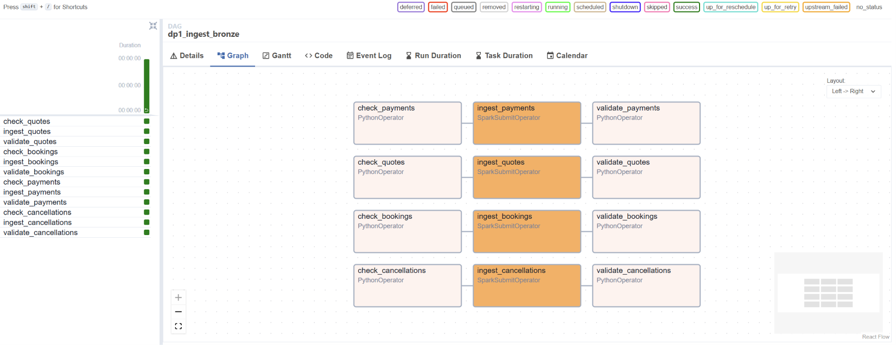
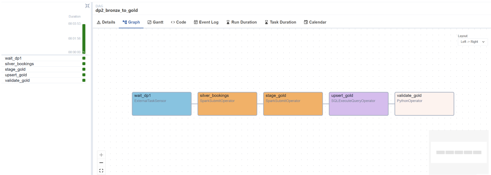
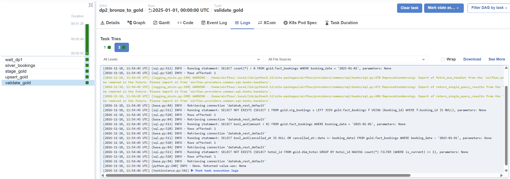
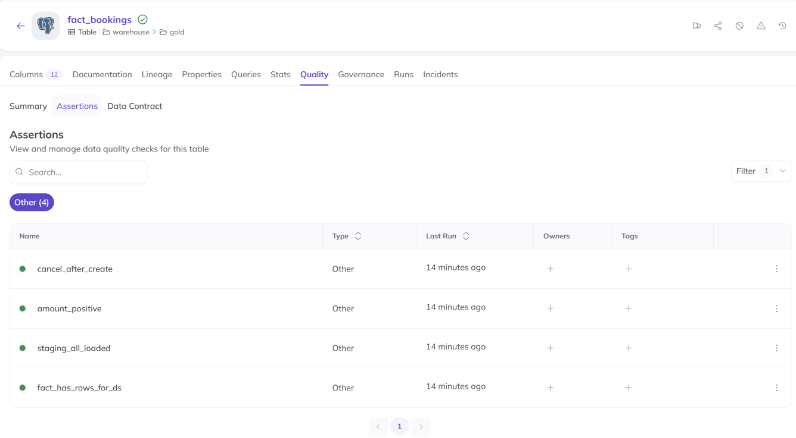

# Data pipeline orchestration

Ba pipeline DP1–DP3 chạy trên Airflow, mỗi pipeline gồm bước ingest và bước validate.

Mỗi mục ứng với một dòng của rubric, gồm phần **Thực thi** (đã làm gì, chạy ở đâu) và **Kết quả** (số liệu đo được,
ảnh chụp trong `docs/images/`). Mọi lần chạy dưới đây diễn ra trên GKE ngày 2026-11-18 (Airflow 2.10.5,
KubernetesExecutor, image `airflow-booking:b9cf9a8-1`), backfill ngày `ds` = 2025-01-01.

## Ingest stage · Pipeline to ingest raw data into bronze zone (DP1)

**Thực thi:** DP1 gồm DAG `dp1_ingest_bronze` (`check_landing` → ingest → validate) và `dp1_load_dims`. Bước ingest là
`SparkSubmitOperator` chạy trên Kubernetes, lấy image Spark từ Variable `spark_image`. Connection (`spark_default`,
`warehouse`, `minio_landing`, `datahub_rest_default`) và Variable (`spark_image`, `landing_start_date`) đặt trong
Airflow. Dữ liệu cũ được nạp bằng `airflow dags backfill`; DAG đặt `catchup=False` để không tự chạy 600 ngày khi bật.
`tests/test_dag_integrity.py` kiểm cấu trúc DAG trong image `apache/airflow:2.10.5`.

**Kết quả:** `dp1_load_dims` nạp 4 bảng dim. `dp1_ingest_bronze` chạy đủ 12 task (4 bảng × check → ingest → validate),
tất cả đều success.

## Validate stage · Pipeline to ingest raw data into bronze zone (DP1)

**Thực thi:** `validate_bronze` dùng Great Expectations 1.x (`governance/bronze_checks.py`, context ephemeral, chỉ đọc
các cột cần kiểm). `tests/test_bronze_checks.py` cho thấy landing của generator qua hết các kiểm tra, còn các lỗi cài
vào (giá âm, `quote_id` trùng, partition rỗng) đều bị bắt.

**Kết quả:** `validate_bookings` chạy Great Expectations trên từng shard Bronze (34/34 metric) rồi đẩy kết quả
`gx_bronze_bookings` lên DataHub. Cả 4 task `validate_*` đều success.

## Ingest stage · Pipeline to ingest data from bronze zone into silver and gol

**Thực thi:** DAG `dp2_bronze_to_gold` đợi DP1 cùng ngày bằng `ExternalTaskSensor`, rồi chạy lần lượt:

1. `silver_bookings` (Spark, chế độ `incr` theo `dt=ds`).
2. `stage_gold` (Spark ghi staging và `gold.hotel_rooms`).
3. `upsert_gold`: `sql/dp2_upsert_gold.sql` chạy trong một transaction, cập nhật `dim_customer`, `dim_hotel` SCD2 và
   `fact_bookings`; fact join theo khoảng hiệu lực của phiên bản dim.

Quotes (khoảng 15 tỷ dòng/năm) giữ ở lakehouse `silver.stg_quotes` (Iceberg, phân vùng theo ngày) thay vì đưa vào Gold
PostgreSQL, vì chưa có consumer nào cần quotes ở warehouse.

**Kết quả:** cả 5 task (`wait_dp1` → `silver_bookings` → `stage_gold` → `upsert_gold` → `validate_gold`) success trong
khoảng 4 phút. Sau lần chạy, Gold có `fact_bookings` 380.512 dòng cho ngày 2025-01-01 (không trùng `booking_id`, 6.425
dòng huỷ ngay trong ngày), `dim_hotel` 50.000 dòng, `dim_customer` 370.969 dòng và `hotel_rooms` 1,5 triệu dòng.

## Validate stage · Pipeline to ingest data from bronze zone into silver and gol

**Thực thi:** `validate_gold` gồm 5 kiểm tra SQL (`dags/gold_checks.py`); `tests/test_gold_sql.py` chạy các kiểm tra
này trên Postgres thật. Mỗi kiểm tra đẩy một `AssertionRunEvent` lên DataHub. Gold dùng SQL thay cho Great Expectations
vì dữ liệu đã nằm sẵn trong PostgreSQL.

**Kết quả:** log `validate_gold` cho thấy từng câu SQL kiểm tra, theo sau mỗi câu là một lần gửi kết quả lên DataHub.
Cả 5 kiểm tra đều đạt.

## Ingest stage · Pipeline to compute offline feature table (DP3)

**Thực thi:** DAG `dp3_offline_features` chạy `sql/dp3_features.sql`, upsert `feat_customer_booking_stats` và
`feat_hotel_demand` trực tiếp trên Gold trong một transaction. `event_timestamp` là cuối ngày `ds` chứ không phải giờ
máy, nhờ đó backfill sinh đủ lịch sử point-in-time cho training. Task validate phát Airflow Dataset để kích hoạt
materialize.

**Kết quả:** `wait_dp2` → `build_features` → `validate_features` success trong 55 giây. Ngày 2025-01-01 cho ra 370.969
dòng `feat_customer_booking_stats` và 46.655 dòng `feat_hotel_demand` (các khách sạn có booking trong cửa sổ 31 ngày).
`event_timestamp` bằng 2025-01-02 00:00, đúng thiết kế train/serve. Đầu ra là Airflow Dataset `feat_hotel_demand`, dùng
để kích hoạt DAG materialize của Feast.

## Validate stage · Pipeline to compute offline feature table (DP3)

**Thực thi:** `validate_features` kiểm ba điều: có dòng cho ngày `ds`, tỉ lệ nằm trong [0, 1], và
`event_timestamp` ≤ `created` (`dags/gold_checks.py`; `tests/test_gold_sql.py` chạy trên Postgres thật).

**Kết quả:** ba kiểm tra của `feat_hotel_demand` (`hotel_rows_for_ds`, `hotel_rate_in_0_1`, `event_before_created`) đều
đạt và hiện trên DataHub. `feat_customer_booking_stats` cũng có dấu đạt (ảnh lineage).

