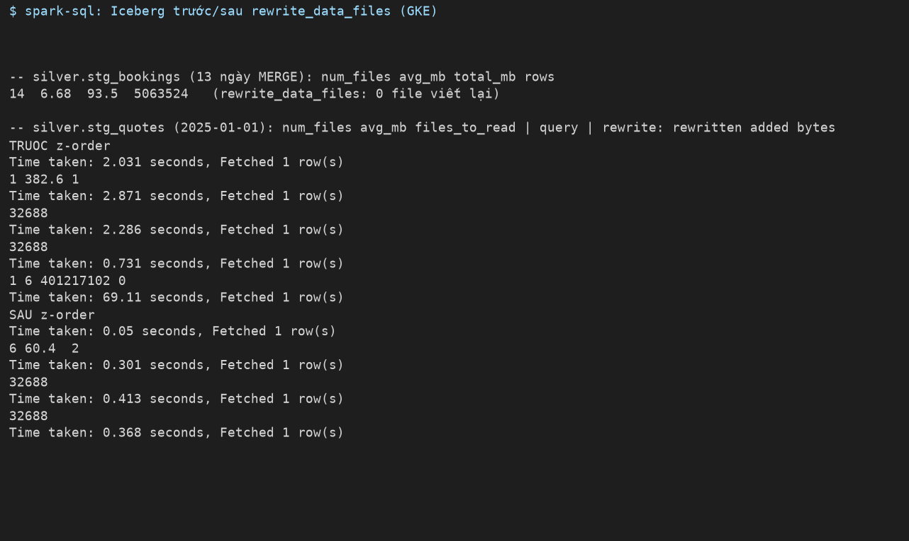

# Tối ưu lưu trữ

Lakehouse dùng Iceberg, data warehouse là tầng Gold trên PostgreSQL.

Mỗi mục dưới đây ứng với một dòng của rubric. Phần **Cách làm** mô tả giải pháp đã triển khai, đồng bộ từ
cột F của rubric. Phần **Kết quả** ghi test đã chạy, số liệu đo được hoặc ảnh chụp (`docs/images/`).

## Lakehouse

**Rubric:** edai-1 · dòng 20 · 3 điểm · nhóm *Data Storage* › *How to optimize your data storage*

> Lakehouse (ví dụ compaction để gom nhiều file nhỏ thành file lớn, z-order hoặc partitioning)

**Cần nộp (cả nhóm):** Document show đoạn code và phân tích đã optimize được những gì so với chưa optimize

**Cách làm:** [Đã có] `optimize.sql` gồm compaction (`rewrite_data_files`), sort order và expire snapshots. [Thiết kế] Catalog `lake` là Iceberg JDBC catalog đặt trên chính PostgreSQL, không thêm service. Đo trên GKE: Iceberg MERGE và write distribution hash đã giữ 1 file mỗi partition nên compaction không có gì để gom; z-order `stg_quotes` (1 × 382,6 MB → 6 × 60,4 MB) cho query khách sạn × ngày ở chỉ đọc 2/6 file, 0,73 → 0,37 s.

**Kết quả:** chạy phần lakehouse của `storage/optimize.sql` bằng `spark-sql` trên GKE (2026-11-18).

`silver.stg_bookings` sau 13 ngày MERGE của DP2: 14 file, trung bình 6,68 MB (5.063.524 dòng). MERGE của Iceberg (copy-on-write)
viết lại cả partition ngày mỗi lần chạy nên mỗi partition chỉ một file; `rewrite_data_files` không có gì để gom (0 file).
`silver.stg_quotes` ghi bằng `silver_quotes.py` một ngày (36.953.623 dòng) cũng chỉ ra 1 file 382,6 MB dù job chạy 1.500
partition shuffle: mặc định `write.distribution-mode = hash` của Iceberg gom dữ liệu theo partition trước khi ghi, nên
không sinh file nhỏ. Lợi ích đo được nằm ở z-order:

| `silver.stg_quotes` | Trước | Sau zorder(`hotel_id`, `stay_date`), file 64 MB |
|---|---|---|
| Số file | 1 × 382,6 MB | 6 × 60,4 MB |
| File phải đọc cho query 201 khách sạn × 2 tuần ngày ở (theo min/max trong metadata) | 1/1 (cả bảng) | 2/6 |
| Thời gian query (lần thứ hai) | 0,73 s | 0,37 s |
| Kết quả | 32.688 quotes | 32.688 quotes |

Z-order xếp các dòng gần nhau theo cả `hotel_id` lẫn `stay_date`, nên min/max của từng file hẹp lại và query lọc theo
khách sạn và ngày ở bỏ qua được 4/6 file; với dữ liệu cả năm (khoảng 105 GiB) số file bỏ qua tăng theo. `expire_snapshots`
dọn snapshot cũ hơn 7 ngày, mốc tính lúc chạy (`current_timestamp() - INTERVAL 7 DAYS`).

## Datawarehouse

**Rubric:** edai-1 · dòng 21 · 3 điểm · nhóm *Data Storage* › *How to optimize your data storage*

> Datawarehouse (ví dụ indexing)

**Cách làm:** [Đã có] `schema/gold_schema.sql` tạo index `fact_bookings(customer_key, booking_date)`, `(hotel_key, booking_date)`, `(checkin_date)`, `booking_risk(hotel_id, stay_date, scored_date)` và partial unique `dim_hotel(hotel_id) WHERE is_current`; các bảng `feat_*` dùng khoá chính (entity, `event_timestamp`). `storage/optimize.sql` thêm `(hotel_key, checkin_date)` và `dim_hotel(hotel_id, hotel_key)` cho query revenue management; trên GKE (4,66 triệu booking) `EXPLAIN ANALYZE` giảm từ 116,3 ms xuống 68,9 ms.

**Kết quả:** chạy phần data warehouse của `storage/optimize.sql` trên GKE (2026-11-18) sau backfill 13 ngày
(`gold.fact_bookings` 4,66 triệu dòng). Query dashboard revenue management: số đêm và doanh thu của một khách sạn theo
khoảng ngày nhận phòng (khách sạn 23059, đông nhất; nhận phòng 15/01–15/02).

| | Trước | Sau |
|---|---|---|
| Tìm phiên bản khách sạn | Seq Scan `dim_hotel` (bỏ 56.095 dòng), 5,65 ms | Index Only Scan `idx_dim_hotel_id`, 0,09 ms |
| Lọc `fact_bookings` | Bitmap Index Scan `(hotel_key, booking_date)` lấy 130.067 dòng, lọc `checkin_date` bỏ 45.826 | Bitmap Index Scan `idx_fact_bookings_hotel_checkin` lấy 91.010 dòng, chỉ còn lọc `status` |
| Thời gian thực thi | 116,3 ms | 68,9 ms (nhanh hơn 1,7 lần) |

Index composite đặt cột lọc bằng (`hotel_key`) trước, cột lọc khoảng (`checkin_date`) sau, nên Postgres lấy đúng các
dòng trong khoảng ngày nhận phòng thay vì mọi booking của khách sạn. Đo với `max_parallel_workers_per_gather = 0` ở cả
hai lần: `/dev/shm` 64MB mặc định của pod Postgres không đủ cho query song song trên bảng lớn.

