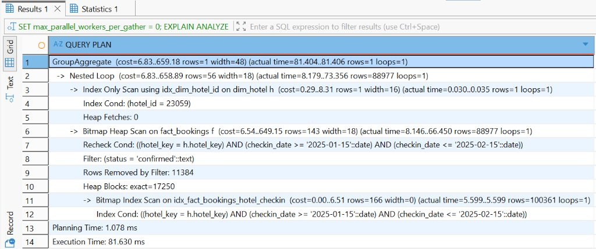

# Tối ưu lưu trữ

Lakehouse dùng Iceberg, data warehouse là tầng Gold trên PostgreSQL.

## Lưu trữ Lakehouse (Iceberg)

`storage/optimize.sql` gồm compaction (`rewrite_data_files`), sort order và expire snapshots. Catalog
`lake` là Iceberg JDBC catalog đặt trên chính PostgreSQL, không cần thêm service. Phần lakehouse của script chạy bằng
`spark-sql` trên GKE.

Compaction không có file nhỏ để gom, vì cách ghi của Iceberg đã giữ mỗi partition một file:

- `silver.stg_bookings` sau 13 ngày MERGE của DP2 có 14 file, trung bình 6,68 MB (5.063.524 dòng). MERGE của Iceberg
  (copy-on-write) viết lại cả partition ngày mỗi lần chạy, nên mỗi partition chỉ có một file và `rewrite_data_files`
  gom được 0 file.
- `silver.stg_quotes` do `silver_quotes.py` ghi cho một ngày (36.953.623 dòng) cũng chỉ ra 1 file 382,6 MB, dù job dùng
  1.500 partition shuffle. Mặc định `write.distribution-mode = hash` của Iceberg gom dữ liệu theo partition trước khi
  ghi, nên không sinh file nhỏ.

Lợi ích đo được nằm ở z-order:

| `silver.stg_quotes` | Trước | Sau zorder(`hotel_id`, `stay_date`), file 64 MB |
|---|---|---|
| Số file | 1 × 382,6 MB | 6 × 60,4 MB |
| File phải đọc cho query 201 khách sạn × 2 tuần ngày ở (theo min/max trong metadata) | 1/1 (cả bảng) | 2/6 |
| Thời gian query (lần thứ hai) | 0,73 s | 0,37 s |
| Kết quả | 32.688 quotes | 32.688 quotes |

Z-order xếp các dòng gần nhau theo cả `hotel_id` lẫn `stay_date`, nên khoảng min/max của từng file hẹp lại. Nhờ đó,
query lọc theo khách sạn và ngày ở bỏ qua được 4/6 file. Với dữ liệu cả năm (khoảng 105 GiB), số file bỏ qua được sẽ tăng
theo. `expire_snapshots` dọn các snapshot cũ hơn 7 ngày, với mốc tính lúc chạy (`current_timestamp() - INTERVAL 7 DAYS`).

## Lưu trữ Data Warehouse (PostgreSQL Gold)

`schema/gold_schema.sql` tạo các index `fact_bookings(customer_key, booking_date)`,
`(hotel_key, booking_date)`, `(checkin_date)`, `booking_risk(hotel_id, stay_date, scored_date)` và partial unique index
`dim_hotel(hotel_id) WHERE is_current`. Các bảng `feat_*` dùng khoá chính (entity, `event_timestamp`).
`storage/optimize.sql` thêm `(hotel_key, checkin_date)` và `dim_hotel(hotel_id, hotel_key)` cho query revenue
management. Phần data warehouse của script chạy trên GKE, sau backfill 13 ngày (`gold.fact_bookings`
4,66 triệu dòng).

Query đo là query của dashboard revenue management: số đêm và doanh thu của một khách sạn theo khoảng ngày
nhận phòng (khách sạn 23059, đông nhất; nhận phòng 15/01–15/02).

| | Trước | Sau |
|---|---|---|
| Tìm phiên bản khách sạn | Seq Scan `dim_hotel` (bỏ 56.095 dòng), 5,65 ms | Index Only Scan `idx_dim_hotel_id`, 0,035 ms |
| Lọc `fact_bookings` | Bitmap Index Scan `(hotel_key, booking_date)` lấy 130.067 dòng, lọc `checkin_date` bỏ 45.826 | Bitmap Index Scan `idx_fact_bookings_hotel_checkin` lấy 100.361 dòng, chỉ còn lọc `status` (loại 11.384 dòng) |
| Thời gian thực thi | 116,3 ms | 81,6 ms (nhanh hơn 1,4 lần) |

Index composite đặt cột lọc bằng (`hotel_key`) trước và cột lọc khoảng (`checkin_date`) sau. Nhờ vậy, Postgres lấy
đúng các dòng trong khoảng ngày nhận phòng thay vì mọi booking của khách sạn. Cả hai lần đo đều đặt
`max_parallel_workers_per_gather = 0`, vì `/dev/shm` 64MB mặc định của pod Postgres không đủ cho query song song trên
bảng lớn.

