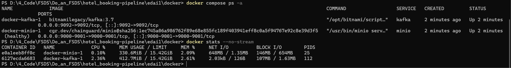
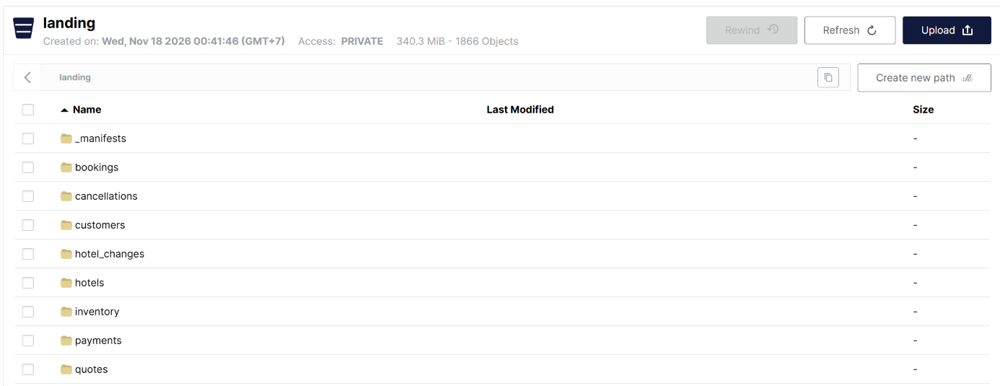

# Docker & Docker Compose

Các thành phần của data platform được đóng gói thành image và tối ưu kích thước.

<a id="edai-1-3"></a>
## Đóng gói và chạy dịch vụ bằng Docker & Docker Compose

`edai1/docker/docker-compose.yml` dựng môi trường cục bộ gồm MinIO (có healthcheck), Kafka,
offline-generator và event-replayer. Spark, Flink, Airflow, Postgres và DataHub không nằm trong compose vì chạy trên GKE
(Helm hoặc operator). Image Spark, Flink, Airflow build từ `k8s/*.Dockerfile`; Postgres và DataHub dùng image chính thức.

Compose chạy trên máy. MinIO (healthy) và Kafka chạy nền. Generator chạy qua compose với
1 ngày (`docker compose run --rm offline-generator 0 1`), ghi 340 MiB, 1.866 object vào bucket `landing`, đủ 9 nhánh
(bảng sự kiện theo `dt=`, các bảng dims, `_manifests`). Bản đầy đủ `0 395` sinh khoảng 111 GB và đã chạy trên GKE
(mục Store data). Image của generator và replayer build từ `docker/Dockerfile` (mục dưới).



*Chú thích: Kết quả `docker compose ps` cho thấy MinIO (đã pass healthcheck `healthy`) và Kafka đang chạy nền ổn định, sẵn sàng phục vụ generator và replayer.*



*Chú thích: Giao diện MinIO Console hiển thị bucket `landing` sau khi chạy thử 1 ngày (`0 1`): đã ghi đủ 340 MiB (1.866 object) cho cả 9 nhánh dữ liệu và `_manifests`.*

<a id="edai-1-4"></a>
## Tối ưu kích thước Dockerfile (Multi-stage build)

`docker/Dockerfile` dùng multistage (builder và runtime trên `python:3.12-slim`). `docker/Dockerfile.single`
là bản một stage để so sánh. Repo có thêm `.dockerignore` và `requirements.txt` ghim version. Hai bản build lại từ cùng
mã nguồn (Docker Desktop 29.6).

| | `Dockerfile.single` | `Dockerfile` (multistage) | Thay đổi |
|---|---|---|---|
| Image gốc | `python:3.12` (Debian đầy đủ) | builder và runtime đều `python:3.12-slim` | |
| Kích thước trên đĩa (`docker images`) | 2,09 GB | 834 MB | −60% |
| Kích thước nén khi push/pull (`docker image inspect.Size`) | 524 MB | 240 MB | −54% |
| Có gcc trong image | có (`/usr/bin/gcc`) | không | |
| User chạy container | `root` | `appuser` | |

Mức giảm đến từ sáu bước tối ưu:

1. Đổi image gốc sang `slim`, bỏ phần lớn thư viện hệ thống không dùng.
2. Multistage: compiler (`build-essential`) chỉ có ở stage builder để build wheel; stage runtime chỉ cài wheel đã build
   rồi xoá.
3. Dùng `--no-cache-dir` và xoá `/var/lib/apt/lists` để layer không giữ cache.
4. Chép `requirements.txt` trước mã nguồn, nhờ đó sửa code không làm build lại layer cài thư viện.
5. `.dockerignore` loại `.git`, test, cache Python, file Parquet và `.env` khỏi build context.
6. Chạy bằng user thường thay vì root.

Lệnh tái lập (từ thư mục `edai1`):

```bash
docker build -f docker/Dockerfile.single -t booking-generator:single .
docker build -f docker/Dockerfile -t booking-generator:multistage .
docker images booking-generator
```


*Chú thích: So sánh trực tiếp `docker images` giữa `Dockerfile.single` (2,09 GB trên đĩa, 524 MB nén) và `Dockerfile` multi-stage (834 MB trên đĩa, 240 MB nén — giảm 60% dung lượng).*
