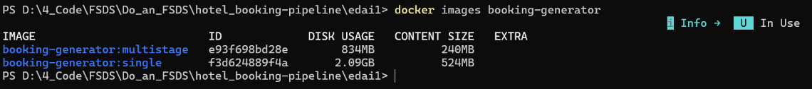

# Docker & Docker Compose

Các thành phần của data platform được đóng gói thành image và tối ưu kích thước.

Mỗi mục dưới đây ứng với một dòng của rubric. Phần **Cách làm** mô tả giải pháp đã triển khai, đồng bộ từ
cột F của rubric. Phần **Kết quả** ghi test đã chạy, số liệu đo được hoặc ảnh chụp (`docs/images/`).

<a id="edai-1-3"></a>
## Có sử dụng Docker & Docker Compose

**Rubric:** edai-1 · dòng 3 · 2 điểm · nhóm *Engineering Fundamentals* › *Docker & Docker Compose*

**Cần nộp (cả nhóm):** Document cách optimizer Docker image, và kích thước sau khi optimize so với cái gốc thay đổi như nào

**Cách làm:** [Đã có] `docker-compose` khởi chạy MinIO, Kafka, generator và replayer. [Cần làm] bổ sung Spark, Flink, Airflow, Postgres, DataHub vào compose; chụp `docker compose ps` với mọi service ở trạng thái healthy, đưa vào `docs/edai-1/docker.md`.

**Kết quả:** chạy `edai1/docker/docker-compose.yml` trên máy (2026-11-18): MinIO (healthy) và Kafka chạy nền, generator
chạy qua compose với 1 ngày (`docker compose run --rm offline-generator 0 1`) ghi 340 MiB, 1.866 object vào
bucket `landing` đủ 9 nhánh (bảng sự kiện theo `dt=`, các bảng dims, `_manifests`). Bản đầy đủ `0 395` sinh khoảng
111 GB, đã chạy trên GKE (mục Store data). Image của generator và replayer build từ `docker/Dockerfile` (mục dưới).


<a id="edai-1-4"></a>
## Optimize Dockerfile

**Rubric:** edai-1 · dòng 4 · 3 điểm · nhóm *Engineering Fundamentals* › *Docker & Docker Compose*

> Optimize Dockerfile (ví dụ multistage build)

**Cách làm:** [Đã có] `docker/Dockerfile` dùng multistage (builder và runtime trên `python:3.12-slim`), kèm `docker/Dockerfile.single` một stage để so sánh, `.dockerignore` và `requirements.txt` ghim version. Đo cục bộ bằng `docker images`: bản một stage nặng 2,09GB, bản multistage 834MB. [Cần làm] ghi bảng so sánh vào `docs/edai-1/docker.md`.

**Kết quả:** build lại cả hai bản từ cùng mã nguồn (2026-11-18, Docker Desktop 29.6):

| | `Dockerfile.single` | `Dockerfile` (multistage) | Thay đổi |
|---|---|---|---|
| Image gốc | `python:3.12` (Debian đầy đủ) | builder và runtime đều `python:3.12-slim` | |
| Kích thước trên đĩa (`docker images`) | 2,09 GB | 834 MB | −60% |
| Kích thước nén khi push/pull (`docker image inspect .Size`) | 524 MB | 240 MB | −54% |
| Có gcc trong image | có (`/usr/bin/gcc`) | không | |
| User chạy container | `root` | `appuser` | |

Các bước tối ưu: (1) đổi image gốc sang `slim`, bỏ phần lớn thư viện hệ thống không dùng; (2) multistage: compiler
(`build-essential`) chỉ có ở stage builder để build wheel, stage runtime chỉ cài wheel đã build rồi xoá; (3)
`--no-cache-dir` và xoá `/var/lib/apt/lists` để không giữ cache trong layer; (4) chép `requirements.txt` trước mã nguồn
để sửa code không làm build lại layer cài thư viện; (5) `.dockerignore` loại `.git`, test, cache Python, file Parquet và `.env` khỏi build context;
(6) chạy bằng user thường thay vì root.

Lệnh tái lập (từ thư mục `edai1`):

```bash
docker build -f docker/Dockerfile.single -t booking-generator:single .
docker build -f docker/Dockerfile -t booking-generator:multistage .
docker images booking-generator
```


