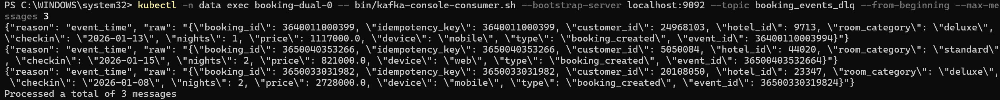
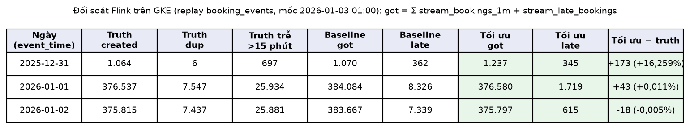

# Novel ideas (edai-1)

Mỗi ý tưởng gồm phần **Thực thi** (vấn đề và cách giải quyết đã cài đặt) và **Kết quả** (minh chứng đã chạy, ảnh chụp
trong `docs/images/`).

## Idea 1 (edai-1): Data contract + DLQ có lỗi cài sẵn

**Thực thi:** contract viết bằng JSON Schema (`schema/contracts/booking_event.json`), không dùng Schema Registry.
Generator thêm 0,5% bản sao lỗi (giá âm, `hotel_id` = 0, thiếu `event_time`) và gắn nhãn `violation` trong event log.
`ContractCheck` của Flink chuyển event sai sang topic `booking_events_dlq`, kèm `reason` là trường vi phạm. Contract chạy
trước bước gán watermark, nên event có `event_time` sai không kịp kéo watermark lên và làm các event đúng bị coi là trễ.

**Kết quả:** `tests/test_stream_e2e.py` chạy cục bộ trên Docker chuỗi replayer → Kafka → Flink → Postgres cho một ngày
replay. Số event trên `booking_events_dlq` theo từng `reason` (price, hotel_id, event_time) khớp đúng số bản lỗi
generator đã cài. `tests/test_stream_gen.py` cho thấy contract bắt được mọi bản lỗi và không chặn event hợp lệ.

Trên GKE (2026-11-17/18), cùng job Flink đẩy event vi phạm vào topic `booking_events_dlq`; mỗi message giữ nguyên event
gốc kèm `reason` là trường vi phạm (ảnh dưới đọc bằng `kafka-console-consumer`).

## Idea 2 (edai-1): Đối soát batch–stream có ground truth

**Thực thi:** generator biết chính xác mọi event, nên với mỗi phút, `sum(gold.stream_bookings_1m)` (nhánh tumbling
1 phút) cộng `count(gold.stream_late_bookings)` (side output) phải bằng số booking hợp lệ, đã khử trùng theo
`idempotency_key`, có `event_time` trong phút đó. `tests/test_stream_e2e.py` chạy replayer → Kafka → Flink (image
`k8s/flink.Dockerfile`) → Postgres trên Docker; `tests/test_stream_gen.py` kiểm tính bất biến stream = landing. Trên GKE
(2026-11-18), phép đối soát chạy theo ngày, so baseline và bản tối ưu với ground truth của generator
(`generator/stream_truth.py`).

**Kết quả:** trên Docker, với mọi phút đã đóng (919 phút), `stream_bookings_1m` cộng `stream_late_bookings` khớp đúng
số booking do generator sinh; không phút nào lệch.

Trên GKE, bản tối ưu khớp truth tới 0,011% (ngày 01-01) và 0,005% (ngày 01-02), còn baseline thừa đúng số bản gửi trùng.
Nhờ có truth, phép đối soát chỉ ra đúng lỗi nào nằm ở đâu: phần thừa của baseline bằng `dup`, còn phần lệch nhỏ của bản
tối ưu khớp với các lần restart (dòng 18).

