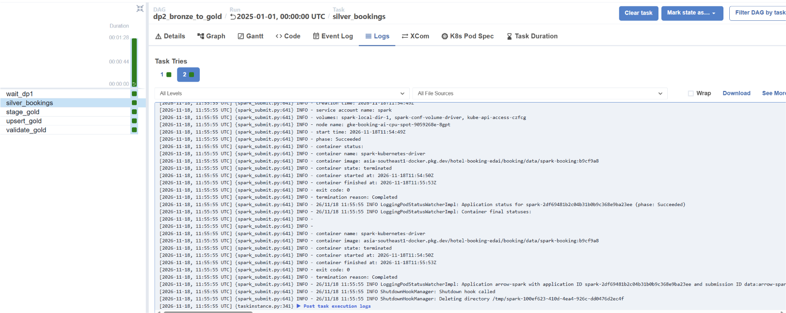
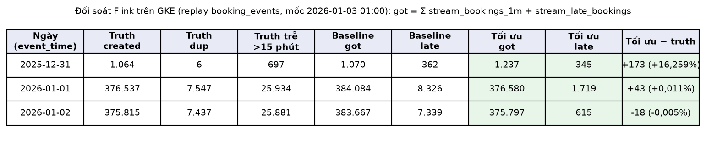
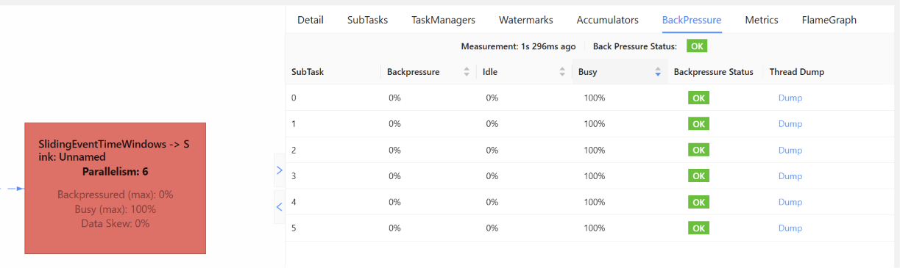

# Processing jobs: Spark & Flink

Các job đi từ bản baseline tới bản tối ưu; hiệu năng được đo bằng Spark UI và Flink UI.

<a id="edai-1-11"></a>
## Spark Job (Baseline) · Xử lý dữ liệu offline

Bản baseline của `silver_quotes` (`silver_quotes.py hotel_baseline`) join `quotes ⋈ hotels` theo `hotel_id`, tắt AQE và tắt broadcast. Job chạy trên GKE với các thông số sau:

- **Dữ liệu đầu vào:**
  - Bảng `quotes` đầy đủ 395 ngày (**104,7 GiB**, khoảng **13,3 tỷ dòng** trong `6.320` file Parquet), đọc trực tiếp từ `s3a://landing/quotes`.
  - Bảng danh mục khách sạn `raw_hotels` (**50.000 dòng**).
- **Hạ tầng chạy (GKE):** 6 máy ảo Spot (`n2-standard-8`, tổng 6 executor × 6 core × 18 GB RAM), gắn Local SSD để chứa dữ liệu tạm khi shuffle.
- **Cấu hình Spark:** chia thành `1.500` partition khi join (`spark.sql.shuffle.partitions = 1500`) và dùng `sink = noop` (không ghi kết quả ra đĩa để đo thuần tốc độ xử lý join, tránh thời gian ghi lên MinIO làm nhiễu phép so sánh).
- **Đo:** số liệu trong bảng rút từ event log Spark trên MinIO bằng `spark_jobs/event_log_stats.py`.

Khi join `quotes ⋈ hotels` chỉ theo `hotel_id` (`hotel_baseline`), lệch phân phối (Zipf `a = 0,8`, khách sạn có nhiều lượt xem nhất chiếm khoảng 2,6% lượt xem) dồn **348.457.885 dòng, 9,78 GB vào một partition, gấp 47 lần trung vị** (6,7 triệu dòng, 212 MB). Một task straggler chạy tới **357,7 s** (trong khi trung vị chỉ **5,5 s**), gây spill **119,9 GB**; cả ứng dụng mất **1.084 s**.

<a id="edai-1-12"></a>
## Xử lý lệch phân phối (Data Skew) trong Spark

Trên cùng cluster và dữ liệu, `silver_quotes` so sánh 3 chế độ join `quotes ⋈ hotels` theo `hotel_id` (`hotel_baseline`, `hotel_aqe`, `hotel_broadcast`).

| Bài | Chế độ | Ứng dụng | Stage join: task | Task max / trung vị | Partition lớn nhất | Spill |
|---|---|---|---|---|---|---|
| Khoá `hotel_id` (⋈ hotels) | `hotel_baseline` | 1.084 s | 1.500 | **357,7 / 5,5 s** | 9,78 GB, 47 × | 119,9 GB |
| | `hotel_aqe` | 815 s | 1.712 | 41,7 / 5,5 s | 1,02 GB, 5 × | 72,4 GB |
| | `hotel_broadcast` | **345 s** | không shuffle | — | — | 0 |

Các bước phân tích và tối ưu:

1. **Tìm skew ở mức partition (`hotel_baseline`).** Join theo `hotel_id` dồn khách sạn nóng nhất vào một partition 9,78 GB. Một task chạy gần 6 phút (357,7 s) trong khi các task khác chỉ vài giây (trung vị 5,5 s), và cả stage chỉ xong khi task đó xong.
2. **AQE skew join (`hotel_aqe`).** AQE phát hiện partition lớn hơn 5 × trung vị và > 256 MB, tự động tách thành nhiều phần và nhân bản phía `hotels` tương ứng. Số task tăng từ 1.500 lên 1.712, partition lớn nhất còn 1,02 GB (5 × trung vị), task chậm nhất giảm từ 357,7 s xuống 41,7 s, và cả ứng dụng nhanh hơn 25% (815 s).
3. **Broadcast (`hotel_broadcast`).** Bảng `hotels` chỉ có 50.000 dòng nên được gửi nguyên bảng tới mọi executor, và `quotes` không phải shuffle. Không còn partition lệch, spill về 0, ứng dụng chỉ còn 345 s (nhanh hơn baseline 68%). Đây là cách rẻ nhất khi phía nhỏ đủ nhỏ.

<a id="edai-1-13"></a>
## Xử lý thay đổi lược đồ (Schema Evolution) trong Spark

Từ mốc `2025-07-01`, schema bảng `bookings` chuyển từ **v1** sang **v2** (đổi tên cột `room_type` → `room_category` và thêm cột mới `channel`):

- **Cách xử lý (`silver_bookings.py`):** hàm `read_bookings` bật `mergeSchema` khi đọc Parquet và gộp hai cột bằng `coalesce(room_category, room_type)` để đưa toàn bộ dữ liệu về cùng một lược đồ.
- **Kiểm thử cục bộ:** `tests/test_silver_bookings.py` chạy PySpark trên dữ liệu qua mốc `2025-07-01` để xác minh không mất dòng.
- **Kiểm chứng trên dữ liệu thật (GKE):** job `spark_jobs/bookings_quality.py` (dùng đúng `read_bookings` và `dedup_bookings`) chạy 6 luồng CPU ngay trong 1 pod `bookings-quality` (mất **6 phút 10 giây**) trên toàn bộ `s3a://landing/bookings` (**395 ngày**, `6.320` file, **3,5 GiB**).

| Phiên bản (theo `dt`) | Số dòng | `room_type` có giá trị | `room_category` có giá trị | `channel` có giá trị |
|---|---|---|---|---|
| v1 (trước 2025-07-01) | 70.855.735 | 70.855.735 | 0 | 0 |
| v2 (từ 2025-07-01) | 81.982.006 | 0 | 81.982.006 | 81.982.006 |

Sau `read_bookings`, `room_category` không null ở dòng nào của cả hai phiên bản và không mất dòng nào. `channel` chỉ
null ở 70.855.735 dòng v1, vì đây là cột mới của v2 mà dữ liệu cũ không có. Test cục bộ cho kết quả tương tự.


*Chú thích: Output pod `bookings-quality` trên toàn bộ `395` ngày `landing/bookings` (`152.837.741` dòng): xác nhận `read_bookings` gộp sạch schema v1/v2 (`room_category` không null) và `dedup_bookings` loại đúng `2.998.388` bản gửi trùng (1,962%).*

<a id="edai-1-14"></a>
## Xử lý các lỗi dữ liệu offline khác (trùng lặp, ép kiểu, giá trị âm)

`dedup_bookings` khử trùng theo `idempotency_key` bằng `row_number` sắp theo `created_at`.
`tests/test_silver_bookings.py` kiểm tra cục bộ rằng mỗi `idempotency_key` còn một dòng và `status` khớp kết cục do
generator sinh. Trên dữ liệu thật, phép đo dùng cùng lần chạy `spark_jobs/bookings_quality.py` ở mục schema evolution.

| | Số dòng |
|---|---|
| Bookings trên landing | 152.837.741 |
| `idempotency_key` khác nhau | 149.839.353 |
| Sau `dedup_bookings` | 149.839.353 |
| Bản gửi trùng bị bỏ | 2.998.388 (1,962%; config 2%) |

Sau dedup, số dòng bằng đúng số `idempotency_key` khác nhau: mỗi lần đặt còn đúng một dòng (dòng có `created_at`
nhỏ nhất). Ảnh output ở mục schema evolution.

<a id="edai-1-15"></a>
## Tích hợp Spark Job vào Airflow Pipeline (DP2)

Trên GKE, DAG `dp2_bronze_to_gold` xử lý dữ liệu theo từng ngày. Đầu tiên, task `silver_bookings` đẩy job Spark lên Kubernetes để đọc dữ liệu của ngày và gộp vào bảng Iceberg ở tầng Silver (đã đối chiếu khớp với chạy toàn bảng trong `tests/test_silver_bookings.py`). Khi pod Spark chạy xong (`exit code: 0`), `stage_gold` và `upsert_gold` tiếp tục đẩy dữ liệu lên tầng Gold qua JDBC/SQL; toàn bộ log được lưu trên MinIO (`s3://lake/airflow-logs`) để xem trực tiếp trên Airflow UI.




*Chú thích: Log Airflow của task `silver_bookings` lưu trên MinIO: cho thấy job Spark chạy trên Kubernetes và kết thúc thành công (`exit code: 0`).*

<a id="edai-1-16"></a>
## Flink Job (Baseline) · Xử lý dữ liệu streaming

Bản baseline chạy Flink với watermark 0 giây và không khử trùng. Cả bản baseline và bản tối ưu đều chạy trên GKE (6 luồng song song) trên cùng luồng dữ liệu `booking_events` (30 ngày qua Kafka, 6 partition). Trước mỗi lần chạy, 3 bảng kết quả stream được xoá sạch để job đọc lại dữ liệu từ đầu.

Cách đối soát: `got` của một ngày bằng tổng `gold.stream_bookings_1m` cộng số dòng `gold.stream_late_bookings` có
`event_time` trong ngày. Truth là số booking hợp lệ đã khử trùng, do `generator/stream_truth.py` tính từ event log và
cắt tại 2026-01-03 01:00.



*Chú thích: Bảng đối soát theo ngày giữa Flink Baseline, Flink Tối ưu và Ground Truth (`stream_truth.py`): Baseline đếm thừa đúng số bản trùng (`+7.547` ngày 01-01), còn bản tối ưu chỉ lệch `0,011%` và `0,005%`.*

Baseline cho thấy hai vấn đề:

- **Đếm thừa.** Ngày 2026-01-01, baseline đếm 384.084 trong khi truth là 376.537. Phần thừa đúng bằng 7.547, tức số
  bản gửi trùng (double submit cùng `idempotency_key`) mà generator cài vào. Ngày 2026-01-02 thừa 7.852, so với 7.437
  bản trùng.
- **Coi event lệch thứ tự là trễ.** Do không chờ event đến lệch thứ tự, 8.326 booking của ngày 01-01 (2,2%) bị đẩy ra
  side output thay vì vào đúng cửa sổ phút.

Các bước tối ưu, mỗi bước xử lý một vấn đề:

1. **Parallelism bằng số partition Kafka (6).** Timestamp được gán sau source. Nếu một subtask đọc nhiều partition,
   watermark chạy theo partition nhanh nhất và event của partition chậm thành trễ giả (đo với parallelism 2: 2.409
   event trễ giả).
2. **Watermark lệch 10 phút và allowed lateness 5 phút**: số event bị đẩy ra side output ngày 01-01 giảm từ
   8.326 xuống 1.719.
3. **Khử trùng theo `idempotency_key`** trước cửa sổ: phần đếm thừa giảm từ 7.547 còn 43 (0,011%).
4. **Kiểm data contract trước watermark:** event sai (`event_time` ở tương lai) vào DLQ trước khi kịp đẩy watermark.
5. **Đếm tăng dần bằng `AggregateFunction`:** state mỗi cửa sổ là một số nguyên thay vì danh sách event.
6. **Unaligned checkpoint và chặn autoscaler gỡ pod Flink.** Khi đọc dồn backlog, barrier aligned kẹt sau buffer đầy nên
   checkpoint không hoàn tất, và mỗi lần restart mất toàn bộ tiến độ.

Flink UI lúc đọc dồn backlog cho thấy source bị backpressure, còn `SlidingEventTimeWindows` bận 100% ở cả 6 subtask.
Mỗi event vào 12 cửa sổ chồng nhau và được xử lý bằng Python, nên đây là nút cổ chai (ảnh BackPressure). Watermark của
6 subtask bằng nhau, vì sau `key_by` mỗi subtask nhận watermark nhỏ nhất của các subtask phía trước.


*Chú thích: Flink Job Graph của `booking_events_window`: thể hiện rõ luồng đọc Kafka → `ContractCheck` (rẽ nhánh DLQ) → gán watermark → `DedupByEventId` → chia 2 nhánh cửa sổ trượt 1h và tumbling 1m.*



*Chú thích: Ảnh BackPressure trên Flink UI khi job đọc dồn backlog từ đầu topic: `Source` bị backpressure (màu đỏ/cam) còn toán tử cửa sổ Python `SlidingEventTimeWindows` bận `100%` ở cả 6 subtask.*


*Chú thích: Trạng thái offset của 6 partition trên Kafka topic `booking_events` để đối chiếu tốc độ tiêu thụ đồng đều với 6 subtask Flink.*

Để job chạy được trên Kubernetes, nhóm đã sửa các lỗi sau:

- Jar connector tải bằng `ADD` có quyền 600 nên user `flink` không đọc được; sửa bằng `--chmod=644`.
- Python worker trên TaskManager không thấy module `contract`; sửa bằng `-pyfs /opt/flink/usrlib`.
- Sau khi thêm `-pyfs`, đường dẫn tương đối tới JSON Schema bị sai; sửa bằng `CONTRACT_PATH`.
- `on_timer` của bước khử trùng trả `None`, làm task lỗi khi timer dọn state kích hoạt (PyFlink cần iterable).
- Autoscaler GKE gỡ JobManager khi thu hồi node spot.

<a id="edai-1-17"></a>
## Xử lý dữ liệu đến trễ (Watermark & Side Output) trong Flink

Nhánh đối soát tumbling 1 phút dùng watermark 10 phút, allowed lateness 5 phút và side output ghi vào
`gold.stream_late_bookings`. Cửa sổ trượt 1 giờ chỉ đẩy event ra side output khi trễ quá 1 giờ 15 phút. Test e2e trên Docker xác nhận số đếm cộng side output bằng tổng thật của từng phút. Số liệu dưới đây lấy từ cùng
lần chạy với baseline Flink.

Số event bị đẩy ra side output (`late`) theo ngày:

| Ngày | Baseline (watermark 0s) | Tối ưu (10 phút + 5 phút) | Truth: trễ > 15 phút theo `ingest_time − event_time` |
|---|---|---|---|
| 2026-01-01 | 8.326 | 1.719 | 25.934 |
| 2026-01-02 | 7.339 | 615 | 25.881 |

Watermark 10 phút cộng allowed lateness 5 phút nhận lại các event trễ tới 15 phút. Mốc này dựa trên bảng độ trễ trong
`data_generator.md`: phần lớn event mobile trễ 5–20 phút (20,09% trễ quá 10 phút, 10,03% trễ quá 15 phút), còn webhook thanh toán trễ
tối đa 15 phút. Chờ lâu hơn sẽ làm feature `bookings_1h` chậm thêm tương ứng. Nếu chờ 1–4 giờ cho channel manager (1%
booking), feature không còn "realtime"; vì vậy các event đó đi vào side output và vẫn được ghi lại để đối soát.

Số event vào side output của bản tối ưu thấp hơn nhiều so với số trễ quá 15 phút theo giờ ingest (truth). Lý do là job
đọc dồn backlog từ đầu topic: 6 partition được đọc với tốc độ khác nhau, và watermark sau `key_by` là watermark nhỏ
nhất. Do đó, khi một event trễ tới, watermark thường chưa vượt qua cửa sổ của nó. Khi job chạy kịp tốc độ replay, số
`late` sẽ tiến về con số truth. Bảng `stream_late_bookings` không lưu nguồn (channel) của event, nên chưa tách được số
trễ theo từng nguồn.


*Chú thích: Tab Watermarks của 6 subtask trên Flink UI: cả 6 subtask sau `key_by` có giá trị watermark đồng bộ bằng nhau (lấy theo watermark nhỏ nhất phía trước).*


*Chú thích: Dữ liệu thực tế trong bảng `gold.stream_late_bookings` trên PostgreSQL: lưu lại các booking trễ quá watermark 10 phút + allowed lateness 5 phút từ side output.*

<a id="edai-1-18"></a>
## Xử lý event trùng lặp trong Flink

`DedupByEventId` khử trùng theo `idempotency_key`. Hàm giữ một cờ `seen` cho mỗi khoá và đăng ký timer
xoá cờ khi watermark vượt `event_time` + 5 giờ, nên state không tăng mãi. Data contract chặn event sai trước watermark:
event thiếu `event_time` vào topic `booking_events_dlq` kèm `reason`. Số liệu lấy từ cùng lần chạy với baseline Flink.

| Ngày | Bản gửi trùng (truth) | Baseline thừa | Tối ưu thừa |
|---|---|---|---|
| 2026-01-01 | 7.547 | +7.547 | +43 |
| 2026-01-02 | 7.437 | +7.852 | −18 |

Baseline đếm cả bản gửi lại, nên phần thừa bằng đúng số bản trùng. Bản tối ưu chỉ còn lệch 0,011% và 0,005%. Phần lệch
nhỏ còn lại do job restart 3 lần trong lúc chạy (lỗi timer, autoscaler gỡ JobManager, apply cấu hình). Sink JDBC là
at-least-once, nên event đã ghi vào `stream_late_bookings` trước restart có thể được đếm lại trong cửa sổ khi job đọc
lại từ checkpoint với watermark khác. Ngày 2025-12-31 là biên đầu của replay (+173).

Checkpoint unaligned EXACTLY_ONCE lên MinIO hoàn tất đều đặn: khoảng 1 phút một lần, 20,2 MB, cả 5 operator đều 6/6.


*Chú thích: Tab Checkpoints trên Flink UI: checkpoint chế độ `UNALIGNED / EXACTLY_ONCE` hoàn tất đều đặn mỗi ~1 phút (`~20,2 MB`), đủ `6/6` subtask ở cả 5 operator.*

<a id="edai-1-19"></a>
## Tổng hợp theo cửa sổ trượt (Sliding Window) trong Flink

Đoạn code window trong `edai1/flink_jobs/booking_events_window.py` (hàm `main`):

```python
wm = WatermarkStrategy.for_bounded_out_of_orderness(MAX_OUT_OF_ORDER).with_timestamp_assigner(EventTimeAssigner())
events = checked.assign_timestamps_and_watermarks(wm) # event time = event_time, watermark lùi 10 phút

created = events.filter(lambda e: e["type"] == "booking_created")
created = created.key_by(lambda e: e["idempotency_key"], key_type=Types.LONG()) \
                 .process(DedupByEventId(), EVENT) # double submit chỉ đếm 1 lần (BASELINE=1 bỏ bước này)
by_hotel = created.key_by(lambda e: e["hotel_id"], key_type=Types.LONG())

# (1) feature: số booking 1 giờ gần nhất của mỗi khách sạn, cập nhật mỗi 5 phút
(by_hotel.window(SlidingEventTimeWindows.of(Time.hours(1), Time.minutes(5)))
 .allowed_lateness(ALLOWED_LATENESS_MS)
 .aggregate(CountAgg(), WithWindowEnd(), accumulator_type=Types.LONG(), output_type=FEAT_ROW)
 .add_sink(jdbc_sink(UPSERT_SQL, FEAT_ROW))) # -> gold.feat_hotel_realtime

# (2) đối soát: số booking từng phút, event trễ quá hạn ra side output thay vì bị bỏ
minutes = (by_hotel.window(TumblingEventTimeWindows.of(Time.minutes(1)))
           .allowed_lateness(ALLOWED_LATENESS_MS)
           .side_output_late_data(LATE_TAG)
           .aggregate(CountAgg(), WithWindowEnd(), accumulator_type=Types.LONG(), output_type=FEAT_ROW))
minutes.add_sink(jdbc_sink(MINUTE_SQL, FEAT_ROW)) # -> gold.stream_bookings_1m
minutes.get_side_output(LATE_TAG).map(late_row, LATE_ROW).add_sink(jdbc_sink(LATE_SQL, LATE_ROW))
```

Đoạn code làm các việc sau:

- **Thời gian sự kiện và watermark.** Cửa sổ tính theo `event_time` của booking, không theo giờ Flink nhận event.
  Watermark bằng `event_time` lớn nhất đã thấy trừ 10 phút (`MAX_OUT_OF_ORDER`): Flink chờ thêm 10 phút cho event đến
  lệch thứ tự rồi mới coi một cửa sổ là đủ dữ liệu.
- **Khoá theo khách sạn.** `key_by(hotel_id)` chia luồng theo khách sạn; mỗi khách sạn có cửa sổ và state riêng. Bước
  khử trùng theo `idempotency_key` đứng trước đó và bỏ bản gửi lặp, nên cửa sổ đếm đúng số lần đặt như Silver.
- **(1) Cửa sổ trượt** dài 1 giờ, bước 5 phút. Mỗi event thuộc 12 cửa sổ chồng nhau; cứ 5 phút có một cửa sổ đóng và
  cho ra `bookings_1h` của khách sạn tính tới `window_end`. Kết quả upsert theo (`hotel_id`, `event_timestamp`) vào
  `gold.feat_hotel_realtime`, làm feature tươi theo giờ cho Feast (DAG `feast_materialize_realtime`).
- **(2) Cửa sổ tumbling** 1 phút, không chồng nhau. Mỗi event thuộc đúng một cửa sổ nên tổng các phút bằng tổng booking;
  nhánh này dùng để đối soát với ground truth (`generator/stream_truth.py`).
- **Event trễ.** `allowed_lateness(5 phút)` giữ state cửa sổ thêm 5 phút sau khi watermark qua `window_end`. Event đến
  trong khoảng đó làm cửa sổ phát lại kết quả mới, và upsert ghi đè dòng cũ. Event trễ hơn nữa (quá watermark 10 phút
  cộng 5 phút) không bị bỏ âm thầm: `side_output_late_data` đẩy chúng vào `gold.stream_late_bookings`. Cửa sổ trượt
  không có side output. Một event chỉ mất khỏi cửa sổ trượt khi cả 12 cửa sổ chứa nó đều đã đóng (trễ khoảng 75 phút),
  và event đó vẫn được ghi ở side output của nhánh tumbling.
- **Đếm tăng dần.** Với `aggregate(CountAgg(), WithWindowEnd())`, state mỗi cửa sổ chỉ là một số nguyên cộng dần, không
  giữ danh sách event. `WithWindowEnd` gắn `hotel_id` và `window_end` vào kết quả khi cửa sổ đóng.

Hai cửa sổ chạy trên GKE và ghi vào Gold: tumbling 1 phút ra `gold.stream_bookings_1m`, sliding 1 giờ bước
5 phút ra `gold.feat_hotel_realtime` (`window_end` là bội số của 5 phút).


*Chú thích: Dữ liệu trong bảng `gold.feat_hotel_realtime` (nhánh Sliding Window 1 giờ, bước 5 phút): các mốc `event_timestamp` đều là bội số của 5 phút.*
