# Processing jobs: Spark & Flink

Các job đi từ bản baseline tới bản tối ưu; hiệu năng được đo bằng Spark UI và Flink UI.

Mỗi mục dưới đây ứng với một dòng của rubric. Phần **Cách làm** mô tả giải pháp đã triển khai, đồng bộ từ
cột F của rubric. Phần **Kết quả** ghi test đã chạy, số liệu đo được hoặc ảnh chụp (`docs/images/`).

<a id="edai-1-11"></a>
## Baseline · Spark job to handle offline data problems

**Rubric:** edai-1 · dòng 11 · 2 điểm · nhóm *Processing Jobs* › *Spark job to handle offline data problems*

> Baseline (without optimization)

**Cần nộp (cả nhóm):** Document giải thích từng step optimize từ baseline như thế nào, dùng Spark UI như thế nào (với screenshots để thấy rõ vấn đề), và đã tích hợp vào Airflow pipeline ra sao

**Cách làm:** [Đã có] Bản baseline của `silver_quotes` tắt AQE và tắt broadcast. `build_spark` không còn ép `autoBroadcastJoinThreshold=-1`, nên phép join với hotels (khoảng 1–2 MB) tự dùng broadcast. `tests/test_silver_quotes.py` chạy pyspark cục bộ và xác nhận bốn chế độ cho cùng kết quả. Chạy trên GKE với 104,7 GiB, 13,33 tỷ quotes: baseline 1.049 s, shuffle 392 GiB; join theo `hotel_id` có task 357,7 s so với trung vị 5,5 s (partition 9,78 GB, 47 × trung vị). Ảnh Spark UI và bảng trong docs.

**Kết quả:** Chạy trên GKE ngày 2026-11-18. Input: toàn bộ quotes trên landing (`s3a://landing/quotes`, 395 ngày, 6.320 file,
**104,7 GiB, 13.328.532.602 dòng**; cùng file Parquet DP1 chép sang Bronze) và `raw_inventory` (99.750.000 dòng). Cluster:
pool `spark-spot` 6 × n2-standard-8 với Local SSD cho shuffle, 6 executor × 6 core × 18 GB, `spark.sql.shuffle.partitions`
1.500, sink `noop` (đo xử lý, không đo ghi). Spark UI xem lại qua Spark History Server (`k8s/spark-history.yaml`) từ
event log trên MinIO; số liệu trong bảng lấy từ event log bằng `spark_jobs/event_log_stats.py`.

Baseline (`silver_quotes.py baseline`: tắt AQE, tắt broadcast), join quotes ⋈ inventory theo (`hotel_id`, `room_type`,
`stay_date`):

| Stage | Task | Thời gian | Task max / trung vị | Shuffle | Spill |
|---|---|---|---|---|---|
| Đọc 104,7 GiB quotes, ghi shuffle | 1.095 | 480 s | 24,3 / 15,3 s | ghi 392,1 GiB | 5,1 GB |
| `SortMergeJoin` | 1.500 | 556 s | 19,0 / 13,2 s | đọc 393,2 GiB | 0,2 GB |
| **Cả ứng dụng** | | **1.049 s** | | | |

Join ra đúng 13.328.532.602 dòng (mọi quote có inventory). Đọc Spark UI: chi phí nằm ở shuffle 392 GiB (1.330 GiB dữ liệu
trước nén) chứ không ở một task chậm; khoá 3 cột băm các ô nóng ra 1.500 partition nên partition lớn nhất chỉ 1,15 lần
trung vị (305,7 so với 266,6 MiB).

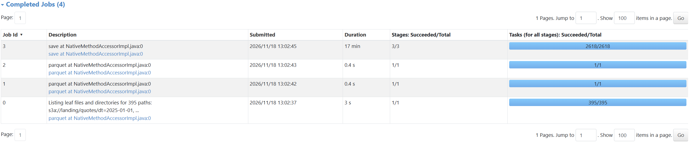

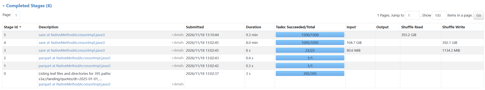

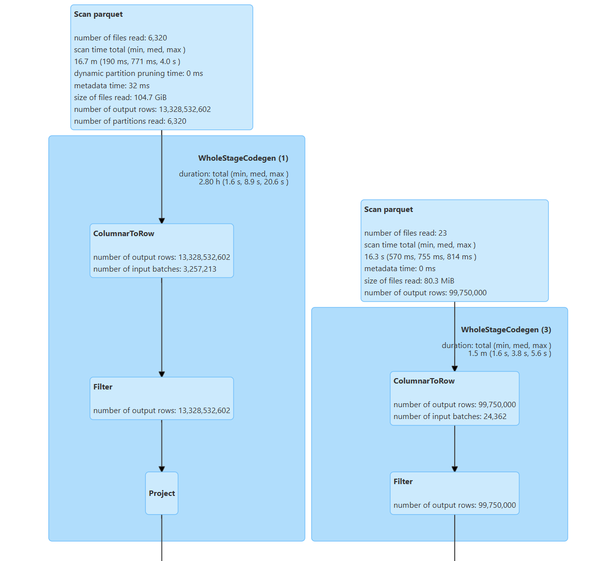

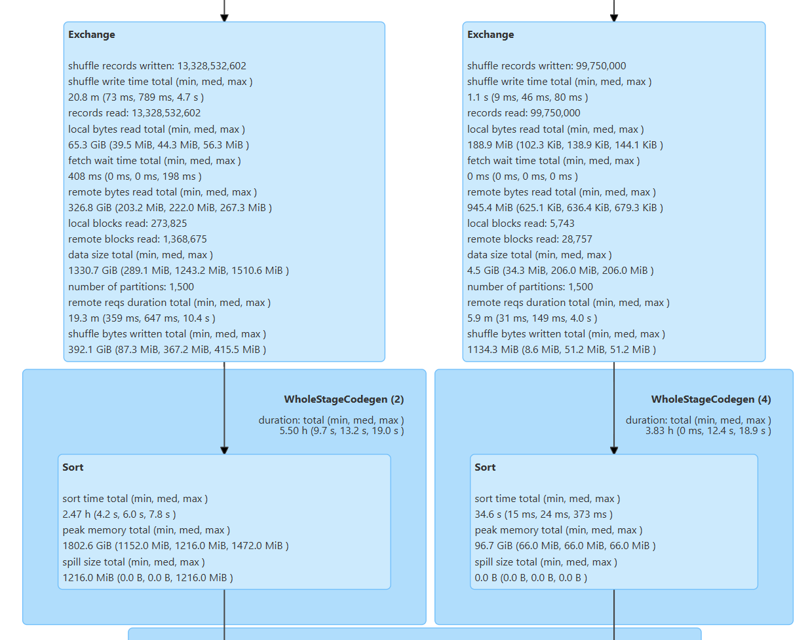

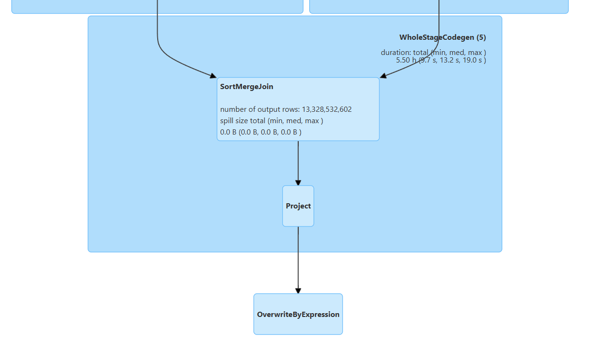

Skew thật xuất hiện khi khoá join chỉ là `hotel_id` (`hotel_baseline`: quotes ⋈ hotels, AQE tắt, broadcast tắt): khách sạn
nóng nhất (Zipf a = 0,8, khoảng 2,6% lượt xem) dồn **348.457.885 dòng, 9,78 GB vào một partition, gấp 47 lần trung vị**
(6,7 triệu dòng, 212 MB). Task đó chạy **357,7 s trong khi trung vị 5,5 s** và làm spill 119,9 GB; cả ứng dụng 1.084 s.

<a id="edai-1-12"></a>
## Handle skew with explanation

**Rubric:** edai-1 · dòng 12 · 3 điểm · nhóm *Processing Jobs* › *Spark job to handle offline data problems*

> Handle skew with explanation (Ví dụ: Do data bị skew như thế này, tôi thấy từ Spark UI có vấn đề như này, tôi sẽ có các phương pháp thử nghiệm như thế này, và sau khi thử nghiệm thì nó tăng ntn so với baseline)

**Cách làm:** [Đã có] `silver_quotes` có bốn cấu hình cho phép join `stg_quotes ⋈ raw_inventory` theo (`hotel_id`, `room_type`, `stay_date`): baseline; `aqe` (mặc định của Spark); `aqe_tuned` (skewJoin factor 2, ngưỡng 64MB); `salt` (salting 200 ô nóng nhất bằng `hot_keys` và `salted_join` tổng quát theo khoá). Trên 104,7 GiB: khoá 3 cột không lệch ở mức partition nên AQE không đổi plan; khoá `hotel_id` thì AQE tách partition lệch (1.500 → 1.712 task, 815 s, −25%), broadcast hotels 345 s (−68%); salting không cần. Bảng 5 lần chạy trong docs.

**Kết quả:** cùng cluster và input ở dòng 11.

| Bài | Chế độ | Ứng dụng | Stage join: task | Task max / trung vị | Partition lớn nhất | Spill |
|---|---|---|---|---|---|---|
| Khoá 3 cột (⋈ inventory) | baseline | 1.049 s | 1.500 | 19,0 / 13,2 s | 1,15 × trung vị | 5,3 GB |
| | aqe_tuned | 1.067 s* | 1.500 | 17,4 / 13,3 s | 1,15 × trung vị | 5,3 GB |
| Khoá `hotel_id` (⋈ hotels) | hotel_baseline | 1.084 s | 1.500 | **357,7 / 5,5 s** | 9,78 GB, 47 × | 119,9 GB |
| | hotel_aqe | 815 s (−25%) | 1.712 | 41,7 / 5,5 s | 1,02 GB, 5 × | 72,4 GB |
| | hotel_broadcast | **345 s (−68%)** | không shuffle | — | — | 0 |

\* không tính 316 s chờ cấp executor ở stage liệt kê file.

Các bước đi từ Spark UI:

1. **Đọc baseline.** Với khoá 3 cột, Summary Metrics của stage join đều (max chỉ hơn trung vị khoảng 40%), không có
   straggler. Ngưỡng skew của AQE (partition > 5 × trung vị và > 256 MB; bản `aqe_tuned` hạ xuống 2 × và 64 MB) không
   partition nào chạm tới, nên `aqe_tuned` không đổi plan và không nhanh hơn: skew ở mức ô (ô nóng nhất khoảng 2.700
   lượt xem mỗi shard mỗi ngày) bị dàn đều khi băm vào 1.500 partition. Chỗ tốn thật là shuffle 392 GiB.
2. **Tìm skew ở mức partition.** Join theo `hotel_id` dồn khách sạn nóng nhất vào một partition 9,78 GB: trên Spark UI
   một task chạy gần 6 phút, các task khác vài giây, và stage chỉ xong khi task đó xong.
3. **AQE skew join** (`hotel_aqe`): AQE thấy partition > 5 × trung vị, tách nó thành nhiều phần và nhân bản phía hotels
   tương ứng, số task tăng từ 1.500 lên 1.712, partition lớn nhất còn 1,02 GB, task chậm nhất từ 357,7 s xuống 41,7 s,
   cả ứng dụng nhanh hơn 25%.
4. **Broadcast** (`hotel_broadcast`): bảng hotels chỉ 50.000 dòng nên gửi nguyên bảng tới mọi executor, quotes không
   phải shuffle; không còn partition lệch, nhanh hơn 68% so với baseline. Đây là cách xử lý rẻ nhất khi phía nhỏ đủ nhỏ.
5. **Salting** (`salt`, `salted_join`) chỉ cần khi phía nhỏ không broadcast được và AQE vẫn còn task chậm hơn hẳn trung
   vị; cả hai bài ở đây đều không cần, nên không chạy trên 105 GiB.

Ba chế độ của mỗi bài cho cùng kết quả (`tests/test_silver_quotes.py`: so từng dòng giữa các chế độ).

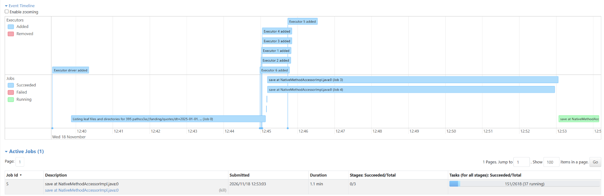

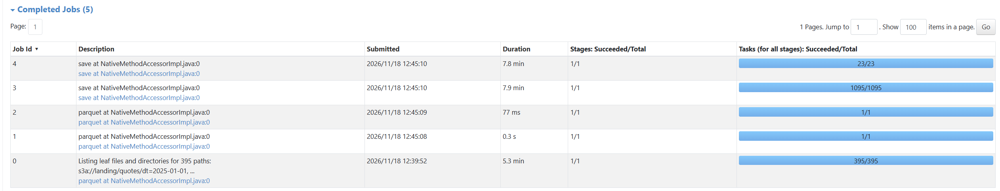

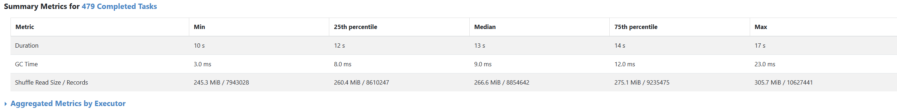

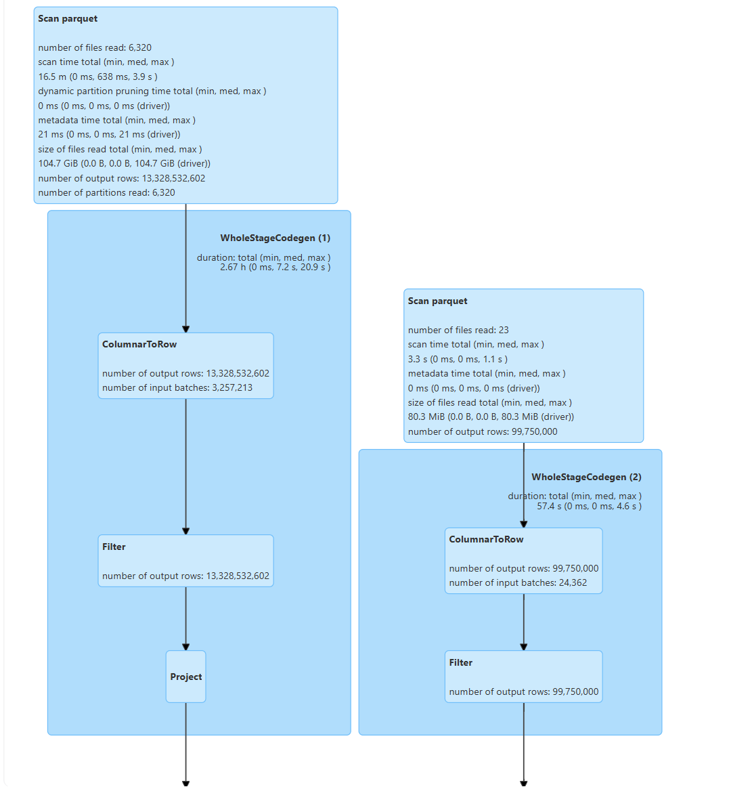

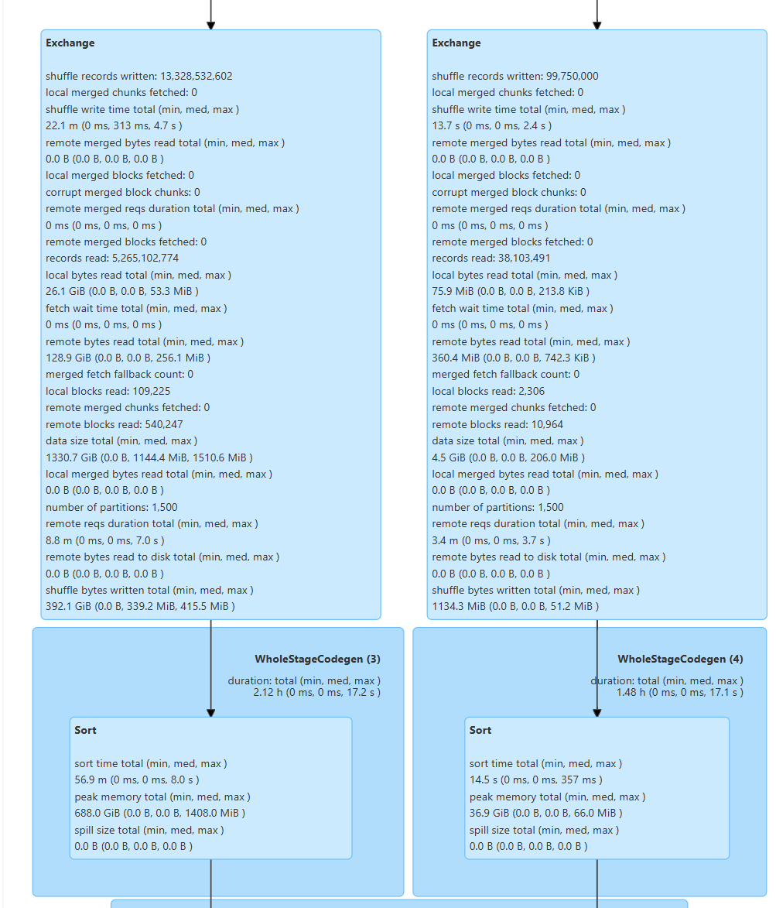

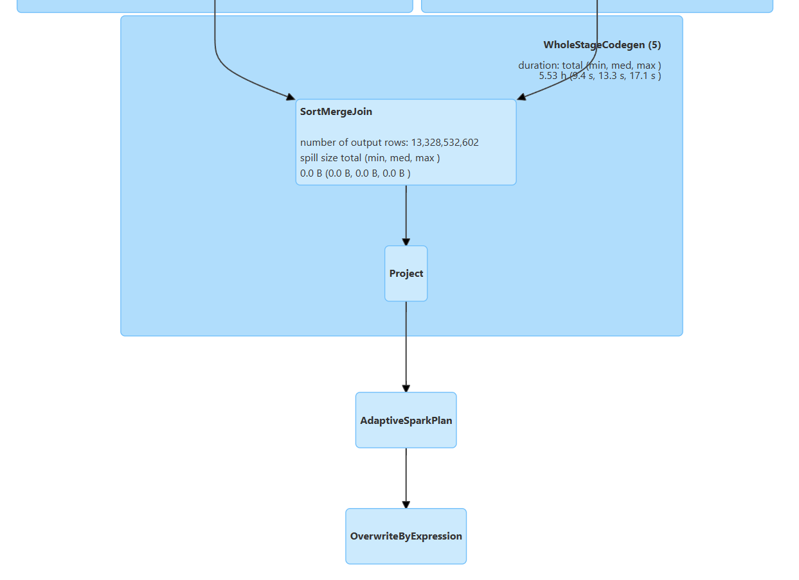

<a id="edai-1-13"></a>
## Handle schema evolution with explanation

**Rubric:** edai-1 · dòng 13 · 3 điểm · nhóm *Processing Jobs* › *Spark job to handle offline data problems*

**Cách làm:** [Đã có] `mergeSchema` kết hợp `coalesce` cho `room_category`. `tests/test_silver_bookings.py` chạy pyspark cục bộ trên Bronze vắt qua mốc 2025-07-01: không mất dòng, `room_category` không null, `channel` chỉ null ở partition v1. Trên toàn bộ 152,8 triệu booking (`spark_jobs/bookings_quality.py`, GKE): 70,86 triệu dòng v1 và 81,98 triệu dòng v2, sau `read_bookings` `room_category` không null dòng nào, `channel` chỉ null ở v1.

**Kết quả:** `spark_jobs/bookings_quality.py` chạy trên GKE (2026-11-18, Spark local[6] trong pod `bookings-quality`, 6 phút 10 giây) trên toàn bộ `s3a://landing/bookings`: 395 ngày, 6.320 file, 3,5 GiB, dùng đúng `read_bookings` và `dedup_bookings` của `silver_bookings.py`.

| Phiên bản (theo `dt`) | Số dòng | `room_type` có giá trị | `room_category` có giá trị | `channel` có giá trị |
|---|---|---|---|---|
| v1 (trước 2025-07-01) | 70.855.735 | 70.855.735 | 0 | 0 |
| v2 (từ 2025-07-01) | 81.982.006 | 0 | 81.982.006 | 81.982.006 |

Sau `read_bookings` (`mergeSchema` + `coalesce(room_category, room_type)`): `room_category` không null dòng nào ở cả hai
phiên bản, không mất dòng nào; `channel` chỉ null ở 70.855.735 dòng v1 (cột mới của v2, dữ liệu cũ không có).

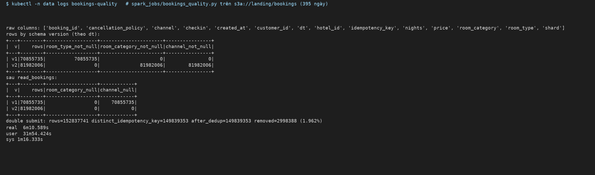

<a id="edai-1-14"></a>
## Handle other offline data problem with explanation

**Rubric:** edai-1 · dòng 14 · 3 điểm · nhóm *Processing Jobs* › *Spark job to handle offline data problems*

**Cách làm:** [Đã có] Khử trùng theo `idempotency_key` bằng `row_number` sắp theo `created_at`. `tests/test_silver_bookings.py` xác nhận sau khi khử trùng, mỗi `idempotency_key` còn một dòng và `status` khớp kết cục do generator sinh. Trên toàn bộ landing: 152.837.741 dòng, 149.839.353 `idempotency_key`; sau khử trùng còn 149.839.353 dòng, bỏ 2.998.388 bản trùng (1,962%).

**Kết quả:** `spark_jobs/bookings_quality.py` chạy trên GKE (2026-11-18, Spark local[6] trong pod `bookings-quality`, 6 phút 10 giây) trên toàn bộ `s3a://landing/bookings`: 395 ngày, 6.320 file, 3,5 GiB, dùng đúng `read_bookings` và `dedup_bookings` của `silver_bookings.py`.

| | Số dòng |
|---|---|
| Bookings trên landing | 152.837.741 |
| `idempotency_key` khác nhau | 149.839.353 |
| Sau `dedup_bookings` | 149.839.353 |
| Bản gửi trùng bị bỏ | 2.998.388 (1,962%; config 2%) |

Sau khử trùng số dòng bằng đúng số `idempotency_key` khác nhau: mỗi lần đặt còn đúng một dòng (dòng `created_at` nhỏ
nhất). Ảnh output ở dòng 13.

<a id="edai-1-15"></a>
## Spark job được tích hợp vào các data pipeline

**Rubric:** edai-1 · dòng 15 · 2 điểm · nhóm *Processing Jobs* › *Spark job to handle offline data problems*

**Cách làm:** [Đã có] DAG `dp2_bronze_to_gold` gọi `silver_bookings.py` qua `SparkSubmitOperator` ở chế độ `incr`: chỉ đọc partition `dt=ds` rồi MERGE vào Iceberg, kèm điều kiện `created_at` để Iceberg cắt partition. `tests/test_silver_bookings.py` chạy MERGE thật trên Iceberg trong image Spark và cho kết quả khớp với dựng lại cả bảng. Tiếp theo, `stage_gold.py` đưa Silver sang staging Gold qua JDBC. Image Spark có sẵn Iceberg, s3a và JDBC (`k8s/spark.Dockerfile`). Đã chạy trên GKE (2026-11-18, ds 2025-01-01), ảnh trong docs.

**Kết quả:** chạy trên GKE ngày 2026-11-18 (Airflow 2.10.5, KubernetesExecutor, image `airflow-booking:b9cf9a8-1`), backfill ngày `ds` = 2025-01-01. Task `silver_bookings` của DP2 gọi `spark-submit` lên Kubernetes; pod driver chạy image
`spark-booking:b9cf9a8`, kết thúc `phase: Succeeded`, `exit code: 0`, rồi `stage_gold` (Spark) và `upsert_gold` (SQL)
chạy tiếp. Log task đọc lại được trên Airflow UI nhờ remote logging lên MinIO (`s3://lake/airflow-logs`).

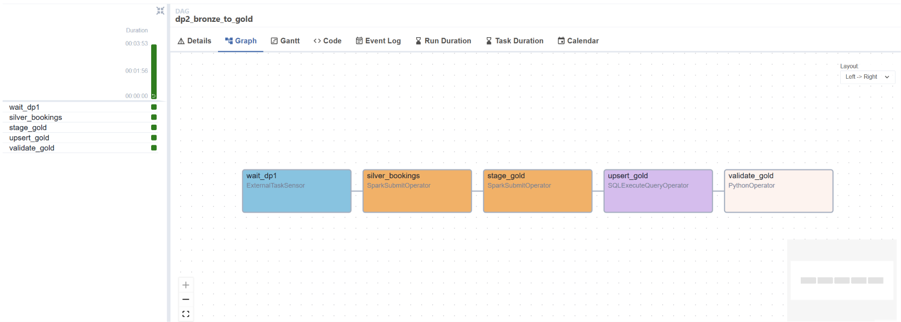


<a id="edai-1-16"></a>
## Baseline · Flink job to handle streaming data problems

**Rubric:** edai-1 · dòng 16 · 2 điểm · nhóm *Processing Jobs* › *Flink job to handle streaming data problems (later in final coursework, we will merge this streaming pipeline into the feature store)*

> Baseline (without optimization)

**Cần nộp (cả nhóm):** Document giải thích từng step optimize từ baseline như thế nào, dùng Flink UI như thế nào (nhớ show hình ảnh để thấy rõ các vấn đề, và giải thích vấn đề)

**Cách làm:** [Đã có] Cờ `BASELINE=True` chạy Flink với watermark 0 giây, không khử trùng. Chạy cả baseline và bản tối ưu trên GKE: baseline thừa đúng số bản gửi trùng (7.547 ngày 2026-01-01) và đẩy 8.326 event ra side output; bản tối ưu lệch truth 0,011%. Bảng đối soát, Flink UI (graph, backpressure) trong docs.

**Kết quả:** Cả hai bản chạy trên GKE với cùng dữ liệu: replay `booking_events` (30 ngày, Kafka 6 partition) từ đầu topic,
FlinkDeployment `booking-events-window` parallelism 6. Baseline chạy ngày 2026-11-17 (`BASELINE=1`, image
`flink-booking:9850a46-2`), bản tối ưu chạy ngày 2026-11-18 (image `c93fff3-1`). Mỗi lần xoá 3 bảng stream rồi
đọc lại từ offset đầu. `got` của một ngày = tổng `gold.stream_bookings_1m` + số dòng `gold.stream_late_bookings`
có `event_time` trong ngày; truth là số booking hợp lệ đã khử trùng do `generator/stream_truth.py` tính từ event
log, cắt tại 2026-01-03 01:00.


Baseline (watermark 0 giây, không khử trùng) cho thấy hai vấn đề:

- **Đếm thừa.** Ngày 2026-01-01 baseline đếm 384.084, truth là 376.537: thừa đúng 7.547, bằng số bản gửi trùng
  (double submit cùng `idempotency_key`) generator cài vào; ngày 2026-01-02 thừa 7.852 so với 7.437 bản trùng.
- **Coi event lệch thứ tự là trễ.** Không chờ event đến lệch thứ tự nên 8.326 booking của ngày 01-01 (2,2%) bị đẩy
  ra side output thay vì vào đúng cửa sổ phút.

Các bước tối ưu, mỗi bước một vấn đề:

1. **Parallelism = số partition Kafka (6).** Timestamp gán sau source; một subtask đọc nhiều partition thì watermark
   chạy theo partition nhanh nhất, event của partition chậm thành trễ giả (đo với parallelism 2: 2.409 event trễ giả).
2. **Watermark lệch 10 phút + allowed lateness 5 phút** (dòng 17): số event bị đẩy ra side output ngày 01-01 giảm từ
   8.326 xuống 1.719.
3. **Khử trùng theo `idempotency_key`** trước cửa sổ (dòng 18): phần đếm thừa từ 7.547 còn 43 (0,011%).
4. **Contract trước watermark:** event sai (`event_time` ở tương lai) ra DLQ trước khi kịp đẩy watermark.
5. **Đếm tăng dần bằng `AggregateFunction`**: state mỗi cửa sổ là một số nguyên thay vì danh sách event.
6. **Unaligned checkpoint** và chặn autoscaler gỡ pod Flink: lúc đọc dồn backlog, barrier aligned kẹt sau buffer
   đầy nên checkpoint không xong; restart khi đó mất toàn bộ tiến độ.

Đọc Flink UI lúc đọc dồn backlog: source bị backpressure, `SlidingEventTimeWindows` bận 100% ở cả 6 subtask vì mỗi
event vào 12 cửa sổ chồng nhau và chạy bằng Python, đó là nút cổ chai (ảnh BackPressure). Watermark của 6 subtask
bằng nhau vì sau `key_by` mỗi subtask nhận watermark nhỏ nhất của các subtask phía trước.


Lỗi phải sửa để job chạy trên Kubernetes: jar connector tải bằng `ADD` có quyền 600 nên user `flink` không đọc được
(`--chmod=644`); Python worker trên TaskManager không thấy module `contract` (`-pyfs /opt/flink/usrlib`); sau
`-pyfs` đường dẫn tương đối tới JSON Schema sai (`CONTRACT_PATH`); `on_timer` của bước khử trùng trả `None` làm task
lỗi khi timer dọn state kích hoạt (PyFlink cần iterable); autoscaler GKE gỡ JobManager khi thu node spot.

<a id="edai-1-17"></a>
## Handle late arrival with explanation

**Rubric:** edai-1 · dòng 17 · 3 điểm · nhóm *Processing Jobs* › *Flink job to handle streaming data problems (later in final coursework, we will merge this streaming pipeline into the feature store)*

**Cách làm:** [Đã có] Nhánh đối soát tumbling 1 phút dùng watermark 10 phút, allowed lateness 5 phút và side output ghi vào `gold.stream_late_bookings`; cửa sổ trượt 1 giờ chỉ đẩy event ra side output khi trễ quá 1 giờ 15 phút. Test e2e trên Docker xác nhận số đếm cộng side output bằng tổng thật của từng phút. Trên PyFlink 1.20, timestamp được gán sau source và không dùng `with_idleness`, vì thực nghiệm cho thấy idleness làm watermark đứng yên. Bảng số event vào side output của baseline (8.326) và bản tối ưu (1.719) ngày 2026-01-01, lý do chọn 10 phút theo phân phối độ trễ từng nguồn, ảnh watermark 6 subtask trong docs.

**Kết quả:** cùng lần chạy ở dòng 16. Số event bị đẩy ra side output (`late`) theo ngày:

| Ngày | Baseline (watermark 0s) | Tối ưu (10 phút + 5 phút) | Truth: trễ > 15 phút theo `ingest_time − event_time` |
|---|---|---|---|
| 2026-01-01 | 8.326 | 1.719 | 25.934 |
| 2026-01-02 | 7.339 | 615 | 25.881 |

Watermark 10 phút cộng allowed lateness 5 phút nhận lại event trễ tới 15 phút: theo bảng độ trễ ở dòng 9, phần lớn
event mobile trễ 5–20 phút (trễ quá 10 phút: 20,09%, quá 15 phút: 10,03% số event mobile), webhook thanh toán trễ
tối đa 15 phút. Chờ lâu hơn làm feature `bookings_1h` chậm thêm tương ứng; chờ 1–4 giờ cho channel manager (1% booking)
thì feature không còn "realtime", nên các event đó đi vào side output và vẫn được ghi lại để đối soát.

Số event vào side output của bản tối ưu thấp hơn nhiều so với số trễ quá 15 phút theo giờ ingest (truth). Lý do: job
đọc dồn backlog từ đầu topic, 6 partition được đọc với tốc độ khác nhau và watermark sau `key_by` là watermark nhỏ nhất,
nên khi một event trễ tới thì watermark thường chưa vượt qua cửa sổ của nó. Khi chạy theo kịp tốc độ replay, số
`late` sẽ tiến về con số truth. Bảng `stream_late_bookings` không lưu nguồn (channel) của event nên chưa tách được
số trễ theo từng nguồn.

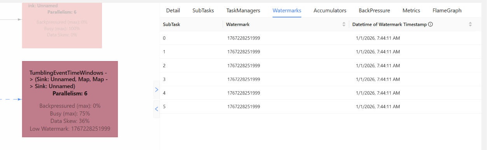


<a id="edai-1-18"></a>
## Handle other streaming problem with explanation

**Rubric:** edai-1 · dòng 18 · 3 điểm · nhóm *Processing Jobs* › *Flink job to handle streaming data problems (later in final coursework, we will merge this streaming pipeline into the feature store)*

**Cách làm:** [Đã có] `DedupByEventId` theo `idempotency_key`, timer xoá state khi watermark qua `event_time` + 5 giờ. Trên GKE phần đếm thừa giảm từ 7.547 (baseline) còn 43; checkpoint unaligned 20,2 MB, ảnh trong docs.

**Kết quả:** cùng lần chạy ở dòng 16.

| Ngày | Bản gửi trùng (truth) | Baseline thừa | Tối ưu thừa |
|---|---|---|---|
| 2026-01-01 | 7.547 | +7.547 | +43 |
| 2026-01-02 | 7.437 | +7.852 | −18 |

Baseline đếm cả bản gửi lại, nên thừa đúng bằng số bản trùng. `DedupByEventId` giữ một cờ `seen` cho mỗi
`idempotency_key` và đăng ký timer xoá cờ khi watermark qua `event_time` + 5 giờ, nên state không tăng mãi; bản tối ưu
còn lệch 0,011% và 0,005%. Phần lệch nhỏ còn lại do job restart 3 lần trong lúc chạy (lỗi timer, autoscaler gỡ
JobManager, apply cấu hình): sink JDBC là at-least-once, event đã ghi vào `stream_late_bookings` trước restart có thể
được đếm lại trong cửa sổ khi đọc lại từ checkpoint với watermark khác. Ngày 2025-12-31 là biên đầu replay (+173).

Data contract chặn event sai trước watermark: event thiếu `event_time` vào topic `booking_events_dlq` kèm `reason`.
Checkpoint unaligned EXACTLY_ONCE lên MinIO hoàn tất đều đặn (khoảng 1 phút mỗi lần, 20,2 MB, 5 operator đều 6/6).

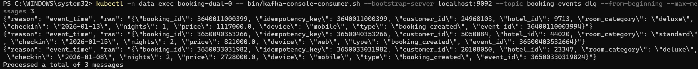

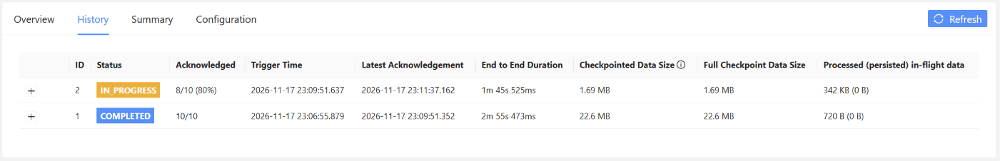

<a id="edai-1-19"></a>
## Window processing

**Rubric:** edai-1 · dòng 19 · 2 điểm · nhóm *Processing Jobs* › *Flink job to handle streaming data problems (later in final coursework, we will merge this streaming pipeline into the feature store)*

**Cần nộp (cả nhóm):** Document show đoạn code thể hiện khả năng xử lý Window trong Flink, và giải thích đoạn code đó làm gì

**Cách làm:** [Đã có] Cửa sổ trượt 1 giờ, bước 5 phút theo `hotel_id` (`SlidingEventTimeWindows`) tính `bookings_1h` và upsert vào `gold.feat_hotel_realtime`. Cửa sổ tumbling 1 phút (`TumblingEventTimeWindows`) ghi `gold.stream_bookings_1m` để đối soát. Đoạn code window và giải thích (watermark, key theo khách sạn, allowed lateness, side output, đếm tăng dần) trong `docs/edai-1/processing_jobs.md`.

**Kết quả:** đoạn code window trong `edai1/flink_jobs/booking_events_window.py` (hàm `main`):

```python
wm = WatermarkStrategy.for_bounded_out_of_orderness(MAX_OUT_OF_ORDER).with_timestamp_assigner(EventTimeAssigner())
events = checked.assign_timestamps_and_watermarks(wm)          # event time = event_time, watermark lùi 10 phút

created = events.filter(lambda e: e["type"] == "booking_created")
created = created.key_by(lambda e: e["idempotency_key"], key_type=Types.LONG()) \
                 .process(DedupByEventId(), EVENT)               # double submit chỉ đếm 1 lần (BASELINE=1 bỏ bước này)
by_hotel = created.key_by(lambda e: e["hotel_id"], key_type=Types.LONG())

# (1) feature: số booking 1 giờ gần nhất của mỗi khách sạn, cập nhật mỗi 5 phút
(by_hotel.window(SlidingEventTimeWindows.of(Time.hours(1), Time.minutes(5)))
 .allowed_lateness(ALLOWED_LATENESS_MS)
 .aggregate(CountAgg(), WithWindowEnd(), accumulator_type=Types.LONG(), output_type=FEAT_ROW)
 .add_sink(jdbc_sink(UPSERT_SQL, FEAT_ROW)))                     # -> gold.feat_hotel_realtime

# (2) đối soát: số booking từng phút, event trễ quá hạn ra side output thay vì bị bỏ
minutes = (by_hotel.window(TumblingEventTimeWindows.of(Time.minutes(1)))
           .allowed_lateness(ALLOWED_LATENESS_MS)
           .side_output_late_data(LATE_TAG)
           .aggregate(CountAgg(), WithWindowEnd(), accumulator_type=Types.LONG(), output_type=FEAT_ROW))
minutes.add_sink(jdbc_sink(MINUTE_SQL, FEAT_ROW))                # -> gold.stream_bookings_1m
minutes.get_side_output(LATE_TAG).map(late_row, LATE_ROW).add_sink(jdbc_sink(LATE_SQL, LATE_ROW))
```

Đoạn code làm các việc sau:

- **Thời gian sự kiện và watermark.** Cửa sổ tính theo `event_time` của booking, không theo giờ Flink nhận event.
  Watermark = `event_time` lớn nhất đã thấy trừ 10 phút (`MAX_OUT_OF_ORDER`): Flink chờ thêm 10 phút cho event đến
  lệch thứ tự rồi mới coi một cửa sổ là đủ dữ liệu.
- **Khoá theo khách sạn.** `key_by(hotel_id)` chia luồng theo khách sạn, mỗi khách sạn có cửa sổ và state riêng.
  Trước đó bước khử trùng theo `idempotency_key` bỏ bản gửi lặp, nên cửa sổ đếm đúng số lần đặt như Silver.
- **(1) Cửa sổ trượt** dài 1 giờ, trượt 5 phút: mỗi event thuộc 12 cửa sổ chồng nhau, cứ 5 phút có một cửa sổ đóng và
  cho ra `bookings_1h` của khách sạn tính tới `window_end`. Kết quả upsert theo (`hotel_id`, `event_timestamp`) vào
  `gold.feat_hotel_realtime`, feature tươi theo giờ cho Feast (DAG `feast_materialize_realtime`).
- **(2) Cửa sổ tumbling** 1 phút không chồng nhau: mỗi event thuộc đúng một cửa sổ, nên tổng các phút bằng tổng
  booking, dùng để đối soát với ground truth (`generator/stream_truth.py`).
- **Event trễ.** `allowed_lateness(5 phút)` giữ state cửa sổ thêm 5 phút sau khi watermark qua `window_end`; event đến
  trong khoảng đó làm cửa sổ phát lại kết quả mới, và upsert ghi đè dòng cũ. Event trễ hơn nữa (quá watermark 10
  phút + 5 phút) không bị bỏ âm thầm: `side_output_late_data` đẩy chúng vào `gold.stream_late_bookings`. Cửa sổ
  trượt không có side output; một event chỉ mất khỏi nó khi cả 12 cửa sổ chứa nó đều đã đóng (trễ khoảng 75 phút), và
  event đó vẫn được ghi ở side output của nhánh tumbling.
- **Đếm tăng dần.** `aggregate(CountAgg(), WithWindowEnd())`: state mỗi cửa sổ chỉ là một số nguyên cộng dần, không giữ
  danh sách event; `WithWindowEnd` gắn `hotel_id` và `window_end` vào kết quả khi cửa sổ đóng.

Hai cửa sổ chạy trên GKE và ghi vào Gold: tumbling 1 phút ra `gold.stream_bookings_1m`, sliding 1 giờ bước 5 phút ra
`gold.feat_hotel_realtime` (`window_end` là bội số 5 phút).

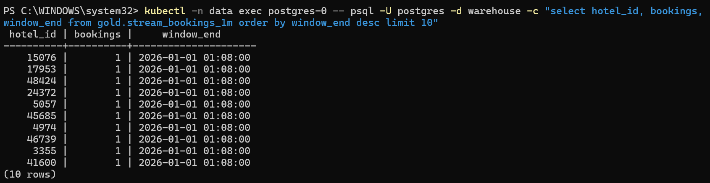

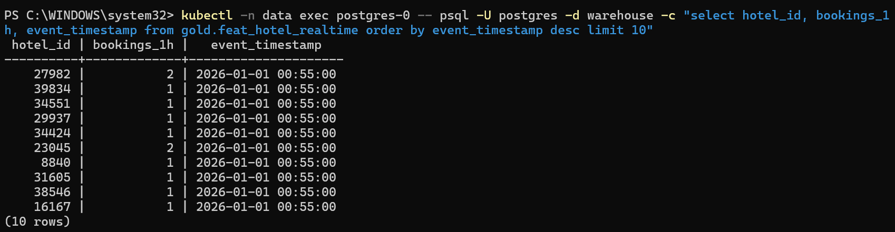
