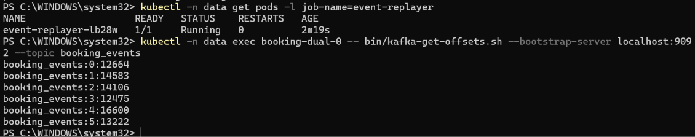
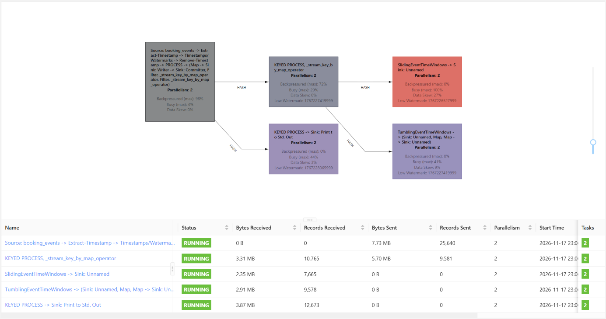
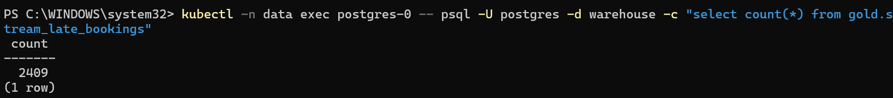

# Processing jobs: Spark & Flink

Các job đi từ bản baseline tới bản tối ưu; hiệu năng được đo bằng Spark UI và Flink UI.

Mỗi mục dưới đây ứng với một dòng của rubric. Phần **Cách làm** mô tả giải pháp đã triển khai, đồng bộ từ
cột F của rubric. Phần **Kết quả** ghi test đã chạy, số liệu đo được hoặc ảnh chụp (`docs/images/`).

## Baseline · Spark job to handle offline data problems

**Rubric:** edai-1 · dòng 11 · 2 điểm · nhóm *Processing Jobs* › *Spark job to handle offline data problems*

> Baseline (without optimization)

**Cần nộp (cả nhóm):** Document giải thích từng step optimize từ baseline như thế nào, dùng Spark UI như thế nào (với screenshots để thấy rõ vấn đề), và đã tích hợp vào Airflow pipeline ra sao

**Cách làm:** [Đã có] Bản baseline của `silver_quotes` tắt AQE và tắt broadcast. `build_spark` không còn ép `autoBroadcastJoinThreshold=-1`, nên phép join với hotels (khoảng 1–2 MB) tự dùng broadcast. `tests/test_silver_quotes.py` chạy pyspark cục bộ và xác nhận bốn chế độ cho cùng kết quả. [Cần làm] chạy trên ≥ 100GB, chụp Spark UI (task chạy chậm bất thường), ghi thời gian vào `docs/edai-1/processing_jobs.md`.

**Kết quả:** các test `edai1/tests/test_silver_quotes.py` chạy cục bộ và đạt (2026-11-16). Chưa có ảnh chụp trên cluster.

## Handle skew with explanation

**Rubric:** edai-1 · dòng 12 · 3 điểm · nhóm *Processing Jobs* › *Spark job to handle offline data problems*

> Handle skew with explanation (Ví dụ: Do data bị skew như thế này, tôi thấy từ Spark UI có vấn đề như này, tôi sẽ có các phương pháp thử nghiệm như thế này, và sau khi thử nghiệm thì nó tăng ntn so với baseline)

**Cách làm:** [Đã có] `silver_quotes` có bốn cấu hình cho phép join `stg_quotes ⋈ raw_inventory` theo (`hotel_id`, `room_type`, `stay_date`): baseline; `aqe` (mặc định của Spark); `aqe_tuned` (skewJoin factor 2, ngưỡng 64MB); `salt` (salting 200 ô nóng nhất bằng `hot_keys` và `salted_join` tổng quát theo khoá). [Cần làm] chạy trên ≥ 100GB, ghi thời gian, thời gian task lớn nhất và trung vị, lượng shuffle read; chỉ dùng salting khi `aqe_tuned` vẫn còn task chậm.

**Kết quả:** _Chưa có. Cần số liệu, ảnh chụp hoặc link code sau khi chạy trên cluster._

## Handle schema evolution with explanation

**Rubric:** edai-1 · dòng 13 · 3 điểm · nhóm *Processing Jobs* › *Spark job to handle offline data problems*

**Cách làm:** [Đã có] `mergeSchema` kết hợp `coalesce` cho `room_category`. `tests/test_silver_bookings.py` chạy pyspark cục bộ trên Bronze vắt qua mốc 2025-07-01: không mất dòng, `room_category` không null, `channel` chỉ null ở partition v1. [Cần làm] chụp kết quả trên dữ liệu thật.

**Kết quả:** các test `edai1/tests/test_silver_bookings.py` chạy cục bộ và đạt (2026-11-16). Chưa có ảnh chụp trên cluster.

## Handle other offline data problem with explanation

**Rubric:** edai-1 · dòng 14 · 3 điểm · nhóm *Processing Jobs* › *Spark job to handle offline data problems*

**Cách làm:** [Đã có] Khử trùng theo `idempotency_key` bằng `row_number` sắp theo `created_at`. `tests/test_silver_bookings.py` xác nhận sau khi khử trùng, mỗi `idempotency_key` còn một dòng và `status` khớp kết cục do generator sinh. [Cần làm] chạy và ghi số dòng trước, sau trên dữ liệu thật.

**Kết quả:** các test `edai1/tests/test_silver_bookings.py` chạy cục bộ và đạt (2026-11-16). Chưa có ảnh chụp trên cluster.

## Spark job được tích hợp vào các data pipeline

**Rubric:** edai-1 · dòng 15 · 2 điểm · nhóm *Processing Jobs* › *Spark job to handle offline data problems*

**Cách làm:** [Đã có] DAG `dp2_bronze_to_gold` gọi `silver_bookings.py` qua `SparkSubmitOperator` ở chế độ `incr`: chỉ đọc partition `dt=ds` rồi MERGE vào Iceberg, kèm điều kiện `created_at` để Iceberg cắt partition. `tests/test_silver_bookings.py` chạy MERGE thật trên Iceberg trong image Spark và cho kết quả khớp với dựng lại cả bảng. Tiếp theo, `stage_gold.py` đưa Silver sang staging Gold qua JDBC. Image Spark có sẵn Iceberg, s3a và JDBC (`k8s/spark.Dockerfile`). [Cần làm] chụp Airflow graph và log Spark.

**Kết quả:** các test `edai1/tests/test_silver_bookings.py` chạy cục bộ và đạt (2026-11-16). Chưa có ảnh chụp trên cluster.

## Baseline · Flink job to handle streaming data problems

**Rubric:** edai-1 · dòng 16 · 2 điểm · nhóm *Processing Jobs* › *Flink job to handle streaming data problems (later in final coursework, we will merge this streaming pipeline into the feature store)*

> Baseline (without optimization)

**Cần nộp (cả nhóm):** Document giải thích từng step optimize từ baseline như thế nào, dùng Flink UI như thế nào (nhớ show hình ảnh để thấy rõ các vấn đề, và giải thích vấn đề)

**Cách làm:** [Đã có] Cờ `BASELINE=True` chạy Flink với watermark 0 giây, không khử trùng. [Cần làm] chụp Flink UI: số event trễ bị bỏ và kết quả window sai.

**Kết quả:** bản tối ưu chạy trên GKE (2026-11-17, FlinkDeployment `booking-events-window`, parallelism 2, replay 30 ngày
`booking_events` vào Kafka 6 partition, khoảng 83.600 event lúc chụp). Chưa chạy bản `BASELINE=True` để so sánh.

Đọc Flink UI: graph cho thấy source bị backpressure 98% trong khi `SlidingEventTimeWindows` bận 100%. Cửa sổ trượt
1 giờ bước 5 phút đưa mỗi event vào 12 cửa sổ và chạy bằng Python, nên đây là nút cổ chai khi job đọc dồn backlog
từ đầu topic. Khi đã đuổi kịp tốc độ replay, các operator về trạng thái OK (ảnh BackPressure).

Ba lỗi phải sửa để job chạy trên Kubernetes: jar connector tải bằng `ADD` có quyền 600 nên user `flink` không đọc
được (`--chmod=644`); Python worker trên TaskManager không thấy module `contract` (`-pyfs /opt/flink/usrlib`); và sau
`-pyfs` đường dẫn tương đối tới JSON Schema sai (`CONTRACT_PATH`).

## Handle late arrival with explanation

**Rubric:** edai-1 · dòng 17 · 3 điểm · nhóm *Processing Jobs* › *Flink job to handle streaming data problems (later in final coursework, we will merge this streaming pipeline into the feature store)*

**Cách làm:** [Đã có] Nhánh đối soát tumbling 1 phút dùng watermark 10 phút, allowed lateness 5 phút và side output ghi vào `gold.stream_late_bookings`; cửa sổ trượt 1 giờ chỉ đẩy event ra side output khi trễ quá 1 giờ 15 phút. Test e2e trên Docker xác nhận số đếm cộng side output bằng tổng thật của từng phút. Trên PyFlink 1.20, timestamp được gán sau source và không dùng `with_idleness`, vì thực nghiệm cho thấy idleness làm watermark đứng yên. [Cần làm] lập bảng số event vào side output của baseline và bản tối ưu theo từng nguồn trễ; giải thích lý do chọn 10 phút.

**Kết quả:** watermark của hai subtask đi đều nhau (ảnh Watermarks). Lúc chụp, `gold.stream_bookings_1m` có 2.819 dòng
(hotel × phút) và side output `gold.stream_late_bookings` có 2.409 event trễ quá watermark 10 phút + allowed lateness
5 phút. Tỉ lệ trễ này cao hơn nhiều so với lượng trễ generator cài vào. Giả thuyết (chưa kiểm chứng): job đọc dồn
backlog từ đầu topic, watermark gán sau source nên lấy theo partition đọc nhanh nhất trong subtask, event của
partition đọc chậm hơn bị tính là trễ. Cần đối chiếu với cột `violation`/độ trễ trong event log, và đếm lại khi
job đã đuổi kịp replay.

## Handle other streaming problem with explanation

**Rubric:** edai-1 · dòng 18 · 3 điểm · nhóm *Processing Jobs* › *Flink job to handle streaming data problems (later in final coursework, we will merge this streaming pipeline into the feature store)*

**Cách làm:** [Đã có] `DedupByEventId` với state TTL 1 giờ. [Cần làm] chạy và đếm event trùng trước, sau khi khử; chụp state size trên Flink UI.

**Kết quả:** data contract chặn event sai trước watermark: event thiếu `event_time` vào topic `booking_events_dlq`
kèm `reason`. Checkpoint EXACTLY_ONCE lên MinIO hoàn tất (checkpoint 1: 22,6 MB, 10/10 task). Chưa đếm event trùng
trước và sau dedup.

## Window processing

**Rubric:** edai-1 · dòng 19 · 2 điểm · nhóm *Processing Jobs* › *Flink job to handle streaming data problems (later in final coursework, we will merge this streaming pipeline into the feature store)*

**Cần nộp (cả nhóm):** Document show đoạn code thể hiện khả năng xử lý Window trong Flink, và giải thích đoạn code đó làm gì

**Cách làm:** [Đã có] Cửa sổ trượt 1 giờ, bước 5 phút theo `hotel_id` (`SlidingEventTimeWindows`) tính `bookings_1h` và upsert vào `gold.feat_hotel_realtime`. Cửa sổ tumbling 1 phút (`TumblingEventTimeWindows`) ghi `gold.stream_bookings_1m` để đối soát. [Cần làm] trích code và giải thích trong `docs/edai-1/processing_jobs.md`.

**Kết quả:** hai cửa sổ chạy trên GKE và ghi vào Gold: tumbling 1 phút ra `gold.stream_bookings_1m`, sliding 1 giờ
bước 5 phút ra `gold.feat_hotel_realtime` (`window_end` là bội số 5 phút).

