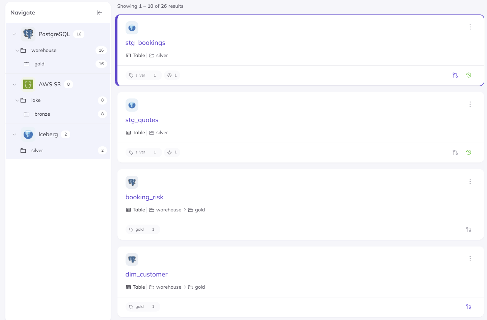
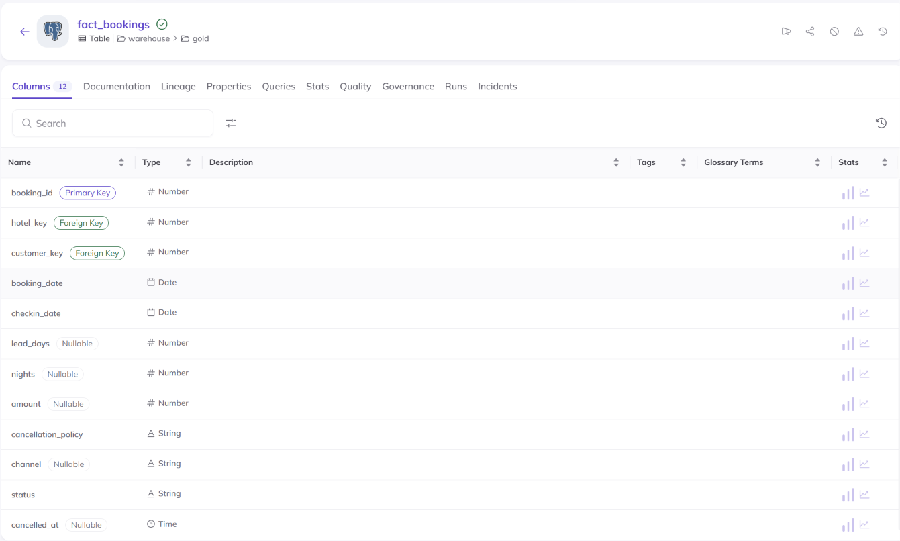
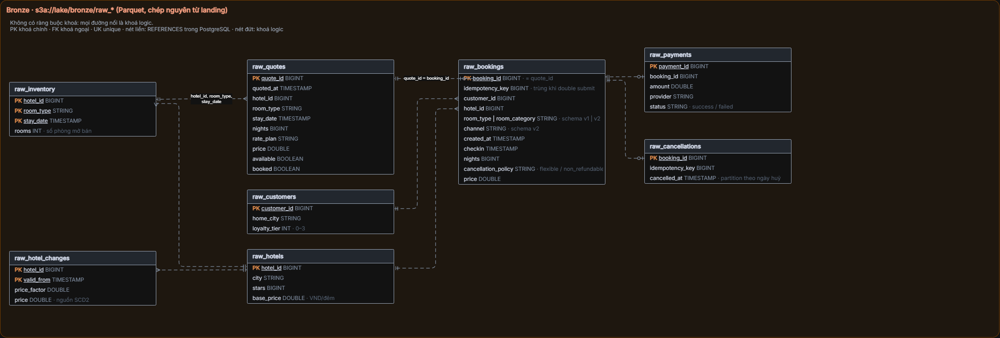
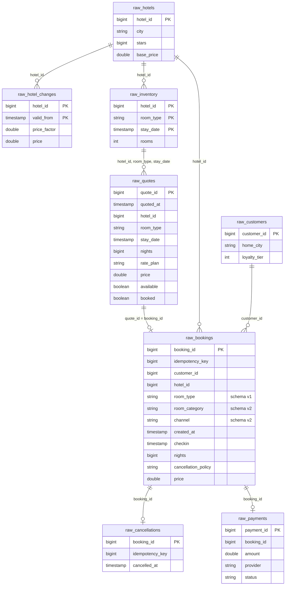
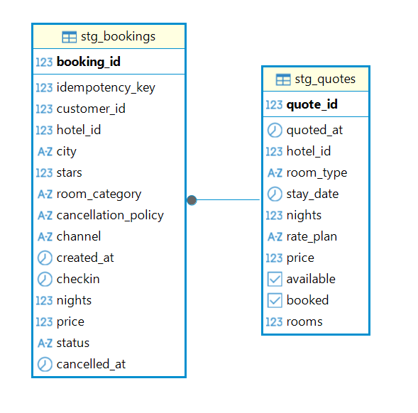
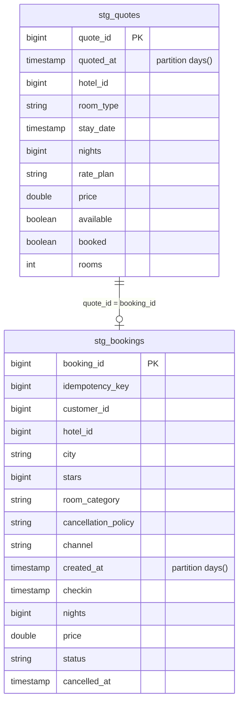
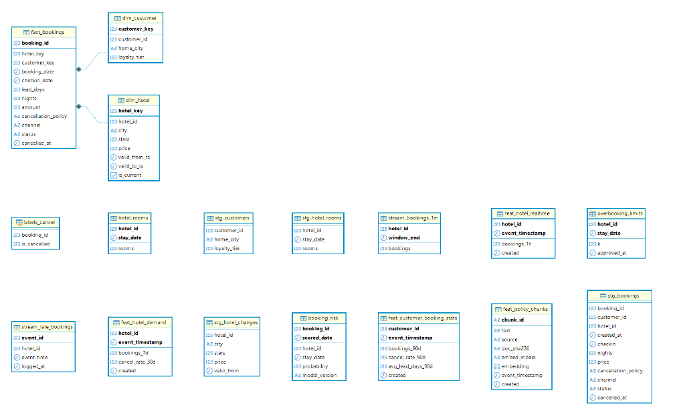
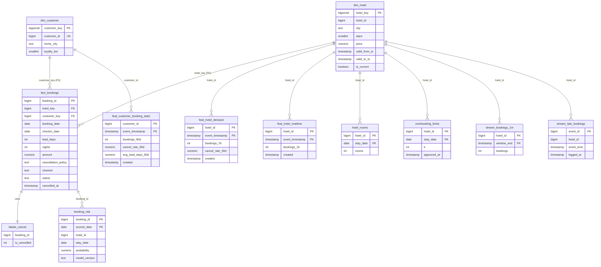
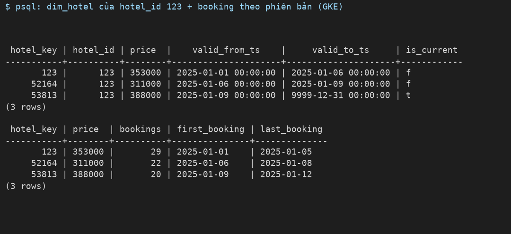
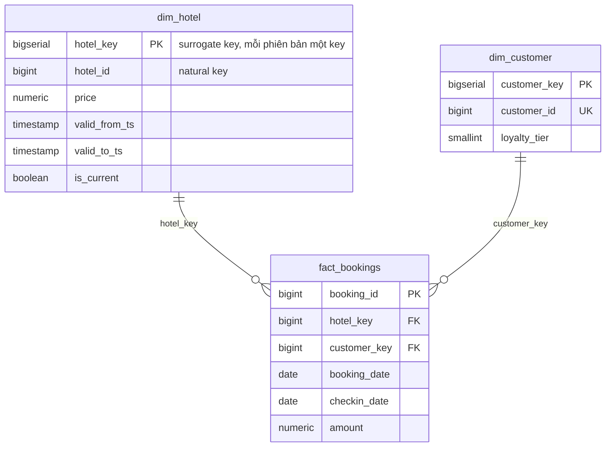

# Schema design

Thiết kế bảng theo zone, dimension SCD2, bảng feature, quan hệ dim–fact và quy ước đặt tên.

## Sơ đồ bảng dữ liệu qua các zone (Bronze, Silver, Gold)

ERD của ba tầng (Bronze `raw_`, Silver `stg_`, Gold) được xuất bằng DBeaver (kèm bản Mermaid thu gọn bên dưới mỗi ảnh). Trên GKE, DataHub tự động nạp schema qua 3 recipe (`s3`, `iceberg`, `postgres`) và gắn mô tả cùng tag phân tầng cho đủ 26 bảng (`tests/test_datahub_recipes.py` kiểm tra tên bảng khớp với lineage).

Lọc theo tag zone trên DataHub ra đủ 26 bảng: 8 bảng Bronze trên S3, 2 bảng Silver trên Iceberg, 16 bảng
Gold trên PostgreSQL. Tab Columns của bảng Gold hiện khoá chính và khoá ngoại. Bronze và Silver là file Parquet và bảng
Iceberg nên không có ràng buộc khoá; các đường nối ở hai zone này là quan hệ logic theo cột cùng tên. Ở Gold, chỉ hai
đường nối của `fact_bookings` là khoá ngoại thật.

*Chú thích: Danh sách 26 bảng trên DataHub được gắn tag theo 3 tầng: 8 bảng `bronze` (`raw_*`), 2 bảng `silver` (`stg_*`) và 16 bảng `gold` tuân thủ đúng quy ước đặt tên.*

*Chú thích: Tab Columns của bảng `gold.fact_bookings` trên DataHub hiển thị Primary Key (`booking_id`) và hai Foreign Key thực trỏ tới `dim_hotel` (`hotel_key`) và `dim_customer` (`customer_key`).*

### Bronze (`s3a://lake/bronze/raw_*`, Parquet)

DP1 chép nguyên dữ liệu từ landing, không biến đổi. Bốn bảng sự kiện chia partition theo `dt=<ngày>`; bốn bảng dim chép một lần.

*Chú thích: Sơ đồ quan hệ (ERD) 8 bảng tầng Bronze (`raw_*` lưu dạng Parquet trên S3/MinIO) và các mối liên kết logic theo mã định danh.*

Cùng sơ đồ dạng Mermaid

| Bảng | Nhiệm vụ |
|---|---|
| `raw_quotes` | log lượt xem giá, một dòng mỗi lượt; bảng lớn nhất (mốc 100GB), dùng cho bài skew |
| `raw_bookings` | sự kiện đặt phòng lúc tạo, chưa có trạng thái huỷ; còn bản trùng do double submit và hai phiên bản schema |
| `raw_cancellations` | các lần huỷ, chia theo ngày huỷ nên partition theo ngày không chứa lần huỷ tương lai |
| `raw_payments` | giao dịch thanh toán của booking |
| `raw_hotels` | danh mục khách sạn: thành phố, hạng sao, giá gốc |
| `raw_hotel_changes` | lịch sử đổi giá của khách sạn, nguồn của SCD2 `dim_hotel` |
| `raw_customers` | danh mục khách: thành phố, hạng thành viên |
| `raw_inventory` | số phòng mở bán theo khách sạn, loại phòng và đêm |

### Silver (`lake.silver.stg_*`, Iceberg)

Dữ liệu đã làm sạch: dedup, hợp nhất schema, gắn trạng thái huỷ. Hai bảng chia partition theo ngày.

*Chú thích: Sơ đồ ERD 2 bảng tầng Silver trên Apache Iceberg (`stg_quotes` và `stg_bookings`) đã được làm sạch, gộp schema v1/v2 và khử trùng.*

Cùng sơ đồ dạng Mermaid

| Bảng | Nhiệm vụ |
|---|---|
| `stg_bookings` | một dòng mỗi booking sau dedup theo `idempotency_key`; `room_type` và `room_category` gộp thành một cột; có `city`, `stars` từ `raw_hotels`; `status` và `cancelled_at` cập nhật bằng MERGE mỗi ngày |
| `stg_quotes` | lượt xem giá kèm số phòng mở bán (`rooms`) của ô `hotel × room_type × stay_date`, kết quả của bài join lệch |

### Gold (`gold.*`, PostgreSQL)

*Chú thích: Sơ đồ ERD 16 bảng tầng Gold trên PostgreSQL gồm bảng Dimension (`dim_hotel` SCD2, `dim_customer`), `fact_bookings`, 3 bảng `feat_*` và các bảng vận hành.*

Cùng sơ đồ dạng Mermaid

| Bảng | Nhiệm vụ |
|---|---|
| `dim_hotel` | dimension SCD2 của khách sạn: mỗi lần đổi giá sinh một phiên bản mới |
| `dim_customer` | dimension khách hàng |
| `fact_bookings` | một dòng mỗi booking, trỏ tới phiên bản `dim_hotel` có hiệu lực lúc đặt |
| `labels_cancel` (view) | nhãn huấn luyện: `is_cancelled` = huỷ trước ngày nhận phòng |
| `feat_customer_booking_stats` | feature lịch sử 90 ngày của khách, do DP3 tính |
| `feat_hotel_demand` | feature nhu cầu 7 và 30 ngày của khách sạn, do DP3 tính |
| `feat_hotel_realtime` | số booking trong 1 giờ gần nhất của khách sạn, do Flink ghi |
| `booking_risk` | xác suất huỷ của từng booking kèm phiên bản model đã chấm |
| `hotel_rooms` | số phòng mở bán theo khách sạn và đêm trong 30 đêm tới |
| `overbooking_limits` | số phòng bán vượt K đã được revenue manager duyệt |
| `stream_bookings_1m` | số booking từng phút do Flink đếm, dùng để đối soát stream với batch |
| `stream_late_bookings` | event tới trễ hơn watermark cộng allowed lateness (side output của Flink) |
| `stg_bookings`, `stg_customers`, `stg_hotel_changes` | bảng trung chuyển của DP2: Spark ghi thay đổi trong ngày qua JDBC, sau đó `sql/dp2_upsert_gold.sql` nạp vào dim và fact; không có trong ERD vì ghi đè mỗi lần chạy |

## Bảng Dimension áp dụng SCD Type 2

`dim_hotel` có `valid_from_ts`, `valid_to_ts`, `is_current`, cập nhật bằng `sql/dp2_upsert_gold.sql`.
`tests/test_gold_sql.py` chạy 40 ngày trên Postgres thật và xác nhận bốn điều: mỗi khách sạn có số phiên bản bằng 1 cộng
số lần đổi giá; mỗi khách sạn có đúng một bản hiện hành; fact trỏ đúng phiên bản tại thời điểm đặt; chạy lại cùng ngày
không làm thay đổi dữ liệu. Trên GKE, DP1–DP3 được backfill cho 2025-01-01 → 2025-01-13.

Phân bố số phiên bản mỗi khách sạn trong `gold.dim_hotel`: 44.237 khách sạn có 1 phiên bản, 5.442 có 2,
311 có 3, 8 có 4 và 2 có 5. Mỗi khách sạn có đúng một dòng `is_current` (partial unique index `dim_hotel_one_current`).

Ví dụ khách sạn 123 có 3 phiên bản giá; `valid_to_ts` của bản trước bằng `valid_from_ts` của bản sau. Booking của từng
ngày trỏ đúng `hotel_key` của phiên bản còn hiệu lực ngày đó:

- 29 booking ngày 01–05/01 vào bản giá 353.000;
- 22 booking ngày 06–08/01 vào bản giá 311.000;
- 20 booking từ ngày 09/01 vào bản hiện hành, giá 388.000.

*Chú thích: Truy vấn SQL kiểm tra khách sạn 123 trong `gold.dim_hotel`: cho thấy rõ 3 phiên bản giá nối tiếp nhau (`valid_to_ts` bản cũ bằng `valid_from_ts` bản mới), chỉ 1 bản `is_current = true` và các booking trỏ đúng `hotel_key` theo ngày đặt.*

## Bảng Feature Store với cột event_timestamp và created

Ba bảng feature `feat_customer_booking_stats`, `feat_hotel_demand`, `feat_hotel_realtime` trong
`schema/gold_schema.sql` đều có hai cột `event_timestamp` (thời điểm feature có hiệu lực) và `created` (thời điểm ghi).
DP3 ghi hai bảng đầu, Flink ghi `feat_hotel_realtime`. Phép kiểm chạy trên Postgres của GKE, sau
backfill DP1–DP3 và lần chạy Flink.

`information_schema.columns` xác nhận cả ba bảng đều có `event_timestamp` và `created`. Không dòng nào có
`event_timestamp > created` ở cả ba bảng, tức feature không được ghi trước thời điểm có hiệu lực; đây cũng là điều kiện
`event_before_created` mà `validate_features` kiểm mỗi ngày.

## Quan hệ giữa bảng Dimension và Fact

`schema/gold_schema.sql` khai báo hai khoá ngoại của `fact_bookings`: tới `dim_hotel` (`hotel_key`) và
`dim_customer` (`customer_key`). Recipe postgres của DataHub đọc được khoá ngoại khi ingest schema.

Trên DataHub, tab Columns của `fact_bookings` đánh dấu `booking_id` là Primary Key, `hotel_key` và
`customer_key` là Foreign Key trỏ sang `dim_hotel`, `dim_customer`.

*Chú thích: Tab Columns của bảng `gold.fact_bookings` trên DataHub hiển thị Primary Key (`booking_id`) và hai Foreign Key thực trỏ tới `dim_hotel` (`hotel_key`) và `dim_customer` (`customer_key`).*

- Fact trỏ tới dim bằng surrogate key (`hotel_key`, `customer_key`), không bằng natural key.
- Với `dim_hotel` (SCD2), `sql/dp2_upsert_gold.sql` chọn phiên bản bằng join theo khoảng: `created_at` của booking nằm
  trong `[valid_from_ts, valid_to_ts)`. Nhờ vậy, mỗi booking giữ đúng giá niêm yết tại thời điểm đặt.
- Các bảng `feat_*`, `booking_risk`, `hotel_rooms` nối với dim qua natural key (`hotel_id`, `customer_id`) và không khai
  báo khoá ngoại, vì chúng được ghi bởi job khác (DP3, Flink, `score_bookings`) và đọc theo natural key.

## Quy ước đặt tên (Naming Convention)

Quy ước tiền tố theo zone:

- Bronze: `raw_` (8 bảng `raw_*` trên `s3a://lake/bronze/`).
- Silver: `stg_` (`stg_bookings`, `stg_quotes` trên Iceberg).
- Gold: `dim_`, `fact_`, `feat_` cho bảng mô hình; `stg_` cho bảng trung chuyển của DP2 (`stg_bookings`,
  `stg_customers`, `stg_hotel_changes`, `stg_hotel_rooms`).

Danh sách bảng theo tag zone trên DataHub (ảnh dưới) cho thấy mọi bảng Bronze và Silver, cùng các bảng
mô hình ở Gold, đều theo quy ước trên. Các bảng vận hành ở Gold (`booking_risk`, `hotel_rooms`, `overbooking_limits`,
`stream_bookings_1m`, `stream_late_bookings`) và view `labels_cancel` đặt tên theo nghiệp vụ, không mang tiền tố.

*Chú thích: Danh sách 26 bảng trên DataHub được gắn tag theo 3 tầng: 8 bảng `bronze` (`raw_*`), 2 bảng `silver` (`stg_*`) và 16 bảng `gold` tuân thủ đúng quy ước đặt tên.*

