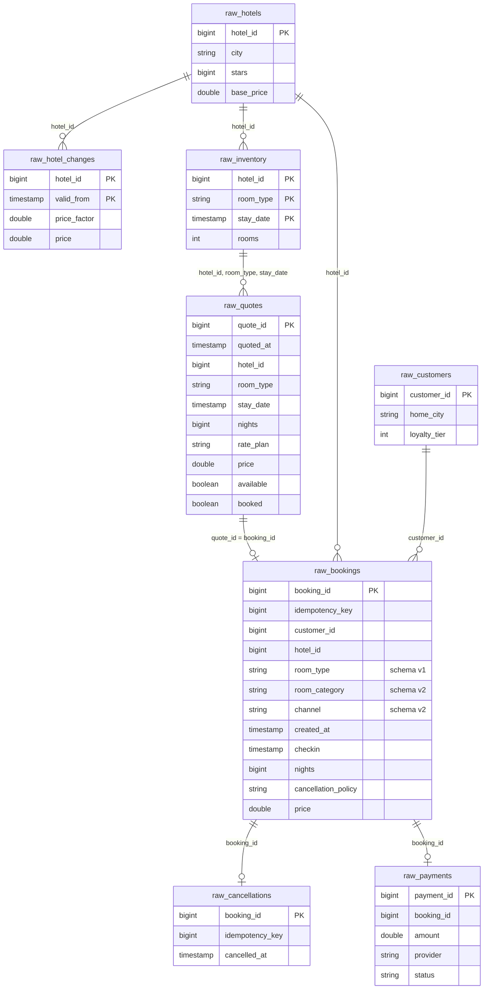
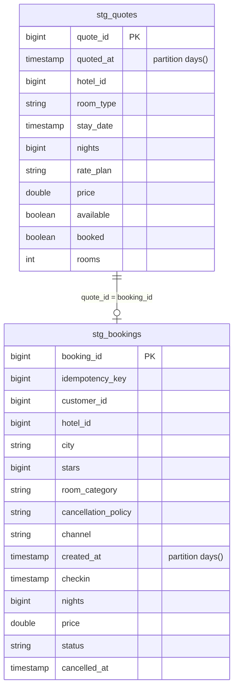
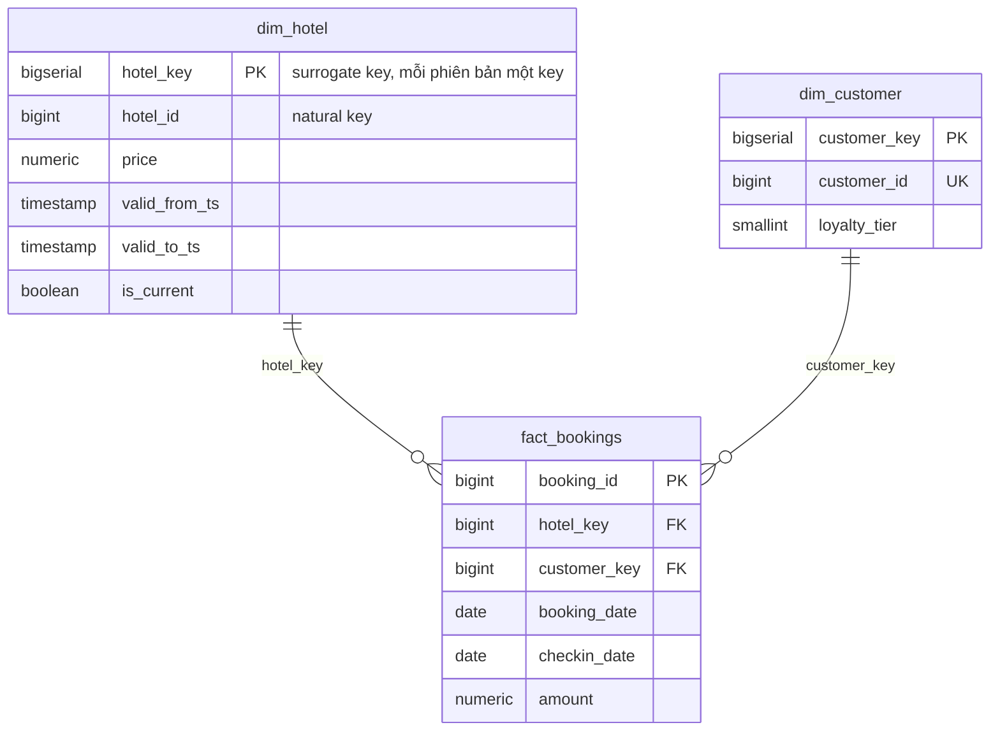

# Schema design

Thiết kế bảng theo zone, dimension SCD2, bảng feature, quan hệ dim–fact và quy ước đặt tên.

Mỗi mục dưới đây ứng với một dòng của rubric. Phần **Cách làm** mô tả giải pháp đã triển khai, đồng bộ từ
cột F của rubric. Phần **Kết quả** ghi test đã chạy, số liệu đo được hoặc ảnh chụp (`docs/images/`).

## Visualize tables on all zones

**Rubric:** edai-1 · dòng 34 · 2 điểm · nhóm *Documentation* › *Schema design*

**Cần nộp (cả nhóm):** Document capture màn hình thể hiện các bảng và quan hệ giữa chúng trên mỗi zone, giải thích từng bảng có nhiệm vụ gì

**Cách làm:** [Đã có] `docs/edai-1/schema_design.md` có ERD cho từng zone (Bronze `raw_`, Silver `stg_`, Gold) vẽ bằng Mermaid từ schema trong code (`generator/offline_gen.py`, `storage/optimize.sql`, `schema/gold_schema.sql`), mỗi bảng một dòng mô tả vai trò. Trên DataHub: 3 recipe `governance/datahub/` (postgres Gold, iceberg Silver, s3 Bronze) ingest schema; `emit_datahub.emit_table_docs` gắn mô tả và tag zone cho 25 bảng; `tests/test_datahub_recipes.py` kiểm tên dataset khớp lineage. [Cần làm] chụp ERD từ DBeaver và trang Schema, lọc theo tag zone trên DataHub.

**Kết quả:** ERD dưới đây vẽ từ schema trong code. Bronze và Silver là file Parquet và bảng Iceberg nên không có ràng
buộc khoá; các đường nối ở hai zone này là quan hệ logic theo cột cùng tên. Ở Gold, chỉ hai đường nối của `fact_bookings`
là khoá ngoại thật. _Chưa có ảnh ERD xuất từ DBeaver trên cluster._

### Bronze (`s3a://lake/bronze/raw_*`, Parquet)

DP1 chép nguyên dữ liệu từ landing, không biến đổi. Bốn bảng sự kiện chia theo `dt=<ngày>`; bốn bảng dim chép một lần.

| Bảng | Nhiệm vụ |
|---|---|
| `raw_quotes` | log lượt xem giá, một dòng mỗi lượt; bảng lớn nhất (mốc 100GB), dùng cho bài skew |
| `raw_bookings` | sự kiện đặt phòng lúc tạo, chưa có trạng thái huỷ; còn bản trùng do double submit và hai phiên bản schema |
| `raw_cancellations` | các lần huỷ, chia theo ngày huỷ nên partition `dt=ds` không chứa lần huỷ tương lai |
| `raw_payments` | giao dịch thanh toán của booking |
| `raw_hotels` | danh mục khách sạn: thành phố, hạng sao, giá gốc |
| `raw_hotel_changes` | lịch sử đổi giá của khách sạn, nguồn của SCD2 `dim_hotel` |
| `raw_customers` | danh mục khách: thành phố, hạng thành viên |
| `raw_inventory` | số phòng mở bán theo khách sạn, loại phòng và đêm |

### Silver (`lake.silver.stg_*`, Iceberg)

Dữ liệu đã làm sạch: dedup, hợp nhất schema, gắn trạng thái huỷ. Hai bảng chia partition theo ngày.

| Bảng | Nhiệm vụ |
|---|---|
| `stg_bookings` | một dòng mỗi booking sau dedup theo `idempotency_key`; `room_type` và `room_category` gộp thành một cột; có `city`, `stars` từ `raw_hotels`; `status` và `cancelled_at` cập nhật bằng MERGE mỗi ngày |
| `stg_quotes` | lượt xem giá kèm số phòng mở bán (`rooms`) của ô `hotel × room_type × stay_date`, kết quả của bài join lệch |

### Gold (`gold.*`, PostgreSQL)

| Bảng | Nhiệm vụ |
|---|---|
| `dim_hotel` | dimension SCD2 của khách sạn: mỗi lần đổi giá sinh một phiên bản mới |
| `dim_customer` | dimension khách hàng |
| `fact_bookings` | một dòng mỗi booking, trỏ tới phiên bản `dim_hotel` có hiệu lực lúc đặt |
| `labels_cancel` (view) | nhãn huấn luyện: `is_cancelled` = huỷ trước ngày nhận phòng |
| `feat_customer_booking_stats` | feature lịch sử 90 ngày của khách, do DP3 tính |
| `feat_hotel_demand` | feature nhu cầu 7 và 30 ngày của khách sạn, do DP3 tính |
| `feat_hotel_realtime` | số booking trong 1 giờ gần nhất của khách sạn, do Flink ghi |
| `booking_risk` | xác suất huỷ của từng booking kèm phiên bản model đã chấm |
| `hotel_rooms` | số phòng mở bán theo khách sạn và đêm trong 30 đêm tới |
| `overbooking_limits` | số phòng bán vượt K đã được revenue manager duyệt |
| `stream_bookings_1m` | số booking từng phút do Flink đếm, dùng để đối soát stream với batch |
| `stream_late_bookings` | event tới trễ hơn watermark cộng allowed lateness (side output của Flink) |
| `stg_bookings`, `stg_customers`, `stg_hotel_changes` | bảng trung chuyển của DP2: Spark ghi thay đổi trong ngày qua JDBC, sau đó `sql/dp2_upsert_gold.sql` nạp vào dim và fact; không có trong ERD vì ghi đè mỗi lần chạy |

## Dim table with SCD 2

**Rubric:** edai-1 · dòng 35 · 2 điểm · nhóm *Documentation* › *Schema design*

> Dim table with SCD 2 (valid_from_ts, valid_to_ts, is_current)

**Cách làm:** [Đã có] `dim_hotel` có `valid_from_ts`, `valid_to_ts`, `is_current`, cập nhật bằng `sql/dp2_upsert_gold.sql`. `tests/test_gold_sql.py` chạy 40 ngày trên Postgres thật. Kết quả: mỗi khách sạn có số phiên bản bằng 1 cộng số lần đổi giá (có khách sạn từ 3 phiên bản trở lên), đúng một bản hiện hành, fact trỏ đúng phiên bản tại thời điểm đặt, chạy lại cùng ngày không làm thay đổi dữ liệu. [Cần làm] chụp một khách sạn có 3 dòng phiên bản.

**Kết quả:** các test `edai1/tests/test_gold_sql.py` chạy cục bộ và đạt (2026-11-16). Chưa có ảnh chụp trên cluster.

## Feature tables with 2 columns event_timestamp and created

**Rubric:** edai-1 · dòng 36 · 2 điểm · nhóm *Documentation* › *Schema design*

> Feature tables (feat_ tables) with 2 columns event_timestamp and created

**Cách làm:** [Đã có] `feat_customer_booking_stats`, `feat_hotel_demand`, `feat_hotel_realtime` đều có `event_timestamp` và `created`.

**Kết quả:** _Chưa có. Cần số liệu, ảnh chụp hoặc link code sau khi chạy trên cluster._

## Relationship between dim & fact tables

**Rubric:** edai-1 · dòng 37 · 2 điểm · nhóm *Documentation* › *Schema design*

> Relationship between dim & fact tables (You can simply export via DBeaver or similar tools)

**Cách làm:** [Đã có] `fact_bookings` có khoá ngoại tới `dim_hotel` (`hotel_key`) và `dim_customer` (`customer_key`) trong `schema/gold_schema.sql`; ERD dim–fact nằm ở `docs/edai-1/schema_design.md`. Recipe postgres đọc được khoá ngoại nên tab Schema của `fact_bookings` trên DataHub hiện nhãn Foreign Key trỏ sang `dim_hotel`, `dim_customer`. [Cần làm] thêm `fact_quotes`, `dim_event`; chụp ERD DBeaver và tab Schema trên DataHub.

**Kết quả:** `fact_bookings` có hai khoá ngoại khai báo trong `schema/gold_schema.sql`. _Chưa có ảnh ERD xuất từ DBeaver._

- Fact trỏ tới dim bằng surrogate key (`hotel_key`, `customer_key`), không bằng natural key.
- Với `dim_hotel` (SCD2), `sql/dp2_upsert_gold.sql` chọn phiên bản bằng join theo khoảng: `created_at` của booking nằm
  trong `[valid_from_ts, valid_to_ts)`. Mỗi booking vì vậy giữ đúng giá niêm yết tại thời điểm đặt.
- Các bảng `feat_*`, `booking_risk`, `hotel_rooms` nối với dim qua natural key (`hotel_id`, `customer_id`) và không khai
  báo khoá ngoại, vì chúng được ghi bởi job khác (DP3, Flink, `score_bookings`) và đọc theo natural key.

## Naming convention

**Rubric:** edai-1 · dòng 38 · 2 điểm · nhóm *Documentation* › *Schema design*

> Naming convention (- Gold layer: `dim_`, `fact_`, `obt_`, `feat_`, `raw`, prefix or similar) (- Bronze & Silver layer: `raw_`, `stg_` prefix or similar)

**Cách làm:** [Đã có] Quy ước tiền tố `raw_`, `stg_`, `dim_`, `fact_`, `feat_`. [Cần làm] áp dụng cho các bảng mới (`raw_quotes`, `stg_quotes`, `fact_quotes`, `dim_event`).

**Kết quả:** _Chưa có. Cần số liệu, ảnh chụp hoặc link code sau khi chạy trên cluster._
