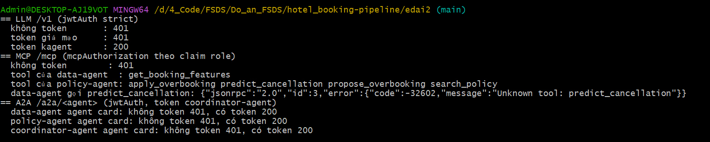
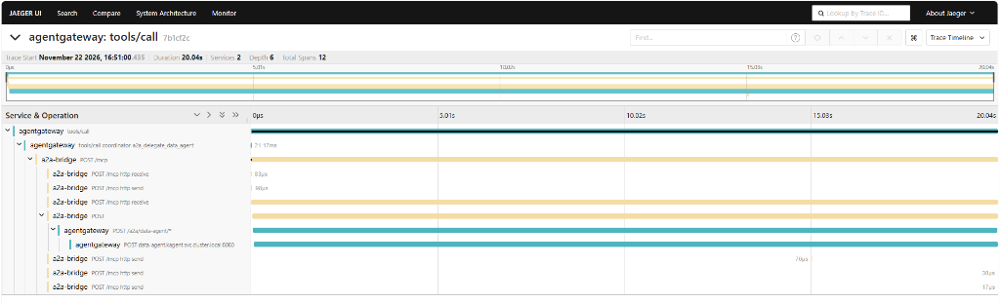

# A2A gateway

`agentgateway` là điểm vào duy nhất cho các agent theo giao thức A2A.

## Cấu hình A2A Gateway

Các route `/a2a/data-agent`, `/a2a/policy-agent`, `/a2a/policy-agent-v2` và `/a2a/coordinator-agent` trong [`gateway/agentgateway.yaml`](../../edai2/gateway/agentgateway.yaml) được cấu hình với policy `a2a` (nhận diện lưu lượng A2A), `jwtAuth` (`mode: strict`) và `urlRewrite` về `/` của từng pod agent. Riêng `/a2a/policy-agent` chia tải 50/50 giữa `policy-agent` (v1) và `policy-agent-v2` để phục vụ A/B testing, còn `/a2a/policy-agent-v2` gọi thẳng bản v2.

Kiểm thử bằng [`gateway/check.sh`](../../edai2/gateway/check.sh): agent card của cả 3 agent trả về `401` khi thiếu token và `200` khi dùng token của client `coordinator-agent`. Khi gửi `message/send` tới `/a2a/coordinator-agent/` kèm JWT, coordinator điều phối thành công `data-agent` và `policy-agent` để trả về đủ số liệu (`completed`, 17,9 giây).

Để lời gọi nội bộ từ `coordinator-agent` tới `data-agent` và `policy-agent` cũng đi qua `agentgateway` (thay vì gọi thẳng trong cluster do `kagent v1alpha2` chỉ tham chiếu agent con theo tên Kubernetes), hệ thống triển khai MCP server [`a2a-bridge`](../../edai2/gateway/a2a_bridge.py) (cung cấp 2 tool `delegate_data_agent` và `delegate_policy_agent`) đứng sau route `/mcp-a2a` trên `agentgateway` (xác thực JWT và kiểm tra quyền `jwt.role == "coordinator-agent"` qua CEL). Khi `coordinator-agent` cần điều phối, yêu cầu đi theo chuỗi `coordinator-agent` → `agentgateway (/mcp-a2a)` → `a2a-bridge` → `agentgateway (/a2a/data-agent/` hoặc `/a2a/policy-agent/)` → sub-agent đích, giữ nguyên ngữ cảnh trace phân tán (OTel `trace.id` xuyên suốt trên Jaeger) và tổng hợp kết quả thành công (`HTTP 200`).

