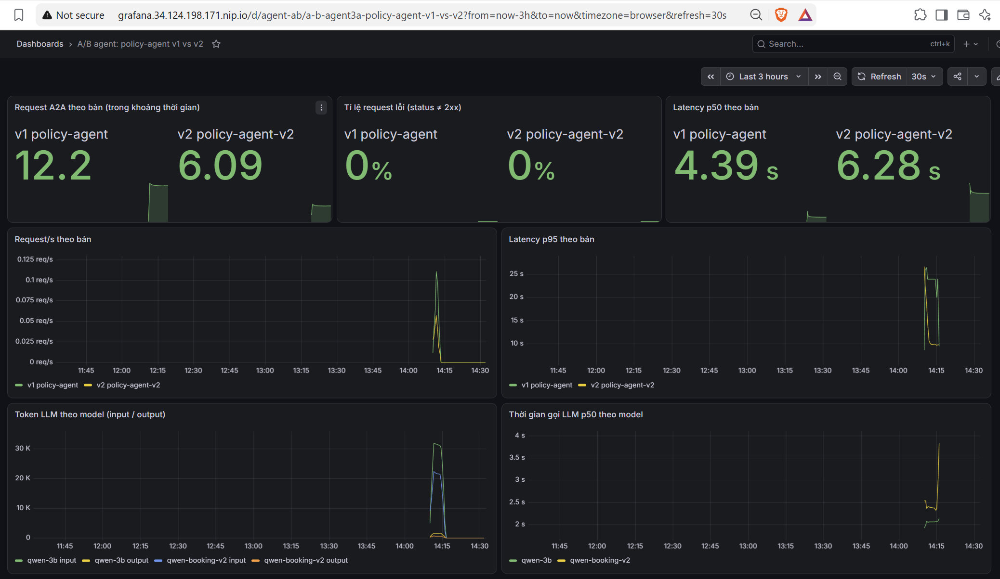

# A/B testing

A/B testing cho agent, LLM và model inference.

## A/B test cho Agent với ModelConfig và Prompt khác nhau

policy-agent có hai bản chạy song song trong [`agents/agents-gke.yaml`](../../edai2/agents/agents-gke.yaml):

| | policy-agent (v1) | policy-agent-v2 |
|---|---|---|
| ModelConfig | `default-model-config` → `/v1` của gateway (90/10 qwen-3b / LoRA) | `model-config-v2` → `/llm-v2/v1`, chỉ adapter `qwen-booking-v2` |
| Prompt | trả lời ngắn gọn | tối đa 3 câu, câu cuối ghi nguồn (tool, chunk_id) |
| Tool, HITL | 4 tool, `apply_overbooking` cần duyệt | giống v1 |

`agentgateway` ([`gateway/agentgateway.yaml`](../../edai2/gateway/agentgateway.yaml)) chia route `/a2a/policy-agent` **50/50** giữa hai bản (còn `/a2a/policy-agent-v2` gọi thẳng v2). Metric được Prometheus thu thập và trực quan hóa trên dashboard Grafana [`agent-ab`](../../edai2/observability/dashboards/agent-ab.json) (số request, tỉ lệ lỗi, latency p50/p95 và token theo từng bản/model).

[`tests/ab_agent.py`](../../edai2/tests/ab_agent.py) gửi 20 câu hỏi (xác suất huỷ, chính sách, bán vượt) qua
`/a2a/policy-agent/` và ghi bản trả lời theo `kagent_app_name`:

| Bản | Lượt | p50 | max | completed | tool lỗi | token output TB |
|---|---|---|---|---|---|---|
| policy-agent (v1) | 13 | 4,5 s | 13,7 s | 13 | 0 | 85 |
| policy-agent-v2 | 7 | 5,7 s | 17,5 s | 7 | 0 | 49 |

v2 trả lời ngắn hơn đúng như prompt (token output thấp hơn khoảng 42%) nhưng chậm hơn, vì adapter LoRA thêm chi phí
trên cùng vLLM (dashboard: thời gian gọi LLM p50 của `qwen-booking-v2` cao hơn `qwen-3b`). Mẫu 20 lượt còn nhỏ và tỉ
lệ chia thực tế là 13/7, nên kết quả chỉ mang tính định hướng; chưa đánh giá độ đúng nội dung câu trả lời.

*Chú thích: Dashboard Grafana `agent-ab` so sánh song song 2 bản `policy-agent` (v1 vs v2) và 2 bản LLM (`qwen-3b` vs `qwen-booking-v2`) về số request, latency p50/p95 và lượng token.*

## A/B test giữa các phiên bản LLM trên nền tảng inference

Phiên bản LLM mới được thử theo hai bước, không thay thẳng bản cũ.

**A/B offline** chạy trên vLLM 0.9.2 ở laptop GPU. Một vLLM phục vụ cùng lúc Qwen2.5-1.5B gốc và hai
adapter LoRA: `qwen-booking-v1` (fine-tune với 400 hội thoại tính K + 29 câu chính sách và PII, 2 epoch) và
`qwen-booking-v1b` (60 hội thoại K, 4 epoch). Cả ba trả lời cùng 6 câu hỏi, temperature 0; đáp án K đối chiếu với
`overbooking.limit`, chính sách đối chiếu với `policies/*.md`.

| Nhóm câu hỏi | base | v1 | v1b |
|---|---|---|---|
| Tính K (2 câu, đáp án 5 và 3) | 0/2 | 1/2 | 0/2 |
| Chính sách huỷ, đổi ngày (2 câu) | 0/2 | 0/2 | 0/2 |
| Từ chối dữ liệu PII: số thẻ, CCCD (2 câu) | 2/2 | 0/2 | 1/2 |

Quyết định: giữ v1, không promote v1b (kém hơn v1 ở phần tính K). Cả hai bản fine-tune đều bịa chính sách và kém base ở
phần từ chối PII: model 1,5B học khuôn câu trả lời chứ không học phép tính hay dữ kiện. Vì vậy K lấy từ tool
`propose_overbooking`, chính sách lấy qua RAG (`search_policy`), PII chặn ở lớp ngoài (`llm_metrics.py`); fine-tune chỉ
nên dùng để dạy cách gọi tool và giọng trả lời.

**A/B online** qua `agentgateway` trên GKE: route `/v1` ([`gateway/agentgateway.yaml`](../../edai2/gateway/agentgateway.yaml)) chia tỉ lệ **90/10** giữa `qwen-3b` và adapter LoRA `qwen-booking-v2` trên cùng một vLLM; đổi tỉ lệ hay rút bản mới chỉ cần sửa gateway, còn token và latency p50 được so sánh trực tiếp trên dashboard `agent-ab`.

Trong 1 giờ đầu sau khi bật scrape, route `/v1` có 29 request thành công: 27 tới `qwen-3b` và 2 tới
`qwen-booking-v2` (khoảng 93/7, sát trọng số 90/10). Tính cả route `/llm-v2` của policy-agent-v2, `qwen-booking-v2`
nhận 15 request. Trên dashboard, thời gian gọi LLM p50 của `qwen-booking-v2` cao hơn `qwen-3b` (adapter LoRA thêm
chi phí trên cùng GPU); số mẫu của bản v2 còn ít nên chưa đủ để quyết định promote.

*Chú thích: Kết quả chạy A/B offline giữa Qwen2.5-1.5B gốc, LoRA `v1` và `v1b`: cho thấy model 1,5B fine-tune kém phần nhớ chính sách/từ chối PII nên phải giao các phần đó cho RAG và proxy.*

*Chú thích: Dashboard Grafana `agent-ab` so sánh song song 2 bản `policy-agent` (v1 vs v2) và 2 bản LLM (`qwen-3b` vs `qwen-booking-v2`) về số request, latency p50/p95 và lượng token.*
