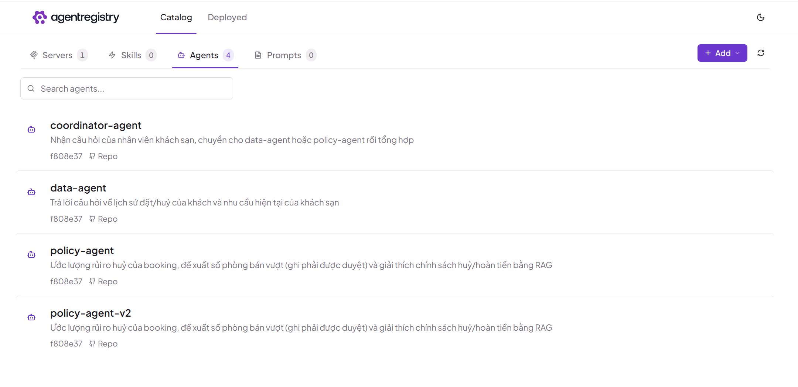
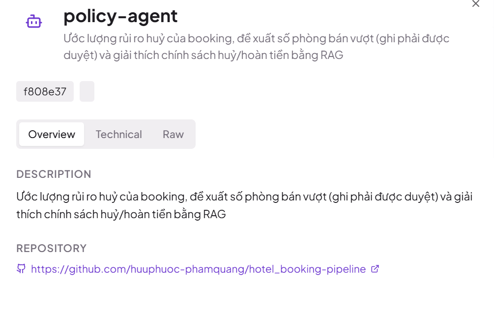

# Agent registry

Registry lưu agent card và MCP server.

Mỗi mục ứng với một dòng của rubric, ghi lại phần đã triển khai và kết quả (số liệu đo được, ảnh chụp trong
`docs/images/`).

## Deploy registry for agent theo tutorial này

agentregistry v0.4.0 (aregistry.ai) cài bằng Helm chart chính thức
`oci://ghcr.io/agentregistry-dev/agentregistry/charts/agentregistry` với
[`k8s/agentregistry-values.yaml`](../../edai2/k8s/agentregistry-values.yaml), namespace `agentregistry`, trên cluster
thứ hai ngày 2026-11-19. Registry dùng Postgres sẵn có của data platform (database `agentregistry`, extension pgvector)
thay cho Postgres bundled để không thêm pod; chuỗi kết nối nằm trong Secret `agentregistry-db`. Một pod phục vụ cả
web UI, REST API (`/v0/...`, tài liệu ở `/docs`) và MCP endpoint của registry; UI ra ngoài qua Ingress
`registry.34.124.198.171.nip.io` có basic auth (dòng 41).

Catalog hiện có 4 agent (`coordinator-agent`, `data-agent`, `policy-agent`, `policy-agent-v2`) và 1 MCP server
`booking-tools`, cùng tag `f808e37` là commit đang deploy. Mỗi agent ghi lại tiêu đề và mô tả từ agent card A2A,
model, MCP server dùng, repository kèm commit và thư mục `edai2/agents`, cùng địa chỉ A2A qua agentgateway.

