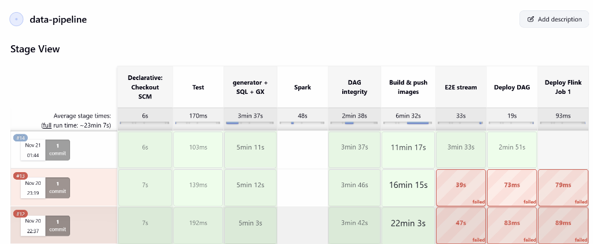
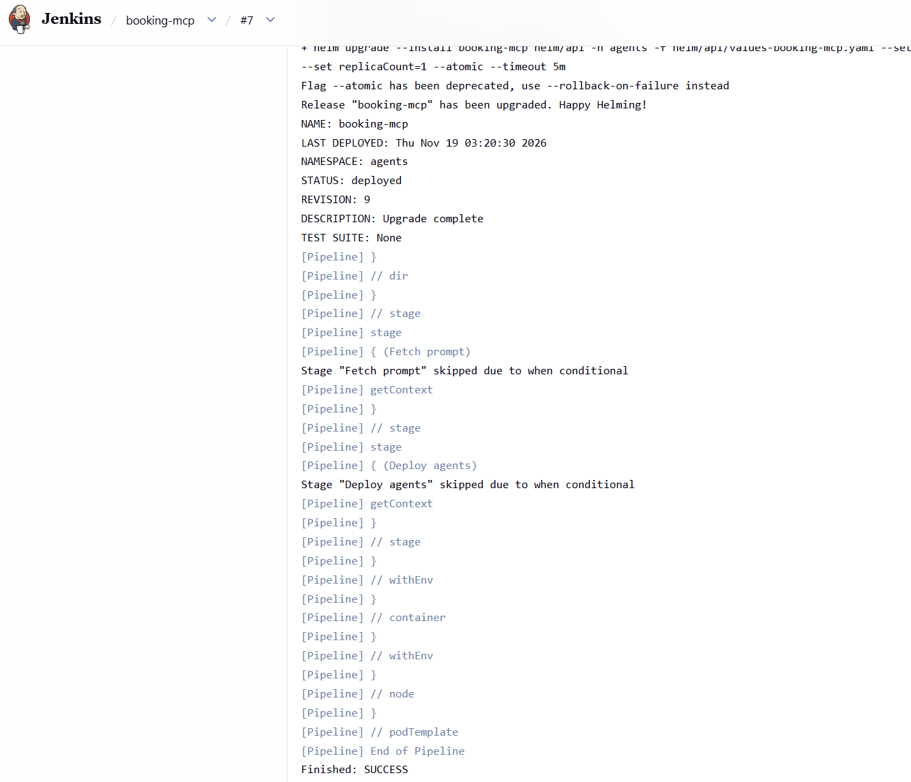

# CI/CD

Jenkins chạy test, build image và tự deploy.

Mỗi mục dưới đây ứng với một dòng của rubric. Phần **Cách làm** mô tả giải pháp đã triển khai, đồng bộ từ
cột F của rubric. Phần **Kết quả** ghi test đã chạy, số liệu đo được hoặc ảnh chụp (`docs/images/`).

## RAG Data Pipeline

**Rubric:** edai-2 · dòng 33 · 2 điểm · nhóm *CI/CD* › *CI/CD cho data pipelines ở trên (chỉ cần demo RAG Data Pipeline là được vì mấy cái khác tương tự)*

**Cần nộp (cả nhóm):** Document show các CICD pipelines đã chạy và từng step trong component làm gì + link tới các Jenkinsfile tương ứng

**Cách làm:** [Đã có] [`ci/Jenkinsfile.data`](../../ci/Jenkinsfile.data) chạy DAG integrity test (có `rag_data_pipeline`) trong image Airflow, lấy secret registry từ Vault, rồi deploy DAG bằng image Airflow (DAG nằm trong image, `helm upgrade --atomic`) và kiểm Airflow parse không lỗi.

**Kết quả:** Pipeline `data-pipeline` trên Jenkins (`cicd-vm`) đã chạy thành công ở **Build #14** (commit `d48433b`, ngày 2026-11-21) với từng stage:

- **Checkout SCM (6 s):** kéo mã nguồn từ nhánh `main` trên GitHub (Jenkins poll repo 2 phút/lần).
- **Test (song song):**
  - `DAG integrity` (3 min 37 s): chạy [`ci/test_dags.sh`](../../ci/test_dags.sh) bên trong image `apache/airflow:2.10.5-python3.12`, xác nhận import và cấu trúc hợp lệ cho toàn bộ DAG (`4 passed`, gồm `rag_data_pipeline`, `feast_materialize_incremental`, `feast_materialize_realtime`, DP1–DP3).
  - `generator + SQL + GX` (5 min 11 s): chạy `test_stream_gen.py`, `test_gold_sql.py`, `test_bronze_checks.py` (`27 passed`).
- **Build & push images (11 min 17 s):** lấy `REG_KEY` (base64 một dòng) từ Vault `secret/ci/registry`, đăng nhập Artifact Registry (`Login Succeeded`, không lộ secret), build và push `data/airflow-booking:d48433b` (cùng `data/generator:d48433b`, `data/flink-booking:d48433b`) kèm tag `:latest` để dùng `--cache-from`.
- **E2E stream (3 min 33 s):** kiểm end-to-end nhánh stream (`3 passed`).
- **Deploy DAG (2 min 51 s):** xoá Job migrate/create-user cũ nếu còn sót, chạy `helm upgrade airflow --atomic` trong namespace `data` lên **revision 6 (`STATUS: deployed`)** với image `data/airflow-booking:d48433b`, gọi `airflow dags reserialize` và kiểm `airflow dags list-import-errors -o json` trả về `[]` (`Finished: SUCCESS`).

## Agent kéo dữ liệu

**Rubric:** edai-2 · dòng 34 · 2 điểm · nhóm *CI/CD* › *CI/CD cho các MCP Servers & Agents ở trên (Build & package xong MCP Servers => Deploy Agent with the corresponding MCP Servers) (Agent cần sử dụng System Prompt từ một Prompt Management tool như Langfuse)*

**Cách làm:** [Đã có] [`edai2/ci/Jenkinsfile`](../../edai2/ci/Jenkinsfile) gồm các bước `Test` → `Build & push images` (secret từ Vault) → `Deploy APIs` (Helm `--atomic`) → `Fetch prompt` (`ci/render_agents.py` lấy prompt label `production` từ Langfuse) → `Deploy agents` (apply `Agent` + `rollout status` + `publish_agent_card.py` lên `agentregistry`); agent build chạy trên [`ci/pod-template.yaml`](../../edai2/ci/pod-template.yaml) và [`ci/tools.Dockerfile`](../../edai2/ci/tools.Dockerfile).

**Kết quả:** Toàn bộ pipeline `booking-mcp` (cả nửa MCP server lẫn nửa agent với `WITH_AGENTS=true`) đã chạy thành công ở **Build #19** (commit `762fa7b`, ngày 2026-11-21) trên Jenkins (`cicd-vm`):

- **Hạ tầng CI & Secret:** Jenkins chạy trên VM `cicd-vm` (JCasC + Kubernetes agent trong namespace `ci`, RBAC trong [`edai2/k8s/jenkins-ci.yaml`](../../edai2/k8s/jenkins-ci.yaml)); secret Artifact Registry (`secret/ci/registry`) và Langfuse (`secret/ci/langfuse`, host `https://jp.cloud.langfuse.com`) được nạp từ HashiCorp Vault, không lộ giá trị ra log.
- **Test (4 min 46 s) & Build & push (22 min 15 s):** Test pass 79 case (coverage `mcp_server` + `observability` 96%, `drift-api` 100%), build và push `agents/booking-mcp:762fa7b`.
- **Deploy APIs (1 min 22 s):** `helm upgrade --install booking-mcp` trong namespace `agents` lên **revision 30 (`STATUS: deployed`)**.
- **Fetch prompt (1 min 8 s):** lấy 4 system prompt gắn nhãn `production` (`data-agent`, `policy-agent`, `policy-agent-v2`, `coordinator`) từ Langfuse bằng [`ci/render_agents.py`](../../edai2/ci/render_agents.py) ra `build/agents.yaml`.
- **Deploy agents (47 s):** `kubectl apply -f build/agents.yaml`, đợi `rollout status` thành công và chạy [`ci/publish_agent_card.py`](../../edai2/ci/publish_agent_card.py) đăng ký `MCPServer booking-tools` (`762fa7b`) và `Agent data-agent` (`762fa7b`, `created`) lên `agentregistry` (`Finished: SUCCESS`).

Các build trước đó lần lượt lộ ra và được sửa: docker CLI thiếu trong image tools, git từ chối workspace do khác uid (`safe.directory`), thiếu quyền `servicemonitors`, vượt quota CPU khi chart chạy 2 replica (`API_REPLICAS`), và giảm `requests.memory` của `booking-mcp` xuống `1Gi` để RollingUpdate đủ chỗ trên 2 node.

## Agent để làm coordinator

**Rubric:** edai-2 · dòng 35 · 2 điểm · nhóm *CI/CD* › *CI/CD cho các MCP Servers & Agents ở trên (Build & package xong MCP Servers => Deploy Agent with the corresponding MCP Servers) (Agent cần sử dụng System Prompt từ một Prompt Management tool như Langfuse)*

**Cách làm:** [Đã có] [`edai2/ci/Jenkinsfile`](../../edai2/ci/Jenkinsfile): `render_agents.py` lấy prompt `coordinator` (label `production`) từ Langfuse → `kubectl apply -f build/agents.yaml` → kiểm `rollout status` từng agent (gồm `coordinator-agent`) → `publish_agent_card.py` đăng ký lên `agentregistry`.

**Kết quả:** Trong cùng **Build #19** (`WITH_AGENTS=true`, commit `762fa7b`, ngày 2026-11-21), sau khi `booking-mcp` lên revision 30 và `data-agent`, `policy-agent`, `policy-agent-v2` sẵn sàng, pipeline chạy tiếp cho `coordinator-agent`:
- `Fetch prompt`: kéo system prompt `coordinator` v1 (label `production`) từ Langfuse vào `build/agents.yaml`.
- `Deploy agents`: `agent.kagent.dev/coordinator-agent` được apply, `kubectl -n kagent rollout status deploy/coordinator-agent` báo `successfully rolled out`, và `publish_agent_card.py` đăng ký `Agent coordinator-agent` tag `762fa7b` (`created`) lên `agentregistry`.

## CI/CD cho stream feature jobs

**Rubric:** edai-2 · dòng 36 · 2 điểm · nhóm *CI/CD*

**Cách làm:** [Đã có] [`ci/Jenkinsfile.data`](../../ci/Jenkinsfile.data) build image Flink, chạy e2e stream trên Docker (Kafka → Flink → Postgres), rồi apply FlinkDeployment (offline). Job 2 cho online là DAG `feast_materialize_realtime`, deploy cùng các DAG khác.

**Kết quả:** Đã chạy thành công ở **Build #14** của job `data-pipeline` trên Jenkins (commit `d48433b`, ngày 2026-11-21):

- **Build & push image Flink (Job 1):** [`ci/Jenkinsfile.data`](../../ci/Jenkinsfile.data) build `edai1/k8s/flink.Dockerfile` và push `data/flink-booking:d48433b` (cùng `data/generator:d48433b`) lên Artifact Registry bằng secret từ Vault.
- **E2E stream (3 min 33 s):** chạy [`edai1/tests/test_stream_e2e.py`](../../edai1/tests/test_stream_e2e.py) bằng đúng 2 image vừa build (`booking-generator:multistage` → Kafka → Flink `booking-flink:local` → PostgreSQL): **3 passed trong 210,25 s** (`test_minute_reconciliation`, `test_dlq_matches_injected_violations`, `test_realtime_feature_written` xác nhận ghi `gold.feat_hotel_realtime`).
- **Deploy Job 2 (Online Store):** DAG `feast_materialize_realtime` nằm trong image `data/airflow-booking:d48433b`, được deploy tự động qua `helm upgrade airflow --atomic` lên **revision 6** (namespace `data`) và kiểm không có lỗi import.
- **Deploy Flink Job 1 (Offline Store):** stage `Deploy Flink Job 1` đặt tham số `WITH_FLINK_DEPLOY=false` và bỏ qua có chủ đích trên cluster thứ 2 (không cài Flink Operator); khi bật trên cluster có Flink Operator, stage này apply [`edai1/k8s/flink.yaml`](../../edai1/k8s/flink.yaml) với tag mới và chờ `lifecycleState=STABLE`.

