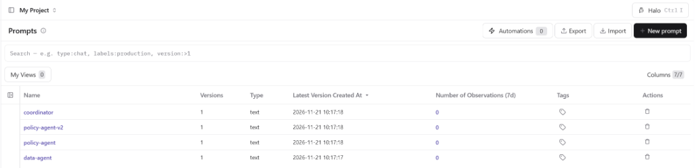
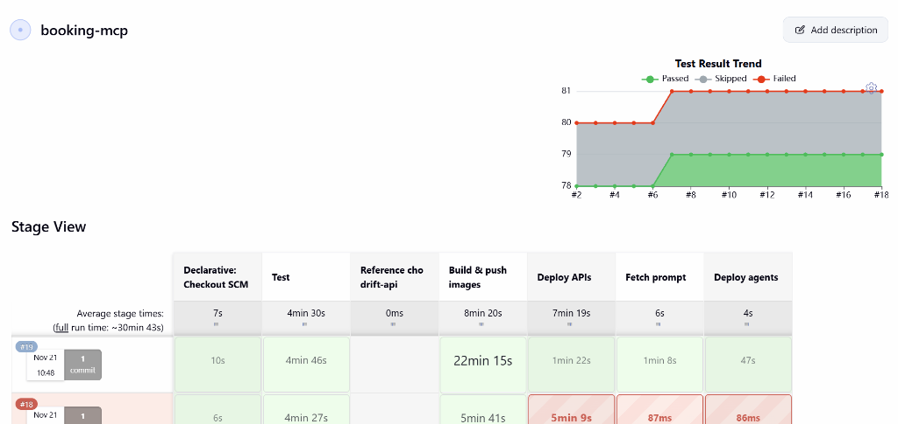
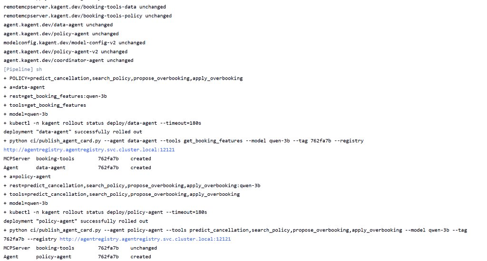
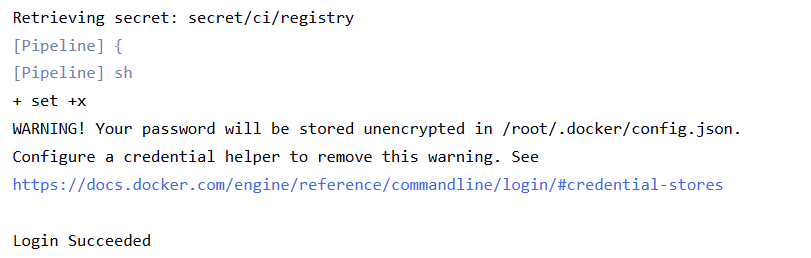

# CI/CD

Jenkins tự động chạy test, build image và deploy lên GKE.

## CI/CD cho Data & RAG Pipelines

Pipeline `data-pipeline` ([`ci/Jenkinsfile.data`](../../ci/Jenkinsfile.data)) trên Jenkins (`cicd-vm`) đã chạy thành công ở **Build #14** (commit `d48433b`) với từng stage:

- **Checkout SCM (6 s):** kéo mã nguồn từ nhánh `main` trên GitHub.
- **Test (song song):**
  - `DAG integrity` (3 min 37 s): chạy [`ci/test_dags.sh`](../../ci/test_dags.sh) trong image `apache/airflow:2.10.5-python3.12`, xác nhận import và cấu trúc hợp lệ cho toàn bộ DAG (`4 passed`, gồm `rag_data_pipeline`, `feast_materialize_incremental`, `feast_materialize_realtime`, DP1–DP3).
  - `generator + SQL + GX` (5 min 11 s): chạy `test_stream_gen.py`, `test_gold_sql.py`, `test_bronze_checks.py` (`27 passed`).
- **Build & push images (11 min 17 s):** lấy `REG_KEY` từ Vault `secret/ci/registry`, đăng nhập Artifact Registry (`Login Succeeded`, không lộ secret), build và push `data/airflow-booking:d48433b` (cùng `data/generator:d48433b`, `data/flink-booking:d48433b`) kèm tag `:latest`.
- **E2E stream (3 min 33 s):** kiểm end-to-end nhánh stream (`3 passed`).
- **Deploy DAG (2 min 51 s):** nâng cấp `helm upgrade airflow --atomic` trong namespace `data` lên **revision 6 (`STATUS: deployed`)** với image `data/airflow-booking:d48433b`, gọi `airflow dags reserialize` và kiểm `airflow dags list-import-errors -o json` trả về `[]` (`Finished: SUCCESS`).

## CI/CD cho MCP Server & Agents (tích hợp Langfuse)

Toàn bộ pipeline `booking-mcp` ([`edai2/ci/Jenkinsfile`](../../edai2/ci/Jenkinsfile), bật `WITH_AGENTS=true`) đã chạy thành công ở **Build #19** (commit `762fa7b`) trên Jenkins (`cicd-vm`, agent chạy trong namespace `ci`):

- **Secret:** Nạp Artifact Registry (`secret/ci/registry`) và Langfuse (`secret/ci/langfuse`, `https://jp.cloud.langfuse.com`) từ HashiCorp Vault, không lộ giá trị ra log.
- **Test (4 min 46 s) & Build & push (22 min 15 s):** Pass `79` test case (coverage `mcp_server` + `observability` 96%, `drift-api` 100%), build và push `agents/booking-mcp:762fa7b`.
- **Deploy APIs (1 min 22 s):** `helm upgrade --install booking-mcp` trong namespace `agents` lên **revision 30 (`STATUS: deployed`)**.
- **Fetch prompt (1 min 8 s):** lấy 4 system prompt gắn nhãn `production` (`data-agent`, `policy-agent`, `policy-agent-v2`, `coordinator`) từ Langfuse bằng [`ci/render_agents.py`](../../edai2/ci/render_agents.py) ra `build/agents.yaml`.
- **Deploy agents (47 s):** `kubectl apply -f build/agents.yaml`, chờ `rollout status` thành công và chạy [`ci/publish_agent_card.py`](../../edai2/ci/publish_agent_card.py) đăng ký `MCPServer booking-tools` (`762fa7b`) và `Agent data-agent` (`762fa7b`, `created`) lên `agentregistry` (`Finished: SUCCESS`).

## CI/CD cho Coordinator Agent

Trong cùng **Build #19** (`WITH_AGENTS=true`, commit `762fa7b`), sau khi `booking-mcp` lên revision 30 và các agent con sẵn sàng, pipeline tiếp tục triển khai `coordinator-agent`:
- `Fetch prompt`: kéo system prompt `coordinator` v1 (label `production`) từ Langfuse vào `build/agents.yaml`.
- `Deploy agents`: apply `agent.kagent.dev/coordinator-agent`, chờ `kubectl -n kagent rollout status deploy/coordinator-agent` báo `successfully rolled out`, và chạy `publish_agent_card.py` đăng ký `Agent coordinator-agent` tag `762fa7b` (`created`) lên `agentregistry`.

## CI/CD cho Stream Feature Jobs

Đã chạy thành công ở **Build #14** của job `data-pipeline` ([`ci/Jenkinsfile.data`](../../ci/Jenkinsfile.data), commit `d48433b`):
- **Build & push image Flink (Job 1):** Build [`edai1/k8s/flink.Dockerfile`](../../edai1/k8s/flink.Dockerfile) và push `data/flink-booking:d48433b` lên Artifact Registry.
- **E2E stream (3 min 33 s):** Chạy [`edai1/tests/test_stream_e2e.py`](../../edai1/tests/test_stream_e2e.py) bằng 2 image vừa build (`booking-generator` → Kafka → Flink → PostgreSQL): **3 passed trong 210,25 s** (`test_minute_reconciliation`, `test_dlq_matches_injected_violations`, `test_realtime_feature_written`).
- **Deploy Job 2 (Online Store):** DAG `feast_materialize_realtime` được đóng gói và deploy tự động qua `helm upgrade airflow --atomic` lên **revision 6**.
- **Deploy Flink Job 1 (Offline Store):** Stage `Deploy Flink Job 1` để `WITH_FLINK_DEPLOY=false` trên cluster thứ 2 (không cài Flink Operator); khi bật trên cluster có Flink Operator sẽ apply [`edai1/k8s/flink.yaml`](../../edai1/k8s/flink.yaml) và chờ `lifecycleState=STABLE`.

