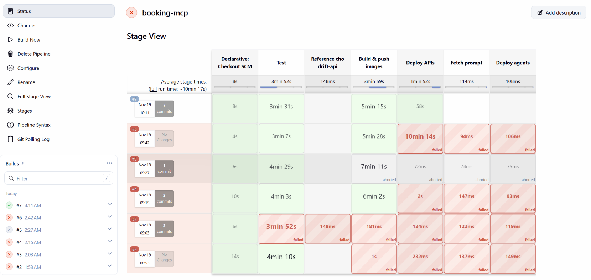
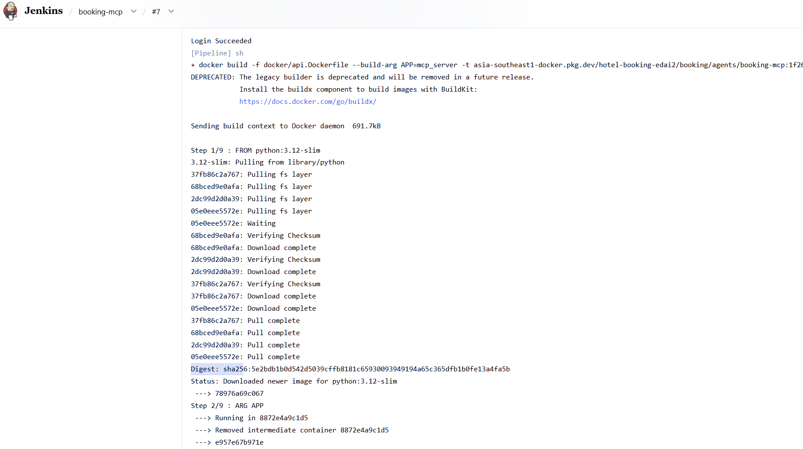

# CI/CD

Jenkins chạy test, build image và tự deploy.

Mỗi mục dưới đây ứng với một dòng của rubric. Phần **Cách làm** mô tả giải pháp đã triển khai, đồng bộ từ
cột F của rubric. Phần **Kết quả** ghi test đã chạy, số liệu đo được hoặc ảnh chụp (`docs/images/`).

## RAG Data Pipeline

**Rubric:** edai-2 · dòng 33 · 2 điểm · nhóm *CI/CD* › *CI/CD cho data pipelines ở trên (chỉ cần demo RAG Data Pipeline là được vì mấy cái khác tương tự)*

**Cần nộp (cả nhóm):** Document show các CICD pipelines đã chạy và từng step trong component làm gì + link tới các Jenkinsfile tương ứng

**Cách làm:** [Đã có] `ci/Jenkinsfile.data` chạy DAG integrity test (có `rag_data_pipeline`) trong image Airflow, rồi deploy DAG bằng image Airflow (DAG nằm trong image, `helm upgrade --atomic`) và kiểm Airflow parse không lỗi. [Cần làm] chụp lần chạy và giải thích từng stage.

**Kết quả:** _Chưa có. Cần số liệu, ảnh chụp hoặc link code sau khi chạy trên cluster._

## Agent kéo dữ liệu

**Rubric:** edai-2 · dòng 34 · 2 điểm · nhóm *CI/CD* › *CI/CD cho các MCP Servers & Agents ở trên (Build & package xong MCP Servers => Deploy Agent with the corresponding MCP Servers) (Agent cần sử dụng System Prompt từ một Prompt Management tool như Langfuse)*

**Cách làm:** [Đã có] Jenkinsfile gồm các bước test → build (secret từ Vault) → helm → `ci/render_agents.py` (lấy prompt từ Langfuse) → deploy agent; agent build chạy trên `ci/pod-template.yaml` và `ci/tools.Dockerfile`. [Cần làm] stage Fetch prompt + Deploy agents khi có Langfuse và kagent (nửa MCP server đã chạy, build #7).

**Kết quả:** nửa MCP server của pipeline đã chạy trên cluster thứ hai ngày 2026-11-19; nửa agent (stage `Fetch prompt` và
`Deploy agents`) chưa chạy vì cluster chưa có Langfuse và kagent, Jenkinsfile đặt `WITH_AGENTS=false` nên hai stage này
được bỏ qua có chủ đích.

- **Hạ tầng CI:** Jenkins chạy trên VM `cicd-vm` (role Ansible `jenkins`), cấu hình hoàn toàn bằng JCasC: cloud
  Kubernetes trỏ GKE (agent là pod trong namespace `ci`, kết nối về Jenkins bằng WebSocket qua IP nội bộ), plugin
  HashiCorp Vault trỏ Vault trên cùng VM, và 2 job pipeline `booking-mcp`, `data-pipeline` đọc thẳng từ GitHub, poll
  repo 2 phút một lần. RBAC của agent nằm trong `edai2/k8s/jenkins-ci.yaml`.
- **Secret:** khoá service account `jenkins-ci` (chỉ quyền ghi Artifact Registry) nằm trong Vault `secret/ci/registry`;
  Jenkins chỉ có token đọc `secret/ci/*`. Log build hiện `Retrieving secret` rồi `Login Succeeded`, không in giá trị.
- **Build #7** (tự chạy khi có commit mới): Test 79 pass, coverage `mcp_server` + `observability` 96% và drift-api 100%;
  build và push image `agents/booking-mcp:1f26787`; `helm upgrade --atomic` lên revision 9, pod mới Ready.

Các build #2–#6 trước đó lần lượt lộ ra và được sửa: docker CLI thiếu trong image tools, git từ chối workspace do khác
uid (`safe.directory`), thiếu quyền `servicemonitors`, và vượt quota CPU khi chart chạy 2 replica (thêm biến
`API_REPLICAS`). Build #1 in khoá registry nhiều dòng ra log vì plugin chỉ che được secret một dòng: khoá đó đã bị thu hồi,
khoá mới lưu dạng base64 một dòng và lệnh login chạy với `set +x`.

## Agent để làm coordinator

**Rubric:** edai-2 · dòng 35 · 2 điểm · nhóm *CI/CD* › *CI/CD cho các MCP Servers & Agents ở trên (Build & package xong MCP Servers => Deploy Agent with the corresponding MCP Servers) (Agent cần sử dụng System Prompt từ một Prompt Management tool như Langfuse)*

**Cách làm:** [Đã có] `ci/Jenkinsfile`: `render_agents.py` lấy prompt từ Langfuse → apply agent → kiểm rollout status từng agent (có coordinator) → `publish_agent_card.py`. [Cần làm] chụp lần chạy.

**Kết quả:** _Chưa có. Cần số liệu, ảnh chụp hoặc link code sau khi chạy trên cluster._

## CI/CD cho stream feature jobs

**Rubric:** edai-2 · dòng 36 · 2 điểm · nhóm *CI/CD*

**Cách làm:** [Đã có] `ci/Jenkinsfile.data` build image Flink, chạy e2e stream trên Docker (Kafka → Flink → Postgres), rồi apply FlinkDeployment (offline). Job 2 cho online là DAG `feast_materialize_realtime`, deploy cùng các DAG khác. [Cần làm] chụp lần chạy.

**Kết quả:** _Chưa có. Cần số liệu, ảnh chụp hoặc link code sau khi chạy trên cluster._
