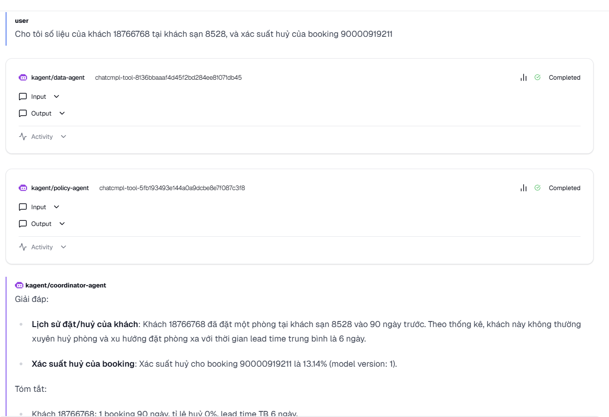
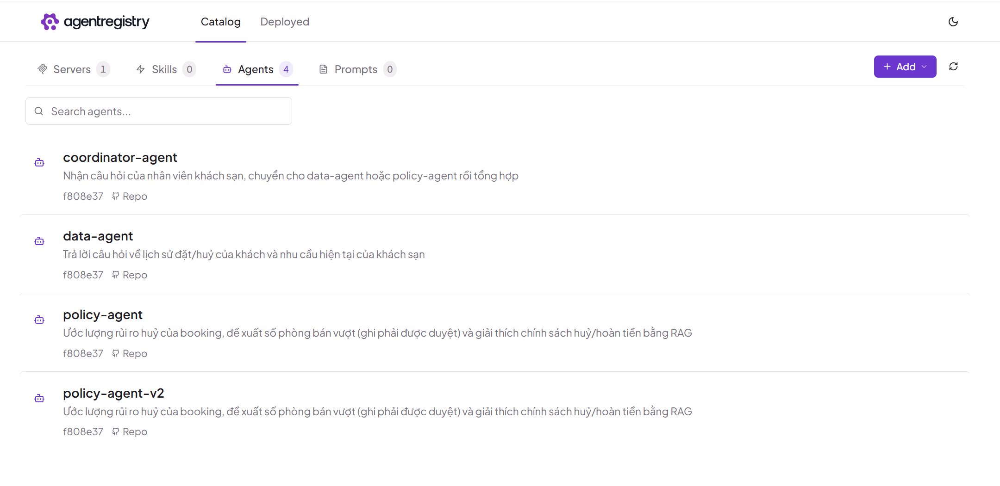
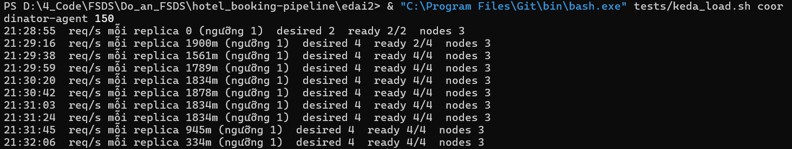

# Coordinator agent

Coordinator điều phối các agent con; tài liệu gồm số replica, autoscale và registry.

## Triển khai Coordinator Agent với multi-replica và auto-scale

`coordinator-agent` ([`agents/agents-gke.yaml`](../../edai2/agents/agents-gke.yaml)) điều phối `data-agent` và `policy-agent` qua `agentgateway` (`/mcp-a2a` → `a2a-bridge` → `/a2a/<agent>/`): tự tách câu hỏi hỗn hợp thành hai yêu cầu con rồi tổng hợp đủ số liệu khách, nhu cầu khách sạn và xác suất huỷ.

Agent chạy **2 replica** và tự động scale **2–4 replica** bằng **KEDA** ([`k8s/keda.yaml`](../../edai2/k8s/keda.yaml)) theo hai trigger (RPS trên gateway và CPU 60%). Khi chạy tải `tests/keda_load.sh` (~10 req/s), hệ thống scale từ `2/2` lên `4/4 Ready` trong **40 giây**.

*Chú thích: Giao diện kagent UI với `coordinator-agent`: tự tách câu hỏi phức hợp thành 2 yêu cầu gọi `delegate_data_agent` và `delegate_policy_agent` rồi tổng hợp lại đầy đủ.*

*Chú thích: Giao diện web `agentregistry` hiển thị đủ catalog 4 Agent (`coordinator-agent`, `data-agent`, `policy-agent`, `policy-agent-v2`) kèm tag commit git.*

*Chú thích: Output HPA của `coordinator-agent` khi chạy `tests/keda_load.sh coordinator-agent 150`: tự scale từ `2/2` lên `4/4` Ready trong 40 giây theo metric `agentgateway_requests_total` và CPU.*

## Đăng ký Coordinator Agent lên agentregistry

`coordinator-agent` được đăng ký tự động lên `agentregistry` bằng [`ci/publish_agent_card.py`](../../edai2/ci/publish_agent_card.py) trong stage `Deploy agents` của [`ci/Jenkinsfile`](../../edai2/ci/Jenkinsfile) (cùng cơ chế lấy A2A card từ kagent controller và gửi `POST /v0/apply` như `data-agent`).

Sau khi chạy thủ công và tự động qua Jenkins Build #19 (`WITH_AGENTS=true`), `coordinator-agent` cùng các agent con và MCP server `booking-tools` đều hiển thị đầy đủ trên registry.

*Chú thích: Giao diện web `agentregistry` hiển thị đủ catalog 4 Agent (`coordinator-agent`, `data-agent`, `policy-agent`, `policy-agent-v2`) kèm tag commit git.*
