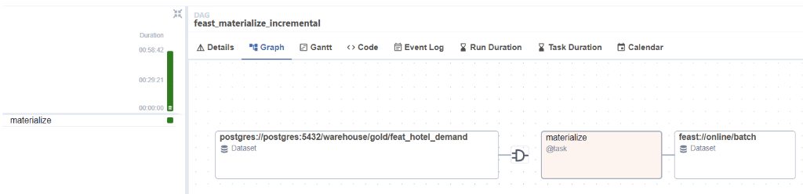

# Feature store

Materialize feature từ offline sang online, đẩy stream feature và chọn TTL cho từng bảng.

Mỗi mục dưới đây ứng với một dòng của rubric. Phần **Cách làm** mô tả giải pháp đã triển khai, đồng bộ từ
cột F của rubric. Phần **Kết quả** ghi test đã chạy, số liệu đo được hoặc ảnh chụp (`docs/images/`).

## Build data pipeline để incremental materialize dữ liệu mới nhất từ OFFLINE qua ONLINE…

**Rubric:** edai-2 · dòng 11 · 2 điểm · nhóm *Feature Store* › *Build materialize pipeline & jobs for push streaming data into feature stores*

> Build data pipeline (ví dụ với Airflow) để incremental materialize dữ liệu mới nhất từ OFFLINE qua ONLINE store

**Cần nộp (cả nhóm):** Document show ảnh pipeline đã chạy thành công trên Airflow + link tới code pipeline

**Cách làm:** [Đã có] [`feast_materialize_incremental`](../../edai2/dags/rag_pipeline.py) chạy theo Airflow Dataset của DP3 (sau bước validate), materialize đúng cửa sổ ngày logic với `max_active_runs=1`, rồi phát Dataset kích hoạt `score_bookings`.

**Kết quả:** Ngày 2026-11-19 trên Airflow 2.10.5 (GKE namespace `data`), DAG `dp3_offline_features` cho ngày logic `2025-01-13` chạy thành công và phát Airflow Dataset `FEAT_BATCH` (`postgres://postgres:5432/warehouse/gold/feat_hotel_demand`), tự động kích hoạt DAG `feast_materialize_incremental` ([`edai2/dags/rag_pipeline.py`](../../edai2/dags/rag_pipeline.py)). Các lần thử đầu với pod worker mặc định (2Gi RAM) bị `OOMKilled` khi Feast kéo toàn bộ cửa sổ ngày vào pandas; sau khi cấu hình `MATERIALIZE_POD` (request 2Gi, limit 8Gi), task `materialize` chạy thành công trong khoảng 20 phút (dùng ~3,8 GB RAM), ghi 1,27 triệu dòng feature của cửa sổ ngày `2025-01-13` (401.782 khách hàng × 3 feature = 1.205.346 dòng trong `feast_online.booking_customer_booking_stats` với `event_ts = 2025-01-14 00:00:00+00`, cùng `booking_attributes` và `hotel_demand`) lên PostgreSQL online store và phát tiếp Dataset `feast://online/batch`.

Tổng cộng sau materialize, online store `feast_online` có 1.584.578 booking (`booking_attributes`), 1.973.203 khách (`customer_booking_stats`), 50.000 khách sạn (`hotel_demand`) và 49.596 khách sạn (`hotel_realtime`). booking-mcp đọc được các feature này (dòng 46, 49).

## Deploy các jobs chịu trách nhiệm push streaming feature vào OFFLINE & ONLINE store

**Rubric:** edai-2 · dòng 12 · 2 điểm · nhóm *Feature Store* › *Build materialize pipeline & jobs for push streaming data into feature stores*

> Deploy các jobs chịu trách nhiệm push streaming feature (ở mini-coursework) vào OFFLINE & ONLINE store

**Cần nộp (cả nhóm):** Document show ảnh các jobs đã chạy thành công, dữ liệu đã có + link tới code của các jobs

**Cách làm:** [Đã có] Job 1: Flink tính cửa sổ trượt 1 giờ, bước 5 phút, upsert `gold.feat_hotel_realtime` (offline). Job 2: DAG `feast_materialize_realtime` chạy mỗi 5 phút, đưa `hotel_realtime` lên online với cửa sổ [`max(event_timestamp)` − 2 giờ, `max`] theo giờ dữ liệu. [Cần làm] chụp 2 job đang chạy và feature có dữ liệu ở cả online lẫn offline.

**Kết quả:** _Chưa có. Cần số liệu, ảnh chụp hoặc link code sau khi chạy trên cluster._
