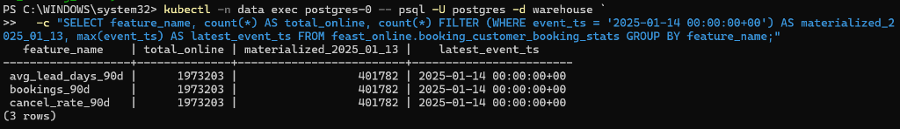
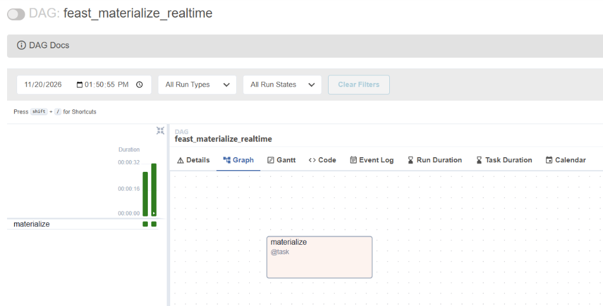

# Feature store

Materialize feature từ offline sang online, đẩy stream feature và chọn TTL cho từng bảng.

## Incremental materialize từ Offline Store sang Online Store

Code pipeline: [`feast_materialize_incremental`](../../edai2/dags/rag_pipeline.py).

Pipeline chạy tự động theo sự kiện Airflow Dataset (`FEAT_BATCH`) ngay sau khi DAG DP3 hoàn thành bước validate, thực hiện materialize tăng dần theo đúng cửa sổ ngày logic với `max_active_runs=1`, rồi phát Dataset `feast://online/batch` để kích hoạt `score_bookings`.

Trên Airflow 2.10.5 (GKE namespace `data`), DAG `dp3_offline_features` cho ngày logic `2025-01-13` đã phát Dataset `FEAT_BATCH`, tự động kích hoạt `feast_materialize_incremental`. Để tránh lỗi `OOMKilled` của pod worker 2Gi mặc định khi Feast nạp toàn bộ cửa sổ ngày vào pandas, task `materialize` được cấu hình chạy trên `MATERIALIZE_POD` (request 2Gi / limit 8Gi), hoàn tất trong khoảng 20 phút (~3,8 GB RAM) và ghi 1,27 triệu dòng feature lên PostgreSQL online store (`feast_online.booking_customer_booking_stats` với 1.205.346 dòng của 401.782 khách hàng, cùng `booking_attributes` và `hotel_demand`).

Tổng hợp dữ liệu trên `feast_online` sau quá trình materialize:
- `booking_attributes`: 1.584.578 booking
- `customer_booking_stats`: 1.973.203 khách hàng
- `hotel_demand`: 50.000 khách sạn
- `hotel_realtime`: 49.596 khách sạn

## Streaming feature jobs đẩy dữ liệu vào Offline & Online Store

- **Job 1 (Flink → Offline Store):** Flink job ([`edai1/flink_jobs/`](../../edai1/flink_jobs/), [`edai1/k8s/flink.yaml`](../../edai1/k8s/flink.yaml)) tiêu thụ stream từ Kafka (`booking_events`), tính cửa sổ trượt 1 giờ (bước 5 phút) và upsert `5.083.405` dòng (`2025-12-31 20:10:00` → `2026-01-03 01:15:00`) vào bảng offline `gold.feat_hotel_realtime`.
- **Job 2 (Airflow `feast_materialize_realtime` → Online Store):** DAG [`feast_materialize_realtime`](../../edai2/dags/rag_pipeline.py) chạy định kỳ mỗi 5 phút trên Airflow 2.10.5 (`scheduled` 27 giây, `manual` 32 giây), truy vấn `max(event_timestamp)` từ `gold.feat_hotel_realtime` rồi materialize cửa sổ 2 giờ `[2026-01-02 23:15:00+00, 2026-01-03 01:15:00+00]` lên `feast_online.booking_hotel_realtime` (49.596 khách sạn có `bookings_1h`, mốc mới nhất `2026-01-03 01:15:00+00`).

