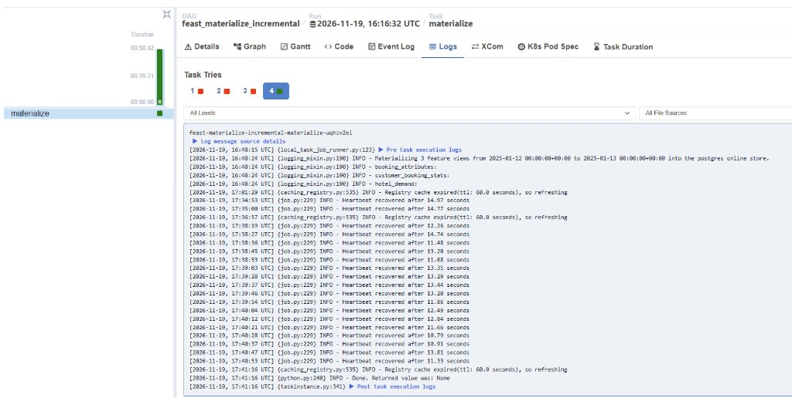
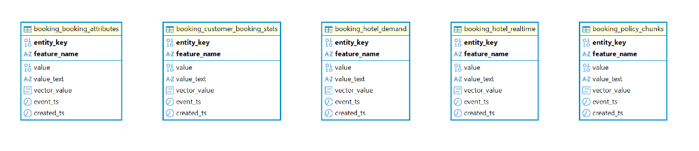

# Feature store

Materialize feature từ offline sang online, đẩy stream feature và chọn TTL cho từng bảng.

## Incremental materialize từ Offline Store sang Online Store

Code pipeline: [`feast_materialize_incremental`](../../edai2/dags/rag_pipeline.py).

Pipeline chạy tự động theo sự kiện Airflow Dataset (`FEAT_BATCH`) ngay sau khi DAG DP3 hoàn thành bước validate, thực hiện materialize tăng dần theo đúng cửa sổ ngày logic với `max_active_runs=1`, rồi phát Dataset `feast://online/batch` để kích hoạt `score_bookings`.

Trên Airflow 2.10.5 (GKE namespace `data`), DAG `dp3_offline_features` cho ngày logic `2025-01-13` đã phát Dataset `FEAT_BATCH`, tự động kích hoạt `feast_materialize_incremental`. Để tránh lỗi `OOMKilled` của pod worker 2Gi mặc định khi Feast nạp toàn bộ cửa sổ ngày vào pandas, task `materialize` được cấu hình chạy trên `MATERIALIZE_POD` (request 2Gi / limit 8Gi), hoàn tất trong khoảng 20 phút (~3,8 GB RAM) và ghi 1,27 triệu dòng feature lên PostgreSQL online store (`feast_online.booking_customer_booking_stats` với 1.205.346 dòng, tức 401.782 khách × 3 feature, cùng `booking_attributes` và `hotel_demand`).

Số entity trên `feast_online`, tích luỹ qua các lần materialize:
- `booking_attributes`: 1.584.578 booking
- `customer_booking_stats`: 1.973.203 khách hàng
- `hotel_demand`: 50.000 khách sạn
- `hotel_realtime`: 49.596 khách sạn

*Chú thích: Graph View của DAG `feast_materialize_incremental` được tự động kích hoạt ngay khi DP3 phát Airflow Dataset `FEAT_BATCH`.*

*Chú thích: Log task `materialize` chạy trên `MATERIALIZE_POD` (limit 8 GiB RAM, tránh OOMKilled): hoàn tất trong ~20 phút và nạp 1,27 triệu dòng feature lên `feast_online`.*

*Chú thích: Dữ liệu bảng `feast_online.booking_customer_booking_stats` trong PostgreSQL sau khi materialize, sẵn sàng phục vụ truy vấn online độ trễ thấp.*

*Chú thích: Sơ đồ 5 bảng trong schema `feast_online` (xuất từ DBeaver): `booking_attributes`, `customer_booking_stats`, `hotel_demand`, `hotel_realtime` và `policy_chunks`.*

## Streaming feature jobs đẩy dữ liệu vào Offline & Online Store

- **Job 1 (Flink → Offline Store):** Flink job ([`edai1/flink_jobs/`](../../edai1/flink_jobs/), [`edai1/k8s/flink.yaml`](../../edai1/k8s/flink.yaml)) tiêu thụ stream từ Kafka (`booking_events`), tính cửa sổ trượt 1 giờ (bước 5 phút) và upsert `5.083.405` dòng (`2025-12-31 20:10:00` → `2026-01-03 01:15:00`) vào bảng offline `gold.feat_hotel_realtime`.
- **Job 2 (Airflow `feast_materialize_realtime` → Online Store):** DAG [`feast_materialize_realtime`](../../edai2/dags/rag_pipeline.py) chạy định kỳ mỗi 5 phút trên Airflow 2.10.5 (`scheduled` 27 giây, `manual` 32 giây), truy vấn `max(event_timestamp)` từ `gold.feat_hotel_realtime` rồi materialize cửa sổ 2 giờ `[2026-01-02 23:15:00+00, 2026-01-03 01:15:00+00]` lên `feast_online.booking_hotel_realtime` (49.596 khách sạn có `bookings_1h`, mốc mới nhất `2026-01-03 01:15:00+00`).

*Chú thích: Flink Job Graph của `booking_events_window`: thể hiện rõ luồng đọc Kafka → `ContractCheck` (rẽ nhánh DLQ) → gán watermark → `DedupByEventId` → chia 2 nhánh cửa sổ trượt 1h và tumbling 1m.*

*Chú thích: Graph View của DAG `feast_materialize_realtime` chạy định kỳ mỗi 5 phút (`~27–32 giây` mỗi lượt).*

*Chú thích: Log của `feast_materialize_realtime`: truy vấn `max(event_timestamp)` từ `gold.feat_hotel_realtime` và đẩy cửa sổ 2 giờ gần nhất lên Online Store.*

*Chú thích: Đối chiếu bảng `gold.feat_hotel_realtime` (Offline, `5.083.405` dòng) và `feast_online.booking_hotel_realtime` (Online, `49.596` khách sạn) với mốc dữ liệu mới nhất `2026-01-03 01:15:00+00`.*

## Chọn TTL cho từng FeatureView

Code định nghĩa tại [`edai2/feature_repo/features.py`](../../edai2/feature_repo/features.py). `ttl` là độ cũ tối đa của một dòng feature khi đọc từ online/offline store (khác với cửa sổ tổng hợp `90d` / `7d` / `1h`):

| FeatureView | Entity | TTL | Lý do chọn |
|---|---|---|---|
| `booking_attributes` | `booking_id` | `365 ngày` | Thuộc tính tĩnh của booking (`lead_days`, `nights`, `free_cancel`, `loyalty_tier`); cần đọc để chấm điểm rủi ro huỷ cho tới ngày nhận phòng (lead time tối đa dưới 1 năm). |
| `customer_booking_stats` | `customer_id` | `90 ngày` | Khách đặt trung bình 4,6 lần/năm, dòng feature chỉ ghi khi có hoạt động; quá 90 ngày không đặt mới thì `bookings_90d` đã về `0` nên không cần giữ bản cũ. |
| `hotel_demand` | `hotel_id` | `2 ngày` | Khách sạn có snapshot nhu cầu hằng ngày (`bookings_7d`, `cancel_rate_30d`); giữ 2 ngày để dự phòng trễ 1 nhịp batch ngày mà vẫn tránh dùng số liệu cũ. |
| `hotel_realtime` | `hotel_id` | `2 giờ` | Feature streaming (`bookings_1h`) từ Flink đẩy mỗi 5 phút; nhu cầu phòng cũ hơn 2 giờ không còn phản ánh áp lực đặt phòng hiện tại. |
| `policy_chunks` | `chunk_id` | `365 ngày` | Vector embedding tài liệu chính sách huỷ/hoàn tiền dùng cho RAG; nội dung ít thay đổi, chỉ cập nhật khi pipeline RAG ingest lại tài liệu. |

