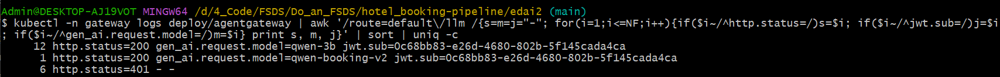

# Global model config

Một `ModelConfig` dùng chung cho mọi agent.

## Global ModelConfig dùng chung cho các agent

kagent 0.9.12 cài bằng Helm với [`k8s/kagent-values.yaml`](../../edai2/k8s/kagent-values.yaml), tạo sẵn `ModelConfig` dùng chung `default-model-config`. Thay vì gọi thẳng vLLM, mọi agent đều trỏ về route `/v1` của `agentgateway` và xác thực bằng JWT do Keycloak cấp (khởi tạo qua `gateway/deploy.sh`; khoá vLLM chỉ lưu ở gateway).

Cả 3 agent ([`agents/agents-gke.yaml`](../../edai2/agents/agents-gke.yaml)) dùng chung `ModelConfig` này; `agentgateway` ([`gateway/agentgateway.yaml`](../../edai2/gateway/agentgateway.yaml)) chia tải **90/10** giữa `qwen-3b` và `qwen-booking-v2` nên đổi model chỉ cần sửa tại gateway. Log route `llm` ghi nhận **13 request hợp lệ (`200`)** chia đúng tỉ lệ (`12` tới `qwen-3b`, `1` tới `qwen-booking-v2`) và **6 request sai/thiếu token bị chặn (`401`)**.

*Chú thích: Log route `llm` của `agentgateway`: ghi nhận 13 request hợp lệ có `jwt.sub=kagent` chia đúng tỷ lệ ~90/10 (`12` tới `qwen-3b`, `1` tới `qwen-booking-v2`) và 6 request sai token trả `401`.*
