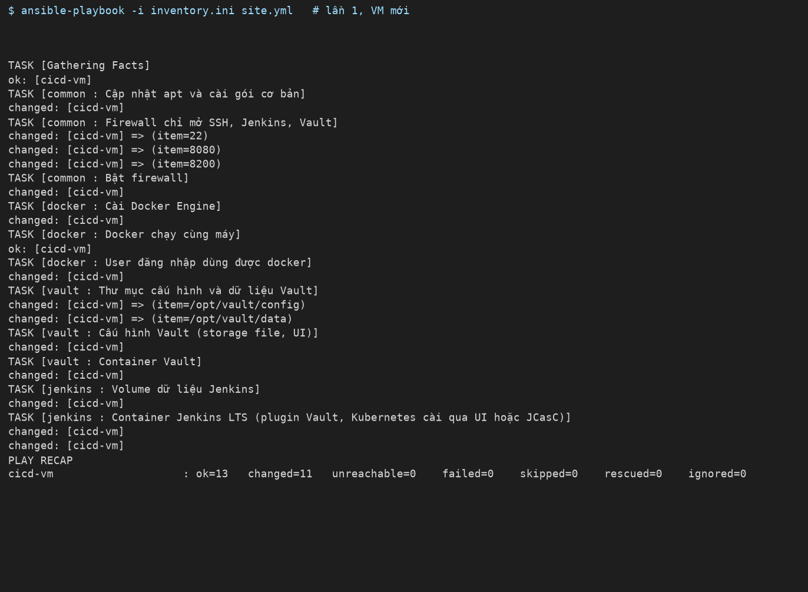
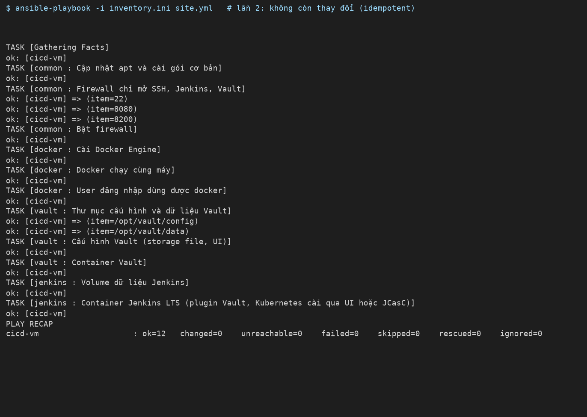
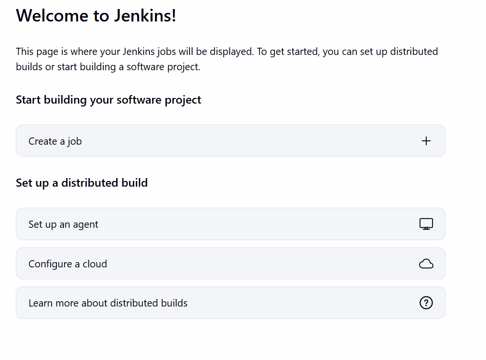

# Infrastructure as Code

Terraform dựng hạ tầng GKE; Ansible cấu hình VM.

## Terraform dựng hạ tầng GKE và Cloud Services

`iac/modules/{network,gke,registry,budget}` và `iac/envs/dev` dựng VPC với Cloud NAT, GKE với node
private, pool CPU spot, pool GPU L4 (tối thiểu 0 node), Artifact Registry và cảnh báo ngân sách. Hạ tầng được dựng bằng
`terraform apply` trong `iac/envs/dev` (project `hotel-booking-edai`, asia-southeast1).

Chạy lại `terraform apply` báo `No changes`: hạ tầng thật khớp code, không có thay đổi tay
ngoài Terraform. Output gồm cluster `booking-ai` và registry `asia-southeast1-docker.pkg.dev/hotel-booking-edai/booking`.
State quản lý 13 tài nguyên và 2 data source (4 API, budget, VPC, subnet, router, Cloud NAT, cluster GKE, 2 node pool,
Artifact Registry).

Cùng ngày, pool thứ ba `spark-spot` (n2-standard-8 kèm Local SSD cho shuffle của job Spark 105 GiB) được tạo bằng
`gcloud` vì cần dùng ngay. Pool này đã được khai báo cùng cấu hình trong `modules/gke/main.tf`; lần `terraform apply` sau
cần `terraform import` pool này.

## Ansible cấu hình VM và triển khai dịch vụ CI/CD

Playbook `iac/ansible/site.yml` (role `common`, `docker`, `vault`, `jenkins`) chạy lên VM `cicd-vm`
(e2-medium spot, Ubuntu 22.04, subnet `booking-gke`; firewall `booking-cicd-allow` chỉ mở cổng 22, 8080, 8200 cho IP
của nhóm). Ansible chạy trong container `python:3.11-slim` trên laptop (ansible-core 2.18, collection `community.docker`,
`community.general` theo `requirements.yml`), SSH bằng key riêng nằm ngoài repo.

| Lần chạy | ok | changed | failed |
|---|---|---|---|
| 1 (VM mới) | 13 | 11 | 0 |
| 2 | 12 | 0 | 0 |

Lần 1 cài gói cơ bản, bật firewall `ufw`, cài Docker, chạy container Vault (`hashicorp/vault:1.20`, storage file) và
Jenkins (`jenkins/jenkins:lts-jdk21`). Lần 2 không còn thay đổi nào, tức playbook idempotent. Jenkins trên VM truy cập
được qua `http://<IP VM>:8080` sau bước unlock bằng mật khẩu khởi tạo. Vault trên VM để init bằng tay theo thiết kế của
role (unseal key không đi qua Ansible).

