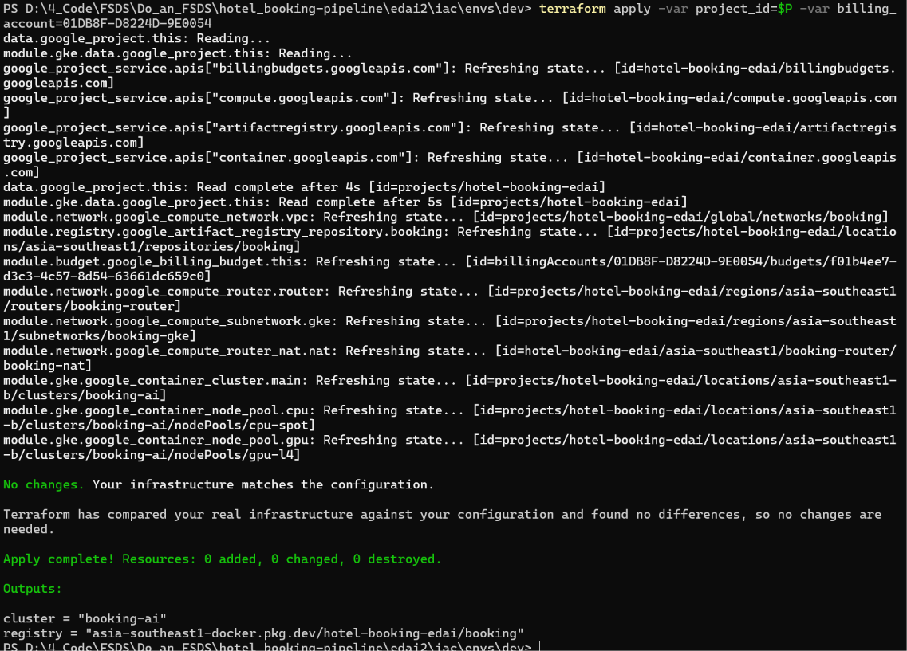
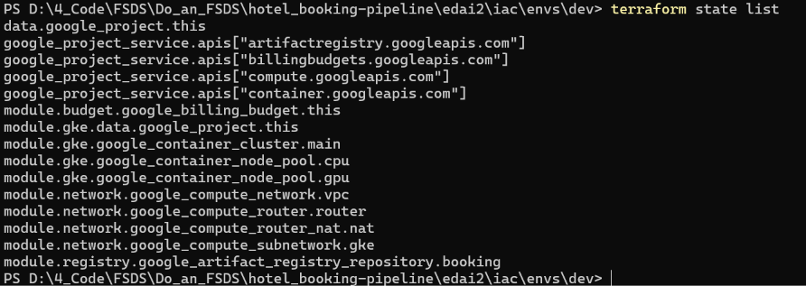

# Infrastructure as Code

Terraform dựng hạ tầng GKE; Ansible cấu hình VM.

Mỗi mục ứng với một dòng của rubric. Mục đã hoàn thành ghi lại phần đã triển khai và kết quả (số liệu đo được,
ảnh chụp trong `docs/images/`). Mục chưa hoàn thành giữ trích rubric, phần **Cách làm** đồng bộ từ cột F của rubric
và phần **Kết quả** chờ bổ sung.

## Dùng Terraform để setup GKE hoặc các cloud services · edai-2 · IaC

`iac/modules/{network,gke,registry,budget}` và `iac/envs/dev` dựng VPC với Cloud NAT, GKE với node
private, pool CPU spot, pool GPU L4 (tối thiểu 0 node), Artifact Registry và cảnh báo ngân sách. Hạ tầng được dựng bằng
`terraform apply` trong `iac/envs/dev` (project `hotel-booking-edai`, asia-southeast1).

Chạy lại `terraform apply` ngày 2026-11-18 báo `No changes`: hạ tầng thật khớp code, không có thay đổi tay
ngoài Terraform. Output gồm cluster `booking-ai` và registry `asia-southeast1-docker.pkg.dev/hotel-booking-edai/booking`.
State quản lý 13 tài nguyên và 2 data source (4 API, budget, VPC, subnet, router, Cloud NAT, cluster GKE, 2 node pool,
Artifact Registry).

Cùng ngày, pool thứ ba `spark-spot` (n2-standard-8 kèm Local SSD cho shuffle của job Spark 105 GiB) được tạo bằng
`gcloud` vì cần dùng ngay. Pool này đã được khai báo cùng cấu hình trong `modules/gke/main.tf`; lần `terraform apply` sau
cần `terraform import` pool này.

## Dùng Ansible để configure và deploy các service lên VM · edai-2 · IaC

**Rubric:** edai-2 · dòng 45 · 1 điểm · nhóm *IaC*

**Cách làm:** [Đã có] `iac/ansible` gồm `site.yml` và các role common, docker, vault, jenkins (chạy dạng container); `--syntax-check` và `ansible-lint` profile production đều sạch. [Cần làm] chạy trên VM, chụp kết quả playbook.

**Kết quả:** _Chưa có. Cần số liệu, ảnh chụp hoặc link code sau khi chạy trên cluster._
