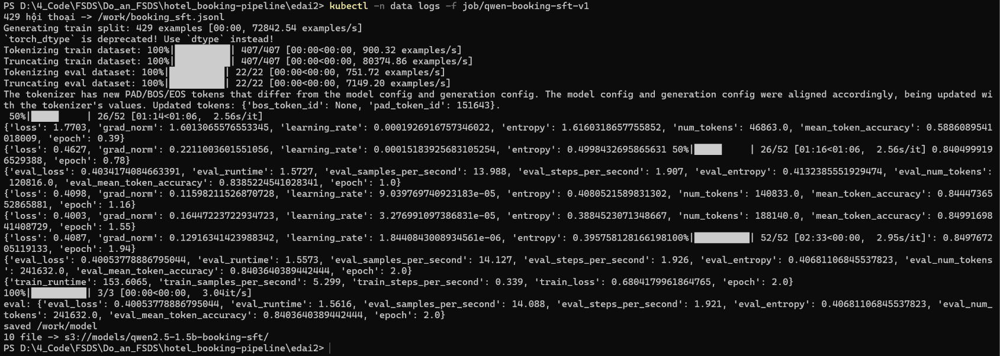
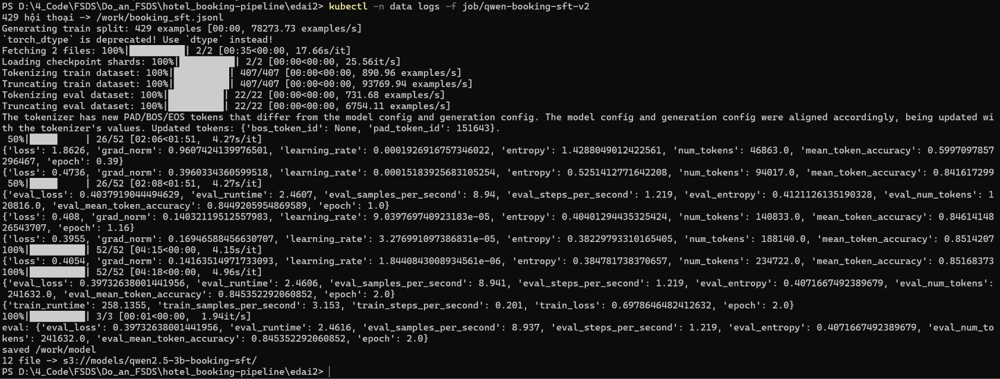
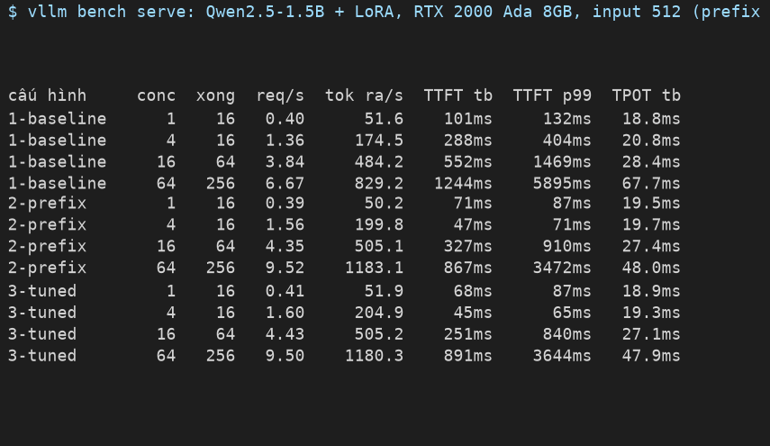

# LLM inference platform

Nền tảng LLM gồm llm-d và vLLM, model tự fine-tune, agentgateway và benchmark.

Mỗi mục ứng với một dòng của rubric. Mục đã hoàn thành ghi lại phần đã triển khai và kết quả (số liệu đo được,
ảnh chụp trong `docs/images/`). Mục chưa hoàn thành giữ trích rubric, phần **Cách làm** đồng bộ từ cột F của rubric
và phần **Kết quả** chờ bổ sung.

## Deploy LLM inference platform

**Rubric:** edai-2 · dòng 3 · 2 điểm · nhóm *Deploy a LLM inference platform theo hướng dẫn này và set up gateway cho agent theo hướng dẫn này* › *Deploy LLM inference platform + setup custom model & agentgateway*

**Cần nộp (cả nhóm):** Document cách setup và benchmark cùng kết quả đạt được sau benchmark

**Cách làm:** [Đã chốt] Chuyển sang llm-d theo quickstart của rubric. KServe huggingface runtime (`llm_platform/llm-inference.yaml`) là trạng thái mẫu, giữ lại tới khi llm-d chạy được thì xoá. [Thiết kế] vLLM và llm-d router (EPP, Gateway API Inference Extension) cài bằng Helm và Kustomize, secret `llm-d-hf-token`; route `/v1` của agentgateway trỏ tới router. [Cần làm] chụp pod Ready và một lần gọi thử `/v1/chat/completions`.

**Kết quả:** _Chưa có. Cần số liệu, ảnh chụp hoặc link code sau khi chạy trên cluster._

## Setup a custom LLM model

`llm_platform/finetune` gồm hai script:

- `build_dataset.py` dựng 429 hội thoại từ `policies/*.md`, giá trị K từ `overbooking.limit` và các câu từ chối PII
  (có test).
- `train_lora.py` fine-tune LoRA r=16, bf16, vừa GPU 8GB, rồi gộp adapter để vLLM nạp được.

Job `llm_platform/finetune/job.yaml` chạy trên GKE ngày 2026-11-17, mỗi model một Job trên 1 GPU L4 (spot), 2 epoch,
407 mẫu train và 22 mẫu eval: v1 dùng Qwen2.5-1.5B-Instruct, v2 dùng Qwen2.5-3B. `upload.py` đẩy model đã gộp lên
`s3://models/qwen2.5-{1.5b,3b}-booking-sft/`.

| Model | Thời gian Job | Loss train (epoch 0,4 → 1,9) | Eval loss | Eval token accuracy | Đích |
|---|---|---|---|---|---|
| v1 Qwen2.5-1.5B | 6 phút 35 giây | 1,77 → 0,41 | 0,401 | 0,840 | `s3://models/qwen2.5-1.5b-booking-sft/` (10 file) |
| v2 Qwen2.5-3B | 12 phút | 1,86 → 0,41 | 0,397 | 0,845 | `s3://models/qwen2.5-3b-booking-sft/` (12 file) |

Loss tính trên toàn bộ hội thoại (`assistant_only_loss=False`), kể cả system prompt lặp lại, nên dừng quanh 0,40. Loss
eval xấp xỉ loss train, chưa có dấu hiệu overfit. Trên bộ dữ liệu này, bản 3B chỉ nhỉnh hơn bản 1.5B rất ít.

## Setup agent gateway theo hướng dẫn và thiết lập security & policy phù hợp

agentgateway v1.6.0 chạy standalone trong namespace `gateway` ([`k8s/agentgateway.yaml`](../../edai2/k8s/agentgateway.yaml)),
cấu hình ở [`gateway/agentgateway.yaml`](../../edai2/gateway/agentgateway.yaml) và dựng bằng
[`gateway/deploy.sh`](../../edai2/gateway/deploy.sh) trên cluster thứ hai ngày 2026-11-19. Gateway là điểm vào duy nhất
của agent cho cả ba loại lưu lượng: LLM (`/v1`), MCP (`/mcp`) và A2A (`/a2a/<agent>`). Keycloak 26.3
([`k8s/keycloak.yaml`](../../edai2/k8s/keycloak.yaml), realm `agents`) cấp JWT theo luồng client credentials, mỗi agent
một client.

| Policy | Thiết lập | Lý do |
|---|---|---|
| `jwtAuth` (`mode: strict`) | issuer realm `agents`, audience `agentgateway`, JWKS lấy từ Keycloak | Mỗi agent có danh tính riêng, thu hồi được theo client; gateway tự kiểm chữ ký bằng JWKS nên không gọi Keycloak mỗi request. Mặc định `jwtAuth` không bắt buộc có token, nên phải đặt `strict`. |
| `backendAuth.key` | khoá vLLM đọc từ Secret `vllm-key` | Agent chỉ cầm JWT; khoá của model server chỉ nằm ở gateway, lộ token agent không lộ khoá vLLM. |
| `backendTLS` | TLS tới vLLM | vLLM chạy trên máy GPU cá nhân, ra ngoài qua Cloudflare tunnel HTTPS. |
| `localRateLimit` | bucket 50, nạp 10 request/giây trên route LLM | Chặn agent rơi vào vòng gọi tool lặp làm nghẽn GPU duy nhất. |
| `mcpAuthorization` | tool theo claim `role` của token | Nguyên tắc quyền tối thiểu: data-agent chỉ thấy tool đọc feature, chỉ policy-agent được dự đoán, tra chính sách và ghi K bán vượt. |
| `a2a` + `urlRewrite` | `/a2a/<agent>/` → `/` của pod agent | Gateway nhận diện lưu lượng A2A (log, telemetry) và giấu địa chỉ nội bộ của agent. |

Script [`gateway/check.sh`](../../edai2/gateway/check.sh) kiểm các policy từ một pod trong cluster. Route LLM trả 401
khi không có token hoặc token giả mạo, 200 với token của client `kagent`. Trên `/mcp`, token data-agent chỉ liệt kê
`get_booking_features`, token policy-agent liệt kê bốn tool còn lại, và data-agent gọi `predict_cancellation` bị từ chối
với lỗi `Unknown tool`. Agent card của cả ba agent qua `/a2a` trả 401 khi không có token, 200 khi có token.

Hai giới hạn còn lại: Keycloak chạy `start-dev` với realm nạp lại từ ConfigMap mỗi lần khởi động, và token sống 30 ngày
vì kagent chỉ nhận khoá tĩnh trong Secret; `gateway/deploy.sh` cấp lại token khi chạy lại.

## Benchmark model server and optimize the platform

**Rubric:** edai-2 · dòng 6 · 2 điểm · nhóm *Deploy a LLM inference platform theo hướng dẫn này và set up gateway cho agent theo hướng dẫn này* › *Deploy LLM inference platform + setup custom model & agentgateway*

**Cách làm:** [Đã có] Các tham số tối ưu: prefix caching, `max-model-len`, `gpu-memory-utilization`. [Thiết kế] Đo bằng `vllm bench serve` hoặc guidellm, quét concurrency 1/4/16/64 với workload có prefix chung. Trình tự: baseline → bật prefix caching → chỉnh `gpu-memory-utilization`, `max-num-seqs` → routing prefix-aware của llm-d. [Cần làm] đo lại với routing prefix-aware của llm-d trên GKE khi có quota GPU (đã đo vLLM trên laptop GPU).

**Kết quả:** benchmark chạy ngày 2026-11-19 trên **laptop có GPU** (RTX 2000 Ada 8 GB), không phải trên GKE: tài
khoản GCP mới chưa có quota GPU, nên chưa có phần routing prefix-aware của llm-d. vLLM 0.9.2 chạy bằng Docker, phục vụ
Qwen2.5-1.5B-Instruct kèm adapter LoRA v1 (multi-LoRA, `max-model-len 2048`). `vllm bench serve` với prompt 512 token có
tiền tố chung 256 token, output 128 token, quét concurrency 1/4/16/64 (script và file JSON kết quả trong
`edai2/llm_platform/bench/`). Không request nào lỗi.

| Cấu hình | Conc. | req/s | token ra/s | TTFT trung bình | TTFT p99 | TPOT trung bình |
|---|---|---|---|---|---|---|
| 1. Baseline, tắt prefix caching | 16 | 3,84 | 484 | 552 ms | 1.469 ms | 28,4 ms |
| | 64 | 6,67 | 829 | 1.244 ms | 5.895 ms | 67,7 ms |
| 2. Bật prefix caching | 16 | 4,35 | 505 | 327 ms | 910 ms | 27,4 ms |
| | 64 | 9,52 | 1.183 | 867 ms | 3.472 ms | 48,0 ms |
| 3. Prefix caching, `gpu-memory-utilization 0.86`, `max-num-seqs 64` | 16 | 4,43 | 505 | 251 ms | 840 ms | 27,1 ms |
| | 64 | 9,50 | 1.180 | 891 ms | 3.644 ms | 47,9 ms |

Prefix caching là tối ưu hiệu quả nhất với workload có tiền tố chung (system prompt giống nhau giữa các request): ở
concurrency 64, throughput tăng 43%, TTFT trung bình giảm 30%, TTFT p99 giảm 41%; ở concurrency 4, TTFT giảm từ 288 ms
xuống 47 ms. Cấu hình 3 chỉ cải thiện thêm ở concurrency 16 (TTFT 327 → 251 ms). Không tăng được
`gpu-memory-utilization` lên 0,92 vì Windows và WSL giữ sẵn khoảng 1 GB VRAM. KV cache còn khoảng 124.000 token, đủ cho
concurrency 64 với độ dài này.

