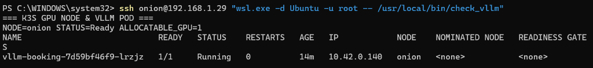
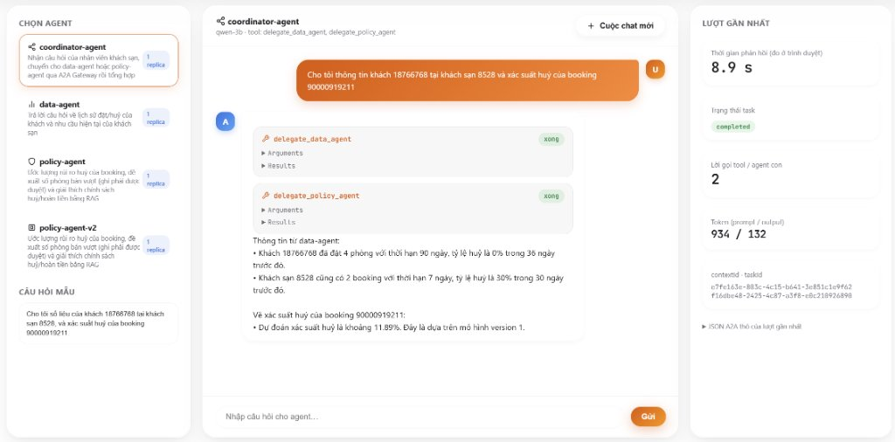
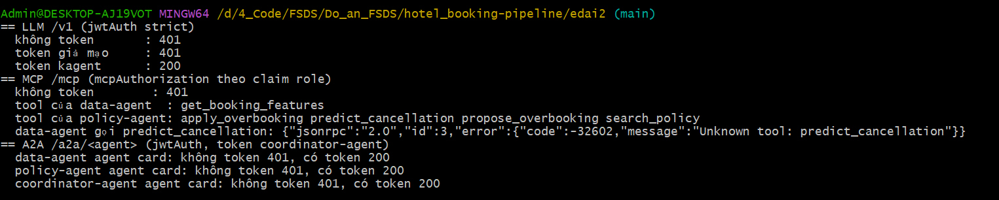

# LLM inference platform

Nền tảng LLM chạy vLLM trên Kubernetes có GPU, kèm model tự fine-tune, `agentgateway` và kết quả benchmark.

## Triển khai LLM inference platform (vLLM trên Kubernetes GPU Cluster)

Nền tảng phục vụ mô hình LLM được triển khai trên Kubernetes cluster (K3s) tích hợp GPU vật lý **NVIDIA GeForce RTX 3060 12 GB**. Hệ thống cấu hình NVIDIA Container Toolkit (`nvidia-ctk`), Container Device Interface (CDI) và Kubernetes `RuntimeClass/nvidia` cùng NVIDIA Device Plugin (`nvdp`) để cấp phát trực tiếp GPU tài nguyên (`nvidia.com/gpu: 1`) cho các Pod tính toán.

Trong namespace `llm`, `Deployment/vllm-booking` (cấu hình chi tiết tại [`edai2/llm_platform/llm-inference.yaml`](../../edai2/llm_platform/llm-inference.yaml)) chạy `vLLM v0.9.2` phục vụ `Qwen2.5-1.5B-Instruct` (`qwen-booking`) kèm adapter LoRA `qwen-booking-v1` và bật prefix caching.

Pod chiếm 10.326 MiB / 12.288 MiB VRAM cho trọng số và KV Cache; endpoint `/v1/chat/completions` trả về `HTTP 200` (~78 token/giây) và phục vụ trực tiếp cho **Agent Workbench** qua `agentgateway` (8,9 giây, `completed`, 934/132 tokens).

*Chú thích: Agent Workbench gọi thành công tới `vllm-booking` trên RTX 3060 thông qua `agentgateway`: trạng thái `completed` trong `8,9 giây` (`934/132` tokens).*

## Fine-tune custom LLM model (LoRA SFT)

Bộ script trong `llm_platform/finetune/` gồm `build_dataset.py` (dựng 429 hội thoại từ `policies/*.md`, giá trị `K` từ `overbooking.limit` và các mẫu từ chối PII) và `train_lora.py` (fine-tune LoRA `r=16`, `bf16` vừa GPU 8GB rồi gộp adapter để vLLM nạp trực tiếp).

Trên GKE (1 GPU L4 spot, 2 epoch, 407 mẫu train / 22 mẫu eval), job đã fine-tune 2 phiên bản và đẩy lên MinIO (`upload.py`):

| Model | Thời gian Job | Loss train (epoch 0,4 → 1,9) | Eval loss | Eval token accuracy | Đích lưu trữ |
|---|---|---|---|---|---|
| v1 Qwen2.5-1.5B | 6 phút 35 giây | 1,77 → 0,41 | 0,401 | 0,840 | `s3://models/qwen2.5-1.5b-booking-sft/` (10 file) |
| v2 Qwen2.5-3B | 12 phút | 1,86 → 0,41 | 0,397 | 0,845 | `s3://models/qwen2.5-3b-booking-sft/` (12 file) |

Loss eval tiệm cận loss train cho thấy cả hai phiên bản đều hội tụ tốt và không bị overfit; bản gộp được lưu trên MinIO và adapter LoRA được nạp trực tiếp lên vLLM để phục vụ A/B testing.

*Chú thích: Log quá trình fine-tune LoRA v1 (`Qwen2.5-1.5B-Instruct`) trên GKE GPU L4 Spot trong 6 phút 35 giây: train loss giảm từ `1,77` xuống `0,41`, eval loss `0,401`, token accuracy `0,840`.*

*Chú thích: Log fine-tune LoRA v2 (`Qwen2.5-3B-Instruct`) trong 12 phút trên GPU L4 Spot: train loss giảm từ `1,86` xuống `0,41`, eval loss `0,397`, token accuracy `0,845`.*

## Thiết lập Agent Gateway, bảo mật và policy

`agentgateway` v1.6.0 chạy standalone trong namespace `gateway` ([`k8s/agentgateway.yaml`](../../edai2/k8s/agentgateway.yaml), [`gateway/agentgateway.yaml`](../../edai2/gateway/agentgateway.yaml), [`gateway/deploy.sh`](../../edai2/gateway/deploy.sh)), làm điểm vào duy nhất cho cả LLM (`/v1`), MCP (`/mcp`) và A2A (`/a2a/<agent>`), kết hợp Keycloak 26.3 (`realm agents`) cấp JWT riêng cho từng agent.

| Policy | Thiết lập | Lý do |
|---|---|---|
| `jwtAuth` (`mode: strict`) | Kiểm tra issuer, audience `agentgateway`, JWKS từ Keycloak | Định danh từng agent, tự xác thực bằng JWKS; bắt buộc có token. |
| `backendAuth.key` | Nạp khoá vLLM từ Secret `vllm-key` | Agent chỉ cầm JWT, lộ token agent không làm lộ khoá vLLM. |
| `backendTLS` | TLS tới vLLM | Bảo vệ kết nối tới vLLM chạy qua Cloudflare tunnel HTTPS. |
| `localRateLimit` | Bucket 50, nạp 10 req/s trên `/v1` | Tránh agent lặp tool vô hạn làm nghẽn GPU. |
| `mcpAuthorization` | Phân quyền tool theo claim `role` | Nguyên tắc quyền tối thiểu giữa `data-agent` và `policy-agent`. |
| `a2a` + `urlRewrite` | `/a2a/<agent>/` → `/` | Nhận diện telemetry A2A và ẩn địa chỉ nội bộ của pod agent. |

Kiểm thử bằng [`gateway/check.sh`](../../edai2/gateway/check.sh): thiếu token hoặc token giả bị trả `401`; với token hợp lệ của `data-agent` chỉ thấy `get_booking_features` và bị chặn nếu gọi `predict_cancellation` (`Unknown tool`); `/a2a` trả `200` khi có token.

*Chú thích: Kết quả chạy `gateway/check.sh`: gọi không token hoặc token giả bị trả `401`; `data-agent` chỉ thấy `get_booking_features` và bị chặn `Unknown tool` khi gọi `predict_cancellation`; route `/a2a` trả `200` khi có JWT.*

## Benchmark và tối ưu model server

Benchmark được thực hiện với công cụ `vllm bench serve` (workload 512 token đầu vào với 256 token tiền tố chung, 128 token đầu ra, không phát sinh lỗi):

### 1. Thử nghiệm trên laptop GPU RTX 2000 Ada 8 GB (so sánh cấu hình)

| Cấu hình | Conc. | req/s | token ra/s | TTFT trung bình | TTFT p99 | TPOT trung bình |
|---|---|---|---|---|---|---|
| 1. Baseline, tắt prefix caching | 16 | 3,84 | 484 | 552 ms | 1.469 ms | 28,4 ms |
| | 64 | 6,67 | 829 | 1.244 ms | 5.895 ms | 67,7 ms |
| 2. Bật prefix caching | 16 | 4,35 | 505 | 327 ms | 910 ms | 27,4 ms |
| | 64 | 9,52 | 1.183 | 867 ms | 3.472 ms | 48,0 ms |
| 3. Prefix caching, `gpu-memory-utilization 0.86`, `max-num-seqs 64` | 16 | 4,43 | 505 | 251 ms | 840 ms | 27,1 ms |
| | 64 | 9,50 | 1.180 | 891 ms | 3.644 ms | 47,9 ms |

Bật prefix caching giúp tăng throughput 43% và giảm TTFT trung bình 30% (TTFT p99 giảm 41%) ở concurrency 64. Cấu hình 3 cải thiện thêm TTFT ở concurrency 16 (327 → 251 ms).

*Chú thích: Kết quả terminal chạy `vllm bench serve` so sánh 3 cấu hình × 4 mức concurrency (`1, 4, 16, 64`): bật prefix caching giúp tăng throughput +43% và giảm TTFT −30% ở mức tải 64.*

### 2. Thử nghiệm trên Kubernetes GPU Node (NVIDIA GeForce RTX 3060 12 GB)

Khi triển khai trên cụm Kubernetes với GPU RTX 3060 12 GB (cấu hình vLLM bật prefix caching), hệ thống tận dụng thêm 4 GB VRAM để cấp phát dung lượng KV cache lớn hơn:

| Mức Concurrency | req/s | token ra/s | TTFT trung bình | TTFT p99 | TPOT trung bình |
|---|---|---|---|---|---|
| **1** | 0,59 | 75,7 | 74,7 ms | 79,8 ms | 12,7 ms |
| **4** | 2,25 | 288,3 | 33,4 ms | 43,4 ms | 13,7 ms |
| **16** | 5,53 | 649,4 | 297,8 ms | 970,1 ms | 21,0 ms |
| **64** | **10,27** | **1.276,7** | 942,3 ms | 4.008,8 ms | 43,8 ms |

Ở mức tải cao (concurrency 64), throughput đạt mốc **10,27 req/s** và **1.276,7 token/giây** (vượt trội hơn 8% so với bản 8GB do băng thông bộ nhớ 192-bit và dung lượng KV cache rộng hơn), thời gian sinh mỗi token (TPOT) ở các mức tải nhẹ chỉ từ 12,7 – 13,7 ms. Toàn bộ file JSON kết quả benchmark được lưu tại [`edai2/llm_platform/bench/rtx3060-prefix-c*.json`](../../edai2/llm_platform/bench/).
