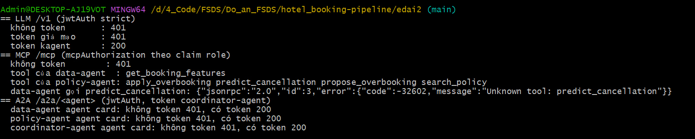

# MCP gateway

`agentgateway` là điểm vào duy nhất cho MCP server.

## Cấu hình MCP Gateway

Route `/mcp` trong [`gateway/agentgateway.yaml`](../../edai2/gateway/agentgateway.yaml) gom MCP server `booking-tools`
(booking-mcp, `http://booking-mcp.agents.svc.cluster.local/mcp/`) sau agentgateway v1.6.0. Agent không còn gọi thẳng
booking-mcp: trong [`agents/agents-gke.yaml`](../../edai2/agents/agents-gke.yaml), mỗi agent có một `RemoteMCPServer`
riêng trỏ tới `http://agentgateway.gateway.svc.cluster.local:3000/mcp` và gửi header `Authorization` lấy từ Secret của
chính agent đó (`mcp-token-data`, `mcp-token-policy`).

Security và policy trên route:

- `jwtAuth` (`mode: strict`): token phải do realm `agents` của Keycloak ký, audience `agentgateway`. Request không token
  bị chặn ở gateway, không tới được MCP server.
- `mcpAuthorization`: quy tắc CEL theo tên tool và claim `role` của token. `get_booking_features` chỉ dành cho
  `role == "data-agent"`; `predict_cancellation`, `search_policy`, `propose_overbooking`, `apply_overbooking` chỉ dành
  cho `role == "policy-agent"`. Claim `role` do mapper hardcoded của từng client Keycloak gắn vào, agent không tự đặt
  được. Lý do: nguyên tắc quyền tối thiểu, và tool ghi dữ liệu (`apply_overbooking`) chỉ lộ ra với đúng agent có bước
  duyệt HITL.

Kiểm bằng [`gateway/check.sh`](../../edai2/gateway/check.sh): `/mcp` không token
trả 401; `tools/list` với token data-agent chỉ có `get_booking_features`, với token policy-agent có bốn tool còn lại;
data-agent gọi thẳng `predict_cancellation` bị gateway từ chối (`Unknown tool: predict_cancellation`). Qua kagent, data-agent
và policy-agent vẫn gọi tool bình thường qua gateway, log ghi `mcp.method.name=tools/call` kèm `jwt.sub` của từng agent.

*Chú thích: Kết quả chạy `gateway/check.sh`: gọi không token hoặc token giả bị trả `401`; `data-agent` chỉ thấy `get_booking_features` và bị chặn `Unknown tool` khi gọi `predict_cancellation`; route `/a2a` trả `200` khi có JWT.*
