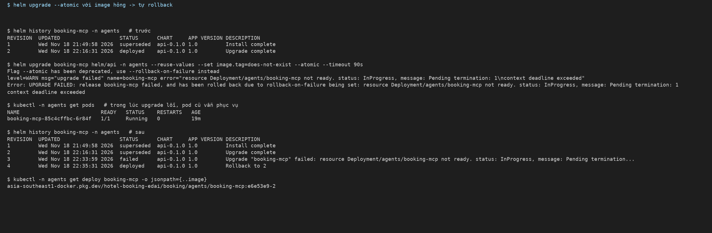

# MCP server & agent dùng tool

booking-mcp viết bằng FastAPI, xử lý bất đồng bộ, deploy bằng Helm; agent gọi MCP tool, chạy trong sandbox
và được đăng ký trên registry.

Mỗi mục ứng với một dòng của rubric. Mục đã hoàn thành ghi lại phần đã triển khai và kết quả (số liệu đo được,
ảnh chụp trong `docs/images/`). Mục chưa hoàn thành giữ trích rubric, phần **Cách làm** đồng bộ từ cột F của rubric
và phần **Kết quả** chờ bổ sung.

## Có sử dụng FastAPI + data validation + healthcheck for k8s

booking-mcp viết bằng FastAPI; input và output của REST và MCP tool là model pydantic (`BookingFeatures`,
`RiskRequest`, `CancelRisk`, `BatchRisk`, `OverbookingProposal`). Tool `predict_cancellation` lấy feature theo
`booking_id` từ Feast online rồi gọi KServe `cancel-risk`; cùng logic mở REST `/v1/cancel-risk` và `/v1/cancel-risk/batch`.
`/healthz` là liveness probe; `/readyz` là readiness probe và chỉ trả 200 khi đọc được online store. booking-mcp chạy trên GKE ngày 2026-11-18 (namespace `agents`, chart `helm/api`, image `booking-mcp:e6e53e9-2`); các phép kiểm dưới đây chạy bằng `api_checks` trong chính pod, gọi qua tên service.

`/healthz` và `/readyz` đều trả 200, và Deployment dùng đúng hai đường dẫn này cho liveness và readiness probe. Request
sai schema bị pydantic chặn với mã 422 trước khi vào logic: `booking_id` âm ("Input should be greater than 0"), chuỗi
thay cho số ("Input should be a valid integer") và thiếu trường ("Field required").

## Sử dụng async cho concurrent processing

Mọi tool và endpoint là `async def`; Feast online được đọc bằng `get_online_features_async`, KServe được gọi bằng
`httpx.AsyncClient`, và warehouse dùng `psycopg.AsyncConnection`. Phép đo gọi 50 lần `get_booking_features` với các cặp
khách, khách sạn thật, một lần tuần tự và một lần đồng thời bằng `asyncio.gather` trên cùng một phiên MCP (cùng lần chạy
ở dòng 16).

50 lần gọi tuần tự mất 1,66 s, gọi đồng thời mất 1,19 s, tức nhanh hơn 1,4 lần và không lỗi lần nào. Mức tăng còn hạn
chế vì cả 50 lời gọi cùng đọc online store qua một pod và một kết nối PostgreSQL; ảnh ở dòng 16.

## Deploy in the form of MCP tool to k8s with helm + rollingupdate + auto fallback

Chart chung `helm/api` (`values-booking-mcp.yaml`) dùng RollingUpdate với `maxSurge: 1`, `maxUnavailable: 0`, và
readiness probe `/readyz`: pod mới chỉ nhận traffic khi đọc được online store, pod cũ chỉ bị gỡ khi pod mới đã Ready.
Jenkins deploy bằng `helm upgrade --install --atomic --timeout 5m`, nên nếu pod mới không Ready kịp, Helm tự rollback về
revision trước. Phép thử chạy trên GKE ngày 2026-11-18: upgrade booking-mcp sang một image tag không tồn tại với
`--atomic --timeout 90s`.

Upgrade thất bại sau 90 giây vì pod mới không kéo được image, và Helm tự rollback: `helm history` ghi revision 3
`failed` và revision 4 "Rollback to 2". Trong suốt quá trình, pod cũ vẫn Running và phục vụ request nhờ
`maxUnavailable: 0`; sau rollback, Deployment trở lại image `booking-mcp:e6e53e9-2`.

## Deploy 1 Agent sử dụng MCP tool ở trên với multi-replica và auto-scale sử dụng cái này

data-agent ([`agents/agents-gke.yaml`](../../edai2/agents/agents-gke.yaml)) dùng MCP server booking-mcp qua
RemoteMCPServer `booking-tools-data` (route `/mcp` của agentgateway, token role `data-agent`) và chỉ được cấp tool
`get_booking_features`. Hỏi về cặp khách 18766768 và khách sạn 8528, agent gọi tool với đúng hai mã rồi trả lời theo
số liệu online store (1 booking 90 ngày, tỉ lệ huỷ 0%; khách sạn 44 booking 7 ngày, tỉ lệ huỷ 30 ngày 17,24%).

Autoscale dùng KEDA 2.20.2 (Helm `kedacore/keda`, namespace `keda`). Mỗi agent có một ScaledObject trong
[`k8s/keda.yaml`](../../edai2/k8s/keda.yaml): tối thiểu 2, tối đa 4 replica, trigger Prometheus theo request/giây của
route A2A trên agentgateway (`agentgateway_requests_total`, ngưỡng 1 request/giây mỗi replica vì mỗi lượt agent chờ
LLM khoảng 5 s); KEDA tự tạo HPA `keda-hpa-<agent>`. kagent đặt lại `deployment.replicas` của Deployment mỗi lần
reconcile nếu Agent có trường này (đã thử: scale tay lên 2 bị kéo về 1 ngay), nên Agent trong
[`agents/agents-gke.yaml`](../../edai2/agents/agents-gke.yaml) không đặt `replicas` và để KEDA quản lý.

[`tests/keda_load.sh`](../../edai2/tests/keda_load.sh) tạo khoảng 10 request/giây vào route `/a2a/data-agent` (GET
agent card qua gateway, không gọi LLM) trong 150 s và in trạng thái HPA mỗi 20 s. Lần chạy ngày 2026-11-19 bắt đầu
ở 2/2 replica (metric 0,25); 20 s sau metric 1,57 request/giây mỗi replica vượt ngưỡng, desired lên 4; 20 s tiếp theo
4/4 replica Ready. Hết tải, HPA giữ 4 replica trong 5 phút (cửa sổ ổn định mặc định) rồi về 2. Ở lần chạy đầu, hai
pod mới không đủ chỗ nên cluster autoscaler của GKE thêm node thứ ba, kéo image kagent (339 MB) mất 53 s, tổng cộng
khoảng 2,5 phút tới khi Ready.

## Configure Agent chạy trong Sandbox để đảm bảo security

**Rubric:** edai-2 · dòng 20 · 1 điểm · nhóm *Web API kéo dữ liệu user (đã lưu thông qua feature pipeline) và chunk (đã được lưu thông qua RAG pipeline)* › *Có sử dụng FastAPI + data validation (với pydantic)*

**Cách làm:** [Thiết kế] `k8s/agent-substrate.yaml`: WorkerPool gVisor, SandboxAgent runtime go cho data-agent và NetworkPolicy chỉ cho agent gọi agentgateway và DNS. Các field của Substrate cần kiểm bằng `kubectl explain` với bản đã cài. [Cần làm] chụp agent chạy trong sandbox.

**Kết quả:** _Chưa có. Cần số liệu, ảnh chụp hoặc link code sau khi chạy trên cluster._

## Publish Agent ở trên lên registry đã deploy để đảm bảo governance

Script [`ci/publish_agent_card.py`](../../edai2/ci/publish_agent_card.py) đăng agent lên agentregistry (dòng 8):
lấy agent card A2A từ kagent controller, dựng resource `ar.dev/v1alpha1` gồm `MCPServer` `booking-tools` (route `/mcp`
của agentgateway) và `Agent` (tiêu đề, mô tả, model, MCP server, repository và commit), rồi gửi `POST /v0/apply`.
Tag là commit đang deploy, nên mỗi lần deploy để lại một phiên bản; apply lại cùng tag thì cập nhật. Card lấy từ
controller chứ không qua `/a2a/policy-agent` của gateway, vì route đó chia 50/50 và có lúc trả card của v2; script
dừng nếu tên trong card không khớp agent. Stage `Deploy agents` của [`ci/Jenkinsfile`](../../edai2/ci/Jenkinsfile)
gọi script này cho cả 4 agent sau khi rollout.

Ngày 2026-11-19 script được chạy từ máy của nhóm (port-forward tới controller và registry) với tag `f808e37`:
`data-agent` (tool `get_booking_features`) có trên registry kèm MCP server `booking-tools`. Stage Jenkins chưa chạy vì tham số `WITH_AGENTS` còn tắt.

