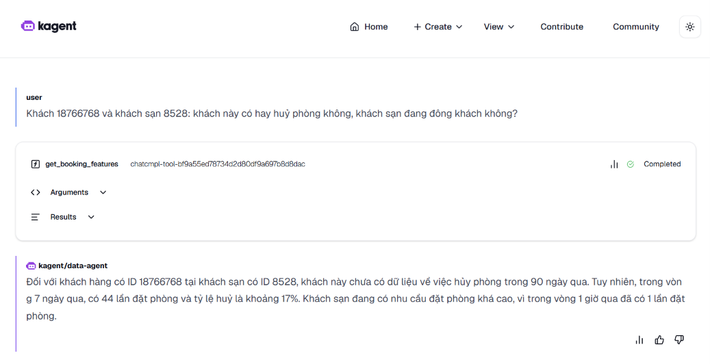
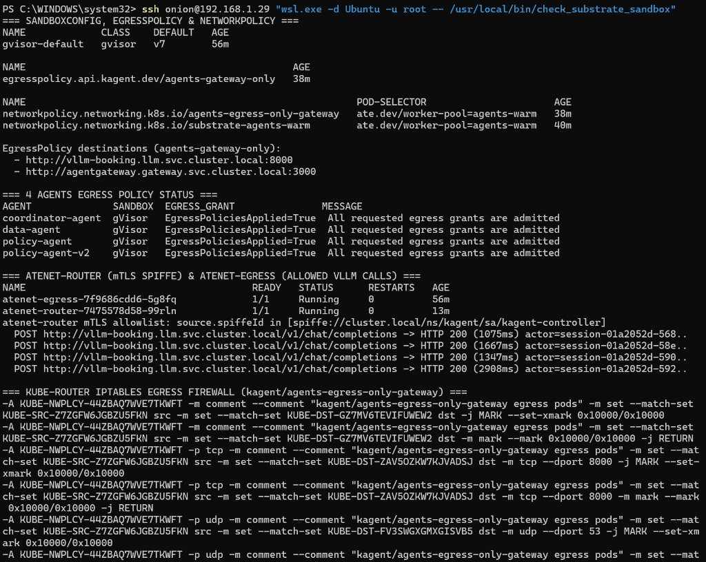

# MCP server & agent dùng tool

`booking-mcp` viết bằng FastAPI, xử lý bất đồng bộ, deploy bằng Helm; agent gọi MCP tool và được đăng ký lên registry.

## FastAPI, Data Validation và Healthcheck cho Kubernetes

`booking-mcp` xây dựng trên FastAPI với pydantic validation cho toàn bộ input/output của REST và MCP tool (`BookingFeatures`, `RiskRequest`, `CancelRisk`, `BatchRisk`, `OverbookingProposal`). Tool `predict_cancellation` đọc feature từ Feast online rồi gọi KServe `cancel-risk`; cùng logic này được mở qua REST `/v1/cancel-risk` và `/v1/cancel-risk/batch`.

Hai probe `/healthz` (liveness) và `/readyz` (readiness — chỉ trả `200` khi đọc được online store) hoạt động đúng trên GKE (namespace `agents`, chart `helm/api`, image `booking-mcp:e6e53e9-2`). Request sai schema (`booking_id` âm, sai kiểu chuỗi, thiếu trường) bị pydantic chặn ngay với mã `422`.

*Chú thích: Kiểm thử `booking-mcp` trên GKE: `/healthz` và `/readyz` trả `200`, dữ liệu sai schema bị Pydantic chặn `422`, và gọi 50 lần đồng thời bằng `asyncio.gather` nhanh hơn 1,4× (`1,19 s` vs `1,66 s`).*

## Xử lý bất đồng bộ (Async) cho truy vấn đồng thời

Mọi tool và endpoint là `async def`; Feast online được đọc bằng `get_online_features_async`, KServe được gọi bằng
`httpx.AsyncClient`, và warehouse dùng `psycopg.AsyncConnection`. Phép đo gọi 50 lần `get_booking_features` với các cặp
khách, khách sạn thật, một lần tuần tự và một lần đồng thời bằng `asyncio.gather` trên cùng một phiên MCP (cùng lần chạy
ở mục trên).

50 lần gọi tuần tự mất 1,66 s, gọi đồng thời mất 1,19 s, tức nhanh hơn 1,4 lần và không lỗi lần nào. Mức tăng còn hạn
chế vì cả 50 lời gọi cùng đọc online store qua một pod và một kết nối PostgreSQL; ảnh ở mục trên.

## Triển khai MCP Server lên Kubernetes bằng Helm (RollingUpdate & Rollback)

Chart chung `helm/api` (`values-booking-mcp.yaml`) dùng RollingUpdate với `maxSurge: 1`, `maxUnavailable: 0`, và
readiness probe `/readyz`: pod mới chỉ nhận traffic khi đọc được online store, pod cũ chỉ bị gỡ khi pod mới đã Ready.
Jenkins deploy bằng `helm upgrade --install --atomic --timeout 5m`, nên nếu pod mới không Ready kịp, Helm tự rollback về
revision trước. Phép thử chạy trên GKE: upgrade booking-mcp sang một image tag không tồn tại với
`--atomic --timeout 90s`.

Upgrade thất bại sau 90 giây vì pod mới không kéo được image, và Helm tự rollback: `helm history` ghi revision 3
`failed` và revision 4 "Rollback to 2". Trong suốt quá trình, pod cũ vẫn Running và phục vụ request nhờ
`maxUnavailable: 0`; sau rollback, Deployment trở lại image `booking-mcp:e6e53e9-2`.

*Chú thích: Output `helm history` chứng minh cơ chế tự phục hồi: revision 3 nâng cấp lên image lỗi bị fail sau 90s và Helm `--atomic` tự tạo revision 4 `Rollback to 2` mà không làm gián đoạn pod cũ.*

## Triển khai data-agent với multi-replica và auto-scale (KEDA)

data-agent ([`agents/agents-gke.yaml`](../../edai2/agents/agents-gke.yaml)) dùng MCP server booking-mcp qua
RemoteMCPServer `booking-tools-data` (route `/mcp` của agentgateway, token role `data-agent`) và chỉ được cấp tool
`get_booking_features`. Hỏi về cặp khách 18766768 và khách sạn 8528, agent gọi tool với đúng hai mã rồi trả lời theo
số liệu online store (1 booking 90 ngày, tỉ lệ huỷ 0%; khách sạn 44 booking 7 ngày, tỉ lệ huỷ 30 ngày 17,24%).

Autoscale dùng KEDA 2.20.2 (Helm `kedacore/keda`, namespace `keda`). Mỗi agent có một ScaledObject trong
[`k8s/keda.yaml`](../../edai2/k8s/keda.yaml): tối thiểu 2, tối đa 4 replica, trigger Prometheus theo request/giây của
route A2A trên agentgateway (`agentgateway_requests_total`, ngưỡng 1 request/giây mỗi replica vì mỗi lượt agent chờ
LLM khoảng 5 s); KEDA tự tạo HPA `keda-hpa-<agent>`. kagent đặt lại `deployment.replicas` của Deployment mỗi lần
reconcile nếu Agent có trường này (đã thử: scale tay lên 2 bị kéo về 1 ngay), nên Agent trong
[`agents/agents-gke.yaml`](../../edai2/agents/agents-gke.yaml) không đặt `replicas` và để KEDA quản lý.

[`tests/keda_load.sh`](../../edai2/tests/keda_load.sh) tạo khoảng 10 request/giây vào route `/a2a/data-agent` (GET
agent card qua gateway, không gọi LLM) trong 150 s và in trạng thái HPA mỗi 20 s. Lần chạy bắt đầu
ở 2/2 replica (metric 0,25); 20 s sau metric 1,57 request/giây mỗi replica vượt ngưỡng, desired lên 4; 20 s tiếp theo
4/4 replica Ready. Hết tải, HPA giữ 4 replica trong 5 phút (cửa sổ ổn định mặc định) rồi về 2. Ở lần chạy đầu, hai
pod mới không đủ chỗ nên cluster autoscaler của GKE thêm node thứ ba, kéo image kagent (339 MB) mất 53 s, tổng cộng
khoảng 2,5 phút tới khi Ready.

*Chú thích: Giao diện kagent UI với `data-agent`: agent tự động gọi đúng MCP tool `get_booking_features(18766768, 8528)` qua gateway và trả lời đúng số liệu từ Feast Online Store.*

*Chú thích: Output theo dõi HPA của `data-agent` khi chạy `keda_load.sh` (10 req/s): từ `2/2` replica tự động tăng lên `4/4` Ready sau ~40 giây nhờ trigger Prometheus RPS của KEDA.*

## Chạy Agent trong Sandbox (Agent Substrate)

Hệ thống đã triển khai **Agent Substrate 1.0.1** kết hợp **kagent 1.0.1** trong [agent-substrate-v1.yaml](../../edai2/k8s/agent-substrate-v1.yaml) để cô lập toàn bộ agent ở hai lớp runtime và mạng:

- **Runtime Sandbox gVisor:** `SandboxConfig/gvisor-default` (`class: gvisor`, `v7`) gắn trên `WorkerPool/agents-warm` (`ateworker-gvisor:v1.0.1`), cô lập tiến trình agent bằng user-space kernel gVisor thay vì chạy trực tiếp trên host kernel.
- **L7 Egress Allowlist (`EgressPolicy/agents-gateway-only`):** gắn qua `egressPolicyRefs` cho cả 4 agent (`coordinator-agent`, `data-agent`, `policy-agent`, `policy-agent-v2`, đạt `EgressPoliciesApplied=True`). Toàn bộ HTTP/HTTPS từ sandbox được định tuyến qua proxy mTLS/CONNECT `atenet-egress` và chỉ được phép gọi tới `http://vllm-booking.llm.svc.cluster.local:8000` (kèm secret injection `OPENAI_API_KEY` qua `k8s-credential-provider`) và `http://agentgateway.gateway.svc.cluster.local:3000`.
- **mTLS Ingress (`atenet-router`) & L4 `NetworkPolicy`:** `atenet-router` chỉ chấp nhận kết nối mTLS có SPIFFE ID `spiffe://cluster.local/ns/kagent/sa/kagent-controller`; ở tầng L4, `NetworkPolicy/agents-egress-only-gateway` và `NetworkPolicy/substrate-agents-warm` (áp trên `ate.dev/worker-pool=agents-warm`) thực thi qua `kube-router` iptables chỉ mở `ate-system`, `llm:8000`, `gateway:3000`, `kube-dns:53` và từ chối mọi egress khác bằng `REJECT --reject-with icmp-port-unreachable` (đã xác minh live probe: `vllm-booking:8000` trả `HTTP 200`, còn `1.1.1.1` và `kagent-ui:8080` bị chặn `HTTP 000`).

*Chú thích: Kiểm chứng Agent Substrate gVisor (`v1.0.1`) trên K3s: cả 4 agent đạt `Ready=True` và `EgressPoliciesApplied=True`; probe từ trong sandbox tới `vllm-booking:8000` trả `HTTP 200` còn `1.1.1.1` và `kagent-ui:8080` bị chặn `HTTP 000`.*

## Đăng ký data-agent lên agentregistry

Script [`ci/publish_agent_card.py`](../../edai2/ci/publish_agent_card.py) đăng agent lên agentregistry:
lấy agent card A2A từ kagent controller, dựng resource `ar.dev/v1alpha1` gồm `MCPServer` `booking-tools` (route `/mcp`
của agentgateway) và `Agent` (tiêu đề, mô tả, model, MCP server, repository và commit), rồi gửi `POST /v0/apply`.
Tag là commit đang deploy, nên mỗi lần deploy để lại một phiên bản; apply lại cùng tag thì cập nhật. Card lấy từ
controller chứ không qua `/a2a/policy-agent` của gateway, vì route đó chia 50/50 và có lúc trả card của v2; script
dừng nếu tên trong card không khớp agent. Stage `Deploy agents` của [`ci/Jenkinsfile`](../../edai2/ci/Jenkinsfile)
gọi script này cho cả 4 agent sau khi rollout.

Script đã được chạy cả thủ công (tag `f808e37`) và tự động trong Jenkins `booking-mcp` Build #19 (`WITH_AGENTS=true`, tag `762fa7b`): `data-agent` (tool `get_booking_features`) có trên registry kèm MCP server `booking-tools`.

*Chú thích: Giao diện web `agentregistry` hiển thị đủ catalog 4 Agent (`coordinator-agent`, `data-agent`, `policy-agent`, `policy-agent-v2`) kèm tag commit git.*
