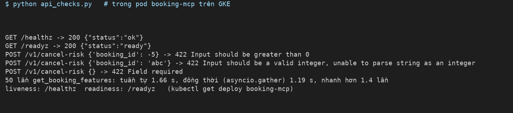
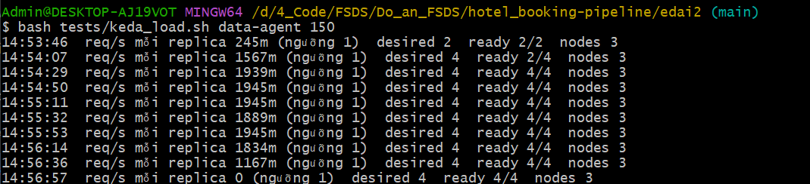
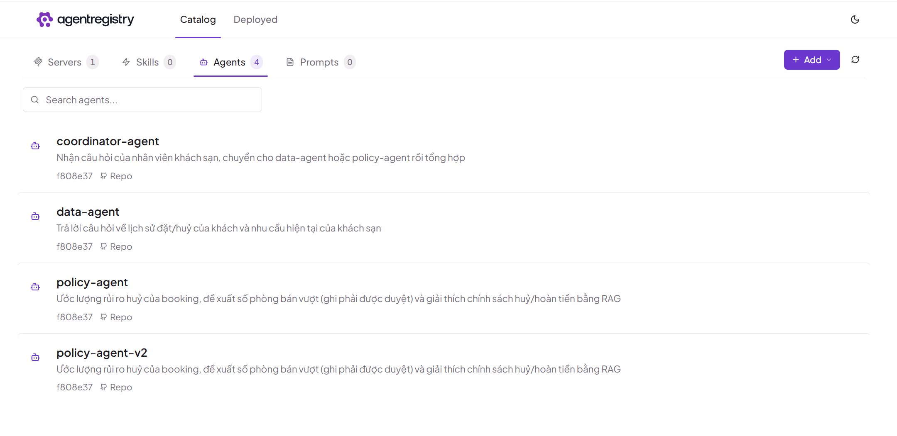

# MCP server & agent dùng tool

`booking-mcp` viết bằng FastAPI, xử lý bất đồng bộ, deploy bằng Helm; agent gọi MCP tool và được đăng ký lên registry.

## FastAPI, Data Validation và Healthcheck cho Kubernetes

`booking-mcp` xây dựng trên FastAPI với pydantic validation cho toàn bộ input/output của REST và MCP tool (`BookingFeatures`, `RiskRequest`, `CancelRisk`, `BatchRisk`, `OverbookingProposal`). Tool `predict_cancellation` đọc feature từ Feast online rồi gọi KServe `cancel-risk`; cùng logic này được mở qua REST `/v1/cancel-risk` và `/v1/cancel-risk/batch`.

Hai probe `/healthz` (liveness) và `/readyz` (readiness — chỉ trả `200` khi đọc được online store) hoạt động đúng trên GKE (namespace `agents`, Helm chart `helm/api`). Request sai schema (`booking_id` âm, sai kiểu chuỗi, thiếu trường) bị pydantic chặn ngay với mã `422`.

*Chú thích: Kiểm thử `booking-mcp` trên GKE: `/healthz` và `/readyz` trả `200`, dữ liệu sai schema bị Pydantic chặn `422`, và gọi 50 lần đồng thời bằng `asyncio.gather` nhanh hơn 1,4× (`1,19 s` vs `1,66 s`).*

## Xử lý bất đồng bộ (Async) cho truy vấn đồng thời

Mọi tool và endpoint là `async def`; Feast online được đọc bằng `get_online_features_async`, KServe được gọi bằng
`httpx.AsyncClient`, và warehouse dùng `psycopg.AsyncConnection`. Phép đo gọi 50 lần `get_booking_features` với các cặp
khách, khách sạn thật, một lần tuần tự và một lần đồng thời bằng `asyncio.gather` trên cùng một phiên MCP (cùng lần chạy
ở mục trên).

50 lần gọi tuần tự mất 1,66 s, gọi đồng thời mất 1,19 s, tức nhanh hơn 1,4 lần và không lỗi lần nào. Mức tăng còn hạn
chế vì cả 50 lời gọi cùng đọc online store qua một pod và một kết nối PostgreSQL; ảnh ở mục trên.

## Triển khai MCP Server lên Kubernetes bằng Helm (RollingUpdate & Rollback)

Chart chung `helm/api` (`values-booking-mcp.yaml`) dùng RollingUpdate với `maxSurge: 1`, `maxUnavailable: 0`, và
readiness probe `/readyz`: pod mới chỉ nhận traffic khi đọc được online store, pod cũ chỉ bị gỡ khi pod mới đã Ready.
Jenkins deploy bằng `helm upgrade --install --atomic --timeout 5m`, nên nếu pod mới không Ready kịp, Helm tự rollback về
revision trước. Phép thử chạy trên GKE: upgrade booking-mcp sang một image tag không tồn tại với
`--atomic --timeout 90s`.

Upgrade thất bại sau 90 giây vì pod mới không kéo được image, và Helm tự rollback: `helm history` ghi revision 3
`failed` và revision 4 "Rollback to 2". Trong suốt quá trình, pod cũ vẫn Running và phục vụ request nhờ
`maxUnavailable: 0`; sau rollback, Deployment tự khôi phục về phiên bản image ổn định trước đó.

*Chú thích: Output `helm history` chứng minh cơ chế tự phục hồi: revision 3 nâng cấp lên image lỗi bị fail sau 90s và Helm `--atomic` tự tạo revision 4 `Rollback to 2` mà không làm gián đoạn pod cũ.*

## Triển khai data-agent với multi-replica và auto-scale (KEDA)

data-agent ([`agents/agents-gke.yaml`](../../edai2/agents/agents-gke.yaml)) dùng MCP server booking-mcp qua
RemoteMCPServer `booking-tools-data` (route `/mcp` của agentgateway, token role `data-agent`) và chỉ được cấp tool
`get_booking_features`. Hỏi về cặp khách 18766768 và khách sạn 8528, agent gọi tool với đúng hai mã rồi trả lời theo
số liệu online store (1 booking 90 ngày, tỉ lệ huỷ 0%; khách sạn 44 booking 7 ngày, tỉ lệ huỷ 30 ngày 17,24%).

Autoscale dùng **KEDA 2.20.2** ([`k8s/keda.yaml`](../../edai2/k8s/keda.yaml)): mỗi agent chạy tối thiểu **2** và tối đa **4 replica**, trigger theo RPS từ Prometheus trên route A2A của `agentgateway`.

Khi chạy kiểm thử tải [`tests/keda_load.sh`](../../edai2/tests/keda_load.sh) (~10 req/s trong 150 s), `data-agent` tự scale từ `2/2` lên **`4/4 Ready` sau 40 giây**, và tự thu gọn về `2` sau 5 phút hết tải.

*Chú thích: Giao diện kagent UI với `data-agent`: agent tự động gọi đúng MCP tool `get_booking_features(18766768, 8528)` qua gateway và trả lời đúng số liệu từ Feast Online Store.*

*Chú thích: Output theo dõi HPA của `data-agent` khi chạy `keda_load.sh` (10 req/s): từ `2/2` replica tự động tăng lên `4/4` Ready sau ~40 giây nhờ trigger Prometheus RPS của KEDA.*

## Chạy Agent trong Sandbox (Agent Substrate)

Hệ thống triển khai **Agent Substrate 1.0.1** kết hợp **kagent 1.0.1** (manifest đầy đủ tại [`edai2/k8s/agent-substrate-v1.yaml`](../../edai2/k8s/agent-substrate-v1.yaml)) để cô lập toàn bộ 4 agent ở cả lớp runtime và mạng:

- **Runtime Sandbox gVisor:** cô lập tiến trình agent trong user-space kernel gVisor trên `WorkerPool/agents-warm` thay vì chạy trực tiếp trên host kernel.
- **L7 Egress Allowlist (`EgressPolicy`):** toàn bộ lưu lượng ra từ sandbox đi qua proxy mTLS và chỉ được phép gọi tới `vllm-booking` và `agentgateway` (cả 4 agent đều đạt `EgressPoliciesApplied=True`).
- **mTLS Ingress & L4 `NetworkPolicy`:** chỉ chấp nhận kết nối mTLS từ `kagent-controller` và chặn mọi kết nối egress ngoài allowlist (kiểm chứng live probe: `vllm-booking:8000` trả `HTTP 200`, còn `1.1.1.1` và `kagent-ui:8080` bị chặn `HTTP 000`).

*Chú thích: Kiểm chứng Agent Substrate gVisor (`v1.0.1`) trên K3s: cả 4 agent đạt `Ready=True` và `EgressPoliciesApplied=True`; probe từ trong sandbox tới `vllm-booking:8000` trả `HTTP 200` còn `1.1.1.1` và `kagent-ui:8080` bị chặn `HTTP 000`.*

## Đăng ký data-agent lên agentregistry

Script [`ci/publish_agent_card.py`](../../edai2/ci/publish_agent_card.py) lấy A2A agent card trực tiếp từ kagent controller (tránh gọi qua route `/a2a/policy-agent` đang chia 50/50), tạo bản khai báo `Agent` kèm `MCPServer` `booking-tools` gắn tag theo commit deploy rồi gửi `POST /v0/apply` lên `agentregistry`. Stage `Deploy agents` trong [`ci/Jenkinsfile`](../../edai2/ci/Jenkinsfile) tự động chạy bước này cho cả 4 agent sau mỗi lần rollout.

Kết quả chạy thủ công và qua Jenkins Build #19 (`WITH_AGENTS=true`) đều đăng ký thành công `data-agent` (tool `get_booking_features`) cùng MCP server `booking-tools` lên registry.

*Chú thích: Giao diện web `agentregistry` hiển thị đủ catalog 4 Agent (`coordinator-agent`, `data-agent`, `policy-agent`, `policy-agent-v2`) kèm tag commit git.*
