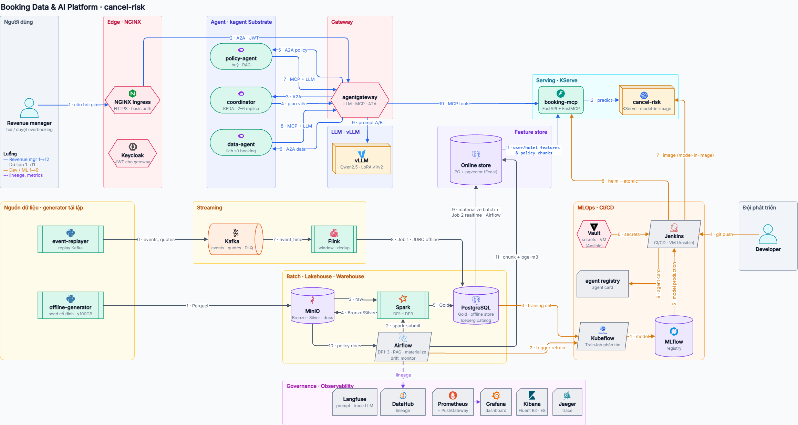
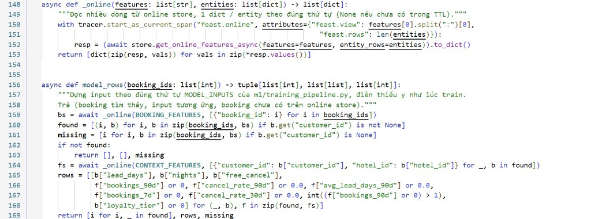
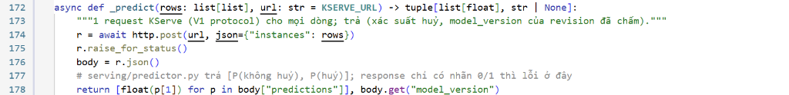
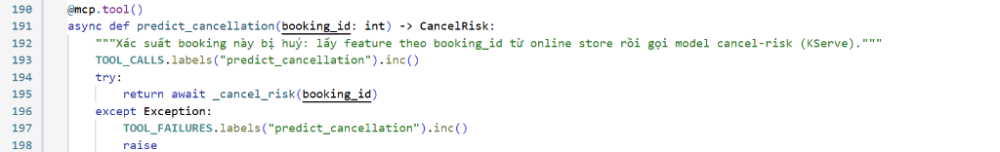
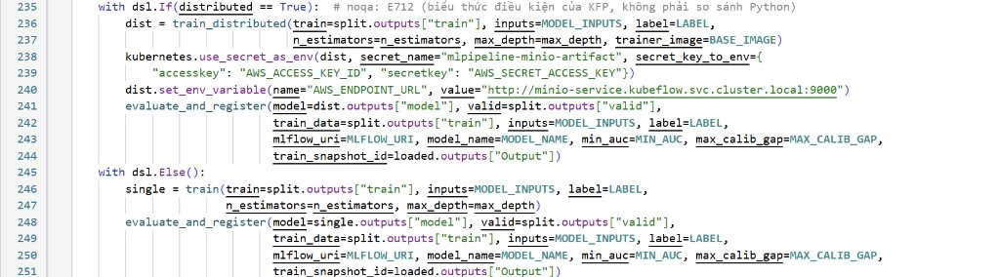

# Repository & low-level ML design

README, tài liệu kỹ thuật và sơ đồ kiến trúc tổng thể của hệ thống.

## README.md và tài liệu kiến trúc

[`README.md`](../../README.md) ở gốc repo trình bày bài toán nghiệp vụ (dự báo cancellation để tối ưu overbooking có người duyệt), cấu trúc repository, luồng dữ liệu theo ngày và liên kết tới các tài liệu chi tiết trong thư mục `docs/`. Toàn bộ file mã nguồn đều có docstring mô tả ở đầu file.

Sơ đồ kiến trúc tổng thể [`booking-overbooking.drawio`](../architecture/booking-overbooking.drawio) được thiết kế theo chuẩn mỗi thành phần chính là một deployable unit, phân biệt rõ luồng dữ liệu và luồng người dùng/MLOps bằng màu sắc, đánh số riêng cho từng luồng (revenue manager 1→12, dữ liệu 1→11, MLOps 1→9).

## Design Patterns trong mã nguồn

| Pattern | Vị trí | Vai trò |
|---|---|---|
| **Repository** | [`_online`](../../edai2/mcp_server/server.py#L148-L169) & `model_rows` trong `edai2/mcp_server/server.py` | Gom toàn bộ truy vấn Feast online store (`booking_attributes`, `customer_booking_stats`, `hotel_demand`) và ghép đúng thứ tự `MODEL_INPUTS` về một nơi duy nhất, tránh lặp logic giữa REST API, batch API và MCP tool. |
| **Adapter** | [`_predict`](../../edai2/mcp_server/server.py#L172-L178) trong `edai2/mcp_server/server.py` | Chuyển đổi payload/response chuẩn KServe V1 (`{"instances": ...}` → `{"predictions": [[p0, p1]], "model_version": ...}`) thành `(list[float], model_version)` cho lớp nghiệp vụ. |
| **Facade** | [`predict_cancellation`](../../edai2/mcp_server/server.py#L190-L198) (`@mcp.tool`) trong `edai2/mcp_server/server.py` | Gói trọn luồng Feast online store → KServe inference → metric/trace thành một tool đơn giản (`booking_id -> CancelRisk`) cho agent sử dụng. |
| **Strategy** | [`dsl.If(distributed == True)`](../../edai2/ml/training_pipeline.py#L235-L251) trong `edai2/ml/training_pipeline.py` | Hoán đổi chiến lược huấn luyện một node (`train`) hoặc phân tán nhiều worker (`train_distributed` qua Kubeflow Trainer) nhưng vẫn giữ cùng đầu ra `Model` cho bước `evaluate_and_register`. |

