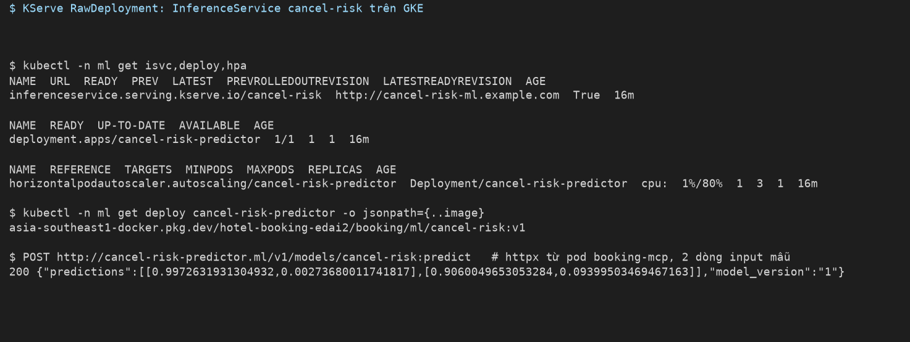

# ML inference service

Model được phục vụ bằng KServe theo mô hình model-inside-image.

Mỗi mục ứng với một dòng của rubric, ghi lại phần đã triển khai và kết quả (số liệu đo được, ảnh chụp trong
`docs/images/`).

## Sử dụng KServe để serve model vừa train ở bên trên, dùng model-inside-image pattern

Cluster thứ hai (project `hotel-booking-edai2`, tài khoản mới, quota 12 vCPU) ngày 2026-11-19: Gold khôi phục từ bản sao lưu (booking 2025-01-01 → 2025-01-13), Feast materialize lên online store, MLflow và KServe cài mới. KServe v0.15.2 cài ở chế độ RawDeployment (Deployment + Service + HPA, không
cần Knative và Istio). Image `ml/cancel-risk:v1` theo mô hình model-inside-image: model version 1 tải từ MLflow
(`models:/cancel-risk/1`) rồi COPY vào `/mnt/models` lúc build (`serving/Dockerfile`, `MODEL_VERSION=1`), nên pod không
tải model lúc khởi động. InferenceService dựng từ `serving/kserve-cancel-risk.yaml`, bỏ `logger` vì cluster chưa có
Knative broker; chưa tạo `cancel-risk-bulk` (RawDeployment không scale về 0 nếu thiếu KEDA).

InferenceService `cancel-risk` Ready, Deployment `cancel-risk-predictor` 1/1, HPA 1–3 replica theo CPU. Gọi thẳng V1
predict trả `200` với xác suất [không huỷ, huỷ] và `model_version: "1"`. Qua booking-mcp, tool `predict_cancellation` và
REST `/v1/cancel-risk` lấy feature từ Feast rồi gọi KServe: 20/20 lời gọi thử thành công. Trace dưới đây ghi lúc chịu tải
(dòng 32): lời gọi KServe chỉ mất 7,49 ms trên tổng 492,64 ms, phần còn lại là hai lần đọc online store Feast.

