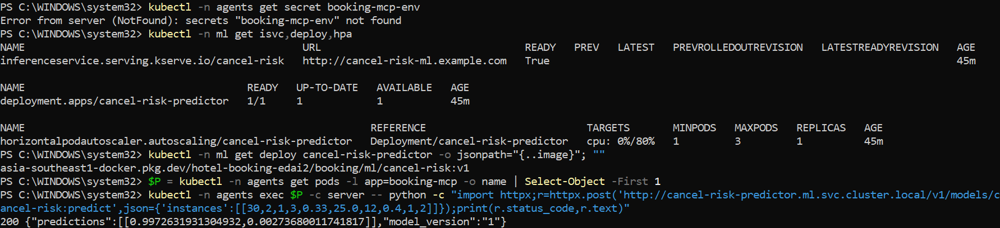
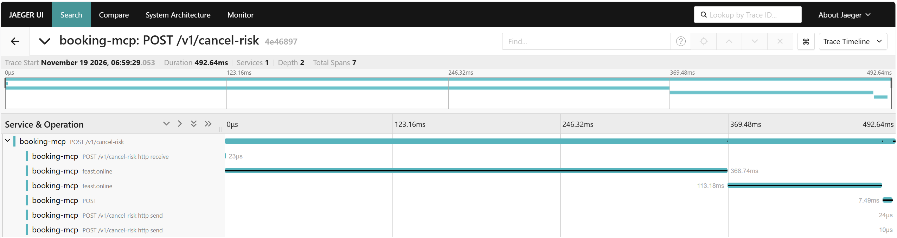
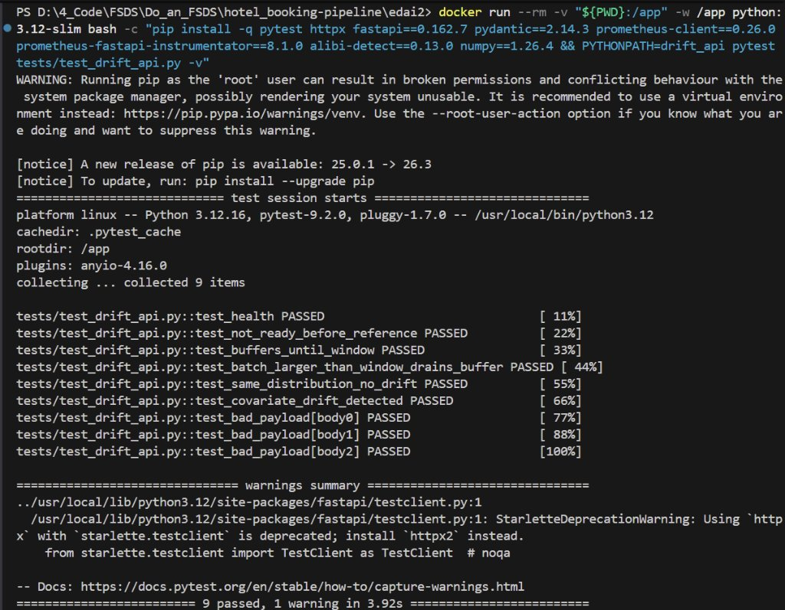
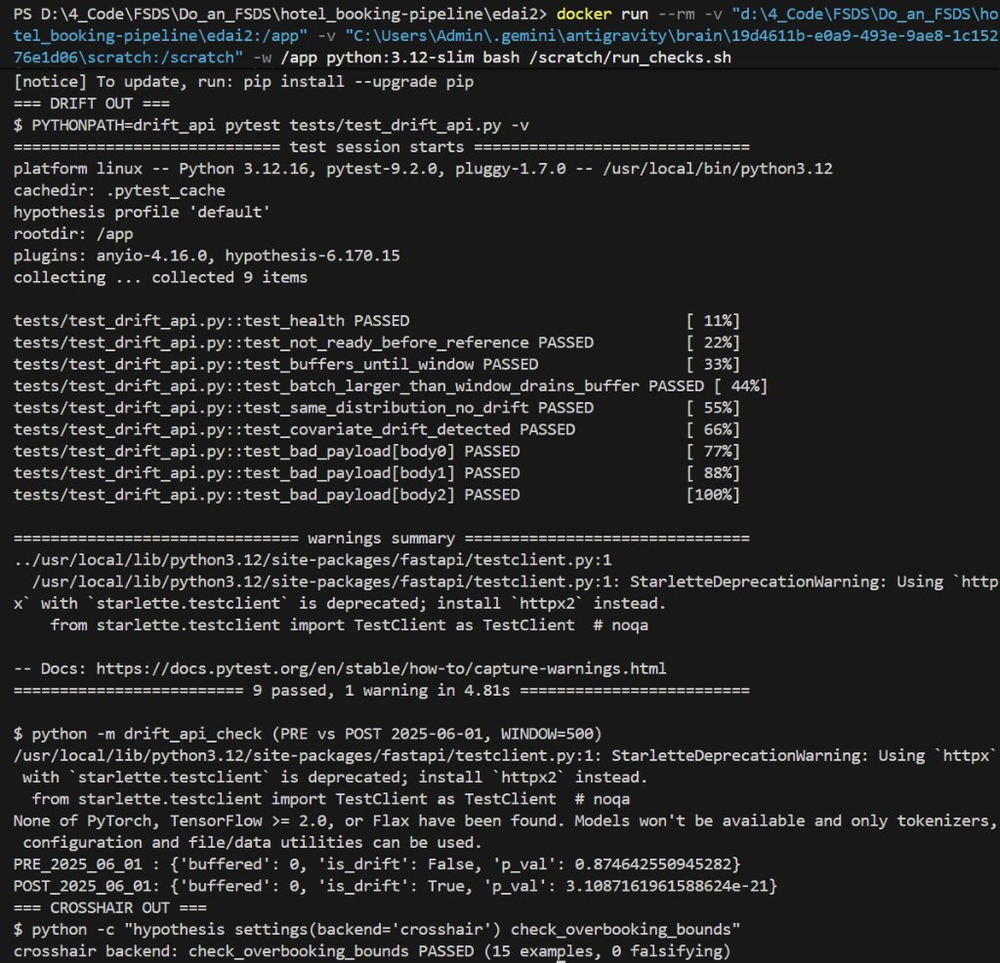
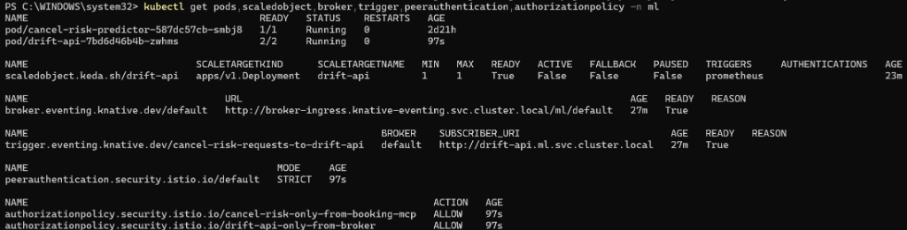

# ML inference service

Model được phục vụ bằng KServe theo mô hình model-inside-image.

## Phục vụ model bằng KServe (model-inside-image)

**KServe v0.15.2** (chế độ RawDeployment, cấu hình tại [`serving/kserve-cancel-risk.yaml`](../../edai2/serving/kserve-cancel-risk.yaml)) phục vụ model `cancel-risk` v1 theo mô hình **model-inside-image** (đóng gói sẵn model từ MLflow lúc build tại [`serving/Dockerfile`](../../edai2/serving/Dockerfile) để pod khởi động nhanh, không phải tải lại model).

Trên GKE, `InferenceService/cancel-risk` đạt `Ready` với HPA `1–3` replica; endpoint V1 `:predict` và luồng `booking-mcp → Feast → KServe` đều trả `200` (`model_version: "1"`). Khi chịu tải, bản thân bước inference KServe chỉ mất **7,49 ms** trên tổng `492,64 ms` của toàn request.

*Chú thích: Output `kubectl` kiểm tra `InferenceService cancel-risk` (`Ready=True`), Deployment `1/1`, HPA (1–3 replica) và kết quả gọi thử endpoint V1 `:predict` trả `200` kèm xác suất và `model_version: '1'`.*

*Chú thích: Trace trên Jaeger cho luồng `booking-mcp → Feast → KServe` lúc chịu tải: toàn bộ request mất `492,64 ms`, trong đó bản thân lệnh gọi KServe chỉ mất `7,49 ms`.*

## Kiểm thử Real-time Drift Detection (`drift-api` + `alibi-detect` KSDrift)

[`edai2/drift_api/drift_api.py`](../../edai2/drift_api/drift_api.py) chạy FastAPI nhận batch feature (hoặc CloudEvent từ Knative Eventing), tích lũy đủ `WINDOW` dòng rồi chạy `KSDrift` trên `lead_days` so với tập reference khi train (`gamma(2, 10)`).

Kiểm thử trong container `python:3.12-slim` (`pytest tests/test_drift_api.py -v`: **9/9 test pass**) và mô phỏng phân phối trước/sau mốc drift `2025-06-01` (`WINDOW=500`, `lead_days * 1.5`):
- **Trước `2025-06-01` (`PRE_2025_06_01`):** `is_drift=False`, `p_val=0.8746`
- **Sau `2025-06-01` (`POST_2025_06_01`):** `is_drift=True`, `p_val=3.11e-21`

*Chú thích: Kết quả chạy `pytest tests/test_drift_api.py -v` trong container `python:3.12-slim`: toàn bộ `9/9` unit test của `drift-api` đều `PASSED`.*

*Chú thích: Kết quả mô phỏng `drift-api` với `KSDrift` (`WINDOW=500`): trước drift cho `is_drift=False` (`p_val=0.8746`), sau mốc `2025-06-01` phát hiện ngay `is_drift=True` (`p_val=3.11e-21`); kèm kết quả CrossHair.*

Trên GKE, `Broker/default` (Knative Eventing), `Trigger/cancel-risk-requests-to-drift-api`, `ScaledObject/drift-api` (KEDA) và `drift-api` (`2/2 Running` kèm Istio sidecar) đều hoạt động ở trạng thái `READY: True`:

*Chú thích: Trạng thái các tài nguyên trong namespace `ml`: Knative `Broker/default`, `Trigger/cancel-risk-requests-to-drift-api`, `ScaledObject/drift-api` (KEDA) và pod `drift-api` (`2/2 Running` có Istio sidecar) đều `READY: True`.*

