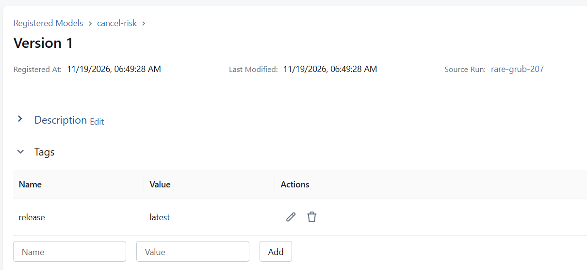

# ML pipeline

Notebook, Kubeflow pipeline, training phân tán, MLflow và versioning dữ liệu train.

Mỗi mục ứng với một dòng của rubric. Mục đã hoàn thành ghi lại phần đã triển khai và kết quả (số liệu đo được,
ảnh chụp trong `docs/images/`). Mục chưa hoàn thành giữ trích rubric, phần **Cách làm** đồng bộ từ cột F của rubric
và phần **Kết quả** chờ bổ sung.

## Build 1 training pipeline với ít nhất 4 steps: load data từ offline feature store, data…

**Rubric:** edai-2 · dòng 13 · 2 điểm · nhóm *ML Pipelines* › *Training Pipelines*

> Build 1 training pipeline (sử dụng Kubeflow Pipelines) với ít nhất 4 steps: load data từ offline feature store, data split, model training, model evaluation

**Cần nộp (cả nhóm):** Document show ảnh pipeline đã chạy thành công trên KF Pipelines + link tới code pipeline

**Cách làm:** [Đã có] Pipeline KFP 4 step cho cancel-risk. Dữ liệu lấy theo cửa sổ [`since`, `until`): v1 dùng [2025-01-01, 2025-06-01), v2 dùng dữ liệu sau mốc drift 2025-06-01 (retrain bằng tay khi nhãn đã chín); lấy mẫu `sample_pct` theo `booking_id`. Nhãn đến từ view `gold.labels_cancel`, chỉ gồm booking đã chín nhãn. Input có `loyalty_tier` và `has_customer_history`. DSN warehouse lấy từ Secret `ml-warehouse`. [Cần làm] chạy trên Kubeflow Pipelines khi có quota; hiện chạy 4 step bằng ml/run_steps.py trong 1 Job.

**Kết quả:** bốn step của pipeline (`load_from_feast` → `split_by_time` → `train` → `evaluate_and_register`) đã
chạy thành công trên GKE ngày 2026-11-19, nhưng **chưa chạy trên Kubeflow Pipelines**: cluster thứ hai chỉ có 12 vCPU, không
đủ cho KFP. `ml/run_steps.py` gọi đúng hàm Python bên trong từng component KFP, tuần tự trong một Job (image `train-base`).
Mẫu 5% booking cửa sổ [2025-01-01, 2025-06-01), train XGBoost 1 node (bỏ nhánh `train_distributed` vì cần Kubeflow Trainer).
Lần chạy đầu lộ một lỗi thật đã sửa: `LABEL_SQL` dùng toán tử phần trăm, mà `pd.read_sql` qua psycopg 3 coi ký tự này là
placeholder, nên đổi sang `mod(booking_id, 100)`. Kết quả train ở dòng 14.

## Lưu model, data và các metadata liên quan khác ở mỗi training run lên MLFlow, tự động gắn…

Cluster thứ hai (project `hotel-booking-edai2`, tài khoản mới, quota 12 vCPU) ngày 2026-11-19: Gold khôi phục từ bản sao lưu (booking 2025-01-01 → 2025-01-13), Feast materialize lên online store, MLflow và KServe cài mới. MLflow 3.6.0 (`k8s/mlflow.yaml`, image `docker/mlflow.Dockerfile`) lưu metadata trên
Postgres (database `mlflow`) và artifact trên MinIO; client chỉ gọi HTTP tới server (`--serve-artifacts`). Bước
`evaluate_and_register` của lần chạy ở dòng 13 ghi:

- tham số XGBoost và `train_snapshot_id`: snapshot Iceberg của tập train (`ml.train_cancel_risk`), đọc lại đúng tập đã
  train bằng time travel (`data_version.load_training_set`);
- dataset `train` gắn vào run (context Training), `feature_importance.json`, `reference_lead_days.npy` cho drift;
- model đăng ký thành `cancel-risk` version 1, tự gắn tag `release = latest`.

| Metric (tập validation) | Giá trị | Cổng promote |
|---|---|---|
| `val_auc` | 0,709 | ≥ 0,60: đạt |
| `val_calib_gap` | 0,068 | ≤ 0,03: **không đạt** |
| `val_brier` | 0,025 | ≤ Brier bản production (chưa có, mặc định 1): đạt |

Model không qua cổng nên không được gắn alias `production`; đây là đúng thiết kế, không gắn tay. `prod_auc_same_valid = 0`
và `prod_brier_same_valid = 1` là giá trị mặc định khi chưa có bản production. Lệch calibration cao vì Gold khôi phục chỉ
có các lần huỷ xảy ra trước 13/01/2025, nhãn huỷ của các booking này còn thiếu phần lớn; số đo vì vậy không phản ánh
chất lượng model trên dữ liệu đủ năm.

