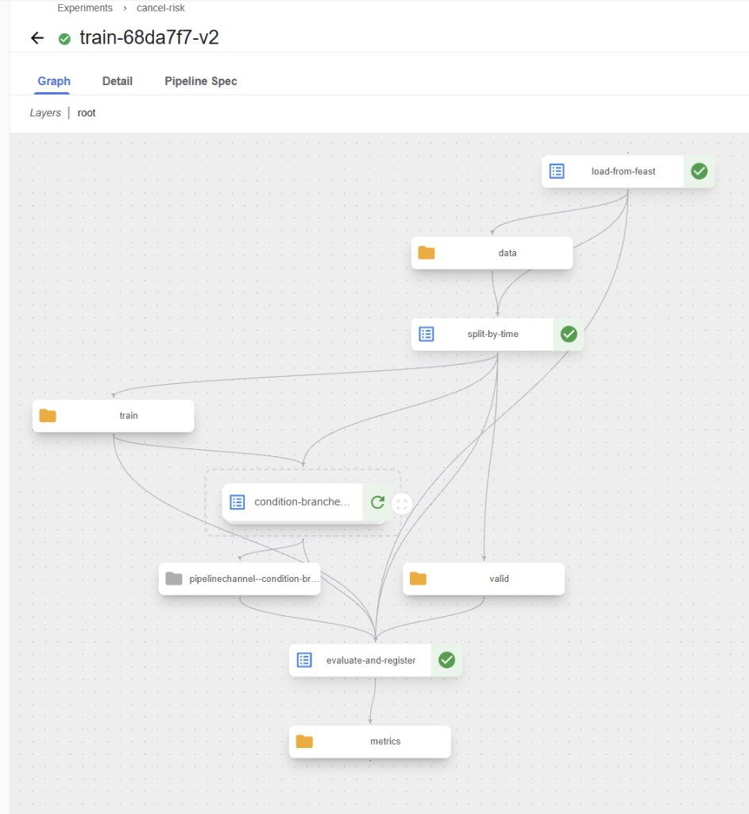
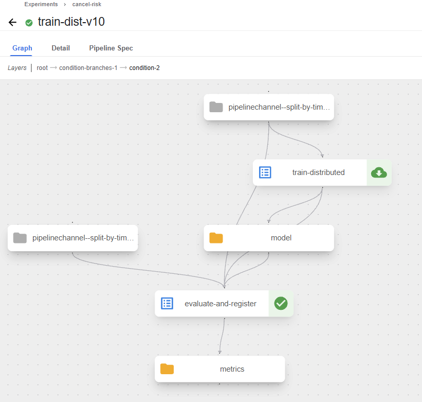
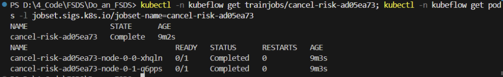
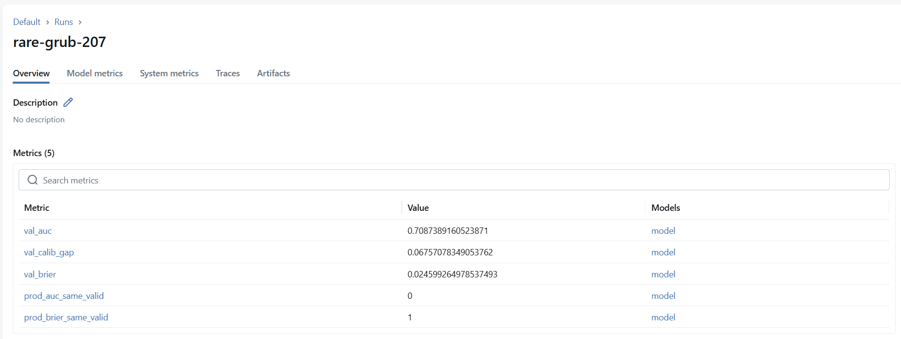

# ML pipeline

Notebook, Kubeflow pipeline, training phân tán, MLflow và versioning dữ liệu train.

## Training pipeline 4 bước (Load Feast → Split → Train → Evaluate)

Pipeline huấn luyện mô hình `cancel-risk` ([`edai2/ml/training_pipeline.py`](../../edai2/ml/training_pipeline.py), [`edai2/ml/run_steps.py`](../../edai2/ml/run_steps.py)) chạy trên **Kubeflow Pipelines 2.4.1** (GKE) theo 4 bước: `load_from_feast` → `split_by_time` → `train` → `evaluate_and_register`, dùng nhãn đã chín từ `gold.labels_cancel` và lưu phiên bản tập train vào bảng Iceberg `ml.train_cancel_risk`:

- **Huấn luyện 1 node (`distributed=False`):** chạy đủ 4 bước và ghi model/metric lên MLflow (`Succeeded`).
- **Huấn luyện phân tán (`distributed=True`):** dùng **Kubeflow Trainer v2.1.0** (`xgboost-distributed`) khởi chạy 2 worker pod XGBoost đồng bộ qua `RabitTracker`, sau đó chuyển sang `evaluate_and_register` (`Succeeded`).

*Chú thích: Giao diện Kubeflow Pipelines run `train-68da7f7-v2` (`distributed=False`): cả 4 step `load-from-feast → split-by-time → train → evaluate-and-register` đều hoàn thành xanh.*

*Chú thích: Giao diện Kubeflow Pipelines run `train-dist-v10` (`distributed=True`): rẽ nhánh Strategy Pattern sang `train-distributed` rồi nối tiếp sang `evaluate-and-register`.*

*Chú thích: Trạng thái `TrainJob cancel-risk-ad05ea73` (Kubeflow Trainer v2.1.0): hoàn tất `Complete` với 2 worker pod XGBoost (`node-0-0`, `node-0-1`) đồng bộ qua `RabitTracker` đều `Completed`.*

*Chú thích: Kết quả chạy `ml/run_steps.py` (`train-cancel-risk`) hoàn thành 4 step và tạo thành công bảng phiên bản dữ liệu Iceberg `ml.train_cancel_risk` trong PostgreSQL.*

## Theo dõi thí nghiệm, model registry và versioning dữ liệu với MLflow

**MLflow 3.6.0** ([`k8s/mlflow.yaml`](../../edai2/k8s/mlflow.yaml)) lưu metadata trên PostgreSQL và artifact trên MinIO. Bước `evaluate_and_register` tự động ghi nhận tham số XGBoost, dataset `train`, artifact theo dõi drift (`feature_importance.json`, `reference_lead_days.npy`), `train_snapshot_id` (trỏ tới snapshot Iceberg của `ml.train_cancel_risk` để tái lập dữ liệu bằng time travel), và đăng ký model `cancel-risk` v1 (`release = latest`).

| Metric (validation) | Giá trị | Cổng promote |
|---|---|---|
| `val_auc` | 0,709 | ≥ 0,60 (đạt) |
| `val_calib_gap` | 0,068 | ≤ 0,03 (**không đạt**) |
| `val_brier` | 0,025 | ≤ Brier bản production (đạt) |

Do `val_calib_gap` vượt ngưỡng `0,03` (dữ liệu 13 ngày đầu năm 2025 còn ít nhãn huỷ muộn), pipeline tự động **không** gắn alias `production` để chặn model kém chất lượng.

*Chú thích: Giao diện MLflow UI liệt kê các experiment run kèm thẻ `Dataset` (`train`) được gắn tự động để truy vết dữ liệu huấn luyện.*

*Chú thích: Chi tiết các metric đánh giá của run trên MLflow: `val_auc = 0,709`, `val_calib_gap = 0,068`, `val_brier = 0,025`.*

*Chú thích: Tab Parameters của run trên MLflow: lưu đầy đủ siêu tham số XGBoost cùng `train_snapshot_id` trỏ về snapshot Iceberg trong `ml.train_cancel_risk`.*

*Chú thích: Model Registry trên MLflow cho thấy model `cancel-risk` version 1 được gắn tag `release=latest` (và chưa được gắn alias `production` do `val_calib_gap` vượt ngưỡng 0,03).*

