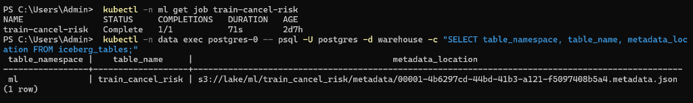
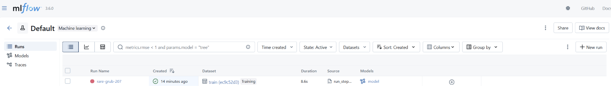
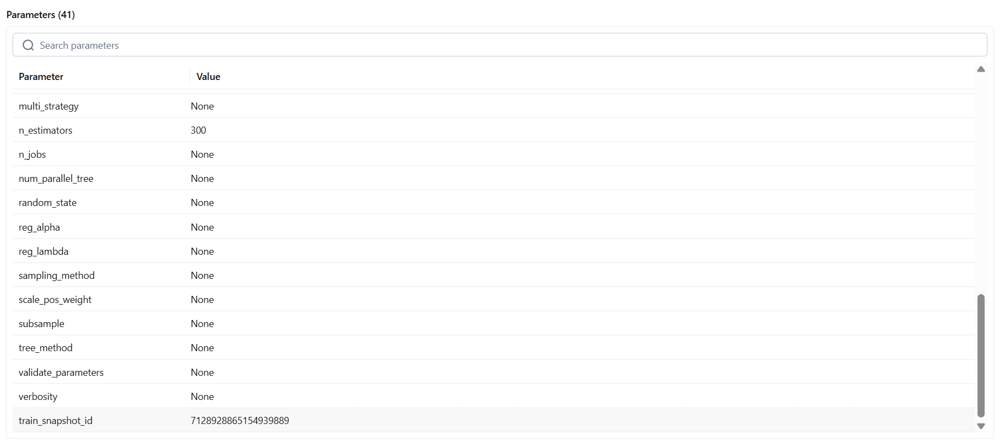

# ML pipeline

Notebook, Kubeflow pipeline, training phân tán, MLflow và versioning dữ liệu train.

## Training pipeline 4 bước (Load Feast → Split → Train → Evaluate)

Code pipeline: `edai2/ml/` (`run_steps.py` và các component KFP cho mô hình `cancel-risk`).

Pipeline gồm 4 bước: `load_from_feast` → `split_by_time` → `train` → `evaluate_and_register`. Dữ liệu lấy theo cửa sổ thời gian (`[2025-01-01, 2025-06-01)` cho v1, sau mốc drift `2025-06-01` cho v2), lấy mẫu `sample_pct` theo `booking_id`, sử dụng nhãn từ view `gold.labels_cancel` (chỉ gồm booking đã chín nhãn) cùng các feature như `loyalty_tier`, `has_customer_history`.

Trên GKE, cả 4 bước đã chạy thành công tuần tự qua `ml/run_steps.py` trong Job `train-cancel-risk` (image `train-base`, mẫu 5% booking, train XGBoost 1 node). Dữ liệu tập train được phiên bản hoá thành bảng Iceberg `ml.train_cancel_risk`. Trong quá trình chạy, lỗi `LABEL_SQL` dùng toán tử `%` (bị `pd.read_sql` qua psycopg 3 hiểu nhầm là placeholder) đã được phát hiện và sửa thành `mod(booking_id, 100)`.

**[update sau]:** Do cluster GKE hiện tại chỉ có quota 12 vCPU nên chưa đủ tài nguyên triển khai Kubeflow Pipelines (KFP) và Kubeflow Trainer. Ý tưởng tiếp theo là khi quota được nâng cấp, deploy KFP để điều phối trực tiếp pipeline 4 bước này trên giao diện KFP và kích hoạt nhánh `train_distributed`, sau đó bổ sung ảnh chụp run trên KFP UI.

## Theo dõi thí nghiệm, model registry và versioning dữ liệu với MLflow

Trên cluster GKE (`hotel-booking-edai2`, dữ liệu Gold khôi phục giai đoạn `2025-01-01` → `2025-01-13`), MLflow 3.6.0 (`k8s/mlflow.yaml`, image `docker/mlflow.Dockerfile`) được cài đặt để lưu metadata trên Postgres (`mlflow`) và artifact trên MinIO (`--serve-artifacts`). Bước `evaluate_and_register` tự động ghi nhận:
- Tham số XGBoost và `train_snapshot_id` trỏ tới snapshot Iceberg của tập train (`ml.train_cancel_risk`), cho phép tái lập đúng tập dữ liệu đã train bằng time travel (`data_version.load_training_set`).
- Dataset `train` gắn vào run, `feature_importance.json` và `reference_lead_days.npy` phục vụ theo dõi drift.
- Đăng ký model `cancel-risk` version 1 kèm tag `release = latest`.

| Metric (tập validation) | Giá trị | Cổng promote |
|---|---|---|
| `val_auc` | 0,709 | ≥ 0,60: đạt |
| `val_calib_gap` | 0,068 | ≤ 0,03: **không đạt** |
| `val_brier` | 0,025 | ≤ Brier bản production (chưa có, mặc định 1): đạt |

Model chưa đạt cổng `val_calib_gap` nên không được gắn alias `production` (đúng thiết kế tự động chặn model kém chất lượng). Nguyên nhân lệch calibration là dữ liệu khôi phục 13 ngày đầu năm 2025 chưa đủ nhãn huỷ muộn.

