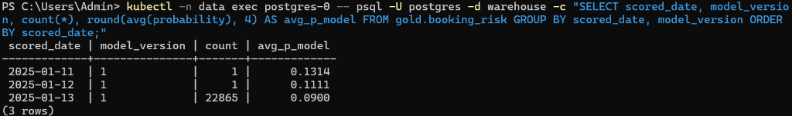
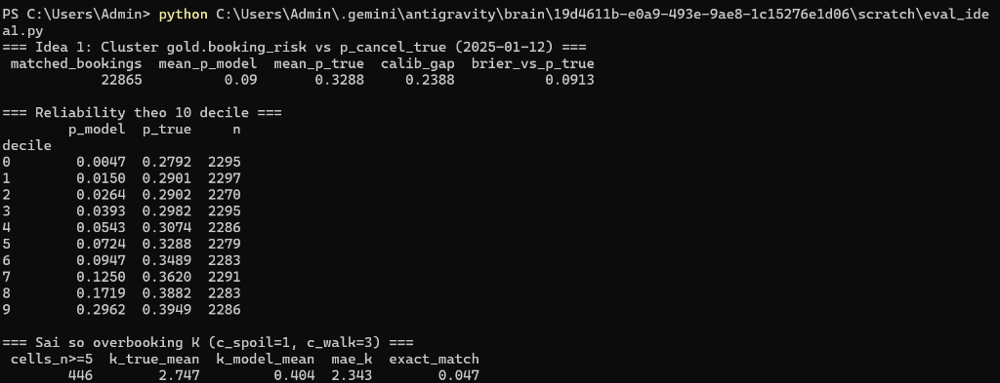
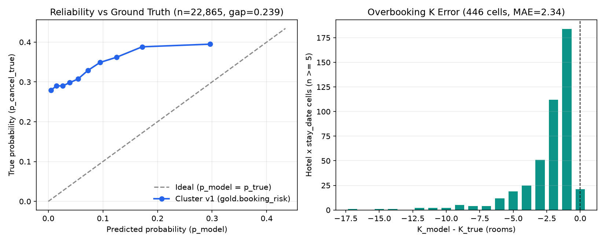
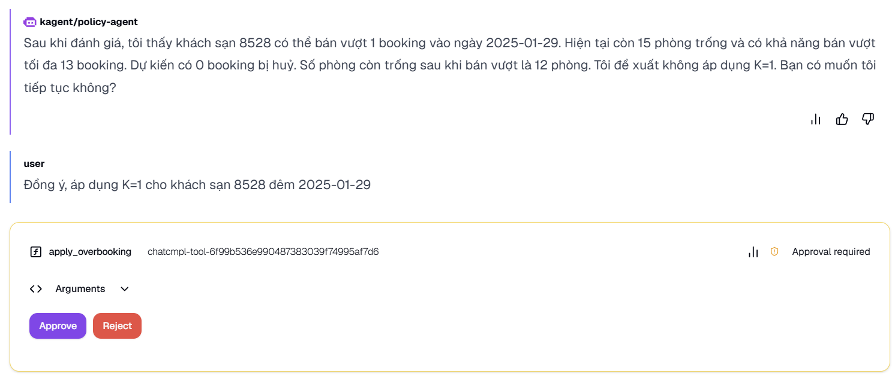
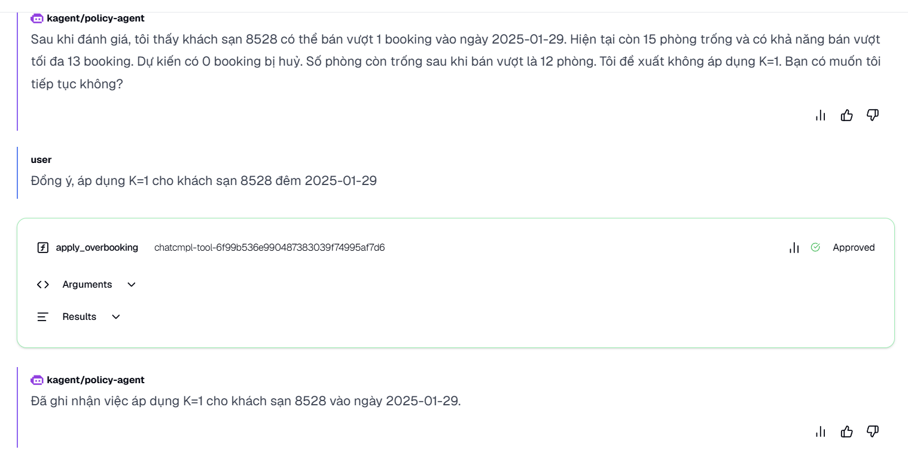

# Novel ideas (edai-2)

Mỗi ý tưởng gồm bài toán đặt ra, giải pháp triển khai và kết quả kiểm chứng thực tế.

## Idea 1: Đánh giá calibration và sai số quyết định K so với xác suất thật

Generator ghi lại xác suất huỷ thật $p$ của từng booking vào bucket `truth` (nằm ngoài landing). Khi đối chiếu (`join`) với `gold.booking_risk`, hệ thống đo được ngay Brier score, độ lệch calibration (reliability theo decile) và sai số số phòng bán vượt $K$ (so sánh $K$ tính từ xác suất model với $K$ tính từ $p$ thật) trước và sau khi retrain, không cần chờ 90 ngày chín nhãn.

1. **Thí nghiệm cục bộ (`notebooks/cancel_risk.ipynb`, đủ nhãn `2025-02` → `2025-08`):**

| Phiên bản / Giai đoạn | Lệch calibration | Brier vs $p$ thật | $|K_{\text{model}} - K_{\text{thật}}|$ TB |
|---|---|---|---|
| v1, validation trước drift | 0,0009 | 0,016 | 0,30 |
| v1, sau drift `2025-06-01` | 0,127 | 0,040 | 1,62 |
| v2 (retrain sau drift) | 0,0008 | 0,019 | 0,36 |

Trước drift, xác suất dự báo lệch xác suất thật dưới `0,05` ở mọi decile trên biểu đồ reliability.

2. **Đối chiếu trực tiếp trên `gold.booking_risk` của cluster GKE:**
   Chấm **22.865 booking** (shard 0 của ngày `2025-01-12`) qua `booking-mcp` (`/v1/cancel-risk/batch`) → Feast online → KServe `cancel-risk` v1, ghi vào `gold.booking_risk` (`scored_date = 2025-01-13`, không thiếu dòng nào), rồi join với `p_cancel_true`:
   - `Mean p_model = 0,0900` vs `Mean p_true = 0,3288` → **lệch calibration = `0,2388`**, **Brier vs $p$ thật = `0,0913`**.
   - Qua 10 decile, `p_model` (`0,0047 → 0,2962`) và `p_true` (`0,2792 → 0,3949`) tăng đơn điệu đúng thứ tự rủi ro, nhưng v1 dự báo thấp toàn cục vì dữ liệu train chỉ có 13 ngày thiếu nhãn huỷ muộn.
   - Trên **446 ô** `(hotel_id, stay_date)` có ≥ 5 booking: `K thật TB = 2,747` vs `K model TB = 0,404` → **`|K model − K thật| TB = 2,343` phòng** (chỉ 4,7% ô khớp chính xác K). Phép đo chứng minh Idea 1 phát hiện ngay độ lệch calibration và tác động tới quyết định bán vượt chỉ sau 1 ngày chấm điểm.

*Chú thích: Truy vấn SQL trên PostgreSQL cluster kiểm tra `22.865` booking ngày `2025-01-12` đã được chấm đầy đủ vào `gold.booking_risk` (`scored_date = 2025-01-13`).*

*Chú thích: Bảng đối chiếu 10 decile giữa `p_model` và `p_true` trên cluster: `Mean p_model = 0,0900` vs `Mean p_true = 0,3288` (lệch calibration `0,2388`), kéo theo sai số K trung bình `2,343` phòng trên 446 ô.*

*Chú thích: Biểu đồ Reliability theo 10 decile và phân bố sai số K trên `gold.booking_risk` của cluster GKE: đường dự báo của v1 tăng đơn điệu nhưng nằm thấp hẳn dưới đường lý tưởng do thiếu nhãn huỷ muộn trong 13 ngày đầu.*

## Idea 2 (edai-2): HITL cho bán vượt

Tool `propose_overbooking` tính K cho từng khách sạn × đêm bằng phân phối Poisson-binomial chính xác trên xác suất
huỷ trong `gold.booking_risk`, với ngưỡng c_spoil / (c_spoil + c_walk), rồi so với số phòng trong `gold.hotel_rooms`.
Tool này chỉ đề xuất. Việc ghi K bằng `apply_overbooking` nằm trong `requireApproval` của policy-agent
([`agents/agents-gke.yaml`](../../edai2/agents/agents-gke.yaml)), nên kagent dừng lời gọi cho tới khi người
duyệt bấm Approve hoặc Reject.

Thử trên GKE: policy-agent đề xuất K cho khách sạn 8528 đêm 2025-01-29, người dùng đồng ý
K = 1, lời gọi `apply_overbooking(8528, 2025-01-29, 1)` chuyển sang trạng thái *Approval required*. Chỉ sau khi bấm
Approve, `gold.overbooking_limits` mới có dòng `8528 | 2025-01-29 | 1`. Qua A2A, cùng lời gọi đó trả task ở trạng thái
`input-required`. Logic K được kiểm bằng `tests/test_overbooking.py` (chạy trong build #7 của Jenkins): giá trị biên
p = 0 và p = 1, không có booking, chi phí không dương, xác suất ngoài [0, 1]; phân phối so với liệt kê đủ 2^n trường
hợp; và tính chất K không giảm khi chi phí chuyển khách giảm.

*Chú thích: Giao diện kagent UI khi `policy-agent` gọi `apply_overbooking(8528, 2025-01-29, 1)`: dừng ở trạng thái "Approval required" chờ revenue manager duyệt.*

*Chú thích: Sau khi revenue manager bấm Approve, dòng `8528 | 2025-01-29 | 1` mới được ghi chính thức vào bảng `gold.overbooking_limits`.*
