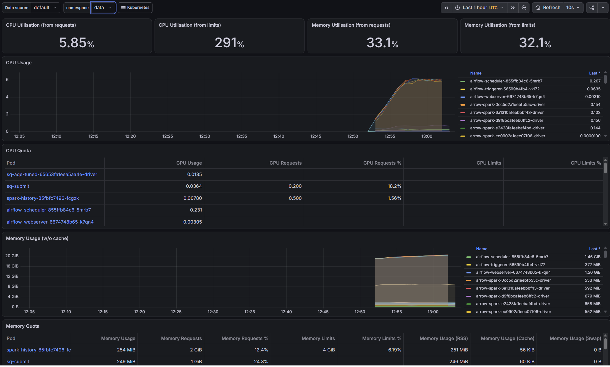
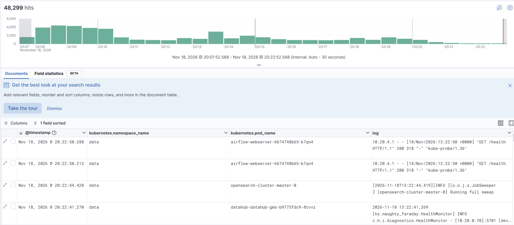

# Observability

Metric của Web API, telemetry hệ thống, log, trace, telemetry cho LLM và agent, kiểm tra drift theo lịch.

Mỗi mục ứng với một dòng của rubric. Mục đã hoàn thành gồm phần **Thực thi** (đã làm gì, chạy ở đâu) và **Kết quả**
(số liệu đo được, ảnh chụp trong `docs/images/`). Mục chưa hoàn thành giữ trích rubric và phần **Cách làm** đồng bộ từ
cột F của rubric.

## Web API monitoring metrics such as req/s, num of reqs, num of failures, etc.

**Rubric:** edai-2 · dòng 46 · 1 điểm · nhóm *Observability* › *Web API metrics*

**Cần nộp (cả nhóm):** Document show được các telemetry

**Cách làm:** [Đã có] booking-mcp dùng `prometheus-fastapi-instrumentator` (req/s, số request, lỗi) cùng các metric `mcp_tool_calls`, `mcp_tool_failures`; dashboard `observability/dashboards/booking-apis.json`. [Cần làm] chụp dashboard.

**Kết quả:** _Chưa có. Cần số liệu, ảnh chụp hoặc link code sau khi chạy trên cluster._

## Collect và visualize metrics với Prometheus + Grafana · edai-2 · Observability

**Thực thi:** Stack observability được cài trên GKE ngày 2026-11-18 vào namespace `monitoring`: `kube-prometheus-stack` 93.4.0
(`observability/stack/kube-prometheus-stack.yaml`, PVC Prometheus dùng storage class `standard`), Pushgateway, Jaeger
(`stack/jaeger.yaml`), Elasticsearch và Kibana 8.5.1, Fluent Bit 0.58.3 (`stack/efk.yaml`). Prometheus thu CPU, RAM, disk, network theo node và pod qua
node-exporter và kube-state-metrics. Grafana đọc mật khẩu admin từ Secret `grafana-admin` và truy cập qua ingress
`grafana.booking.local`.

**Kết quả:** các dashboard có sẵn của chart (node-exporter, kube-state-metrics) hiện CPU, RAM, disk, network theo
cluster, node và pod. Ảnh chụp lúc job Spark 105 GiB đang chạy: namespace `data` dùng khoảng 38 core và 128 GiB RAM, mỗi
executor Spark khoảng 6 core.

## Tương tự cho logs · edai-2 · Observability

**Thực thi:** dùng cùng stack ở dòng 47; log đi theo chuỗi Fluent Bit → Elasticsearch → Kibana
(`observability/stack/efk.yaml`), Kibana truy cập qua ingress. Fluent Bit chạy dạng DaemonSet (1 pod mỗi node), đọc log
container, gắn metadata pod/namespace, bỏ log của `kube-system` và `monitoring`, rồi đẩy vào index `booking-YYYY.MM.DD`.
Chart Kibana 8.5.1 bật `csp.strict` khiến một số trình duyệt bị chặn, nên cấu hình đặt `csp.strict: false`.

**Kết quả:** Kibana (data view `booking-*`) nhận khoảng 48 nghìn dòng log trong 15 phút. Lọc KQL theo pod của task
Airflow DP2 ra đúng log của `silver_bookings`, `stage_gold`, `upsert_gold`.

## Tương tự cho traces · edai-2 · Observability

**Rubric:** edai-2 · dòng 49 · 1 điểm · nhóm *Observability* › *Computing telemetry data (such as CPU, RAM, disk, network, etc.)*

**Cách làm:** [Đã có] `observability/stack/jaeger.yaml` nhận OTLP gRPC cổng 4317, UI qua ingress; booking-mcp gửi trace (FastAPI, httpx tới KServe, span đọc Feast). [Cần làm] tracing cho agentgateway; chụp một trace A2A → MCP → KServe.

**Kết quả:** _Chưa có. Cần số liệu, ảnh chụp hoặc link code sau khi chạy trên cluster._

## Đảm bảo ít nhất các metrics · LLM-related telemetry data

**Thực thi:** `llm_metrics.py` đo số token vào, ra và tổng, thời gian round-trip, TTFT và số lần chặn PII. Một dãy số
thẻ chỉ bị coi là PII khi qua kiểm tra Luhn và không đứng sau tiền tố `BK-`.

**Kết quả:** `edai2/tests/test_llm_metrics.py` (11 test, coverage 100%) chạy cục bộ và đạt ngày 2026-11-16. Test xác
nhận `BK-<id>` không bị chặn, còn `4111 1111 1111 1111` bị chặn. Phần này chưa có ảnh chụp trên cluster.

## Đảm bảo ít nhất các metrics · Agent-related telemetry data

**Rubric:** edai-2 · dòng 51 · 2 điểm · nhóm *Observability* › *Agent-related telemetry data*

> Đảm bảo ít nhất các metrics + total num of times each agent is called + total num of times each MCP tool is called + total failures cho mỗi lượt call tool

**Cách làm:** [Đã có] Các metric `agent_calls_total`, `mcp_tool_calls_total`, `mcp_tool_failures_total` cùng dashboard `observability/dashboards/llm-agents.json` (có request A2A theo route qua agentgateway). [Cần làm] chụp dashboard.

**Kết quả:** _Chưa có. Cần số liệu, ảnh chụp hoặc link code sau khi chạy trên cluster._
