# Observability

Metric của Web API, telemetry hệ thống, log, trace, telemetry cho LLM và agent.

## Web API monitoring metrics (Prometheus + Grafana)

`booking-mcp` chạy trên GKE (namespace `agents`, Helm chart `helm/api`), đọc feature đã materialize từ Gold lên Feast online store (PostgreSQL, schema `feast_online`).
booking-mcp dùng `prometheus-fastapi-instrumentator` để đo req/s, số request, lỗi và latency; ServiceMonitor của chart
cho Prometheus scrape `/metrics`. Dashboard `observability/dashboards/booking-apis.json` hiển thị các metric này.

Locust (`tests/locustfile.py`, 20 user, 5 phút) gọi `POST /v1/cancel-risk`: khoảng 47 req/s, hơn 21 nghìn request,
latency p95 khoảng 96 ms, không có lỗi 5xx (panel 5xx không có series nào).

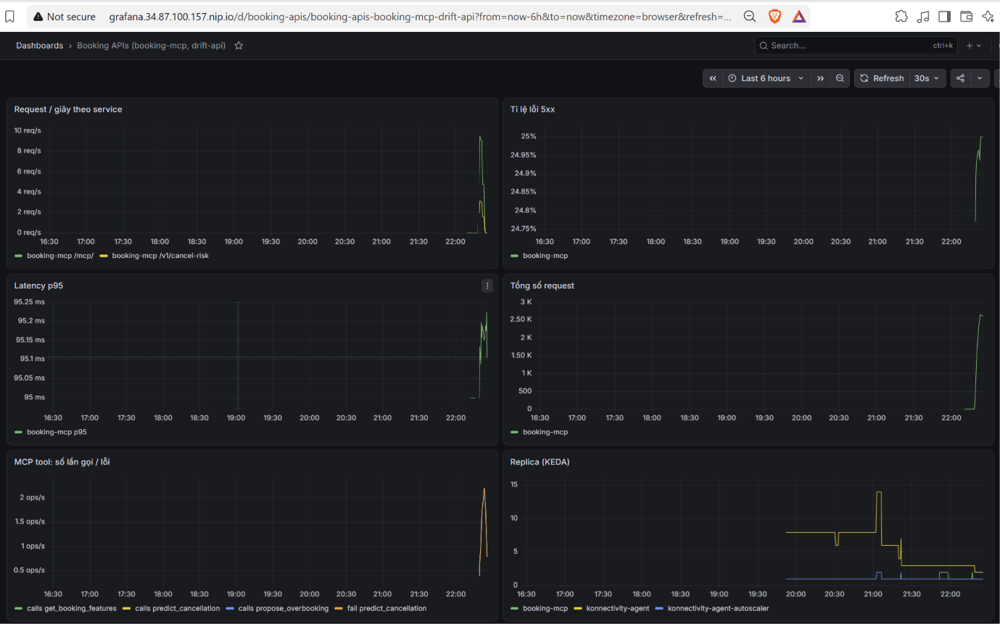

*Chú thích: Dashboard Grafana `Booking APIs` khi chạy Locust (20 user, 5 phút): lưu lượng ~`47 req/s`, latency p95 ~`96 ms` và không có bất kỳ lỗi `5xx` nào.*

## Thu thập và trực quan hoá Metrics (Prometheus + Grafana)

Stack observability triển khai trong namespace `monitoring` (manifest tại `observability/stack/`), gồm Prometheus + Grafana (`kube-prometheus-stack`), Pushgateway, Jaeger và EFK (Fluent Bit + Elasticsearch + Kibana). Prometheus thu thập CPU, RAM, disk, network ở mức cluster, node và pod để hiển thị trên Grafana (`grafana.booking.local`).

Các dashboard có sẵn của chart (node-exporter, kube-state-metrics) hiện CPU, RAM, disk, network theo
cluster, node và pod. Ảnh chụp lúc job Spark 105 GiB đang chạy: namespace `data` dùng khoảng 38 core và 128 GiB RAM, mỗi
executor Spark khoảng 6 core.

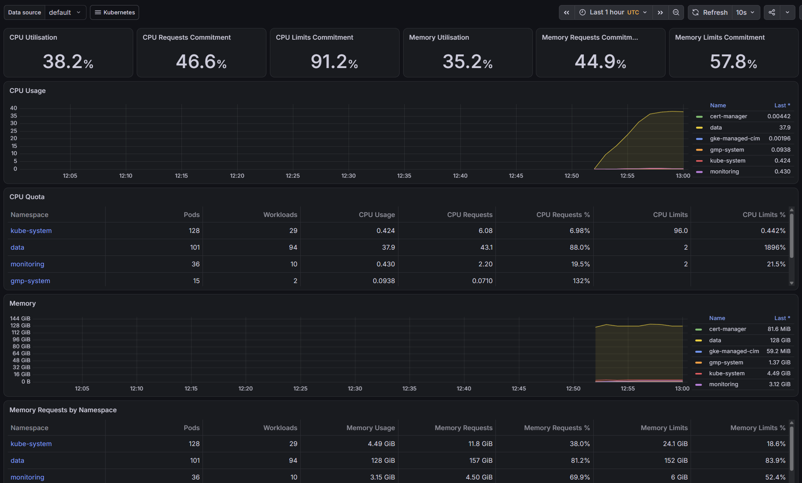

*Chú thích: Dashboard Grafana theo dõi tổng quan tài nguyên (CPU, RAM, disk, network) trên toàn bộ cụm Kubernetes GKE.*

*Chú thích: Dashboard Grafana theo từng pod trong namespace `data` lúc job Spark 105 GiB đang chạy: tiêu thụ ~`38 core` CPU và `128 GiB` RAM.*

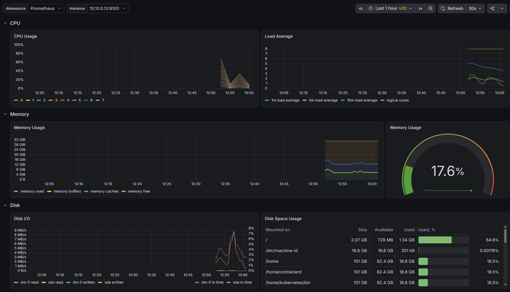

*Chú thích: Dashboard Node Exporter chi tiết tài nguyên phần cứng (CPU, bộ nhớ, I/O đĩa, mạng) của một node trong cụm GKE.*

## Thu thập và trực quan hoá Logs (Fluent Bit + Elasticsearch + Kibana)

Dùng cùng stack ở mục trên; log đi theo chuỗi Fluent Bit → Elasticsearch → Kibana
(`observability/stack/efk.yaml`), Kibana truy cập qua ingress. Fluent Bit chạy dạng DaemonSet (1 pod mỗi node), đọc log
container, gắn metadata pod/namespace, bỏ log của `kube-system` và `monitoring`, rồi đẩy vào index `booking-YYYY.MM.DD`.

Kibana (data view `booking-*`) nhận khoảng 48 nghìn dòng log trong 15 phút. Lọc KQL theo pod của task
Airflow DP2 ra đúng log của `silver_bookings`, `stage_gold`, `upsert_gold`.

*Chú thích: Giao diện Kibana Discover (`data view booking-*`) thu thập khoảng `48.000` dòng log trong 15 phút từ Fluent Bit → Elasticsearch.*

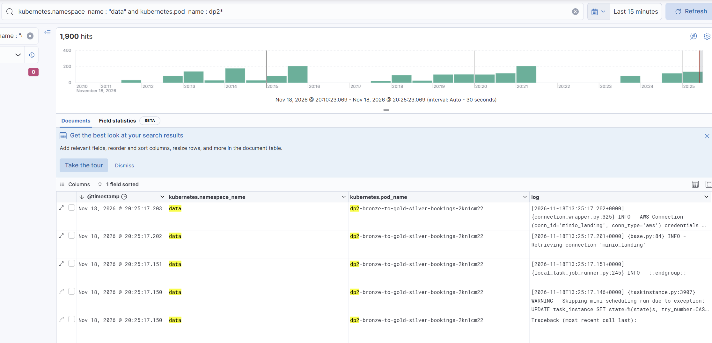

*Chú thích: Kibana dùng truy vấn KQL lọc chính xác log của các pod Airflow thuộc pipeline DP2 (`silver_bookings`, `stage_gold`, `upsert_gold`).*

## Thu thập và trực quan hoá Traces (Jaeger)

**Jaeger** ([`observability/stack/jaeger.yaml`](../../edai2/observability/stack/jaeger.yaml)) nhận trace OpenTelemetry (OTLP) từ cả `agentgateway` lẫn `booking-mcp`, giữ liên thông `trace_id` xuyên suốt các tầng:

- **Trace đơn lẻ `booking-mcp`:** `POST /v1/cancel-risk` (`13,43 ms`, 7 span) tách rõ span FastAPI, hai lần đọc `feast.online` và lệnh gọi KServe.
- **Trace phân tán liên thông:** một lượt gọi `predict_cancellation` đi qua `agentgateway` → `booking-mcp` → Feast online → KServe tạo thành **1 trace duy nhất** (4 tầng, 11 span, tổng **2,33 s**).

*Chú thích: Danh sách các trace của dịch vụ `booking-mcp` được thu thập tự động qua OpenTelemetry trên giao diện Jaeger.*

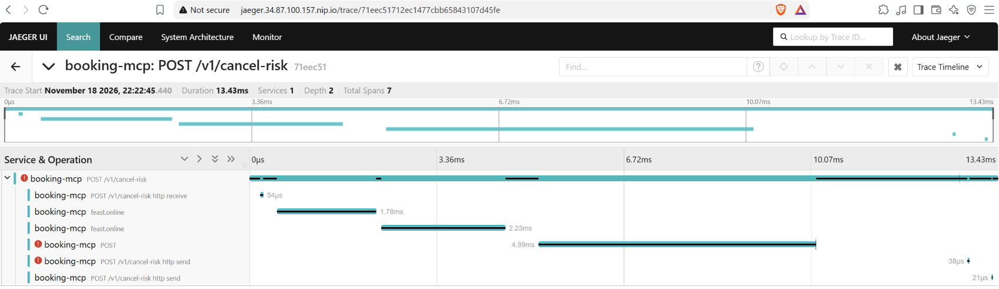

*Chú thích: Chi tiết 1 trace `POST /v1/cancel-risk` (`13,43 ms`, `7` span): tách rõ từng span FastAPI, hai span `feast.online` (`1,78 ms`, `2,23 ms`) và span gọi KServe (`4,99 ms`).*

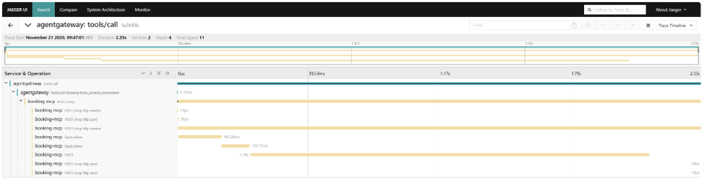

*Chú thích: Trace phân tán liên thông dài `2,33 s` (`11` span qua 4 tầng): `agentgateway` (`4,45 ms`) → `booking-mcp` → 2 lần `feast.online` (`190,26 ms`, `126,72 ms`) → KServe (`1,78 s`).*

## Telemetry cho LLM (token, TTFT, PII blocking)

[`llm_proxy.py`](../../edai2/observability/llm_proxy.py) và [`llm_metrics.py`](../../edai2/observability/llm_metrics.py) (11/11 unit test, coverage 100%) bọc lớp proxy trước `agentgateway` → vLLM để xuất metric Prometheus lên dashboard [`llm-agents.json`](../../edai2/observability/dashboards/llm-agents.json): token vào/ra, TTFT, round-trip và chặn PII (thẻ qua kiểm tra Luhn, CCCD, SĐT — loại trừ mã đặt phòng `BK-*`).

Kiểm thử thực tế trên GKE: prompt chứa PII bị chặn ngay (`HTTP 400`), còn request hợp lệ đi qua thành công (`200 OK`) và hiển thị đủ 4 panel trên Grafana.

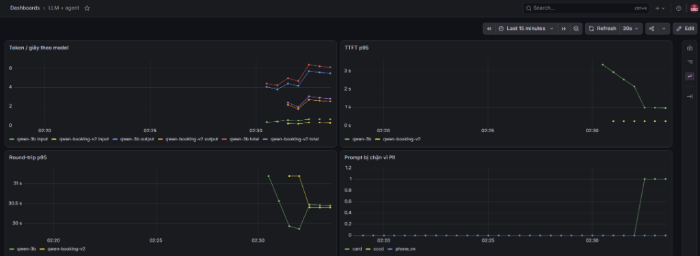

*Chú thích: Dashboard Grafana `LLM Telemetry` hiển thị đủ 4 chỉ số: Token/giây theo model, TTFT p95, Round-trip p95 và Prompt bị chặn vì PII (chặn thẻ Luhn/CCCD/SĐT, cho qua mã `BK-*`).*

## Telemetry cho Agent và MCP Tools

`booking-mcp` đếm số lần gọi từng tool (`mcp_tool_calls_total`) và số lần tool lỗi
(`mcp_tool_failures_total`), hiển thị trên dashboard [`observability/dashboards/booking-apis.json`](../../edai2/observability/dashboards/booking-apis.json).
Trên GKE, sau khi triển khai đủ `agentgateway` và các agent (`coordinator-agent`, `data-agent`,
`policy-agent`), dashboard [`observability/dashboards/llm-agents.json`](../../edai2/observability/dashboards/llm-agents.json)
ghi nhận số lần gọi và lỗi theo từng agent qua metric `agentgateway_requests_total{route=~".*a2a-.*"}`:

| Agent (route A2A) | Thành công (`200`) | Lỗi xác thực (`401`) |
|---|---|---|
| `default/a2a-coordinator` | 21 | 1 |
| `default/a2a-data-agent` | 21 | 2 |
| `default/a2a-policy-agent` | 21 | 2 |

Một client MCP gọi thẳng booking-mcp 300 vòng, mỗi vòng 3 tool (`predict_cancellation`, `get_booking_features`,
`propose_overbooking`), khoảng 5% `booking_id` không tồn tại: 900 lời gọi, 8 lỗi, đều ở `predict_cancellation`. Đường
`get_booking_features` trùng với `propose_overbooking` vì hai tool được gọi cùng nhịp.

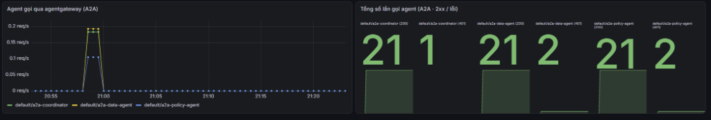

*Chú thích: Panel Grafana thống kê số lần gọi thành công (`200`, 21 lượt/agent) và lỗi xác thực (`401`) cho `coordinator`, `data-agent` và `policy-agent`.*

*Chú thích: Panel Grafana đo số lần gọi (`900` lượt trên 300 vòng) và số lần lỗi (`8` lỗi đều ở `predict_cancellation` với mã không tồn tại) của các tool MCP.*

## Giám sát Drift và Cancel-Risk API (`cancel-risk-ml`)

Dashboard [`cancel-risk-ml.json`](../../edai2/observability/dashboards/cancel-risk-ml.json) hiển thị p-value KS của `drift-api`, `PSI` và `calib_gap` từ `drift_monitor` (PushGateway), cùng request/s, latency p95, lỗi 5xx và lượng CloudEvent qua Knative Broker:

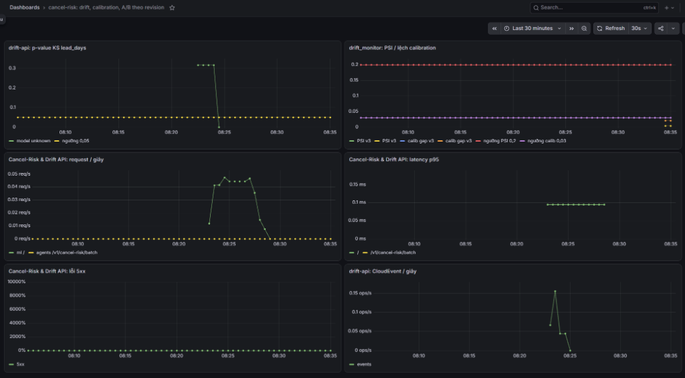

*Chú thích: Dashboard Grafana `cancel-risk-ml` hiển thị đồng thời p-value KS (`drift-api`), `PSI`, `calib_gap` (từ `drift_monitor`), RPS, p95 latency và CloudEvent qua Knative Broker.*

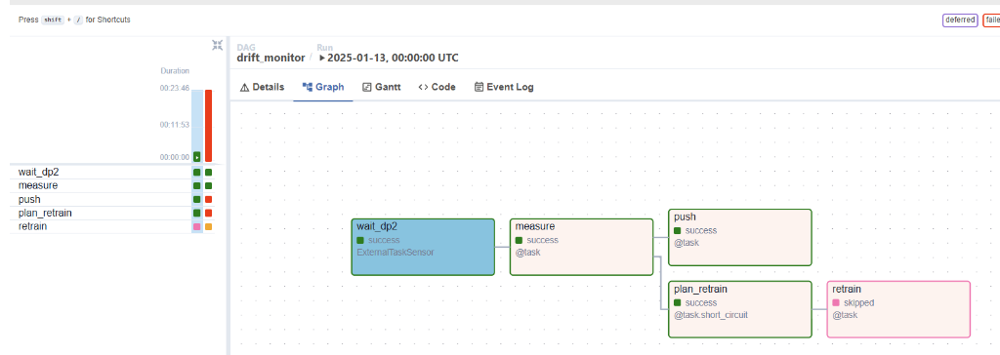

*Chú thích: DAG `drift_monitor` chạy thành công trên Airflow cho ngày dữ liệu `2025-01-13` để tính PSI, KS và độ lệch calibration.*

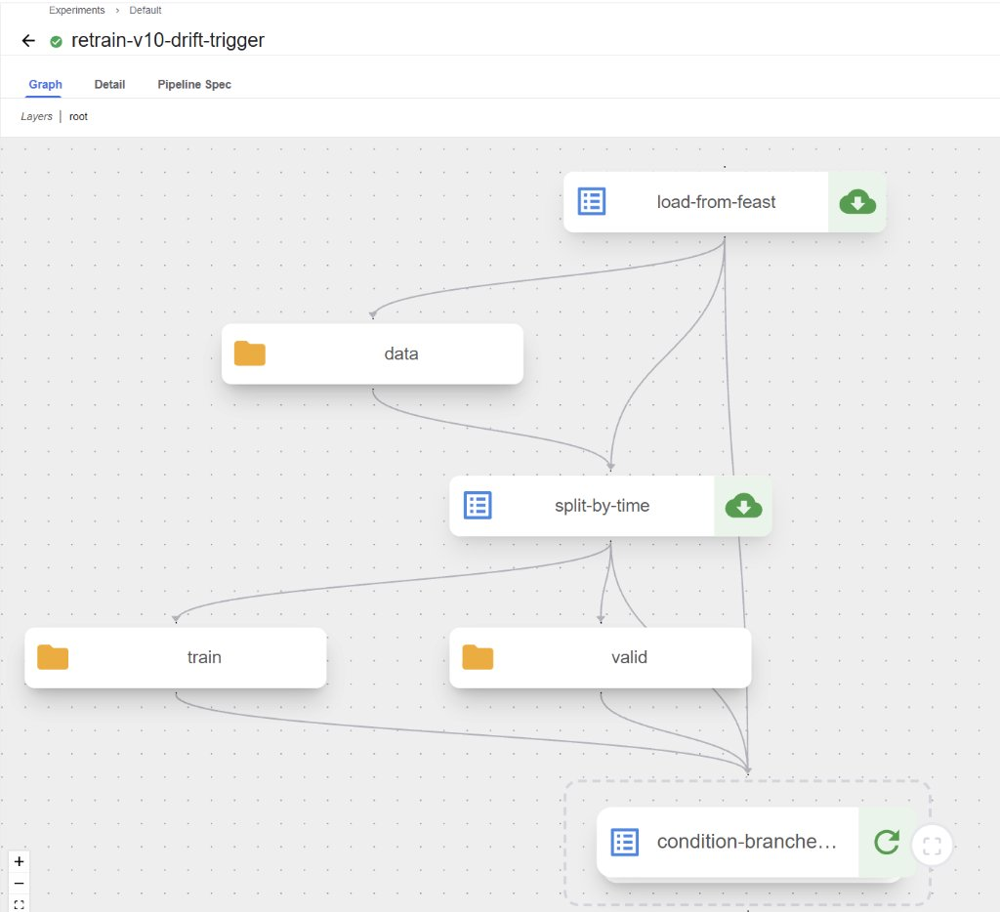

*Chú thích: Giao diện Kubeflow Pipelines hiển thị run `retrain-v10-drift-trigger` đã hoàn thành quá trình retrain tự động sau khi phát hiện drift.*

