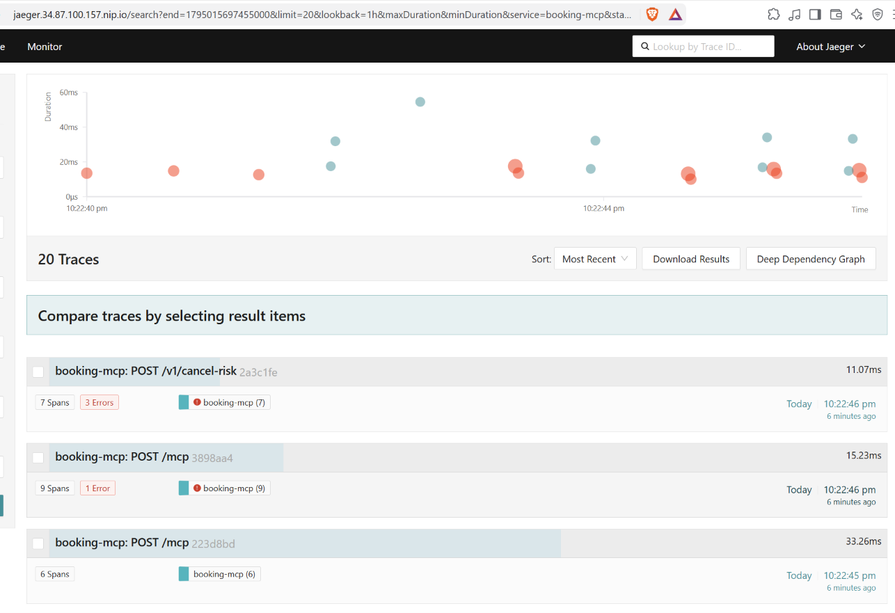
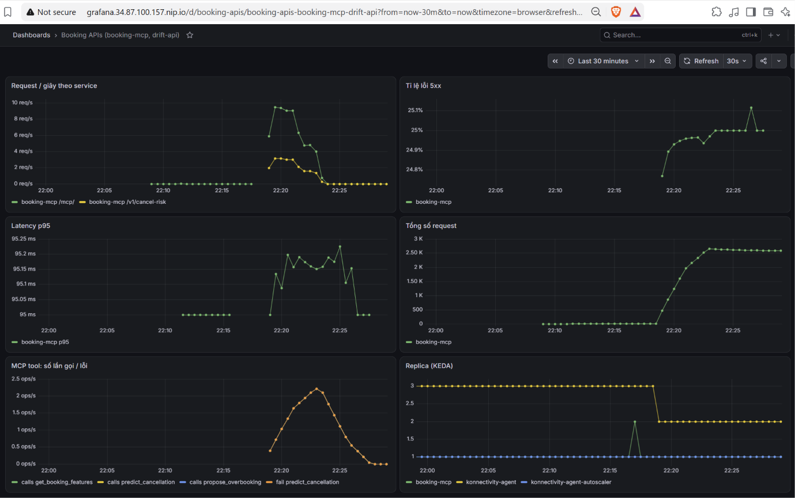

# Observability

Metric của Web API, telemetry hệ thống, log, trace, telemetry cho LLM và agent.

## Web API monitoring metrics (Prometheus + Grafana)

booking-mcp chạy trên GKE (namespace `agents`, Helm chart `helm/api`, image
`booking-mcp:e6e53e9-2`). Feature được materialize từ Gold lên online store Feast (PostgreSQL, schema `feast_online`).
Một script tạo traffic chạy trong pod, lấy `booking_id`, khách và khách sạn thật từ `gold.fact_bookings` rồi lặp 400
vòng; mỗi vòng gọi ba tool MCP (`get_booking_features`, `propose_overbooking`, `predict_cancellation`) và REST
`POST /v1/cancel-risk`. KServe chưa deploy, nên `predict_cancellation` và `/v1/cancel-risk` lỗi thật ở bước gọi model;
các lỗi này hiện thành failure trên dashboard. booking-mcp dùng `prometheus-fastapi-instrumentator` để đo req/s, số request,
lỗi và latency; ServiceMonitor của chart cho Prometheus scrape `/metrics`. Dashboard
`observability/dashboards/booking-apis.json` hiển thị các metric này.

Số đếm trên Prometheus tính từ lúc pod khởi động: `/mcp/` nhận 2.085 request 2xx, `/v1/cancel-risk` trả 692 request 5xx.
Lúc traffic chạy, `/mcp/` đạt đỉnh khoảng 9,4 req/s và `/v1/cancel-risk` khoảng 3 req/s; tỉ lệ lỗi 5xx của service
khoảng 25% (692 trên 2.777 request), đúng bằng phần request REST gọi KServe; latency p95 khoảng 95 ms.

## Thu thập và trực quan hoá Metrics (Prometheus + Grafana)

Stack observability được cài trên GKE vào namespace `monitoring`: `kube-prometheus-stack` 93.4.0
(`observability/stack/kube-prometheus-stack.yaml`, PVC Prometheus dùng storage class `standard`), Pushgateway, Jaeger
(`stack/jaeger.yaml`), Elasticsearch và Kibana 8.5.1, Fluent Bit 0.58.3 (`stack/efk.yaml`). Prometheus thu CPU, RAM, disk, network theo node và pod qua
node-exporter và kube-state-metrics. Grafana đọc mật khẩu admin từ Secret `grafana-admin` và truy cập qua ingress
`grafana.booking.local`.

Các dashboard có sẵn của chart (node-exporter, kube-state-metrics) hiện CPU, RAM, disk, network theo
cluster, node và pod. Ảnh chụp lúc job Spark 105 GiB đang chạy: namespace `data` dùng khoảng 38 core và 128 GiB RAM, mỗi
executor Spark khoảng 6 core.

## Thu thập và trực quan hoá Logs (Fluent Bit + Elasticsearch + Kibana)

Dùng cùng stack ở dòng 47; log đi theo chuỗi Fluent Bit → Elasticsearch → Kibana
(`observability/stack/efk.yaml`), Kibana truy cập qua ingress. Fluent Bit chạy dạng DaemonSet (1 pod mỗi node), đọc log
container, gắn metadata pod/namespace, bỏ log của `kube-system` và `monitoring`, rồi đẩy vào index `booking-YYYY.MM.DD`.
Chart Kibana 8.5.1 bật `csp.strict` khiến một số trình duyệt bị chặn, nên cấu hình đặt `csp.strict: false`.

Kibana (data view `booking-*`) nhận khoảng 48 nghìn dòng log trong 15 phút. Lọc KQL theo pod của task
Airflow DP2 ra đúng log của `silver_bookings`, `stage_gold`, `upsert_gold`.

## Thu thập và trực quan hoá Traces (Jaeger)

Jaeger ([`observability/stack/jaeger.yaml`](../../edai2/observability/stack/jaeger.yaml)) nhận OTLP gRPC cổng 4317 và mở UI qua ingress (dòng 39). Cả `booking-mcp` (FastAPI, span `feast.online` cho mỗi lần đọc online store và httpx tới KServe khi có biến `OTEL_EXPORTER_OTLP_ENDPOINT`) lẫn `agentgateway` ([`gateway/agentgateway.yaml`](../../edai2/gateway/agentgateway.yaml), bật `config.tracing.otlpEndpoint` và `randomSampling: true`) đều gửi trace về `jaeger-collector.monitoring.svc.cluster.local:4317` và truyền tiếp W3C `traceparent` xuyên suốt các dịch vụ.

- **Chạy đơn lẻ `booking-mcp` (trước khi deploy KServe):** trace `POST /v1/cancel-risk` (13,43 ms, 7 span) gồm span FastAPI, hai span `feast.online` (1,78 ms và 2,23 ms) và span `POST` gọi KServe (4,99 ms, đánh dấu lỗi vì KServe chưa deploy).
- **Trace phân tán liên thông qua gateway → MCP → Feast → KServe:** một lượt gọi MCP `predict_cancellation(120152161878)` qua `agentgateway` → `booking-mcp` → Feast online → KServe `cancel-risk` (trả `probability = 0,0643`, `model_version = 1`) tạo thành **1 trace duy nhất** (`1a3bf0b`, 2 service, độ sâu 4, 11 span, tổng **2,33 s**): `agentgateway` (`tools/call` → `tools/call booking-tools_predict_cancellation` 4,45 ms) → `booking-mcp` (`POST /mcp` → hai span `feast.online` 190,26 ms và 126,72 ms → `POST` gọi KServe 1,78 s).

## Telemetry cho LLM (token, TTFT, PII blocking)

`llm_metrics.py` đo số token vào, ra và tổng, thời gian round-trip, TTFT và số lần chặn PII (dãy số thẻ chỉ bị coi là PII khi qua kiểm tra Luhn và không đứng sau tiền tố `BK-`). `edai2/tests/test_llm_metrics.py` (11 test, coverage 100%) chạy cục bộ và đạt.

**[update sau]:** Bổ sung ảnh chụp metric `llm_metrics` thực tế trên Grafana của cluster.

## Telemetry cho Agent và MCP Tools

Cùng lần chạy ở dòng 46, `booking-mcp` đếm số lần gọi từng tool (`mcp_tool_calls_total`) và số lần tool lỗi
(`mcp_tool_failures_total`), hiển thị trên dashboard [`observability/dashboards/booking-apis.json`](../../edai2/observability/dashboards/booking-apis.json).
Trên GKE, sau khi triển khai đủ `agentgateway` và các agent (`coordinator-agent`, `data-agent`,
`policy-agent`), dashboard [`observability/dashboards/llm-agents.json`](../../edai2/observability/dashboards/llm-agents.json)
ghi nhận số lần gọi và lỗi theo từng agent qua metric `agentgateway_requests_total{route=~".*a2a-.*"}`:

| Agent (route A2A) | Thành công (`200`) | Lỗi xác thực (`401`) |
|---|---|---|
| `default/a2a-coordinator` | 21 | 1 |
| `default/a2a-data-agent` | 21 | 2 |
| `default/a2a-policy-agent` | 21 | 2 |

| Tool MCP | Số lần gọi | Số lần lỗi |
|---|---|---|
| `get_booking_features` | 692 | 0 |
| `propose_overbooking` | 692 | 0 |
| `predict_cancellation` | 692 | 692 (chưa có KServe) |

Trên panel "MCP tool: số lần gọi / lỗi", bốn đường (ba đường số lần gọi và đường lỗi của `predict_cancellation`) trùng
nhau, vì ba tool được gọi cùng nhịp và `predict_cancellation` lỗi ở mọi lần gọi.

