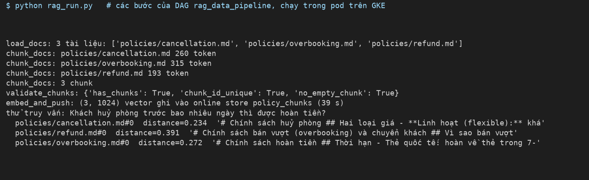
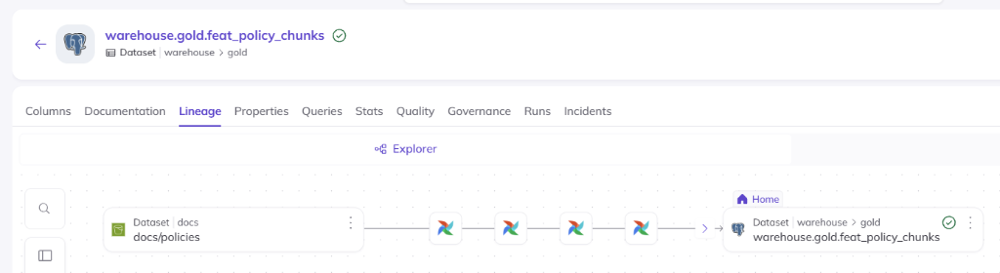

# RAG data pipeline

Tài liệu chính sách được chia chunk, embed rồi lưu vào Feast, có lineage và kiểm tra dữ liệu.

## Pipeline RAG: Load docs, chunking và lưu embedding vào Feast

Code pipeline: [`edai2/dags/rag_pipeline.py`](../../edai2/dags/rag_pipeline.py) (tài liệu nguồn tại `policies/*.md`).

Pipeline chia chunk theo ngưỡng 512 token, sinh vector embedding bằng `BAAI/bge-m3` (1024 chiều) trên pod riêng (`EMBED_POD`, request 4Gi / limit 6Gi) rồi ghi đồng thời vào Feast offline store (`gold.feat_policy_chunks`) và online store (`feast_online.booking_policy_chunks`).

DAG `rag_data_pipeline` đã chạy thành công cả 4 task (`load_docs` → `chunk_docs` → `validate_chunks` → `embed_and_push`) trên Airflow 2.10.5 (GKE namespace `data`, Helm release `airflow`, image `airflow-booking:be6c2e2-3`). Ba tài liệu `policies/*.md` (260, 315 và 193 token) cho ra 3 chunk 512 token, vượt qua đủ 3 bước kiểm tra (`has_chunks=True`, `chunk_id_unique=True`, `no_empty_chunk=True`), với đầy đủ metadata `doc_sha256`, `embed_model` và `embedding`.

Khi truy vấn thử câu hỏi *"Khách huỷ phòng trước bao nhiêu ngày thì được hoàn tiền?"*, hệ thống trả về `policies/cancellation.md#0` gần nhất (distance `0,234`), đúng tài liệu chính sách huỷ. Lưu ý: `retrieve_online_documents_v2` của Feast 0.68 trên PostgreSQL hiện có lỗi ghép nhầm `chunk_id`/`text` ở các kết quả phía sau và Feast chỉ nhận tên metric viết thường (`cosine`, đã sửa).

## Data Governance cho RAG pipeline

Khai báo `inlets` và `outlets` trong [`edai2/dags/rag_pipeline.py`](../../edai2/dags/rag_pipeline.py) giúp đồng bộ lineage lên DataHub từ `docs/policies` (S3) tới `warehouse.gold.feat_policy_chunks` (PostgreSQL). Pipeline kiểm tra các điều kiện chất lượng dữ liệu: `has_chunks` (số chunk > 0), `chunk_id_unique` (không trùng lặp), `no_empty_chunk` (không có chunk rỗng), embedding đúng 1024 chiều và gắn `doc_sha256` để theo dõi phiên bản tài liệu.

Trên GKE (namespace `data`, DataHub 1.1.11 + OpenSearch + Kafka), sau khi cấu hình Connection `datahub_rest_default` trong Airflow và chạy lại `rag_data_pipeline` (`success` trong 2 phút 21 giây), DataHub ghi nhận đầy đủ:
- **Lineage (`DataHub › Lineage`):** `docs/policies` → 4 task của DAG `rag_data_pipeline` (`load_docs` → `chunk_docs` → `validate_chunks` → `embed_and_push`) → `warehouse.gold.feat_policy_chunks`.
- **Validation (`DataHub › Quality › Assertions`):** cả 3 assertion `has_chunks`, `chunk_id_unique`, `no_empty_chunk` đều đạt trạng thái `Passing` (dấu tích xanh trên dataset `warehouse.gold.feat_policy_chunks`).

