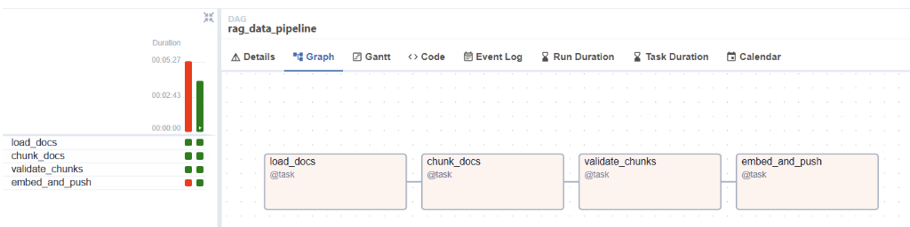
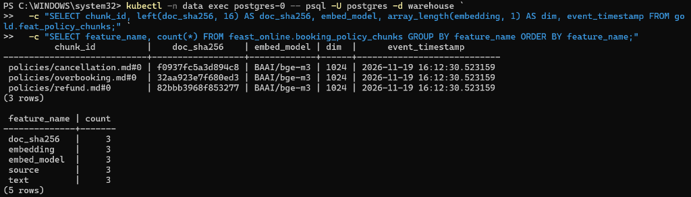

# RAG data pipeline

Tài liệu chính sách được chia chunk, embed rồi lưu vào Feast, có lineage và kiểm tra dữ liệu.

Mỗi mục dưới đây ứng với một dòng của rubric. Phần **Cách làm** mô tả giải pháp đã triển khai, đồng bộ từ
cột F của rubric. Phần **Kết quả** ghi test đã chạy, số liệu đo được hoặc ảnh chụp (`docs/images/`).

## Build data pipeline với ít nhất các step sau: kéo dữ liệu từ text => chia chunk => lưu…

**Rubric:** edai-2 · dòng 9 · 2 điểm · nhóm *RAG* › *RAG Data Pipeline*

> Build data pipeline (ví dụ với Airflow) với ít nhất các step sau: kéo dữ liệu từ text => chia chunk => lưu embedding vector cho các chunk vào feature store thông qua Feast

**Cần nộp (cả nhóm):** Document show ảnh pipeline đã chạy thành công trên Airflow, và lineage thể hiện trên DataHub + link tới code pipeline

**Cách làm:** [Đã có] [`edai2/dags/rag_pipeline.py`](../../edai2/dags/rag_pipeline.py) chia chunk, embed bằng bge-m3 rồi ghi vào Feast `policy_chunks`; tài liệu chính sách nằm ở `policies/*.md`. Task embed chạy trên pod riêng 4–6Gi (`executor_config`), chart booking-mcp nâng limit lên 4Gi.

**Kết quả:** DAG `rag_data_pipeline` ([`edai2/dags/rag_pipeline.py`](../../edai2/dags/rag_pipeline.py)) đã chạy thành công cả 4 task (`load_docs` → `chunk_docs` → `validate_chunks` → `embed_and_push`) trên Airflow 2.10.5 (GKE namespace `data`, Helm release `airflow`, image `airflow-booking:be6c2e2-3`) ngày 2026-11-19. Ba tài liệu `policies/*.md` (260, 315 và 193 token) cho ra 3 chunk 512 token, qua đủ ba kiểm tra (`has_chunks=True`, `chunk_id_unique=True`, `no_empty_chunk=True`). Task `embed_and_push` chạy trên pod riêng (`EMBED_POD`, request 4Gi / limit 6Gi), dùng `BAAI/bge-m3` sinh vector 1024 chiều, ghi 3 dòng có đủ `doc_sha256`, `embed_model` và `embedding` vào bảng offline `gold.feat_policy_chunks` đồng thời cập nhật online store `feast_online.booking_policy_chunks`.

Truy vấn thử "Khách huỷ phòng trước bao nhiêu ngày thì được hoàn tiền?" trả về `policies/cancellation.md#0` gần nhất
(distance 0,234), đúng tài liệu chính sách huỷ. Hai kết quả còn lại ghép nhầm `chunk_id` với `text` và không xếp theo
khoảng cách, nghi do `retrieve_online_documents_v2` của Feast 0.68 trên PostgreSQL; lỗi này chưa được điều tra. Lần chạy
đầu còn lộ một lỗi cấu hình đã sửa: Feast chỉ nhận tên metric viết thường (`cosine`).

## Đảm bảo data governance cho pipeline

**Rubric:** edai-2 · dòng 10 · 2 điểm · nhóm *RAG* › *RAG Data Pipeline*

> Đảm bảo data governance cho pipeline (tương tự mini-coursework)

**Cách làm:** [Đã có] Inlets, outlets tạo lineage trên DataHub từ `docs/policies` tới `policy_chunks`. Pipeline kiểm số chunk > 0, `chunk_id` không trùng và embedding đúng 1024 chiều; mỗi chunk ghi `doc_sha256` (version tài liệu) và `embed_model`. [Cần làm] chụp lineage và tab Validation.

**Kết quả:** _Chưa có. Cần số liệu, ảnh chụp hoặc link code sau khi chạy trên cluster._
