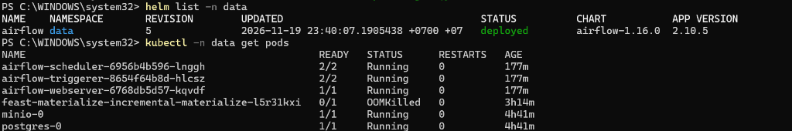
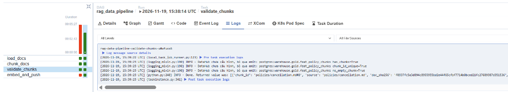
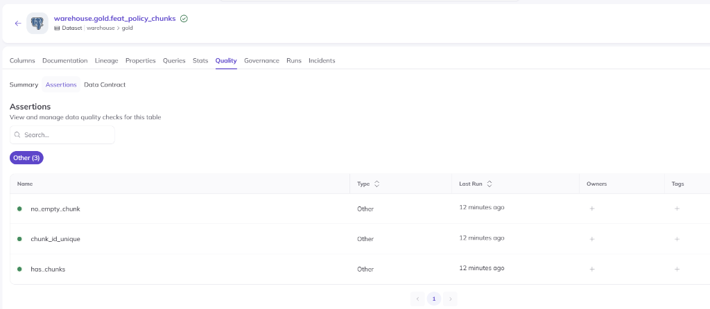

# RAG data pipeline

Tài liệu chính sách được chia chunk, embed rồi lưu vào Feast, có lineage và kiểm tra dữ liệu.

## Pipeline RAG: Load docs, chunking và lưu embedding vào Feast

Code pipeline: [`edai2/dags/rag_pipeline.py`](../../edai2/dags/rag_pipeline.py) (tài liệu nguồn tại `policies/*.md`).

Pipeline chia chunk theo ngưỡng 512 token, sinh vector embedding bằng `BAAI/bge-m3` (1024 chiều) trên pod riêng (`EMBED_POD`, request 4Gi / limit 6Gi) rồi ghi đồng thời vào Feast offline store (`gold.feat_policy_chunks`) và online store (`feast_online.booking_policy_chunks`).

DAG `rag_data_pipeline` đã chạy thành công cả 4 task (`load_docs` → `chunk_docs` → `validate_chunks` → `embed_and_push`) trên Airflow 2.10.5 (GKE namespace `data`). Ba tài liệu `policies/*.md` (260, 315 và 193 token) cho ra 3 chunk 512 token, vượt qua đủ 3 bước kiểm tra (`has_chunks=True`, `chunk_id_unique=True`, `no_empty_chunk=True`), với đầy đủ metadata `doc_sha256`, `embed_model` và `embedding`.

Khi truy vấn thử câu hỏi *"Khách huỷ phòng trước bao nhiêu ngày thì được hoàn tiền?"*, hệ thống trả về `policies/cancellation.md#0` gần nhất (distance `0,234`), đúng tài liệu chính sách huỷ.

*Chú thích: Danh sách Helm release và các pod Airflow 2.10.5 (`scheduler`, `webserver`, `triggerer`) chạy ổn định trong namespace `data` trên GKE.*

*Chú thích: Graph View của DAG `rag_data_pipeline` trên Airflow: cả 4 task `load_docs → chunk_docs → validate_chunks → embed_and_push` đều đạt `success`.*

*Chú thích: Log task `validate_chunks` xác nhận 3 file chính sách cho ra 3 chunk và vượt qua đủ 3 kiểm tra (`has_chunks=True`, `chunk_id_unique=True`, `no_empty_chunk=True`).*

*Chú thích: Truy vấn PostgreSQL kiểm tra dữ liệu chunk và vector embedding `BAAI/bge-m3` đã được ghi đồng bộ ở cả `gold.feat_policy_chunks` và `feast_online.booking_policy_chunks`.*

*Chú thích: Kết quả chạy thử truy vấn RAG trong pod trên GKE với câu hỏi về chính sách huỷ phòng: hệ thống tìm đúng chunk `policies/cancellation.md#0` với khoảng cách cosine `0,234`.*

## Data Governance cho RAG pipeline

DAG [`rag_pipeline.py`](../../edai2/dags/rag_pipeline.py) khai báo `inlets`/`outlets` để đẩy tự động lineage và kết quả kiểm tra chất lượng lên **DataHub** (chạy `success` trong 2 phút 21 giây trên GKE):

- **Lineage:** nối liền từ `docs/policies` (S3) → 4 task Airflow → `warehouse.gold.feat_policy_chunks` (PostgreSQL), kèm `doc_sha256` theo dõi phiên bản tài liệu.
- **Validation:** cả 3 assertion (`has_chunks`, `chunk_id_unique`, `no_empty_chunk`) và kiểm tra vector 1024 chiều đều đạt `Passing` trên DataHub.

*Chú thích: Lineage trên DataHub của `rag_data_pipeline`: nối liền mạch từ `docs/policies` (S3) qua 4 task Airflow tới `warehouse.gold.feat_policy_chunks` (PostgreSQL).*

*Chú thích: Tab Quality trên DataHub của `warehouse.gold.feat_policy_chunks`: hiển thị đủ 3 dấu tích xanh `Passing` cho `has_chunks`, `chunk_id_unique` và `no_empty_chunk`.*
