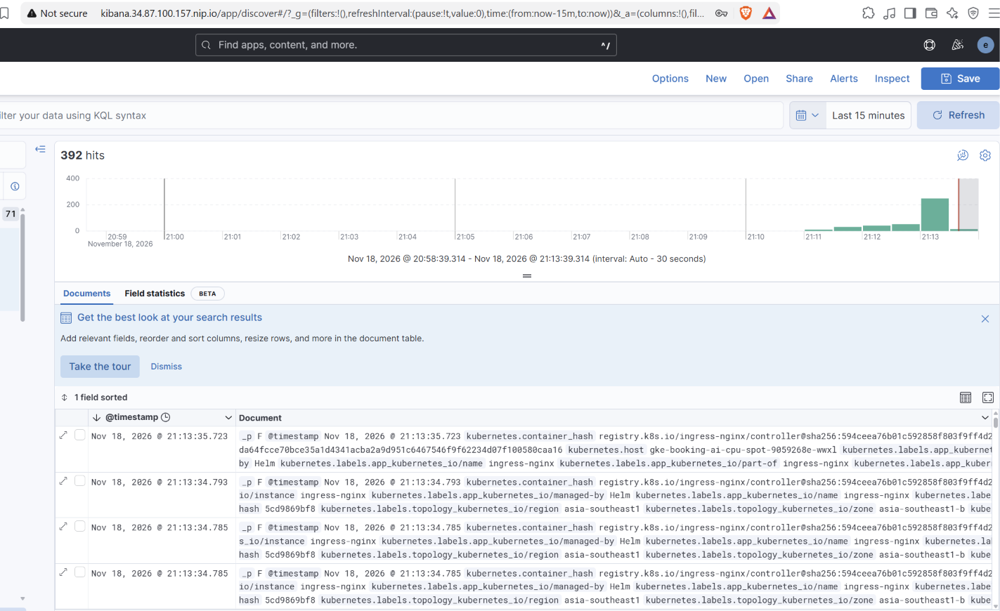

# Routing & gateway (NGINX Ingress)

Service được đặt sau ingress, có basic auth, rate limit, domain và HTTPS.

Mỗi mục dưới đây ứng với một dòng của rubric. Phần **Cách làm** mô tả giải pháp đã triển khai, đồng bộ từ
cột F của rubric. Phần **Kết quả** ghi test đã chạy, số liệu đo được hoặc ảnh chụp (`docs/images/`).

## Service để coi metric · edai-2 · External Routing & Gateway (NGINX Ingress Controll

**Rubric:** edai-2 · dòng 37 · 2 điểm · nhóm *External Routing & Gateway (NGINX Ingress Controller)* › *Các service cần được hide đằng sau gateway*

> Service để coi metric (ví dụ Grafana)

**Cần nộp (cả nhóm):** Document phải link được tới các setting trên NGINX, để thể hiện mọi người đã setup như thế nào

**Cách làm:** [Đã có] Ingress `grafana.booking.local`. Đã chạy trên GKE (2026-11-18): NGINX Ingress Controller + Ingress `observability`, `grafana.booking.local` trả 302 tới trang đăng nhập.

**Kết quả:** NGINX Ingress Controller 4.15.1 (LoadBalancer `34.87.100.157`, `loadBalancerSourceRanges` chỉ mở cho IP của nhóm) và Ingress `observability` trong `k8s/ingress.yaml`. Host `grafana.booking.local` trỏ vào service `kube-prometheus-stack-grafana:80`;
`curl -H "Host: grafana.booking.local" http://34.87.100.157/` trả 302 (chuyển tới trang đăng nhập). Service không mở port ra ngoài, chỉ đi qua
ingress.

## Service để coi log · edai-2 · External Routing & Gateway (NGINX Ingress Controll

**Rubric:** edai-2 · dòng 38 · 2 điểm · nhóm *External Routing & Gateway (NGINX Ingress Controller)* › *Các service cần được hide đằng sau gateway*

> Service để coi log (ví dụ Kibana)

**Cách làm:** [Đã có] Ingress `kibana.booking.local`. Đã chạy trên GKE (2026-11-18): `kibana.booking.local` qua cùng Ingress, trả 302 tới trang đăng nhập.

**Kết quả:** NGINX Ingress Controller 4.15.1 (LoadBalancer `34.87.100.157`, `loadBalancerSourceRanges` chỉ mở cho IP của nhóm) và Ingress `observability` trong `k8s/ingress.yaml`. Host `kibana.booking.local` trỏ vào service `kibana-kibana:5601`;
`curl -H "Host: kibana.booking.local" http://34.87.100.157/` trả 302 (chuyển tới trang đăng nhập). Service không mở port ra ngoài, chỉ đi qua
ingress.

## Service để coi trace · edai-2 · External Routing & Gateway (NGINX Ingress Controll

**Rubric:** edai-2 · dòng 39 · 2 điểm · nhóm *External Routing & Gateway (NGINX Ingress Controller)* › *Các service cần được hide đằng sau gateway*

> Service để coi trace (ví dụ Jaeger)

**Cách làm:** [Đã có] Ingress `jaeger.booking.local`. Đã chạy trên GKE (2026-11-18): `jaeger.booking.local` qua cùng Ingress, trả 200.

**Kết quả:** NGINX Ingress Controller 4.15.1 (LoadBalancer `34.87.100.157`, `loadBalancerSourceRanges` chỉ mở cho IP của nhóm) và Ingress `observability` trong `k8s/ingress.yaml`. Host `jaeger.booking.local` trỏ vào service `jaeger-query:16686`;
`curl -H "Host: jaeger.booking.local" http://34.87.100.157/` trả 200. Service không mở port ra ngoài, chỉ đi qua
ingress.

## UI để test agent

**Rubric:** edai-2 · dòng 40 · 2 điểm · nhóm *External Routing & Gateway (NGINX Ingress Controller)* › *Các service cần được hide đằng sau gateway*

> UI để test agent (xem tại đây)

**Cách làm:** [Đã có] Ingress `agents.booking.local` cho kagent UI. [Cần làm] chụp.

**Kết quả:** _Chưa có. Cần số liệu, ảnh chụp hoặc link code sau khi chạy trên cluster._

## UI cho agent registry

**Rubric:** edai-2 · dòng 41 · 2 điểm · nhóm *External Routing & Gateway (NGINX Ingress Controller)* › *Các service cần được hide đằng sau gateway*

**Cách làm:** [Đã có] Ingress `registry.agents.booking.local`. [Cần làm] deploy registry rồi chụp.

**Kết quả:** _Chưa có. Cần số liệu, ảnh chụp hoặc link code sau khi chạy trên cluster._

## Setup authentication cho UI test agent ở trên

**Rubric:** edai-2 · dòng 42 · 2 điểm · nhóm *External Routing & Gateway (NGINX Ingress Controller)* › *Basic authentication & rate limit ở gateway (username/password)*

**Cách làm:** [Đã có] Kagent UI được bảo vệ bằng basic auth (htpasswd) và `limit-rps` 10. [Cần làm] chụp phản hồi 401 khi sai mật khẩu.

**Kết quả:** _Chưa có. Cần số liệu, ảnh chụp hoặc link code sau khi chạy trên cluster._

## Làm cái này cho Web API kéo dữ liệu · edai-2 · External Routing & Gateway (NGINX Ingress Controll

**Rubric:** edai-2 · dòng 43 · 1 điểm · nhóm *External Routing & Gateway (NGINX Ingress Controller)* › *Setup domain & enable HTTPS*

> Làm cái này cho Web API kéo dữ liệu. Mọi người có thể tham khảo 2 đồ án sau: cái này và cái này

**Cách làm:** [Đã có] cert-manager cấp chứng chỉ Let's Encrypt cho `api.booking.example.com`. [Cần làm] cần domain thật trỏ về ingress; chụp chứng chỉ hợp lệ.

**Kết quả:** _Chưa có. Cần số liệu, ảnh chụp hoặc link code sau khi chạy trên cluster._
